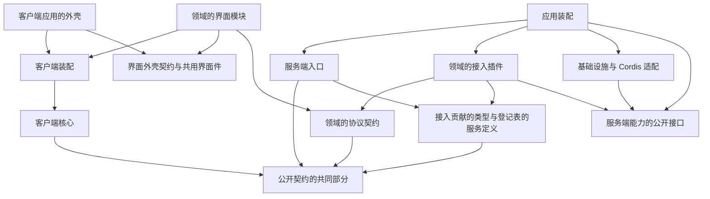

# 系统分层、公开契约与 SDK

本页说明客户端怎样通过统一 SDK 与公开契约使用 Harness，以及各部分必须遵守的依赖方向。它补充[总体结构与责任](structure.md)的协作视图，为客户端、服务端和外部集成提供共同的架构边界。

## 分层范围与阅读路径

这里的客户端是使用 Harness 能力的应用或程序，包含交互界面及程序化集成。服务端是承接调用、维护权威状态和执行业务规则的一方，不表示只能运行在远程机器。个人设备可以同时承载两方，云端部署可以将两方分开。

系统分层、运行时调用和部署位置分别判断。公开契约是两端共同遵循的定义，不是每次调用都必须经过的一个运行进程。SDK 也不承担全部服务端职责。

## 各层职责

| 部分 | 拥有的职责 | 不由它决定的事项 |
|---|---|---|
| 客户端应用 | 展示状态、组织交互、收集输入；处理所属应用的本地状态与资源。应用的[界面外壳](../../.meta_harness/design/ubiquitous_language/terms/interaction-and-dispatch.md#ul-app-shell--界面外壳--app-shell)提供[界面插入位置](../../.meta_harness/design/ubiquitous_language/terms/interaction-and-dispatch.md#ul-ui-slot--界面插入位置--ui-slot)，装上各领域的[界面模块](../../.meta_harness/design/ubiquitous_language/terms/interaction-and-dispatch.md#ul-ui-module--界面模块--ui-module)。 | 不以本地显示、按钮状态或缓存值裁定服务端权限和业务完成。外壳不含任何领域的代码。 |
| 客户端 SDK | 提供统一的编程入口，组织调用、观察、结果与错误；管理明确由客户端拥有的连接和句柄。它分两层。客户端核心由一份协议契约和一个传输得到带类型的方法，不依赖 Cordis，脚本与第三方可以单独使用。客户端装配是一棵 Cordis 树：一条连接，以及按[协议可用性](../../.meta_harness/design/ubiquitous_language/terms/reach-and-availability.md#ul-protocol-availability--协议可用性--protocol-availability)出现与收回的协议客户端。 | 不重写业务规则，不把传输状态推导为执行结果，不直接依赖服务端私有实现。 |
| 公开契约 | 定义可对外使用的操作、数据、事件、错误及行为边界；使 SDK 和服务端对同一交互有一致解释。它分两部分。共同部分是逻辑消息的信封、对外结果、判断次序和可用性，归接入组。每个领域的[公开协议](../../.meta_harness/design/ubiquitous_language/terms/architecture-core-and-extension.md#ul-public-protocol--公开协议--public-protocol)有自己的协议契约，归该领域。 | 不包含服务端存储对象、Cordis 对象和部署配置的内部表示。契约是纯数据，不从实现生成。 |
| 服务端接入适配 | 接入请求及观察，验证协议输入和身份材料，路由到实际能力，并按公开契约交付结果。它分两部分。入口是承载绑定、管道、登记表和观察中枢，对每个协议都一样。领域的接入插件把本领域的[接入贡献](../../.meta_harness/design/ubiquitous_language/terms/architecture-core-and-extension.md#ul-access-contribution--接入贡献--access-contribution)挂到登记表上。 | 不成为业务状态的另一份权威，不以入口校验替代实际能力的授权与状态检查。入口不含任何领域的代码。 |
| 服务端能力与协调 | 按公开能力契约维护业务事实、推进工作、执行治理与资源操作。 | 不依赖某个客户端界面、客户端 SDK 或传输协议才能定义业务含义。领域核心不依赖接入。 |

客户端 SDK 是对完整 Harness 的使用入口，不只是按 URL 发送请求的辅助库。它应让不同客户端以一致方式表达操作和观察工作，同时保留调用者理解失败、取消与结果归属所需的信息。

一个领域对外交付的单位因此是四样：领域核心、协议契约、接入插件、界面模块。后三样随领域变化，放在领域的能力组里，见[产品包组织](../package-organization.md#sdk与系统接入)。

服务端内部的领域、工作治理、runtime、提供者和装配责任继续归总体结构与相应专题。它们不是一条固定的“领域调用 runtime，runtime 调用存储”的层级链，本页不重新划分这些责任。

## 依赖关系与禁止方向

下图的箭头表示依赖某个公开定义或接口，不表示消息流、线程或进程。

图里没有从服务端入口到任何领域的箭头，也没有从外壳到任何领域的箭头。领域只经登记表进到入口，只经界面插入位置进到外壳。领域的接入插件不依赖服务端入口，只依赖接入贡献的类型与登记表的服务定义。

公开契约中引用的业务类型须来自其拥有者的公开、可独立消费的定义，不能反向导入整个服务端实现。序列化表示由公开契约拥有，业务对象的含义仍由原领域或能力拥有；必要转换不产生第二套业务规则。

| 约束 | 允许的依赖与必须阻止的反向依赖 |
|---|---|
| 客户端通过公开入口集成 | 客户端通过 SDK 使用完整 Harness；不得深层导入服务端私有实现来绕过公开契约。 |
| SDK 与服务端实现解耦 | SDK 依赖公开契约及其平台适配，不依赖服务端的存储、运行时实例或 Cordis 装配树。客户端可以用 Cordis 装配自己的一棵树。它和服务端的树是两棵，不共用，也互不导入。客户端核心不依赖 Cordis。 |
| 两端共用契约 | SDK 和服务端适配依赖同一契约。契约不得依赖任一客户端应用或服务端私有实现。 |
| 入口与外壳不含领域代码 | 服务端入口的依赖里没有任何领域的契约，领域只经登记表挂上来。外壳只在一处装配文件里列出界面模块，其他代码不导入任何领域。去掉一个领域，入口和外壳照常编译和运行。 |
| 业务含义不受协议支配 | 接入适配调用能力的公开接口。业务与 runtime 不反向依赖 SDK、界面或具体传输处理器。领域的接入插件是领域能力组里单独的成员，领域核心不导入它。 |
| 提供者经接口接入 | 存储、模型传输、执行环境及 Cordis 适配遵循所实现能力的契约。消费者不导入其内部结构。 |
| 装配负责选择实现 | 装配入口可以引用要组合的实现；业务能力不得反向读取装配入口来取得全局服务或隐式依赖。 |
| 部署变化不改变业务权威 | 本地与远程连接可以有不同适配，但不能因此改变租户归属、授权规则、工作身份或完成含义。 |

运行时调用具体提供者，不等于源码必须依赖该提供者的实现。回调、事件订阅和双向消息也不能据此引入反向代码依赖；每种交互仍须由明确的契约承接。

### 依赖方向与Cordis集成

依赖按角色和公开契约判断，不按core、infra或util目录名取得许可。共同纯定义不依赖领域状态和提供者；能力契约不依赖实现它的提供者、SDK或应用；业务实现通过公开契约和显式依赖组合，产品装配负责选择提供者。

服务定义随能力契约的唯一拥有者就近维护，消费者和提供者引用同一定义，通用assembly不收回全部Service和key。Service形状、键、依赖换代、isolate及撤除的精确规则继续归[Cordis集成约定](cordis-integration-conventions.md)。

同组或同包不豁免依赖方向。类型引用、源码值边、声明和实际产物分别核对，事件或回调不为反向代码依赖提供默认许可。SDK和独立入口的安装闭包按目标平台验证。

共同提交仍须满足实际存储与协调协议；相邻目录、同库路径或相同租户不证明原子性。[IC-5](cordis-integration-conventions.md#ic-5)的精确事务读例外保持原范围，不能借组织更新扩大提供者互引或装配豁免。

Session、Agent、Model 与 Tool 按公开责任单向组合。Session 通过 Agent 的公开操作产生 Model 或 Tool 效果，Agent 可消费 Model 与 Tool 的必要公开契约。Agent、Model、Tool 的契约不要求认识 Session 的状态、生命周期或治理；Model、Tool 的契约也不要求认识 Agent 的状态、生命周期或治理。不透明的结果去处、调用身份或公共身份值不能暗含对外层内部状态的判断义务。

| 来源职责                 | 可以消费的方向                   | 禁止的反向耦合                                                                     |
| ------------------------ | -------------------------------- | ---------------------------------------------------------------------------------- |
| Session 的邻域适配与协调 | Agent 公开契约；显示经公共流契约 | 不直接依赖 Model、Tool 操作契约执行控制或交付解除，也不从 Agent 取得服务后自行调用 |
| Agent 的契约与协调       | Model、Tool 的必要公开契约       | 契约不依赖 Session 领域职责                                                        |
| Model 契约               | 按职责需要的公共值与窄端口       | 不依赖 Session、Agent 领域职责                                                     |
| Tool 契约                | 按职责需要的公共值与窄端口       | 不依赖 Session、Agent 领域职责                                                     |

本表不改变各组内部成员分工。Session 组导入邻域契约的只有 session-adapters 与 session-observation，后者只导入 Model 契约与 Model 的 Cordis 定义；表中 Session 到 Agent 的方向不授予 session-contract 或 session-cordis 新的邻域导入权限。外部装配按其实际职责选择公开能力与提供者，不获得整个目录的反向依赖豁免。

会话观察的依赖边归 session 组的 session-observation，不归接入组。它有两条跨组的成员级边：`session-observation -> model-contract` 只用公共流的两个读取面 `ModelStreamReferences.current` 与 `ModelStreamObservation.observe` 的类型，`session-observation -> model-cordis-contract` 只用这两个面的服务键。两条边都不导入实现，也不导入接入组的任何成员；后一条由约束登记的方向行 `DIR-SESSION-OBSERVATION-ACCESS` 守。

同一能力的 Cordis 定义入口保持相同依赖方向，不能以服务键、Context/Events 增补或 `import type` 重新引入纯契约禁止的耦合。类型导入、重导出、跨成员相对路径和公开子路径分别核对。实际约束以所引用成员的身份与责任判断，不按名称含有 Session 或 Agent 一词作结论。

领域语义、源码依赖、公开声明、发布产物和运行时授权是不同检查对象。导入检查只报告其已实现并采用的静态范围；没有代码禁边不证明旧行为条款已经迁移。已经机读的角色与方向行在[约束登记](constraints.json)里，由 `pnpm run lint:deps` 执行。共同值仍遵守领域模型边界，不能复制完整 Session 或 Agent 状态后改名 common 来绕过方向。

## 领域语义依赖与模型边界

领域从自己的职责、规则、不变量和生命周期出发建模。外部存在某个对象，不构成本域为它建立模型的理由。只有本域履行承诺时必须理解的外部含义，才成为本域的语义依赖。依赖关系须明确到具体概念、用途与公开契约，不能用“依赖某领域”代替分析。

此原则适用于架构、领域建模、契约、内部技术设计及实现。领域模型与集成模型分别判断，目录、包、类、服务或进程不自动对应 DDD 的限界上下文。

### 外域概念的进入方式

| 本域所需知识 | 建模方式 | 必须保留的边界 |
| --- | --- | --- |
| 必须理解其含义，才能判断下一步或履行交付责任 | 消费原拥有者的公开契约；语义不适配时，以消费者所需的窄接口或投影转换 | 明确原身份、有效范围、版本、失败和责任；不复制对方的完整对象与状态机 |
| 只需关联、追溯或交回原位置 | 保留有类型的标识、引用或证据 | 明确引用用途及解析方；持有引用不授予操作资格，也不让本域解码对方私有状态 |
| 双方必须采用同一含义的基础值 | 复用已有公共值契约 | 共享范围和演进拥有者明确；不因字段相似就把多个领域模型提升为公共模型 |
| 仅调用方业务、系统协调或装配需要 | 放在外部协调者或集成适配器中 | 本域公开能力可独立使用，无需模拟上层工作流；跨域保证仍须由具名参与者兑现 |
| 与本域职责无关 | 不进入本域模型、配置和依赖 | 不为将来可能使用而预留整套外域对象或管理接口 |

建模不等于创建同名类。已有公开值或协议可以直接表达必要依赖；仅为避免导入而复制类型，会留下两份需要同步的含义。

集成方知道被集成方；被集成方只声明自己供什么、要什么，用自己的词，不知道被谁集成。两方之间的中介是集成方选用的，不是让被集成方互相认识的通道。[Runtime Context](runtime/runtime-context.md#需要绑定与集成原则) 的集成原则是这一条的具体化。

内部角色也按所需知识分责。纯决策对象可只消费已校验的决策事实；效果协调者可以理解原调用、等待、控制和交付协议；宿主可以理解装配与资源。一个角色需要的外域知识，不自动扩散到整个领域。

### 隔离语义，不隐藏责任

契约类型、依赖注入和接口只能改变代码的连接方式。若本域仍须解释上层工作状态、权限模式或外域内部生命周期，语义依赖仍然存在。把完整外域对象改名成本地类型，或封装成通用 JSON、回调、句柄，也不构成边界隔离。

本域可以建立自己的消费模型，并以适配器翻译外域协议。投影必须保留本域做决定所需的事实及其有效依据。不能把未知压成失败、把观察成功压成可靠承接，或把一次快照当作未来动作的授权。当前资格、撤权、共同提交、结果保管和恢复仍由实际边界保护，不能为了减少依赖而删去这些义务。

已有公开契约与消费语义一致时直接复用，不为每个类型增加包装层。确有语义差异时，转换集中在边界；不把所有数据塞进一个中央公共包，也不要求所有领域达到零依赖。由本域承诺决定合理依赖，由原拥有者决定其事实与规则。领域合作不转移治理权。

### 日历与日程的边界实例

Calendar 的职责是日期知识，Schedule 的职责是未来安排，Job 的职责是一次冻结工作。Schedule 与 Job 仍属于同一责任域。Clock 是时间来源与等待机制的横向能力，不拥有到期规则、补跑或工作次数。

| 概念与消费方                                         | 进入方式                                                | 原拥有者保留的责任                                           |
| ---------------------------------------------------- | ------------------------------------------------------- | ------------------------------------------------------------ |
| Schedule 所需的日期、版本和覆盖                      | Calendar 公开查询与不可变依据                           | Calendar 供应、发布和日期计算语义                            |
| Schedule 所需的有效环境、资格和配额                  | 治理拥有者的窄读取契约与具名提交守卫                    | 原身份、撤权、环境设置及配额政策                             |
| Job 的 program/agent、instruction、new/existing 要求 | Job 自有冻结工作值；目标只保存不透明引用                | Session 消息、Run、Agent Loop 与实际推进                     |
| JobExecutor 的受理、查询、停止及结果                 | Job 声明消费协议，外部执行适配器实现                    | 程序或 Session 保存原执行事实，适配器保留原关联              |
| 日历、日程和 Job tools                               | 独立工具作者插件消费应用服务定义，经 Cordis inject 调用 | 应用服务负责规则、权限与可靠接受，工具不访问私有表或实现调度 |

因此，核心不导入 Session/Agent 的类型或服务，也不通过通用 JSON 保存其完整快照。执行适配器可以消费它们的公开协议，核心只处理自身的意图、稳定关联和类型化回执。Session intake/inbound 负责将 instruction 转为合法输入与消息；Job 不指定消息 role。程序和纯通知调用无需模拟会话，替换执行后端也不得改变次数、日历或候选接受规则。

此实例按 SOLID 核对变化边界。单一职责分开日期、安排、工作和协议翻译；依赖倒置把 JobExecutor 留给消费方；接口隔离让查询方不依赖供应写入或执行控制。替换实现须保留原身份、幂等、unknown 和真实停止含义；不支持 existing 却创建新会话，或把入队标为成功，均违反替换约束。新增业务执行语义须同步契约，不能借自由参数掩盖领域变化。

完整消费图与反例归[日程协作](../domains/schedules-and-jobs/architecture.md)，日历事实与供应边界归[日历协作](../domains/calendars/architecture.md)。

Calendar 与 Schedule/Job 各按纯契约、Cordis 定义、通用实现、单机后端和工具贡献组织为五个成员，具体边界见 [Calendar 组](../../packages/calendar/SPEC.md)和 [Schedule 组](../../packages/schedule/SPEC.md)。包划分建立安装依赖与维护边界，不要求每个包单独成为进程。

公共服务可以部署在与 Session、Agent runtime 不同的机器或进程。`*-contract` 拥有公共数据和可替换服务端口，不包含 Cordis、SQL 后端、工厂配置或运行时对象。线上请求和回执可序列化，使用稳定身份、明确协议版本及授权语义。`calendar` 与 `schedule` 拥有纯领域算法、应用工厂及其内部构造依赖。`*-cordis-contract` 唯一拥有 Service、键和类型增补，不依赖通用实现。`*-tools` 经 inject 消费服务，不能依赖 core 或 `*-local`。服务定义本身不是网络协议。

本次后端为 `calendar-local` 与 `schedule-local`。它们组合通用实现、sql-contract、具体来源或执行适配，提供无 Cordis 的构造入口及独立 `./cordis` 绑定。选定 SQL 介质由应用装配提供，业务包不绑定 SQLite 实现。schedule-local 的 Agent 执行适配可以消费 Session/Agent 的公开契约；纯契约和通用实现不能导入它们的服务或运行实现。Job 保持 Schedule 域内治理，不另建第二套 Job 调度或状态包。

Calendar→Schedule、Job→Session 及通知/结果提供者交接，不得以共享内存、共享数据库或跨域事务参加者作为公共协议前提。命令接受与工作完成分别观察；断连、超时与取消观察不证明未接受。跨域交接保存原操作身份，以耐久意图、原操作查询及回执恢复，禁止未知时换身份重做。`-local` 可在自己的事务域内使用参加者，但这些对象不进入 wire 契约。

既有设计中“最新依据与接受一致”“当前资格”和强撤权等保证保持有效。涉及远端权威时，必须由该权威提供可兑现的授权、保留或围栏协议，并声明能力与有效范围；单次读取后在本地提交不证明这些保证。不虚构分布式原子性。缺少必要能力时拒绝相关写入，不能降低为过期快照放行。

远程客户端可以替换本地绑定的提供者，保持相同的公共语义。没有真实消费者的 RPC、消息队列或远程提供者包不先建。公共类型和 schema 随源码实现成为唯一的形状源。

## 两种消费方式

| 消费方式 | 入口与适用范围 | 调用方必须承接的责任 |
|---|---|---|
| 使用完整 Harness | 客户端 SDK 与公开系统契约；面向会话、工作、资源及相关系统操作。 | 提供有效调用身份，处理结果与失败，释放自己拥有的本地资源。 |
| 独立使用能力 | 领域模块、计算能力或 runtime 的公开入口；无需为复用能力创建隐式 Session 或启动完整 Harness。 | 按该能力契约提供依赖，承接属于调用方的授权、生命周期、结果与资源责任。 |

独立消费不是访问系统托管资源的旁路。模块一旦读取系统数据、使用凭据或执行受控动作，就仍须满足相应访问与资源契约。客户端复用纯计算等公开模块也须保持这条界限。

完整 Harness 的 SDK 与内部模块接口可以引用同一份公开数据定义，但两者不要求拥有相同的方法集合。不能为了复用一个函数引入整个 SDK，也不能把服务端全部接口原样公开。

## 跨边界行为与事实归属

公开契约必须表达足够的行为信息，使调用者不需要了解内部装配也能正确使用能力。SDK 和服务端适配对这些含义保持一致，不能只共享类型而各自解释行为。

| 边界事项 | 必须保持的含义 |
|---|---|
| 身份与权限 | 明确本次调用代表谁、作用于什么范围；服务端不能信任客户端自报的授权结果。具体规则归[身份与授权](security/identity-and-authorization.md)。 |
| 输入与受理 | 区分输入已接收、工作已承接、动作已执行和业务已完成；不能以请求成功替代最终结果。 |
| 工作与调用关联 | 保留对应工作、执行和请求的关联；不能把下一个回复、空闲信号或最新消息自动当作本次操作结果。 |
| 流、订阅与恢复 | 区分订阅者已观察和业务已消费；定义缺口、重复、断线及恢复时的处理依据。具体责任归[流式与消费](runtime/streaming-and-consumption.md)。 |
| 取消与资源释放 | 释放本地句柄、结束订阅和断开连接不自动表示取消远端工作。拥有式启动及退出若需要这种联动，必须另有明确契约。 |
| HITL | 通过正式操作取得并回答原决策请求；有效资格、失效和唯一决定仍归原拥有者，不由界面或 SDK 自行批准。 |
| 多模态 | 公开输入输出保留模态、来源及实际内容引用；不能只提供文字便利接口而丢失必要语义。 |
| 错误与未知 | 区分协议、连接、授权及业务失败，保留无法确定是否已执行的情形；SDK 不能对可能产生副作用的未知请求无条件重试。 |

客户端可以维护显示投影和缓存，但服务端业务拥有者仍是事实权威。多客户端同时操作、离线后重连和服务端实例变化时，客户端不能用本地旧状态覆盖权威事实。具体同步与冲突协议在确定后由相应公开契约维护。

## 领域能力的公开位置

域内接口不自动公开。一个领域能力要被客户端使用时，领域把它做成自己的[公开协议](../../.meta_harness/design/ubiquitous_language/terms/architecture-core-and-extension.md#ul-public-protocol--公开协议--public-protocol)里的一个操作或一个[公开观察](../../.meta_harness/design/ubiquitous_language/terms/interaction-and-dispatch.md#ul-public-observation--公开观察--public-observation)，由领域的接入插件挂到入口的登记表上。入口不为新增的领域能力改代码。规则有十条：

| 规则 | 内容 |
| --- | --- |
| G1 一个领域一个协议 | 协议有名字和主版本。名字取领域的名字，不加后缀。跨几个领域的集成视图不属于任何一个领域，用它自己的名字。地址是 `/api/<协议名>/v<主版本>/<操作名或观察名>`。每个协议有封闭的操作表和独立的版本。同名同版本的协议至多挂一份。 |
| G2 领域拥有含义，也拥有自己协议的契约 | 领域拥有操作的业务含义、允许与拒绝，也拥有这个操作在线上的字段与结果集。协议契约是纯数据，放在领域的能力组，不导入领域核心的实现。信封、对外结果、判断次序和可用性是共同部分，归接入组。入口不认识任何领域。 |
| G3 先识别登录，再由具名持有者签发行事主体 | 管道只解释路径与请求头：识别登录，核对行事租户。带目标租户的操作把目标租户放在消息体里，由领域的接入插件核对目标租户的账号等于识别出的账号。行事主体只由[应用装配](runtime/application-assembly.md#principal-holders)登记的持有者签发，接入插件向它要。入口的身份检查不替代领域的授权。 |
| G4 拒绝一致 | 资格不足、对象不存在与跨租户都得到同一份 `denied`，响应体逐字节相同，不披露对象是否存在。 |
| G5 跨协议只传引用 | 一个协议不承载另一个领域的语义。需要另一个领域处理时，响应只给对象引用，调用者到那个领域的协议去读取和操作。 |
| G6 列表与读取是领域的查询投影 | 列表与读取的结果带来源、快照与完整度。客户端据此区分权威结果与投影，不把一页投影当作全部事实。 |
| G7 客户端从契约得到 | 客户端核心由协议契约和传输得到每个操作的方法与每个观察的入口，不为每个协议手写一个客户端。CLI 等交付面只经客户端核心使用协议。 |
| G8 挂上与撤下随插件 | 协议随领域接入插件的 Cordis 作用域挂上与撤下。撤下时，每个在途的调用和在途的观察都有确定的结局。领域的提供者暂时不在不等于协议撤下：协议仍然挂着，调用答「依据不可用」。 |
| G9 有贡献不等于开放 | 一个部署开放哪些协议，由服务端应用的装配列出。接入插件不自动加载。 |
| G10 可用性只说协议挂没挂着 | 入口自己挂一个内置协议，里面有[协议可用性](../../.meta_harness/design/ubiquitous_language/terms/reach-and-availability.md#ul-protocol-availability--协议可用性--protocol-availability)这个观察。它不需要登录，和调用者无关。允不允许用，由领域在每次调用时回答。客户端按它决定树上有哪些协议客户端和界面模块。 |

G3 的行事主体有两种来源，按领域在什么时刻核对资格选择：

- 领域在每次调用时重核资格，例如 Session，使用登录步骤签发的主体。这个主体的 `work` 含登录状态，每次登录都不同。
- 领域在对象创建时固定受众，例如 HITL 的读者与答复者，使用稳定的入口主体。入口主体的 `work` 是固定文本，所以同一租户每次登录都得到同一个主体引用。具名持有者在同一次请求的登录核对成立之后签发它。

两种主体的签发与关系核对规则都归身份。选哪一种是领域的事，入口不替领域选。

协议怎样划分：

| 协议 | 拥有者 | 内容 |
| --- | --- | --- |
| `access/v1` | 接入 | 内置协议。协议可用性的观察 |
| `identity/v1` | 身份与授权 | 注册、登录、账号、租户、组织、邀请、隶属、准入、授权表达 |
| `assets/v1` | 资产与规则 | 设置项的列出、查看、设置、清除 |
| `session/v1` | 会话与工作 | 建会话、发输入、读历史、列出会话、取消一轮、停一次调用；[会话观察](../../.meta_harness/design/ubiquitous_language/terms/record-and-context.md#ul-session-observation--会话观察--session-observation) |
| `session-diagnostics/v1` | 会话一侧的集成成员。它读会话、Agent、模型、工具四个领域的只读记录，装不装由应用装配定 | 读会话诊断 |
| `human-intervention/v1` | 人工介入 | 列出卡片、读卡、提交答复、认回一次提交 |

### 实时媒体的通道

操作和观察是为事实设计的：每一条都要有着落，晚到仍然有用，断了从上次的位置续上。通话里的声音这类实时媒体相反：单独一条丢了不要紧，晚到就没用，断了不重放。它不走操作，也不走观察，走通道。通道是客户端和服务端之间一条双向、连续、不重放的媒体流。规则：

- 开通道是一个普通操作。它走完整的管道，认登录、核租户，答复里给出通道的地址和一张票。关闭通道也是一个操作，有确定的答复。
- 通道上只传媒体。命令和事实不走通道。通话中的状态和转写的文字是事实，仍然走观察。
- 没有绕过管道的通道。每条通道都由一个操作开出来。
- 票短时有效，只能用一次，只对这一条通道有效。
- 通道的寿命挂在它所属的协议下。协议撤下，通道关闭。
- 通道用什么技术是承载的事，契约不规定。

有实时需求时，在协议契约里加第三类成员，不改已有的操作和观察。

### 公开操作与契约覆盖

每个协议的版本和操作名由它的协议契约拥有。[领域能力的公开位置](#领域能力的公开位置)的协议表列出已经划定的协议。新的领域能力按同一节的规则公开。

人工介入的协议不提供观察，新卡的在线提示和离线收件箱归通知能力。本页不枚举协议表以外的方法名，也不将服务端全部能力自动暴露。

### 传输与兼容约定

传输路线沿[技术基础的共同技术选择](technical-foundations.md#共同技术选择)：HTTP JSON 控制与查询，fetch SSE 单向观察。公开操作、认证、端点与观察的语义由公开契约拥有，不从 DSH 的实现直接继承协议与限制。

契约定义一条逻辑消息，每种承载把它放进自己原生的外层。逻辑消息有六部分：协议名与版本、操作名、消息编号、登录证明、行事租户、消息体。在 HTTP 上：

- 协议名、版本与操作名在路径里（G1）。每个协议独立计版本。
- 登录证明放 `Authorization` 头。行事租户与消息编号各有一个请求头。请求体里只有消息体。服务端在读消息体之前就知道调的是什么、调用者是谁。
- 所有操作和观察都用 POST。业务结果只认响应体里的 `outcome`，调用者不用状态码判断业务含义。读取类失败答「依据不可用」，提交类失败答「未知」。
- 不用 Cookie。所有响应不许缓存。
- 一个观察是一条逻辑上的帧流，有两种送法。独占：一次 POST 建立观察，这次请求的响应就是 SSE。共用：客户端先开一条共用的事件流，之后建立的观察把帧送到那条流上。网页外壳一律用共用的送法，本机的入口不以传输加密为前提。两种送法用同一个地址，走同一条管道，领域的帧来源和界面模块不知道帧走的是哪一种。

每个头的名字、状态码与 `outcome` 的对应、精确的判断次序归公开契约的共同部分。实时媒体不走观察，见[实时媒体的通道](#实时媒体的通道)。

### 客户端状态与资源管理

客户端装配的树上，协议客户端随协议可用性出现与收回，依赖它的界面模块跟着加载与卸载。协议客户端收回之后，旧的方法句柄一律在本地拒绝。客户端的树上没有可写的业务状态：列表、设置与历史每次取自服务端。结果未知时如实交给界面，不写成成功或失败。

会话输出的观察由会话的协议契约固定。
