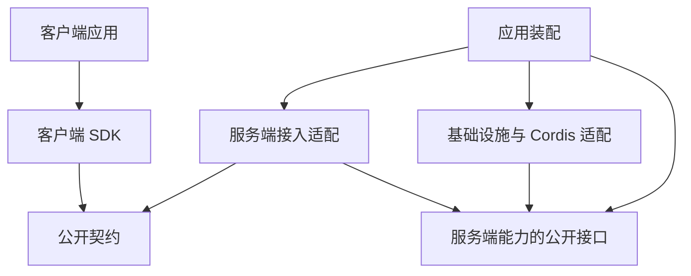

# 系统分层、公开契约与 SDK

本页说明客户端怎样通过统一 SDK 与公开契约使用 Harness，以及各部分必须遵守的依赖方向。它补充[总体结构与责任](structure.md)的协作视图，为客户端、服务端和外部集成提供共同的架构边界。

状态：目标架构正文已获项目负责人接受。本页不表示现有实现已经具备这些能力。传输方式、治理以外的公开操作、包划分及兼容策略尚待细化，集中入口见[未决事项与后续设计](README.md#未决事项与后续设计入口)。

## 分层范围与阅读路径

这里的客户端是使用 Harness 能力的应用或程序，包含交互界面及程序化集成。服务端是承接调用、维护权威状态和执行业务规则的一方，不表示只能运行在远程机器。个人设备可以同时承载两方，云端部署可以将两方分开。

系统分层、运行时调用和部署位置分别判断。公开契约是两端共同遵循的定义，不是每次调用都必须经过的一个运行进程。SDK 也不承担全部服务端职责。

| 问题 | 本页的落点或其他拥有者 |
|---|---|
| 客户端、SDK、公开契约和服务端怎样分工？ | [各层职责](#各层职责) |
| 哪些依赖允许，哪些依赖会破坏边界？ | [依赖关系与禁止方向](#依赖关系与禁止方向) |
| 本域应理解哪些外域概念，怎样避免带入外域治理？ | [领域语义依赖与模型边界](#领域语义依赖与模型边界) |
| 怎样使用完整 Harness，怎样独立使用某个模块？ | [两种消费方式](#两种消费方式) |
| 一次操作和后续事件在两端怎样保持同一含义？ | [跨边界行为与事实归属](#跨边界行为与事实归属) |
| 内部领域、三个 runtime、装配和生命周期怎样协作？ | [总体结构](structure.md)、[运行架构](runtime/README.md) |
| 怎样部署到进程、设备和集群？ | [部署拓扑](deployment/README.md) |

## 各层职责

| 部分 | 拥有的职责 | 不由它决定的事项 |
|---|---|---|
| 客户端应用 | 展示状态、组织交互、收集输入；处理所属应用的本地状态与资源。 | 不以本地显示、按钮状态或缓存值裁定服务端权限和业务完成。 |
| 客户端 SDK | 提供统一的编程入口，组织调用、订阅、结果与错误；管理明确由客户端拥有的连接和句柄。 | 不重写业务规则，不把传输状态推导为执行结果，不直接依赖服务端私有实现。 |
| 公开契约 | 定义可对外使用的操作、数据、事件、错误及行为边界；使 SDK 和服务端对同一交互有一致解释。 | 不包含服务端存储对象、Cordis 对象和部署配置的内部表示。 |
| 服务端接入适配 | 接入请求及订阅，验证协议输入和身份材料，路由到实际能力，并按公开契约交付结果。 | 不成为业务状态的另一份权威，不以入口校验替代实际能力的授权与状态检查。 |
| 服务端能力与协调 | 按公开能力契约维护业务事实、推进工作、执行治理与资源操作。 | 不依赖某个客户端界面、客户端 SDK 或传输协议才能定义业务含义。 |

客户端 SDK 是对完整 Harness 的使用入口，不只是按 URL 发送请求的辅助库。它应让不同客户端以一致方式表达操作和观察工作，同时保留调用者理解失败、取消与结果归属所需的信息。

服务端内部的领域、工作治理、runtime、提供者和装配责任继续归总体结构与相应专题。它们不是一条固定的“领域调用 runtime，runtime 调用存储”的层级链，本页不重新划分这些责任。

## 依赖关系与禁止方向

下图的箭头表示依赖某个公开定义或接口，不表示消息流、线程或进程。

公开契约中引用的业务类型须来自其拥有者的公开、可独立消费的定义，不能反向导入整个服务端实现。序列化表示由公开契约拥有，业务对象的含义仍由原领域或能力拥有；必要转换不产生第二套业务规则。

| 约束 | 允许的依赖与必须阻止的反向依赖 |
|---|---|
| 客户端通过公开入口集成 | 客户端通过 SDK 使用完整 Harness；不得深层导入服务端私有实现来绕过公开契约。 |
| SDK 与服务端实现解耦 | SDK 依赖公开契约及其平台适配，不依赖服务端的存储、运行时实例或 Cordis 装配树。 |
| 两端共用契约 | SDK 和服务端适配依赖同一契约。契约不得依赖任一客户端应用或服务端私有实现。 |
| 业务含义不受协议支配 | 接入适配调用能力的公开接口。业务与 runtime 不反向依赖 SDK、界面或具体传输处理器。 |
| 提供者经接口接入 | 存储、模型传输、执行环境及 Cordis 适配遵循所实现能力的契约。消费者不导入其内部结构。 |
| 装配负责选择实现 | 装配入口可以引用要组合的实现；业务能力不得反向读取装配入口来取得全局服务或隐式依赖。 |
| 部署变化不改变业务权威 | 本地与远程连接可以有不同适配，但不能因此改变租户归属、授权规则、工作身份或完成含义。 |

运行时调用具体提供者，不等于源码必须依赖该提供者的实现。回调、事件订阅和双向消息也不能据此引入反向代码依赖；每种交互仍须由明确的契约承接。

## 领域语义依赖与模型边界

领域从自己的职责、规则、不变量和生命周期出发建模。外部存在某个对象，不构成本域为它建立模型的理由。只有本域履行承诺时必须理解的外部含义，才成为本域的语义依赖。依赖关系须明确到具体概念、用途与公开契约，不能用“依赖某领域”代替分析。

此原则适用于架构、领域建模、契约、内部技术设计及实现。领域模型与集成模型分别判断，目录、包、类、服务或进程不自动对应 DDD 的限界上下文。

### 外域概念的进入方式

| 本域所需知识 | 建模方式 | 必须保留的边界 |
| --- | --- | --- |
| 必须理解其含义，才能判断下一步或履行交付责任 | 消费原拥有者的公开契约；语义不适配时，以消费者所需的窄接口或投影转换 | 明确原身份、有效范围、版本、失败和责任；不复制对方的完整对象与状态机 |
| 只需关联、追溯或交回原位置 | 保留有类型的标识、引用或证据 | 明确引用用途及解析方；持有引用不授予操作资格，也不让本域解码对方私有状态 |
| 双方必须采用同一含义的基础值 | 复用已有公共值契约 | 共享范围和演进拥有者明确；不因字段相似就把多个领域模型提升为公共模型 |
| 仅调用方业务、系统协调或装配需要 | 放在外部协调者或集成适配器中 | 本域公开能力可独立使用，无需模拟上层工作流；跨域保证仍须由具名参与者兑现 |
| 与本域职责无关 | 不进入本域模型、配置和依赖 | 不为将来可能使用而预留整套外域对象或管理接口 |

建模不等于创建同名类。已有公开值或协议可以直接表达必要依赖；仅为避免导入而复制类型，会留下两份需要同步的含义。

集成方知道被集成方；被集成方只声明自己供什么、要什么，用自己的词，不知道被谁集成。两方之间的中介是集成方选用的，不是让被集成方互相认识的通道。[Runtime Context](runtime/runtime-context.md#需要绑定与集成原则) 的集成原则是这一条的具体化。

内部角色也按所需知识分责。纯决策对象可只消费已校验的决策事实；效果协调者可以理解原调用、等待、控制和交付协议；宿主可以理解装配与资源。一个角色需要的外域知识，不自动扩散到整个领域。

### 隔离语义，不隐藏责任

契约类型、依赖注入和接口只能改变代码的连接方式。若本域仍须解释上层工作状态、权限模式或外域内部生命周期，语义依赖仍然存在。把完整外域对象改名成本地类型，或封装成通用 JSON、回调、句柄，也不构成边界隔离。

本域可以建立自己的消费模型，并以适配器翻译外域协议。投影必须保留本域做决定所需的事实及其有效依据。不能把未知压成失败、把观察成功压成可靠承接，或把一次快照当作未来动作的授权。当前资格、撤权、共同提交、结果保管和恢复仍由实际边界保护，不能为了减少依赖而删去这些义务。

已有公开契约与消费语义一致时直接复用，不为每个类型增加包装层。确有语义差异时，转换集中在边界；不把所有数据塞进一个中央公共包，也不要求所有领域达到零依赖。由本域承诺决定合理依赖，由原拥有者决定其事实与规则。领域合作不转移治理权。

### 设计与开发的核对

新增或改变跨域概念、公开字段、调用端口或状态分支时，在既有对象模型、架构或契约说明中交代以下内容。局部实现沿已明确的边界执行，不要求每次改动重写模型。

1. 本域哪项职责或不变量需要这个概念，缺少它会造成什么具体错误。
2. 谁拥有其含义和权威状态，本域实际读取、判断、保存或发起哪些部分，哪些部分明确留在域外。
3. 采用公开契约、消费投影、共享值、引用还是外部集成；这些表示由哪个角色使用，并放在哪个包或接口。
4. 正常、失败、未知、撤权和恢复怎样交接；需共同成立的保证由谁保护，如何验证。
5. 更换上层调用者或外域实现时，本域哪些规则应保持不变。以独立消费者和一个边界反例核对，避免迫使消费者实现无关治理。

评审同时检查概念、类型、行为与装配。导入无环、契约分包和类型通过，均不能单独证明语义边界正确。遗漏必要依赖与引入无关治理都是设计问题；发现后修改原拥有者和真实消费者，不在适配器中静默补造规则。

### 方法依据与采用范围

DDD 的限界上下文限定模型适用范围，防腐层用于在边界翻译模型，Published Language 支持公开语义交换。这里采用这些方法判断概念归属与转换，不把每个治理领域预设为独立部署服务，也不把公共类型包自动视为 Shared Kernel。[Eric Evans，DDD Reference，Bounded Context、Anticorruption Layer、Published Language](https://www.domainlanguage.com/wp-content/uploads/2016/05/DDD_Reference_2015-03.pdf)。

OOP 的封装隐藏内部表示；SOLID 的单一职责帮助区分变化原因，依赖倒置和接口隔离帮助表达消费者所需能力。这些方法支持上述项目规则，但不能替代业务语义与不变量的判断。[Robert C. Martin，Single Responsibility Principle](https://blog.cleancoder.com/uncle-bob/2014/05/08/SingleReponsibilityPrinciple.html)、[A Little Architecture](https://blog.cleancoder.com/uncle-bob/2016/01/04/ALittleArchitecture.html)。

## 两种消费方式

| 消费方式 | 入口与适用范围 | 调用方必须承接的责任 |
|---|---|---|
| 使用完整 Harness | 客户端 SDK 与公开系统契约；面向会话、工作、资源及相关系统操作。 | 提供有效调用身份，处理结果与失败，释放自己拥有的本地资源。 |
| 独立使用能力 | 领域模块、计算能力或 runtime 的公开入口；无需为复用能力创建隐式 Session 或启动完整 Harness。 | 按该能力契约提供依赖，承接属于调用方的授权、生命周期、结果与资源责任。 |

独立消费不是访问系统托管资源的旁路。模块一旦读取系统数据、使用凭据或执行受控动作，就仍须满足相应访问与资源契约。客户端复用纯计算等公开模块也须保持这条界限。

完整 Harness 的 SDK 与内部模块接口可以引用同一份公开数据定义，但两者不要求拥有相同的方法集合。不能为了复用一个函数引入整个 SDK，也不能把服务端全部接口原样公开。

## 跨边界行为与事实归属

公开契约必须表达足够的行为信息，使调用者不需要了解内部装配也能正确使用能力。SDK 和服务端适配对这些含义保持一致，不能只共享类型而各自解释行为。

| 边界事项 | 必须保持的含义 |
|---|---|
| 身份与权限 | 明确本次调用代表谁、作用于什么范围；服务端不能信任客户端自报的授权结果。具体规则归[身份与授权](security/identity-and-authorization.md)。 |
| 输入与受理 | 区分输入已接收、工作已承接、动作已执行和业务已完成；不能以请求成功替代最终结果。 |
| 工作与调用关联 | 保留对应工作、执行和请求的关联；不能把下一个回复、空闲信号或最新消息自动当作本次操作结果。 |
| 流、订阅与恢复 | 区分订阅者已观察和业务已消费；定义缺口、重复、断线及恢复时的处理依据。具体责任归[流式与消费](runtime/streaming-and-consumption.md)。 |
| 取消与资源释放 | 释放本地句柄、结束订阅和断开连接不自动表示取消远端工作。拥有式启动及退出若需要这种联动，必须另有明确契约。 |
| HITL | 通过正式操作取得并回答原决策请求；有效资格、失效和唯一决定仍归原拥有者，不由界面或 SDK 自行批准。 |
| 多模态 | 公开输入输出保留模态、来源及实际内容引用；不能只提供文字便利接口而丢失必要语义。 |
| 错误与未知 | 区分协议、连接、授权及业务失败，保留无法确定是否已执行的情形；SDK 不能对可能产生副作用的未知请求无条件重试。 |

客户端可以维护显示投影和缓存，但服务端业务拥有者仍是事实权威。多客户端同时操作、离线后重连和服务端实例变化时，客户端不能用本地旧状态覆盖权威事实。具体同步与冲突协议在确定后由相应公开契约维护。

## 偏离检查与维护责任

本页拥有系统角色的依赖方向，目标能力组和包边界由[产品包组织](../package-organization.md)维护。access组就近承载公共SDK、共同契约和服务端接入，组内成员仍须分别满足本页方向；目录邻近不表示共同安装、发布或已经实现。

依赖检查应区分源码导入、构建依赖、发布产物依赖及运行时装配关系。合法的装配引用不能掩盖 SDK 携带了服务端实现，开发依赖也不能自动当作发布产物的一部分。

| 检查对象 | 所需证据 | 不能仅据此声称的结论 |
|---|---|---|
| 导入与成员依赖 | 将实际成员映射到本页职责，检查公开入口、反向依赖和循环。 | 依赖图无环不证明授权正确。 |
| SDK 与契约产物 | 检查入口和依赖闭包，验证其声明支持的客户端环境。 | 源码类型通过不证明产物没有服务端依赖。 |
| 两端行为一致 | 对同一公开操作检查输入、结果、事件、错误及取消语义。 | 共用类型不证明行为一致。 |
| 身份、故障与重连 | 使用真实边界验证越权、连接中断、未知结果和订阅恢复。 | 单一正常调用不证明隔离或恢复成立。 |

架构负责人维护职责与依赖规则，公开契约拥有者维护精确行为，成员维护者提供映射与验证资源。报告分别列出现存偏离、本次增减、未覆盖和无法判定项。现有文档检查只度量登记及可读结构，不表示上述依赖和行为检查已经实现。

## 待细化范围

以下内容须继续设计。本页的职责和依赖方向不预先决定它们。

### 公开操作与契约覆盖

治理消息版本和治理操作名由[系统公开契约](../../packages/access/public-contract/SPEC.md)拥有。这些名字不再属于本项缺项。该页不决定治理以外的 SDK 覆盖范围。

<!-- documentation:placeholder -->

SDK 首批覆盖的其余能力、操作及订阅范围仍待明确。那些项的受理、结果、取消、错误和权限契约仍待逐项确定。本页不枚举治理以外的方法名，也不将服务端全部能力自动暴露。

### 传输与兼容约定

<!-- documentation:placeholder -->

SDK 与接入的传输沿[技术基础](technical-foundations.md#共同技术选择)已采用的路线：HTTP JSON 做控制与查询，fetch SSE 做单向观察。端点、认证交互与订阅语义仍归 public-contract。本地与远程接入方式、协议版本及 SDK 发布关系待明确。不从 DSH 的实现直接继承协议与限制。

### 客户端状态与资源管理

<!-- documentation:placeholder -->

待明确支持的客户端环境、连接与订阅生命周期、缓存同步及恢复方式，以及 SDK 是否提供拥有式本地进程启动。取消、关闭和失败时的行为须分别规定。

本页保留的缺项不阻止其他已明确架构继续推进。依赖这些决定的接口和实现不能自行补成默认政策。

## 未决问题与待办事项

以下事项沿本页已接受要求继续承接。来源定位不表示现行契约已经完整或验证已通过。

### CLIENT-M01 本地状态关闭中的多重失败保留

本项为已知符合性差距的修复待办。封存本地状态提供者的两项清理同时失败时，后一个失败会覆盖前一个。须核对现行提供者和组合关闭路径，保持初始结果与各清理失败分别可观察。

承接责任为客户端本地状态提供者与组合关闭拥有者。待办是取得双失败及成功清理的回归证据，并核验其他资源的真实关闭状态；目标沿有序退出与清理失败要求。

[封存来源](../../packages.0.0.1.legacy/frontend/client-local-state-sqlite/README_ZH.md#关闭失败的现状偏离)仅供核对原范围和消费者；旧接受记录、归档位置与已有测试不能授予冲突设计继续采用。实际限制、待设计输入及验证结果须由各自当前拥有者确认。

### SDK-T01 客户端治理操作的公开契约承接

本项为契约承接待办。客户端治理操作及订阅的现行范围、输入、受理、结果、取消、错误与权限表达尚须定位具体公开契约。封存客户端操作集不自动成为当前 SDK 全量支持清单。

承接责任为SDK、治理公开操作及实际客户端消费者。待办是确认获准操作范围、入口与两端行为，验证依赖闭包、身份、故障及重连；未采用的传输和发布决定继续保持待定。

[封存来源](../../packages.0.0.1.legacy/core/governance-client-operations/SPEC.md)仅供核对原范围和消费者；旧接受记录、归档位置与已有测试不能授予冲突设计继续采用。实际限制、待设计输入及验证结果须由各自当前拥有者确认。
