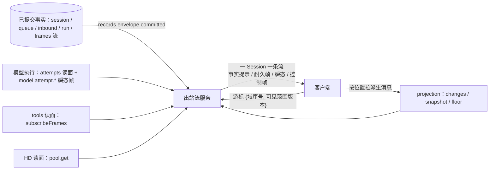

# 消息流与出站流

本页是客户端消息流的系统视图；选择依据见[提案](../proposals/message-stream/README.md)与
[D-015](../decisions/D-015-tool-execution-message-stream-and-hooks.md)，精确承诺归
[message-stream v1](../../spec/capabilities/message-stream/v1/contract.md)；消息模型的数据形状归
[CD v2](../../spec/data/core-work/v2/contract.md)，历史派生表与快照读面归
[session v2](../../spec/capabilities/session/v2/contract.md)，模型执行的瞬态帧归
[model-execution v2](../../spec/capabilities/model-execution/v2/contract.md)。出站流是四层职责里
的最后一层：把"事实变了"与"正在发生"送到获准客户端，不改变事实、不持久化、不做准入。
目标提供者设计尚未写（`packages/session/message-stream` 候选）。

## 系统位置

客户端只认一个 `Message` 模型：消息按 `(seq, index, ordinal)` 定位，事实提示只带位置，
正文按位置从 projection 拉；瞬态帧不入游标。

## 已确认的选择

- **一个消息模型，三种投影。** `Message` 从事实确定性派生（取批输入、attempt 结算、调用结算、
  切点里的提醒），历史、实时与模型上下文是同一记录的纯函数；内容块补齐 `reasoning`、
  `system_reminder`、`deferred_receipt`、嵌套 `tool_result.value`（U-48～U-58）。
- **游标只有域序号，整批安装完成才推进。** 补齐区间是"游标之后、完整覆盖水位为止"；
  重连重发半批，客户端按去重键丢帧但仍完成正文安装；掉出保留期或可见范围版本变化走全量重取。
- **全量重取只有一个时刻。** projection 的 `snapshot` 在同一 fold 水位上给出历史、队列、请求、
  调用与可见范围；请求与调用的可见范围由 HD 与 tools 注册的贡献在同一水位裁剪，授权语义
  仍只有能力自己一份权威。
- **瞬态帧不承诺重放。** `model.attempt.started / chunk / ended` 按 attempt 编号，`ended` 指向已
  提交事实位置；`pub{gen, n}` 让"先读基线再订阅"成为同步切；来源消失时出站流代发
  `ended{abandoned}` 并关闭自己的账；`toPublic` 是前缀单调的确定性转换，没有明文不退摘要（U-49）。
- **背压只作用于瞬态旁路。** 事实提示与瞬态帧两个缓冲，瞬态满了丢并标 `gap`，事实永远到达。
- **传输是装配层。** SSE 端点、心跳、批处理、压缩与背压阈值按测量定，不进契约（U-36、决定 A）。

## Cordis 位置

出站流服务 `omneMessageStream`（候选包 `packages/session/message-stream`）订阅
`records.envelope.committed` 与 tools / HD / MC 的读面，按租户与 Session 作用域过滤；SSE 端点是
应用装配（`apps/local-harness`）。projection 增加 `changes` / `snapshot` / `floor` 读面，session 增加
`visibilityVersion` 与 `frames(S)`，MC 提供者增加 `attempts` 读面与发布计数。装载效应、撤除
责任、依赖变化政策与 fork 演化路径见[提案 Cordis 视角](../proposals/message-stream/cordis.md)。

## 证据与缺口

[游标模型](../../spec/capabilities/message-stream/verification.md)覆盖可丢的铃、订阅水位、分页
补齐、瞬态缺口与崩溃；不覆盖正文安装、多视图快照、来源消失与授权变化。尚未完成：
message-stream、MC 与 projection 的提供者设计；信封与 `Message` 的 JSON Schema；OpenRouter
adapter 的模型族投影；SSE / HTTP 装配；背压测量；客户端持久化；PF-004 子 Session 的流合并；
跨协调域的一致读取切点。
