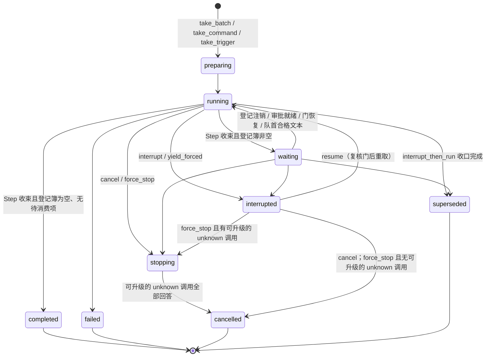

# Run

本页是 Run 的系统视图；选择依据见[提案](../proposals/session-run-agent-lifecycles/README.md)、
[工具执行提案](../proposals/tool-execution/README.md)、[D-014](../decisions/D-014-session-run-agent-lifecycles.md)
与 [D-015](../decisions/D-015-tool-execution-message-stream-and-hooks.md)，精确承诺归
[run v2](../../spec/capabilities/run/v2/contract.md)（v1 冻结可引用）。Run 是一次由单一启动依据发起、
由驱动器推进到终态的业务执行；它拥有自己的状态机、epoch、Step、等待登记簿、驱动位置投影、
控制与恢复兼容证据。推进规则归 [run-driver v3](../../spec/capabilities/run-driver/v3/contract.md)，
与 Session、实例的关系归[生命周期组合 v2](../../spec/compositions/session-run-agent-lifecycles/v2/contract.md)。
目标提供者尚未实现；提供者设计归 [run 包](../../packages/session/run/design.md)。

## 状态机

running、waiting 与 stopping 占位；interrupted 与四个终态不占位
（[RN-01](../../spec/capabilities/run/v2/contract.md)、[LC-02](../../spec/compositions/session-run-agent-lifecycles/v2/contract.md)）。
`waiting_human` 与 `waiting_gate` 不再是状态：等人、等工具、等门都是登记簿的投影 `waitingFor`。
对 interrupted 的 Run 做 cancel 直接进入 cancelled（模型发现，[RN-03](../../spec/capabilities/run/v2/contract.md)）；
force_stop 只在有声明 `forced_isolation` 的 owner 尚未回答隔离时经 `stopping`，其余 unknown
调用记 `isolation: unverified`、不阻止 cancelled（[RN-05](../../spec/capabilities/run/v2/contract.md)）。

## 已确认的选择

- **Run 在等谁只有一份权威。** 需要 Run 等它的对象自己登记：本 Run 提议的调用在提议时、
  进入的门在等待时；人类请求附属于调用；注销恰与释放它的事实同批；interrupted 保留登记簿，
  superseded / failed / cancelled 与 force_stop 受理整簿注销（[RN-01/04](../../spec/capabilities/run/v2/contract.md)，
  用户裁决 [U-59](../proposals/tool-execution/README.md#裁决记录2026-09-14用户)）。
- **被越过的 Run 有终点。** interrupt_then_run 让旧 Run 进终态 `superseded`，不可 resume；
  未消费的接续改判为上下文，被保留的工作清单告知新 Run 的模型；停止未知计入收口、
  复合意图的结果记 `partial{unknown: K}`（[RN-04/05](../../spec/capabilities/run/v2/contract.md)）。
- **执行者是租约，不是所有权。** Run 对实例的关系是 epoch 加 WorkPermit 的执行权租约：
  epoch 耐久、持有者关联不耐久；每次提交核对 epoch（[RN-02](../../spec/capabilities/run/v2/contract.md)、
  [LC-03](../../spec/compositions/session-run-agent-lifecycles/v2/contract.md)）。Run 结束实例可以还在，
  实例退役 Run 可以还在。
- **Yield 只封闭 epoch。** 实例退役时驱动器到安全边界提交 Yield，Run 状态与占位不变，
  由调度者以新 epoch 重取并从投影位置继续（[RN-05](../../spec/capabilities/run/v1/contract.md)、
  [LC-07](../../spec/compositions/session-run-agent-lifecycles/v1/contract.md)）。
- **驱动位置是投影。** 只有意图是权威事实；位置从 Run 流 fold 得到，恢复时重算，
  投影缓存不成为第二权威（[RN-07](../../spec/capabilities/run/v1/contract.md)）。
- **终态与接续同提交。** Run 进入终态时，指向它的未消费 continuation 在同一提交转为
  trigger 或关闭（[RN-09](../../spec/capabilities/run/v1/contract.md)、
  [LC-04 行 4](../../spec/compositions/session-run-agent-lifecycles/v1/contract.md)）。
- **恢复不重放执行。** 重取前核对兼容证据与在途 attempt、call、request；已耐久 dispatched
  的不重发（[RN-08](../../spec/capabilities/run/v1/contract.md)）。

## Cordis 位置

Run 是独立插件 `omneRun`，独立包 `packages/session/run`；提交面（开 Step、准入/派发/结算
attempt、提出/受理调用、消费决定、收束 Step、进门、结算 Run、Yield、重取、控制受理）
由驱动器与控制入口消费，读面供 `decide` 取 view。它与 `omneSession` 互不 required inject；
同时改动两者的操作由 Session 包内的组合者、裁决者与调度者完成
（[提案 Cordis 视角](../proposals/session-run-agent-lifecycles/cordis.md)）。Run 独立权威只算
"边界就绪"：把 Run 权威另置协调域之前必须兑现
[LC-09](../../spec/compositions/session-run-agent-lifecycles/v1/contract.md) 列出的义务，
不据此声称当前条款可分布。

## 证据与缺口

[生命周期组合模型](../../spec/compositions/session-run-agent-lifecycles/verification.md)覆盖
执行者唯一、占位唯一、终态后接续、Yield 重取与跨域义务；
[RunDriver 模型](../../spec/capabilities/run-driver/verification.md)覆盖推进、收口、恢复不重发
与门等待；[调用生命周期模型](../../spec/capabilities/tools/verification.md)以按调用投影覆盖
登记簿的路由、复合打断的整簿注销与停止未知。尚未完成：任何提供者实现与崩溃窗口注入；
多进程部署下旧 epoch 持有者的活性判定；跨协调域的租约、版本戳、意图重投与登记簿交接协议；
事件与 envelope 的 JSON Schema。
