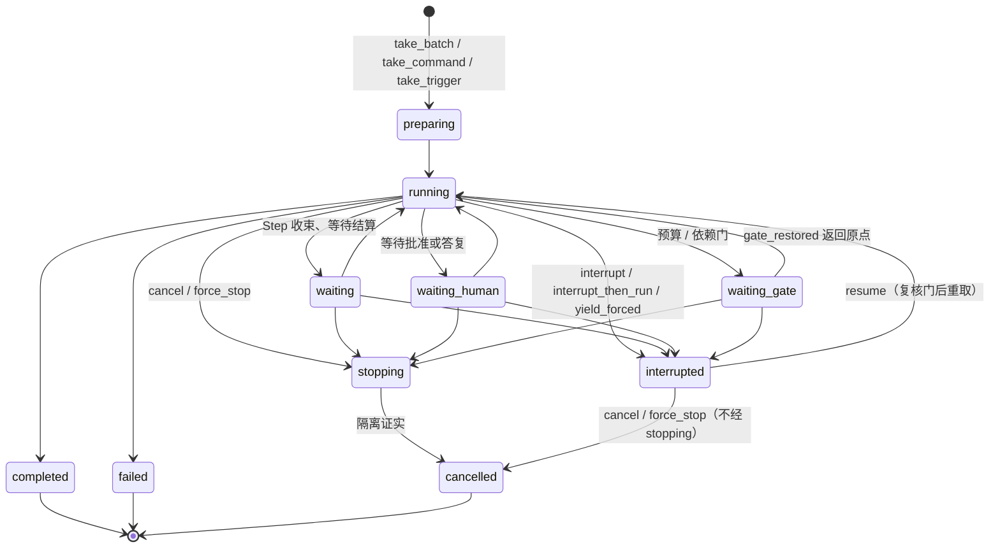

# Run

本页是 Run 的系统视图；选择依据见[提案](../proposals/session-run-agent-lifecycles/README.md)
与 [D-014](../decisions/D-014-session-run-agent-lifecycles.md)，精确承诺归
[run v1](../../spec/capabilities/run/v1/contract.md)。Run 是一次由单一启动依据发起、
由驱动器推进到终态的业务执行；它拥有自己的状态机、epoch、Step、驱动位置投影、
控制与恢复兼容证据。推进规则归 [run-driver v2](../../spec/capabilities/run-driver/v2/contract.md)，
与 Session、实例的关系归[生命周期组合 v1](../../spec/compositions/session-run-agent-lifecycles/v1/contract.md)。
目标提供者尚未实现；提供者设计归 [run 包](../../packages/session/run/design.md)。

## 状态机

running、waiting、waiting_human、waiting_gate 与 stopping 占位；interrupted 与三个终态不占位
（[RN-01](../../spec/capabilities/run/v1/contract.md)、[LC-02](../../spec/compositions/session-run-agent-lifecycles/v1/contract.md)）。
对 interrupted 的 Run 做 cancel / force_stop 直接进入 cancelled，这是模型发现
（[RN-03](../../spec/capabilities/run/v1/contract.md)）：若经 stopping 会重新占位并与新 Run 并存。

## 已确认的选择

- **执行者是租约，不是所有权。** Run 对实例的关系是 epoch 加 WorkPermit 的执行权租约：
  epoch 耐久、持有者关联不耐久；每次提交核对 epoch（[RN-02](../../spec/capabilities/run/v1/contract.md)、
  [LC-03](../../spec/compositions/session-run-agent-lifecycles/v1/contract.md)）。Run 结束实例可以还在，
  实例退役 Run 可以还在。
- **Yield 只封闭 epoch。** 实例退役时驱动器到安全边界提交 Yield，Run 状态与占位不变，
  由调度者以新 epoch 重取并从投影位置继续（[RN-05](../../spec/capabilities/run/v1/contract.md)、
  [LC-07](../../spec/compositions/session-run-agent-lifecycles/v1/contract.md)）。
- **驱动位置是投影。** 只有意图是权威事实；位置从 Run 流 fold 得到，恢复时重算，
  投影缓存不成为第二权威（[RN-07](../../spec/capabilities/run/v1/contract.md)）。
- **终态与接续同提交。** Run 进入终态时，指向它的未消费 continuation 在同一提交转为
  trigger 或关闭（[RN-09](../../spec/capabilities/run/v1/contract.md)、
  [LC-04 行 4](../../spec/compositions/session-run-agent-lifecycles/v1/contract.md)）。
- **恢复不重放执行。** 重取前核对兼容证据与在途 attempt、call、request；已耐久 dispatched
  的不重发（[RN-08](../../spec/capabilities/run/v1/contract.md)）。

## Cordis 位置

Run 是独立插件 `omneRun`，独立包 `packages/session/run`；提交面（开 Step、准入/派发/结算
attempt、提出/受理调用、消费决定、收束 Step、进门、结算 Run、Yield、重取、控制受理）
由驱动器与控制入口消费，读面供 `decide` 取 view。它与 `omneSession` 互不 required inject；
同时改动两者的操作由 Session 包内的组合者、裁决者与调度者完成
（[提案 Cordis 视角](../proposals/session-run-agent-lifecycles/cordis.md)）。Run 独立权威只算
"边界就绪"：把 Run 权威另置协调域之前必须兑现
[LC-09](../../spec/compositions/session-run-agent-lifecycles/v1/contract.md) 列出的义务，
不据此声称当前条款可分布。

## 证据与缺口

[生命周期组合模型](../../spec/compositions/session-run-agent-lifecycles/verification.md)覆盖
执行者唯一、占位唯一、终态后接续、Yield 重取与跨域义务；
[RunDriver 模型](../../spec/capabilities/run-driver/verification.md)覆盖推进、收口、恢复不重发
与门等待。尚未完成：任何提供者实现与崩溃窗口注入；多进程部署下旧 epoch 持有者的
活性判定；跨协调域的租约、版本戳与意图重投协议；事件与 envelope 的 JSON Schema。
