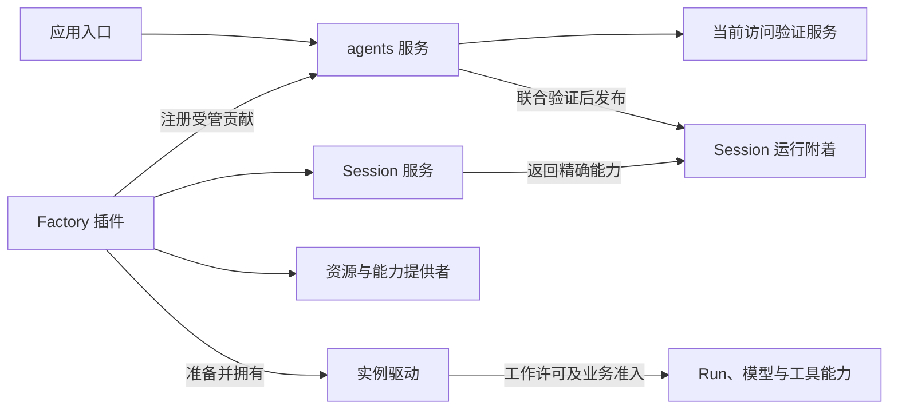

# 运行时共同边界与 Session 附着

[D-007](../decisions/D-007-runtime-composition.md)接受本页投影的共同边界；精确交接
归 [composition.agent-session-binding v1](../../spec/compositions/agent-session-binding/v1/contract.md)，
身份与活体生命周期继续沿用 [Agent 运行时](agent-runtime.md)的 identity/live-agent v1。
当前完成设计，尚无目标组合的真实提供者实现。

## 状态、上下文与能力

| 能力 | 自己裁决的事实 | 对相邻能力的交接 |
|---|---|---|
| Session | 长期身份、原定义关联、生命周期、历史与会话状态 | 当前资格和精确运行附着；历史读取与存储接口 |
| Agent 原语 | 活体占位、确切实例、工作账目、资源退出 | 受限操作和工作许可；不拥有整个 Session |
| 输入/Run 控制 | 耐久输入、取批、运行位置、控制意图和恢复裁决 | 驱动消费合法工作，不以激活代表恢复 |
| 工具执行 | 调用/attempt、过程帧、结果与后台执行 | Session 关联，上下文选择，存储保存；控制有自己的传播规则 |
| 模型 | 获准请求、实际模型/adapter、流、结果与费用事实 | 统一 OpenRouter；供应商格式投影共享内容 |
| 上下文装配 | 本次选择的提示词、历史、输入、摘要与贡献 | 形成实际模型内容依据；不成为任意可变会话状态容器 |

Cordis Context 负责服务访问与动态组合；调用上下文携带该次操作的身份、因果及
受限能力；模型上下文表达一次请求的内容。来源状态按能力持有。scope 和 initiator
分别处理可见性/路由与归因，不提供授权或改变资源寿命。

## 插件依赖与运行交接

箭头表达服务消费、贡献登记或运行对象交接，标签区分它们。Registry 调用选定的
Factory 贡献，不静态注入某个具体 Loop；Factory 的准入在必要依赖就绪后开放。
包、插件、服务及运行对象不一一对应。具体服务键和后端映射在各自实施规格中确定。

四类接口分别回答：谁验证当前权限、谁附着已有 Session、谁准备和驱动实例、谁
记录使用并释放资源。发布时这些权威共同参加短提交；旧允许、Session DTO 或
多个独立 `isValid` 检查不能替代共同撤销屏障。详细约束直接引用组合规格。

## 退出、失效与后续设计

退出先关准入，等待准备/工作收口和确认移交，再取得驱动静止，按依赖释放资源、
解除精确附着，最后释放 Registry 占位。晚到结果仍归原尝试；失败或未知不伪报
释放。清理不会删除长期 Session，也不会隐式取消独立工具、HITL 或子会话。

资格失效阻止旧附着继续准入；必要提供者计划撤除先协作退出再实际卸载。独立
历史读面不因原模型、工具或 Agent 不在而全部失效。归档落盘、Run 停止和关闭
运行准入是不同事实，耐久组合沿 [Session/Run v1](../../spec/capabilities/session-run/v1/contract.md)核对。

D-006 工作 A 的共同边界由 D-007 接受，后续本批共享内容、Session/Run、耐久
记录、工具、模型及相邻能力契约由 [D-008](../decisions/D-008-core-capabilities.md)
接受，精确版本归 [catalog](../../spec/catalog.json)。具体提供者和组合映射从
[应用设计](../../apps/local-harness/design.md)进入；真实 writer、准入和完整运行
组合仍待验收。D-007 当时范围见[需求映射](../proposals/runtime-composition/requirements.md)，
后续覆盖与相邻缺口见[核心能力视图](core-capabilities.md)。
