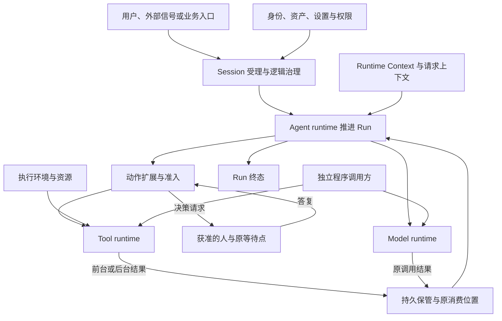

# 运行架构

本专题说明会话怎样承接输入，Agent Loop 怎样推进，模型和工具怎样独立执行，以及控制、消费、变更与恢复怎样协作。它描述目标设计，不根据当前源码反推行为。

状态：十二页目标架构正文已获项目负责人接受。各页明确保留的未决项继续按原范围处理；正文接受不表示实现或验证完成。产品规则沿各页引用的 PF 基线与限定增量；旧技术源的切换按[架构采用规则](../README.md#采用状态与当前有效源)执行。

## 代表性主流程

一轮会话工作先确定身份、能力与条件，再可靠受理输入，创建或唤醒 Run。Agent runtime 组装请求并调用模型，对模型提出的动作运行扩展链、准入和环境选择，最后执行工具并承接结果。满足完成条件后收束 Run，未结消费和费用仍继续处理。

箭头表达调用和数据关系，不规定线程、进程或 Cordis 父子结构。领域业务也可直接使用计算能力，不必全部包装成 Session 或工具。

### 会话建立与运行准备

1. [会话创建、身份与作用域确定](session-and-run.md#会话创建与身份)。
2. [组织、租户、工作区的资产、设置与权限求值](assembly-and-change.md#多层来源求值)。
3. [AgentDefinition 解析、能力选入与装配](assembly-and-change.md#能力选入与实现解析)。
4. [会话模式初始化](session-and-run.md#会话模式)与 [Runtime Context 建立](runtime-context.md#模式与-context-初始化)。
5. [运行条件检查与 Agent runtime 启动](agent-runtime.md#启动与运行条件)。

### 输入进入与工作承接

6. [入站输入分类、去重与持久受理](session-and-run.md#输入受理与分流)。
7. [普通输入排队、卡片答复路由与控制指令分流](session-and-run.md#输入受理与分流)。
8. [Run 创建、已有 Run 唤醒与推进者确定](session-and-run.md#run-创建与推进权)。新 Run 开始时是否重装，见[何时重装](assembly-and-change.md#何时重装)。
9. [attempt 建立、恢复对账与原工作接续](session-and-run.md#attempt-与原工作接续)。
10. [当前步骤承接输入与读取运行条件](agent-runtime.md#启动与运行条件)。

### 一次 Agent Loop 的推进

11. [系统提示词、历史消息、工具声明与当前上下文组装](request-context.md#输入来源与组装)。
12. [模态表示选择、输入限额检查与上下文压缩](request-context.md#模态表示与完整输入限制)。
13. [模型调用前扩展执行与请求输入固定](request-context.md#失败与固定采用值)。
14. [模型请求发起、供应商选择与适用重试](model-runtime.md#真实发出与调用收场)。
15. [流式内容交付、在途快照与观察者接续](streaming-and-consumption.md#到达语法与在途观察)。
16. [模型调用收场、回复处理与消息准入](agent-runtime.md#回复准入与动作处理)。
17. [动作提取、参数改写与逐动作扩展链执行](loop-extensions.md#有序组合与参数改写)。
18. [动作授权检查、HITL 等待与答复后续判](loop-extensions.md#准入与-hitl)。
19. [执行环境选择、资源准备与工具调用排队](tool-runtime.md#已知能力可用性与排队)。
20. [工具执行、前后台转换与执行内部等待](tool-runtime.md#前后台与内部等待)。
21. [工具结果返回、可靠承接与执行后扩展](agent-runtime.md#一轮推进)。
22. [下一步求值、新输入处理与循环继续](agent-runtime.md#下一步与完成条件)。

### 工作收束与消费完成

23. [Run 完成条件检查与终态扩展](agent-runtime.md#完成条件与终态)。
24. [Run 终态记录、未结工作与交付责任处理](session-and-run.md#生命周期与工作收束)。
25. [模型结果消费确认与无用副本清理](streaming-and-consumption.md#模型-ack-与副本清理)。
26. [迟到结果、费用与其他结算事实归集](model-runtime.md#结果确认与费用)。

### 运行中的变化与控制

27. [Runtime Context、模式与权限变化的生效](runtime-context.md#更新通知与读取)。
28. [资产、模型、工具及 MCP 可用性变化的处理](assembly-and-change.md#工作区与能力变化)。
29. [显式 reload、重新装配与推进权交接](assembly-and-change.md#reload-与推进权交接)。
30. [用户插队、模型中断与单个工具中断](control-and-recovery.md#插队与单次中断)。
31. [Run 取消、会话归档与相关执行收束](control-and-recovery.md#取消与归档)，以及归档后的[作用域释放](control-and-recovery.md#作用域释放)。

### 故障恢复与其他调用路径

32. [Agent runtime 退出后的原调用接续](control-and-recovery.md#agent-runtime-退出后的接续)，以及[恢复的发现与收束](control-and-recovery.md#恢复的发现与收束)。
33. [Model runtime 失联后的判定与恢复](model-runtime.md#重试与失联边界)。
34. [Tool runtime 或执行环境失联后的处置](tool-runtime.md#中断与失联)。
35. [存储及关键服务暂时不可用时的降级与恢复](control-and-recovery.md#存储与关键服务降级)。
36. [Session 之外的模型与工具独立调用](session-and-run.md#多会话与独立调用)。
37. [多会话并行推进、子会话派发与结果回传](session-and-run.md#多会话与独立调用)。

这些编号是阅读顺序，不是一条所有工作必须走完的流水线。循环步骤可重复，控制和故障可在多个阶段发生，独立调用不必经过会话创建。

## 生命周期与状态转换

| 对象 | 拥有的状态与责任 | 详细规则 |
|---|---|---|
| Session、Run、attempt | 会话治理、逻辑终态和有效推进者。 | [会话与工作](session-and-run.md) |
| Agent runtime | 执行 Loop 决定，等待并消费原调用。 | [Agent runtime](agent-runtime.md) |
| Model runtime | 真实发出、内容与调用收场。 | [模型](model-runtime.md) |
| Tool runtime | 工具执行、内部等待、前后台与效果。 | [工具](tool-runtime.md) |
| 结果保管与消费方 | 原消费位置、可靠交接及清理许可。 | [流式与消费](streaming-and-consumption.md) |

三个 runtime 生命周期独立。Session 通过明确业务规则治理它们，不要求共享执行栈、进程、节点或随父销毁的对象树。等待另一项执行形成数据依赖，不自动形成生命周期所有权。

## 并发与取消

同一 Session 至多一个未终结 Run，同一 Run 至多一个有效推进者。不同 Session 并行，单 Run 可有多个工具执行，后台执行也可在下一步继续存在。共享资源仍须遵循租户隔离、授权与各能力的并发约束。

控制须明确目标和效果。中断模型、停止工具、取消 Run、归档会话及撤回外部效果是不同操作。原推进者退出不取消它引用的全部执行，终态也不代表所有结果已经消费。完整协调见[控制与恢复](control-and-recovery.md)。

## 失败与恢复

先分清观察失败、执行丢失、结果未交接和业务失败，再确定恢复动作。查询暂时不可用不能直接证明执行已经终止或丢失；工具实际失败也不能证明没有外部副作用。

恢复优先接续原身份、原结果与原消费位置。模型按首内容边界决定能否重新发出，工具失去连续性后不自动重放。存储及安全能力不可用时，依赖其保证的工作不得假报成功。

每条路径保留适用的租户、工作、attempt、调用、实际实现及环境关联。长期会话的加载、组装、排队和等待分别计量；遥测与诊断不扩大数据访问或对外传送权限。

## 局部细化与维护

线程模型、持久化事务、精确接口、缓存算法和数值阈值由相应接口拥有者维护采用范围。Model 非 pi-ai 细化设计已接受；其他成员及共同方案按原接受状态推进，实际实现与运行验证分别判断。

[流中在途内容的故障保留](streaming-and-consumption.md#在途内容的局部对账)与[不可用工具应答分类](tool-runtime.md#不可用应答的分类边界)保留为局部对账。跨会话派发仍需补齐授权和可靠投递契约。持续利益对齐仍是长期承诺，本阶段不在运行专题展开专项设计。

系统架构负责人确认目标语义及采用范围。各专题维护者更新规则时同步相关图、流程入口和登记；实现符合性另行报告，不能靠改写目标正文消除偏离。

## #342 主干契约候选

Tool 和 Model 的架构、公开契约、操作协议、对象模型与 Cordis 集成设计已接受；Model 的 pi-ai 相关细化、Session、Agent 及共同细化仍为候选。设计接受不表示生产实现已完成。

- [对象与责任模型](runtime-contract-model.md)区分原工作、原调用、执行实例、句柄与保管责任。
- [Model操作](../../../packages/model/model-contract/docs/public-api.md)、[Tool操作](../../../packages/tool/tool-contract/docs/public-api.md)、[Session操作](../../../packages/session/session-contract/docs/public-api.md)、[Agent操作](../../../packages/agent/agent-contract/docs/public-api/README.md)各自拥有精确定义，接受状态以上述说明为准。行为、必要协议及参数与依赖分类分别归 [Model SPEC](../../../packages/model/model-contract/SPEC.md#342-主干运行契约候选)、[Tool SPEC](../../../packages/tool/tool-contract/SPEC.md#342-主干运行契约候选)、[Session SPEC](../../../packages/session/session-contract/SPEC.md#运行契约候选)和 [Agent SPEC](../../../packages/agent/agent-contract/SPEC.md#主干运行契约)。
- [Cordis集成](runtime-contract-integration.md)拥有共同宿主、事件、配置和IC对账，各成员集成专题拥有独有接缝。
- [后继实现与验证](runtime-contract-handoff.md)说明四条实现线及相邻能力如何消费各成员设计，哪些生产与组合证据仍须补齐。
