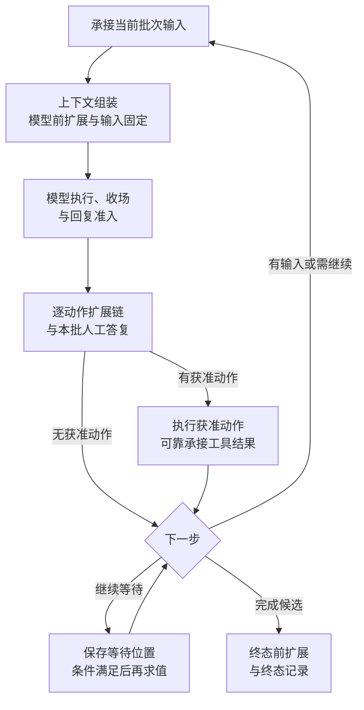

# Agent runtime 与 Agent Loop

Agent Loop 根据会话事实和当下条件求出下一步。Agent runtime 执行这个决定，发起调用，等待并消费结果。Loop 规则没有实例寿命；Agent runtime 可以退出或替换，原 Run 和它调用的执行不因此结束。

状态：已接受的目标架构。Session、Run 和 attempt 的身份及推进权归[会话治理](session-and-run.md)，扩展的详细规则归[Loop extensions](loop-extensions.md)。

## 启动与运行条件

启动前取得已校验的装配依据、Run 与 attempt、原消费位置、日志读取范围及当前运行条件。运行条件包含模式、权限、能力可用性、模型与窗口、Runtime Context、执行环境及必要资源。

这些输入各有来源与生效时刻。日志负责已经发生的事实，不独自提供全部当前输入。历史授权用于解释旧执行，不能授权未来动作。不能把权威推进状态只保存在停机后无法恢复的 Agent runtime 内部。

恢复实例先完成原工作对账。存在未完成的模型调用、工具调用或扩展等待时，先接续它们，再判断是否发起新工作。装配失败、无法取得必要输入和暂时等待分别报告。

## 一轮推进

图展示正常循环。恢复时先回到原调用或等待位置，取消和失败按各自路径收束；不能直接跳到下一次求值，也不能用一次函数返回当作全部调用收场。具体推进顺序如下。

1. 优先处理已生效取消、既有终态及原调用，恢复原消费位置。
2. 承接当前批次输入，取得本步可使用的事实与条件。
3. 通过[请求上下文](request-context.md)取得可发送输入，不能装下时按既有失败规则收束。
4. 执行模型调用前扩展，必要时重新组装，再固定输入并登记调用。
5. 等待原模型调用，处理真实收场，执行模型后及消息入口扩展。
6. 对每个动作执行自己的有序扩展链。不同动作可并行判断，整批判断完成前不发出已经获准的部分。
7. 等待本批人工答复后继续原扩展位置。获准动作通过授权、环境及资源检查后执行。
8. 取得前台结果或合法后台占位，可靠承接结果，经过执行后扩展，再次求值。

step 用于标识一次 Loop 推进单元，不能替代实际调用身份。同一步允许多个工具动作。模型回复被入口否决后，原调用已收场，后续模型调用是新调用，不能伪装成原调用内部重试。step 的精确切分和连续否决计数需在实现规格中对齐既有规则。

## 回复准入与动作处理

模型返回的是候选回复，模型 runtime 不执行其中的工具建议。Agent runtime 对完整回复进行准入和动作解析。未完整到达的参数块不能发起工具执行。

消息入口否决按来源分别处理。外部输入拒收并记录原因。模型回复被否决时保留原调用结果，退避后可创建新调用，连续否决达到适用上限使 Run 失败。工具结果被否决使 Run 失败，不能重跑工具来制造另一份结果。

模型已经展示的原文不能由后续扩展改写。模态转换可以按契约追加派生表示，不能伪造原始内容。动作参数改写保留原参数与生效参数，后续准入、人工确认和执行必须针对同一生效参数。

## 下一步与完成条件

没有动作不直接等于工作完成。Loop 仍须检查新输入、未完成等待、协作模式及终态前扩展。

前台工具必须交回本步所需的结果；符合工具声明的后台占位可以使本步继续。后台工具仍有真实执行和后续结果责任。所有动作被否决后也须重新求值，不能把“没有发出动作”当成完成目标。

### 完成条件与终态

Run 成为完成候选时，执行终态前扩展。扩展可要求继续、等待或否决该候选。只有实际记录的终态才生效，随后执行终态后扩展。后置扩展不能撤销已成立的终态。

失败和取消也经过适用的终态路径，不能由普通消息冒充。终态后禁止发起新的工作，迟到结果与费用仍可记录。真实收场、逻辑终态、结果消费及资源清理分别判断。

## 调用关联与可接续性

每次模型调用、工具调用和扩展调用都须有独立身份，关联 Run、attempt、step、动作及原消费位置。跨 attempt 接续使用稳定工作关联，不能仅凭 Session、Run、step 三项区分同一步的多个效果。

| 原调用用途 | 结果必须返回的位置 |
|---|---|
| 主流程模型回复 | 原模型回复处理节点。 |
| 压缩内部模型调用 | 原压缩计算与摘要提交节点。 |
| 扩展中的模型判断 | 原扩展调用与判断位置。 |
| 工具执行 | 原动作及结果处理节点。 |

扩展中的模型结果不能直接当成主流程回复。新的推进者不得因失去旧实例内存而重复付费判断或重做工具效果。结果保管遵循[流式与消费](streaming-and-consumption.md#可靠承接与原消费位置)。

## 长期运行与验证义务

Loop 读取决定下一步所需的依据，不要求每次扫描全部会话历史。派生投影和缓存须可重建，并标明其对应的事实范围。性能优化不能遗漏新输入、未完成等待或取消意图。

循环守卫根据原始事实计算，不能因压缩或更换 attempt 清零。预算、时限和轮数采用明确策略，不在架构中虚构统一上限。实现验证须覆盖重复触发、推进者竞争、等待后替换实例、迟到结果及终态后禁止新发起。

## 依据

主流程、step、扩展与终态的当前产品责任候选见 [Agent 定义与工作推进](../../../.meta_harness/design/product/agent-progression/README.md)。受理与队列的候选责任见[会话与工作](../../../.meta_harness/design/product/sessions-and-work/README.md)，输入与可靠交接也见[会话与工作](../../../.meta_harness/design/product/sessions-and-work/README.md)。两者仍为草案；本页架构承诺按项目要求与实际已接受范围执行。
