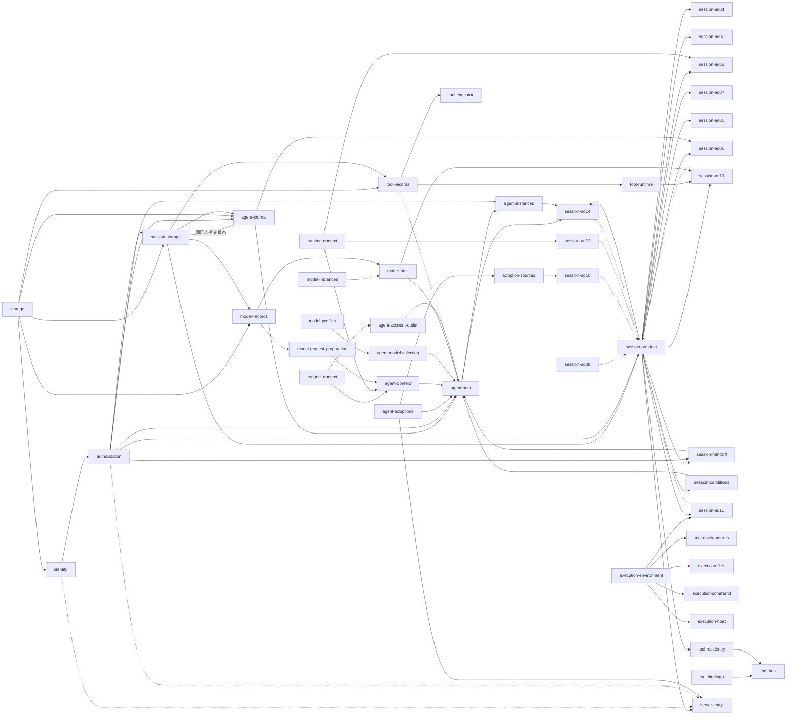

# 应用装配：单机首条租户路径

状态：[#677](https://github.com/nemori-ai/omne-harness-lite/issues/677) 的装配设计。它不表示应用成员或首条租户路径已经实现或验证；各成员的实际支持范围以成员 README 的支持范围表为准。

本页拥有单机首条租户路径的应用装配责任：进程里装哪些成员、每个成员以插件树的哪一行进入、装配入口提供哪些运行时对象、替身与真件在哪里切换，以及只能由应用装配承担的桥接。首条租户路径是：外部调用者创建租户、登录、发出第一次请求，收到第一条 Agent 纯消息回复，再读到历史。首条路径先验收纯消息回复；插件树同时列出工具与本地执行环境的装配，供后续工具往返使用，实际实现与验证归 M2。

插件树的格式与层叠归 [IC-15](../cordis-integration-conventions.md#ic-15)、[IC-16](../cordis-integration-conventions.md#ic-16)；运行时对象经装配入口提供归 [IC-1](../cordis-integration-conventions.md#ic-1)；共同宿主与配置归 [Cordis 集成](runtime-contract-integration.md#配置与插件树)；采用协调与重装归[定义求值与装配交接](../../domains/assembly-and-handoff/README.md)。本页不发布可运行的插件树。

## 进程与装配入口

首条租户路径是一个单机进程，由一个私有应用成员承载，它就是本页所说的应用装配。应用成员先确定规格、成员路径、包名、启动入口和公开依赖，再按 apps 的规范建立真实成员。现有 package-template 不适用于应用，本次不扩展通用模板。名字和目录须由该应用规格及获准任务确定，不由本页叙述授予。首条租户路径的应用成员是 `apps/harness-server`。

装配入口按下面的次序启动进程：

1. 读取发行层与运维者层，按行 id 层叠出最终插件树（[IC-16](../cordis-integration-conventions.md#ic-16)）。检查每行 inject 的受信名都在该行的可见集合内（见[受信子树](#受信子树)），不成立时启动失败。
2. 提供[运行时对象](#运行时对象)：根上下文的对象，以及受信子树各作用域内的对象。运行时对象不进插件树。宿主文件责任域在这一步创建一次，早于任何行装载。
3. 按插件树装载各行插件。受信子树的行装在只为它可见的受信名建立的上下文中，其余行装在根上。插件经 `inject` 取得必需服务，按调用现取的端口不进 `inject`。插件体构造时检查不能由 `inject` 表达的装配条件，不成立时抛出，该行 `FAILED`。
4. 等待全部行就绪。某一行停在 `PENDING` 时，装配入口报告缺哪一项必需服务，进程不开始接收消息；某一行 `FAILED` 时启动失败，分别诊断（[Cordis 集成](runtime-contract-integration.md#配置与插件树)）。
5. 全部行就绪后，装配入口调用 `server-entry` 登记的开始句柄，服务端接入开始在会话位置与治理位置接收消息。
6. 计划停止按应用成员规格的「有序关闭」执行：先关接入，再停业务，再关会话存储组合，最后关存储，报告确定之后才通知存储提供者。停业务之后对宿主文件责任域跑最后一次维护，剩余未结清的份数写进关闭报告。

## 插件树

下表是首条租户路径的发行层。行 id 是对运维者的稳定承诺；改名、删一行或换一行的插件属于发行层修订，要写进应用成员的当前说明与发行说明。运维者层只按行 id 替换配置、停用或插入行。

| 行 id | 成员与插件 | 提供 | 必需（`inject`） | 按调用现取 | 配置（可序列化） |
| --- | --- | --- | --- | --- | --- |
| `storage` | 存储契约的 SQLite 提供者 | `storage`：按事务域登记的存储服务（只在[受信存储子树](#受信子树)内可见） | `storageHost`、`assemblyLifecycle` | 无 | 存储根目录；[SQLite 提供者配置](../../../packages/storage/sqlite-provider/SPEC.md#121-配置)要求的四项数值（`admissionQueueLimit`、`lockWaitMs`、`maxCommandsPerCommit`、`maxCommandBytes`）；组提交与关闭期限的数值，按 SQL 提供者的配置 |
| `identity` | `@omne-harness/identity-sql` 的 `./cordis` 插件 | `identityOperations`（注册激活、签发登录、识别登录）；`tenantStanding` | `storage` | 无 | 登录期限与空闲期限 |
| `authorization` | 应用成员的授权适配插件 | Session 身份桥使用的准入裁定；`agentAccessCheck`、`sessionAccessCheck`（含作用域释放恢复的三项系统请求：`scope-release-receive`、`scope-release-load` 与 `scope-release-query`）；`agentActionAdmission` | `tenantStanding`、`principalVerifier` | 无 | 无 |
| `session-storage` | 应用成员的会话存储组合插件：在同一插件体内构造租户到事务域的目录与 `@omne-harness/session-storage-sql` 根入口的纯提供者，目录的存储构造能力只经闭包交给后者 | `sessionTransactions`；`sessionDelegatedTransactions`（会话委派事务，受信）；`tenantDomains`（只含部署枚举 `enumerate`）；`tenantDomainLookup`（已发布快照的只读查找，受信）；`sessionPrincipalBindings`（会话归属读口，受信） | `storage`、`sessionAccessCheck`、`assemblyLifecycle`；部署枚举授权所需的原能力键（随 D-AUTH 与 XC-IDCORDIS 定名） | `sessionCursorSigning` | 事务域推导规则；组合版本；登记表的文件位置（在存储根目录下）；介质（与 `storage` 行相同的 SQLite）；`pageBytes` 上限；`maxScanPerPage`；`maxRegistrationRetries`；快照重建方式。其余字段取 Session SQL 纯工厂配置的初值。见[租户到事务域的目录](#租户到事务域的目录) |
| `session-provider` | `@omne-harness/session-cordis` 的插件 | `session`（四个面）；协调器与调度器，含推进触发调度器 S1 | `sessionAccessCheck`、`sessionDelegatedTransactions`（受信）、`sessionPrincipals`、`sessionWorkPrincipals`（受信）、`assemblyLifecycle` | `sessionIdentity`、`sessionEvidence`、`sessionContextInput`、`sessionIdleInput`、`sessionAgentDrive`、`sessionScopeRelease`、`sessionClock`、`sessionNotifier`、`sessionTransactions`（只服务 `pending`、`references`、`releasedScopes` 三项目录读取） | `admission: 'none'`（本部署没有命令域与 hooks） |
| `session-ad01` | session-adapters 的 AD-01 Agent 同日志提交参加者 | 无（与 Journal 提供者共用会话日志的发布边界） | `session`（`caller: 'coordinator'`） | 无 | 无 |
| `session-ad02` | AD-02 Agent 同日志解释 | 无 | `session`（`'coordinator'`） | Journal 提供者的 `output.read`、`output.events` 与 `load` | 每次读取事件数上限；超时与重试退避 |
| `session-ad03` | AD-03 持有者与生产者，含回放与变化提醒两个子插件 | 无 | `runtimeContext`、`session`（`'coordinator'`、`'reader'`） | 无 | 无 |
| `session-ad04` | AD-04 历史源 | 无 | `session`（`'reader'`；下界子插件 `'coordinator'`）；RQ 来源登记服务 | 无 | 无 |
| `session-ad05` | AD-05 Model 日志消费适配，含 Tool 原生产者确认投影 | 无 | `session`（`'coordinator'`） | 同一 Journal 提供者的 `received` 条目、材料与 `load().results` | 超时与重试退避 |
| `session-ad06` | AD-06 Tool 日志消费适配 | 无 | `session`（`'coordinator'`）；同一 Journal 提供者的 entries、results 与材料视图 | 无 | 超时与重试退避 |
| `session-ad09` | AD-09 身份桥 | `sessionIdentity` | `principalVerifier` | 无 | 无 |
| `session-ad10` | AD-10 证据桥 | `sessionEvidence` | 装配采用、生产来源与保管来源的服务（键见缺口表） | 无 | 无 |
| `session-ad11` | AD-11 空闲输入 | `sessionIdleInput` | `modelRuntime`、`toolRuntime`、`session`（`'maintainer'`） | 无 | 无 |
| `session-ad12` | AD-12 Context 输入 | `sessionContextInput` | `runtimeContext` | 无 | 无 |
| `session-ad14` | AD-14 `AgentDrivePort` | `sessionAgentDrive` | `agentInstances`、`agentInstanceProvision`、`agentExecutionRecovery`、`agentExecutionControl`、`session`（`'coordinator'`） | 无 | 无 |
| `session-ad15` | AD-15 作用域释放，含重新释放子插件 | `sessionScopeRelease` | `executionEnvironment`（`caller: 'maintainer'`）；子插件还需 `session`（`'maintainer'`） | 构造时交入恢复授权 | 超时、重试退避与重新释放页大小 |
| `session-handoff` | session-adapters 的 J06 消息准入插件 | `agentMessageHandoff` | `session`（`'coordinator'`）、`agentAccessCheck` | 无 | 无 |
| `session-conditions` | session-adapters 的 J06 当前条件插件 | `agentConditions` | `session`（`'coordinator'`） | 实际已采用配置、模型选择、Context 与 bindings 的原来源（见缺口表） | 无 |
| `agent-journal` | session-adapters 的会话日志 Journal 提供者 | `agentJournal`；同一提供者兑现 `AgentJournalEntries` 与 `AgentMaterials` | `sessionAccessCheck`（派生的 Session 参加按 Session 操作裁定）；`storage`、`tenantDomainLookup`（受信存储子树；只对已登记租户查找事务域，不触发登记）；与 `session-storage` 共用会话日志提交状态 | 无 | 组合版本与清单摘要，取自会话存储组合的声明（提交请求要带它们） |
| `agent-adoptions` | 应用成员的采用适配插件 | `agentAdoptions`；`definitionMappings`（受信，与 `agentAdoptions` 出自同一份解析表与内容身份） | 无 | 无 | [定义名映射](#桥接责任) |
| `adoption-sources` | 应用成员的采用来源插件，实现 Session 的 `SessionAdoptionSource` | `sessionAdoptionSource` | `definitionMappings`（受信） | 无 | 无 |
| `agent-model-selection` | 应用成员的模型选择适配插件，实现 Agent 的 `ModelSelection` | `agentModelSelection` | `modelProfiles` | 会话保存的选择及其来源，读取面见缺口表 | 无 |
| `agent-host` | `@omne-harness/agent-host-local` 的宿主插件 | Agent 宿主、`agentPublicationAuthority`、`agentExecutionRecovery`、`agentExecutionControl`、`agentInstanceProvision` | `agentJournal`、`agentJournalEntries`、`agentMaterials`、`agentAccessCheck`、`agentAdoptions`、`agentConditions`、`agentRequests`、`agentModelSelection`、`agentModelContext`、`agentMessageHandoff`、`agentAccountOutlet`、`modelRuntime`、`agentClock`、`agentHostPrincipal`、`assemblyLifecycle` | `toolRuntime`，在工具阶段取得；`toolStartFence`，要使启动失效时先预检，再在子 fiber 取得；其余局部依赖见[宿主的 Cordis 页](../../../packages/agent/agent-host-local/docs/cordis.md#局部依赖与可选依赖) | `jointCommits`：与 Journal 提供者支持的共同提交种类一致；`instanceIdleMs`：实例空闲回收时长；Agent [工厂配置](../../../packages/agent/agent/docs/public-api.md#工厂配置)的其余项 |
| `agent-instances` | `@omne-harness/agent-cordis-contract` 的 `agentInstancesPlugin` | `agentInstances` | `agentPublicationAuthority`、`agentAccessCheck` | 无 | 无 |
| `model-host` | `@omne-harness/model-host-local` 的 `ModelRuntimeLocalPlugin` | `modelRuntime`、`modelInstanceHost` | `modelCommands`、`modelClock`、`modelHostAuthority` | 发送、重试与目录由局部阶段子插件取得；推送阶段按 `ConsumerRef.owner` 读本插件的接收登记表 | 并发上限、唤醒容量、扫描批次与扫描间隔，按[Model 装配设计](../../../packages/model/model/docs/cordis.md#单机提供者的插件划分) |
| `model-instances` | `@omne-harness/model-host-local` 的 `ModelInstancesLocalPlugin` | `modelInstances` | `modelPublicationAuthority` | 无 | 无；失去目录只影响路由取得 |
| `model-converters` | 同成员的 `ModelConvertersLocalPlugin` | `modelConverters`。M2 内没有消费方，不被任何行 `inject`；目录独立于运行时与结果查询 | `modelConverterAuthority` | 无 | 无；独立于运行时与结果查询 |
| `model-profiles` | Model 档案读取提供者，继承 `ModelProfilesService` | `modelProfiles` | 档案读取、当前身份与设置、凭据状态元数据适配器，精确跨域键归提供者 | 无 | 无 |
| `model-request-preparation` | `@omne-harness/model-host-local` 的准备插件，继承 `ModelRequestPreparationService` | `modelRequestPreparation` | `modelCommands` | 无 | 无；不依赖 `modelRuntime` 或供应商网络 |
| `model-credential` | `@omne-harness/model-host-local` 的 `LocalCredentialPlugin` | `modelCredential` | 无 | 无 | 保管库配置，见[凭据插件](../../../packages/model/model-host-local/docs/cordis.md#生命周期与清理) |
| `model-records` | 应用成员的 Model 耐久记录仓插件：`ModelCommands` 的 SQL 实现与迁移片段由 Model 线交付，插件接线由应用成员交付 | `modelCommands` | `storage`、`tenantDomainLookup`（受信存储子树；只对已登记租户查找事务域，不触发登记） | 无 | 无。与会话日志同一事务域，见[租户到事务域的目录](#租户到事务域的目录) |
| `tool-records` | 耐久 Tool 记录仓插件：一个插件体、一个记录仓、一个启动协调器；成员是 `@omne-harness/tool-storage-sql` | `toolCommands`、`toolReads`、`toolStartAuthority`、`toolStartFence`。后两键是同一启动协调器的两个视图，属同提供者组 `tool-start` | `storage`、`tenantDomainLookup`（受信存储子树；只对已登记租户查找事务域，不触发登记） | 无 | `maxCommandBytes`：装配把交给 `storage` 行的同一个值交给本行，两行不得不同。与会话日志同一事务域，见[租户到事务域的目录](#租户到事务域的目录) |
| `tool-bindings` | 绑定登记表与 Catalog 的插件 | `toolBindings`、`toolCatalog` | `toolContributionAuthority`（运行时对象） | 无 | 无。与 `tool-records` 分行，Catalog 不与持久 Commands/Reads 共用一个会连带卸载的 fiber |
| `tool-runtime` | `@omne-harness/tool-host-local` 的门面插件 | `toolRuntime` | `toolCommands`、`toolReads` | `toolCatalog`、`toolInstances` 的稳定窄代理逐次现取 | 按[宿主阶段装配](../../../packages/tool/tool-host-local/docs/cordis.md#阶段装配与换代) |
| `tool-executor` | tool-host-local 的长期执行宿主插件 | Tool 的独立执行驱动 | `toolCommands`、`toolInstanceHost`、`toolClock` | 准备、环境、等待与输出能力在各自阶段取得 | 有界调度策略，见[宿主规格](../../../packages/tool/tool-host-local/SPEC.md) |
| `tool-host` | tool-host-local 的换代协调者插件 | `toolGenerations` | `toolBindings`、`toolContributionAuthority`、`toolResidencyReader` | 无 | 无；冻结不由换代协调者判定 |
| `tool-residency` | 应用成员的常驻引用桥接插件 | `toolResidencyReader`（键与形状归 [tool-cordis-contract](../../../packages/tool/tool-cordis-contract/docs/cordis.md#换代协调者契约)） | `session`（`caller: 'maintainer'`）、`toolResidencyPrincipal`（常驻引用读取主体，装配入口提供的运行时对象，见[运行时对象](#运行时对象)） | 无 | 每页读取上限，交给 `references` 的 `limit` |
| `tool-instances` | Tool 实例目录提供者，构造定义入口的 `ToolInstancesService` | `toolInstances` | `toolPublicationAuthority` | 无 | 无 |
| `tool-environments` | 工具宿主侧的执行环境适配插件 | `toolEnvironments` | `executionEnvironment`（`caller: 'integrator'`） | 原获取与释放记录按 Tool P03 保存与认回 | 环境目标按调用的固定采用进入，不写共享租户覆盖表 |
| `execution-environment` | `@omne-harness/execution-environment-host-local` 的 `ExecutionEnvironmentRegistry` | `executionEnvironment` | 无 | `executionEnvironmentAuthority`、`executionScopeBinding`、`executionRecoveryAuthority`，从提供者装载上下文现取 | 空配置 |
| `execution-files` | 同成员的 `filesFacilityPlugin` | `files` 设施声明，不另提供服务键 | `executionEnvironment`（`caller: 'provider'`） | 无 | 空配置 |
| `execution-command` | 同成员 `./cordis` 的 `command` 设施声明插件（导出名以 Tool 实现交付为准） | `command` 设施声明，不另提供服务键 | `executionEnvironment`（`caller: 'provider'`） | 无 | 空配置 |
| `execution-host` | 同成员的宿主提供者插件工厂（现名 `createHostFilesPlugin(domain)`，加入 `command` 后以交付的导出名为准）所产插件。这是工厂行，见具名偏离 [`HOSTFILE-FACTORY-ROW`](#hostfile-factory-row) | `host_machine` 的 `files` 与 `command` 提供者，不另提供服务键 | `executionEnvironment`（`caller: 'provider'`） | 无 | `drainBoundMs`；`filesRoot`（宿主文件根，不声称隔离）；`stateDirectory`；`listPageLimit`；三项搜索预算；`startBoundMs`、`graceMs`、`stopBoundMs`、`probeRetryMs`；`command` 的缓冲上限、单块上限与等待上界。字段的精确含义归 execution-environment-host-local 的 SPEC，代码里的数值只是初值；责任域是工厂参数，不进配置 |
| `request-context` | `@omne-harness/request-context-cordis` 的插件 | `requestContext`、`contextAccountingInbox` | `requestContextTrust`（受信） | 按 [request-context-cordis 的 Cordis 页](../../../packages/context/request-context-cordis/docs/cordis.md)现取 | 压缩策略的选择 |
| `agent-context` | Context 一侧的 Agent 适配集成包（[适配方案](../../../packages/context/request-context-contract/docs/context.md#适配方案)） | `agentRequests`、`agentModelContext` | `requestContext`、`runtimeContext`、`modelRequestPreparation` | 无 | 无 |
| `agent-account-outlet` | Context 一侧的 Agent 集成提供者的账目出站插件，继承 `AgentAccountOutletService` | `agentAccountOutlet` | `requestContext`、`contextAccountingInbox`（两键由 `request-context` 行在同一 fiber 提供，见 [request-context-cordis 的 Cordis 页](../../../packages/context/request-context-cordis/docs/cordis.md#插件与服务)） | 无 | 无 |
| `runtime-context` | `@omne-harness/runtime-context-cordis` 的插件 | `runtimeContext` | `runtimeContextTrust`（受信） | 无 | `retention`（初值 64）；`replayCapacity`（初值 10000）；`supplyBoundMs`（初值 30000）；`settleBoundMs`（初值 1000）；`readCacheEntries`（初值 256，0 表示不缓存）；`diagnostics`（诊断级别）。初值由装配给 |
| `server-entry` | `@omne-harness/server-entry` 的插件 | 治理位置与会话位置的接入 | `session`（`caller: 'intake'` 与 `'reader'`）、`principalIssuer`（受信）、`definitionMappings`（受信）、`assemblyLifecycle` | `identityOperations`、`principalVerifier`、准入裁定 | `listenPort`（初值 8787）；`maxBodyBytes.small`（治理路径，初值 16384）；`maxBodyBytes.input`（会话路径，初值 1048576）；`heartbeatIntervalMs`（初值 15000）；`pageBytes` 上界；读历史的条目种类清单（默认 `message.user`、`message.assistant`）；[定义名映射](#桥接责任)的选择 |

每行装一个插件（[IC-16](../cordis-integration-conventions.md#ic-16)）；插件自己的子插件随父插件装载。`session-ad*` 各行的 `inject` 以 [session-adapters 的 Cordis 页](../../../packages/session/session-adapters/docs/cordis.md#插件注入与提供的键)为准，运维者可以按行 id 单独替换其中一行。

`sessionAccessCheck` 由 `authorization` 行提供，`session-provider` 把它列为必需 `inject`，缺席时停在 `PENDING`。Session 的十一个依赖键以 [session-cordis-contract 的端口服务键](../../../packages/session/session-cordis-contract/docs/cordis.md#端口服务键)为唯一表，本页各行只引用它。每次公开读写在实际执行处调用一次检查，事务 `commit` 显式携带本次 `SessionAccess`，规则见[访问检查](../../../packages/session/session-contract/docs/access-check.md)。各成员已经接入的范围以成员的支持范围表为准；`authorization` 行与 `session-provider` 行列在本表中，不表示这条路径已经可运行。

`agentActionAdmission` 也由 `authorization` 行提供。它与 `agentAccessCheck`、`sessionAccessCheck` 读同一份角色映射与同一组 identity 读口，失败语义相同。`agent-host` 的阶段适配器以局部依赖取得它。它没有默认放行：规则来源缺席或读不到时答 `unavailable`。M2 不装许可解释器与决定卡解释器，`permissions` 非空或带 `decision` 时答 `unavailable`。有效禁止不改代码即可配置，被禁止的动作答 `deny`。

`agent-host` 在实例之外持有结果接收方，经 `inject` 取得同一会话日志提供者的 Journal、entries、materials 与账目出站，构造时交给它，不新增结果接收服务键。`agent-host` 在插件体内经 `modelRuntime` 的接收登记，把接收方登记到它的 consumer owner 下。登记落在 `agent-host` 的 fiber，撤除时随之撤除（[IC-13](../cordis-integration-conventions.md#ic-13)）。`model-host` 的推送阶段按受理时冻结的 `ConsumerRef.owner` 在本进程登记表中解析接收方；没有登记时不推送，交付保持待推并出具名诊断，登记出现后重推。同一 owner 出现新登记时，旧登记属于已撤除或正在撤除的 fiber，新登记直接替换它；两个都还存活的 fiber 争同一 owner 是装配错误，后登记者 `FAILED`。接收登记是装配给的保证：登记表只在本进程，拆成多个进程时推送目标的到达协议本版不定义。任何 `inject` 了 `modelRuntime` 的插件都能为尚无登记的 owner 登记，这一点不靠可见性约束，由装配测试核对登记者是 `agent-host` 行。Model 经登记的接收方推送，`received`、完整材料、消费绑定与 `saved` 同次提交可见，Agent loop 只从 Journal 采用结果；Agent 对 Model 只发 `admit`、`cancel`，`inspect` 仅用于恢复对账。Model 在 `saved` 之后自己取得 ACK，Agent 不代发 ACK，见 [#787 已接受的接收边界](../../../packages/agent/agent-host-local/docs/cordis.md#接收组件的宿主寿命)。Tool 结果同样经结果接收方推送进入这份日志，接收方只返回 `saved`，Tool 宿主收到 `saved` 后自己解除交付责任。Session 的 AD-05 与 AD-06 只读这份日志，不注入 Model 或 Tool。完整 Tool 收场材料（[`TOOL-SETTLEMENT-SCHEMA`](#tool-settlement-schema)）、Model 确认到达（`MODEL-ACK-ARRIVAL`）与 Tool 解除回执进入日志的方式（`JC-RELEASE-TOOL-PATH`）都有具名承接者，见缺口表。

`agent-host` 把 Agent 公开接口列为必需的十项，加生产者接收面所需的 `agentJournalEntries`、`agentMaterials`、`agentAccountOutlet`，以及宿主维护主体 `agentHostPrincipal`，全部放进 `inject`。`toolStartFence` 是局部依赖，与 `toolRuntime` 同类：缺席时按 `invalidate` 返回 `unavailable` 处置，不写 `start-fence` 条目，不声称新的发起已被阻止，保留任务，之后用原 operation 与原守卫重试。`tool-records` 缺席时 `agent-host` 照常就绪。Agent 的[开放问题](../../../packages/agent/agent/docs/architecture/open-questions.md)里「静态 inject 还是在使用点取得」一项，本部署按 `inject` 裁定：缺任一项时 Agent 宿主停在 `PENDING`，不在首次使用时才失败。`agentJournal`、`agentJournalEntries`、`agentMaterials` 必须由同一行提供，否则启动失败（[生产者接收面的服务](../../../packages/agent/agent-cordis-contract/SPEC.md#生产者接收面的服务)）。

工具与执行环境各行按上表装载。`toolRuntime` 由 `tool-runtime` 提供，Agent 在工具阶段取得它，AD-11 静态注入它，AD-06 只读会话日志而不注入它；`toolEnvironments` 由工具宿主侧适配器提供，Tool 准备与安全恢复阶段取得它；适配器以 `integrator` 调用 `executionEnvironment`，取得落点、租约与设施。工具执行者只拿设施，不接管租约。三个键的定义分别归 Tool 与执行环境的定义入口；[获取、认回与释放映射](../../../packages/execution/execution-environment-contract/docs/context.md#邻域交接)及[执行环境寿命对应](../../domains/sessions-and-work/architecture.md#执行环境的寿命对应)约束其组合。Agent 退出或重装配不释放 Tool 的环境。`files` 的读、写与编辑组合沿 [#791 的执行环境契约](../../../packages/execution/execution-environment-contract/SPEC.md#设施协议)，`command` 真实宿主及四个工具仍是 M2 缺口。`command` 设施由 `execution-command` 行声明，由 `execution-host` 行的同一宿主提供者兑现；声明的生灭不随宿主提供者。`terminal` 不进 M2，不装行，需要终端的工具在落点解析时得到 `missingFacility`。`toolCommands`、`toolReads` 与两个启动键由 `tool-records` 行提供，`toolBindings`、`toolCatalog` 由 `tool-bindings` 行提供。`toolDecisions`、`toolResourceResponses`、`toolChildren`、`toolOffloader`、`toolAccounts` 在 M2 不装行，阶段适配器在它们缺席时答 `unavailable` 并保留任务。

`tool-host` 与 `tool-residency` 同装载，不装 `tool-host` 时也不装桥接行。桥接以 `toolResidencyPrincipal` 出示装配入口签发的常驻引用读取主体，调用 Session 的公开 `SessionReconciliation.references`，把每个引用投影为 `{ holder, tenant, shape }`。`tenant` 原样取自每条 `ResidentReference`，不按会话标识经目录反查。调用输入显式带系统作用域与登记键，只读持有者引用，不读取业务正文，不授普通租户装载、冻结或执行权（[IC-18](../cordis-integration-conventions.md#ic-18)）。桥接缺席或未就绪时换代协调者停在 `PENDING`，不提供 `toolGenerations`、不撤贡献；读取失败交为 `unavailable`，协调者 `reopen(key)` 并返回 `retained`。桥接撤除路径把尚未返回的读取结算为 `unavailable`，后续重跑与保留规则见[持有者引用桥接](tool-runtime.md#持有者引用由应用装配桥接)。

AD-06、AD-11、AD-15 按表装载，AD-13 不装载，由 `tool-residency` 承接 Reader；插件树中没有驻留动作端口。桥接读到的每个常驻引用都自带 tenant，桥接不按会话反查租户，也不按租户换用别的调用方类。会话历史源由 `session-ad04` 提供，常驻引用桥不提供历史。模型选择不属于 Session 组：`agent-model-selection` 行的应用侧适配器实现 Agent 的[模型选择](../../../packages/agent/agent-contract/SPEC.md#模型选择)，会话只保存选择及其来源。AD-08 仍待 NP-07，本部署 `admission: 'none'`。AD-16 与 AD-17 对应的两个出站端口已被替代，不装载，见 [被替代的协议](../../../packages/session/session-contract/SPEC.md#被替代的协议)。启动围栏是 Agent 日志的 `start-fence` 条目。交付责任解除不经 Session 的出站端口：生产者收到 `saved` 后自己解除，结果接收方只返回 `saved`。Tool 一侧原生产者确认怎样写入日志见缺口表的 `JC-RELEASE-TOOL-PATH`，Model 一侧见缺口表的 `MODEL-ACK-ARRIVAL`。

`sessionIdleInput` 或 `sessionScopeRelease` 缺席时，按 [Session 的端口表](../../../packages/session/session-contract/SPEC.md#构造依赖端口与出站端口)返回 `unavailable` 或保留任务，不把缺席当空闲或释放完成。本部署不提供 `sessionNotifier`，每次提交后它缺席不回滚提交；它也不是观察通道的事实源。

| 通道 | 组合与边界 |
| --- | --- |
| 观察通道 | `server-entry` 从 Session 公开日志读面取得稳定 `ModelInvocationRef`，携带观察者自己的 `Access` 查询 Model `current`，再向目标生产者先取快照、后观察增量。各边界分别核权，Agent 不在重附着链路；接入拥有有界刷新、迟到响应隔离与本地观察资源清理。脱离、取消或撤权停止观察，不控制、不重发 Model 或 Tool，不推进 Session。完整约束见[观察脱离与重附着](runtime-contract-handoff.md#观察脱离与重附着)，运行连续证据归 #790 H3。显示只接公共观察端口，观察流不作控制、结果保管或交付责任解除的输入 |

箭头从提供方指向使用方。除 `session-storage` 到 `agent-journal` 表示同一会话日志提交状态外，实线是 `inject`（必需，缺席时使用方停在 `PENDING`）；虚线是按调用现取（缺席时只让需要它的操作返回 `unavailable`）。`session-provider` 对 `session-ad*` 提供的端口按调用现取，`agent-host` 与 `session-ad14` 之间的方向也只有一条实线，所以插件树没有 `inject` 环。`session-ad10` 的来源服务、`session-ad04` 的 RQ 来源登记服务、`session-conditions` 的原来源、Tool 内部后端与 Model 除目录阶段以外的阶段依赖未在图中展开，以表及成员 Cordis 页为准。运行时对象不进插件树，图中不画。受信名的 `inject` 也画实线；哪些行在受信作用域内见[受信子树](#受信子树)。装配入口提供的对象（签发者、会话工作主体、Agent 宿主维护主体、Context 信任、`assemblyLifecycle`）是运行时对象，图中不画。`tool-records` 到 `agent-host` 是虚线：`toolStartFence` 是局部依赖。`model-records` 与 `tool-records` 对 `session-storage` 的实线是受信的 `tenantDomainLookup`。

### 受信子树

下列服务名只在受信作用域内可见。装配入口为每个作用域持有一个 isolate 标签；一行插件装在只对它可见的受信名做过 isolate 的上下文中（[IC-6](../cordis-integration-conventions.md#ic-6)）。根上的插件按名取得受信名时得到 `undefined`，`inject` 它时停在 `PENDING`；根上的同名提供者不替换受信作用域内的实现。

隔离不是权限（[basis](../../../.meta_harness/design/basis/cordis/isolate-hides-instances-not-data.md)）。同进程的代码仍能经反射取得实例。受信子树阻止的是按名取得与按名替换；保护靠「受信作用域的成员只由受信装配安装」。成员是发行层的代码事实，不是插件树配置。运维者层插入的行一律装在根上；运维者对受信行只能替换配置或停用，不能换插件。

| 作用域 | 受信名 | 提供者 |
| --- | --- | --- |
| 受信存储子树 | `storage`、`tenantDomainLookup` | `storage` 行；`session-storage` 行 |
| 签发 | `principalIssuer` | 装配入口 |
| 定义名映射 | `definitionMappings` | `agent-adoptions` 行 |
| 会话工作主体 | `sessionWorkPrincipals` | 装配入口 |
| 会话归属 | `sessionPrincipalBindings` | `session-storage` 行；只由装配入口按调用读取 |
| 会话委派事务 | `sessionDelegatedTransactions` | `session-storage` 行 |
| Context 信任 | `runtimeContextTrust`、`requestContextTrust` | 装配入口 |

`tenantDomainLookup` 是正式键，服务定义归 `@omne-harness/sql-contract` 的 `./cordis`。

| 行 id | 可见的受信名 |
| --- | --- |
| `storage` | `storage`、`storageHost` |
| `identity` | `storage` |
| `session-storage` | `storage`、`tenantDomainLookup`、`sessionPrincipalBindings`、`sessionDelegatedTransactions` |
| `session-provider` | `sessionWorkPrincipals`、`sessionDelegatedTransactions` |
| `agent-journal` | `storage`、`tenantDomainLookup` |
| `model-records` | `storage`、`tenantDomainLookup` |
| `tool-records` | `storage`、`tenantDomainLookup` |
| `agent-adoptions` | `definitionMappings` |
| `adoption-sources` | `definitionMappings` |
| `request-context` | `requestContextTrust` |
| `runtime-context` | `runtimeContextTrust` |
| `server-entry` | `principalIssuer`、`definitionMappings` |

表中未列的行可见集合为空。受信子树内的行提供的其他服务名不受隔离，根上的行照常 `inject`。

两个已知限制同属这一类，约束都不靠可见性：

- `contextAccountingInbox` 由受信子树内的 `request-context` 行提供，是普通名，登记在根标签下。收件口的约束是逐次访问判定与账目输入校验。
- `toolStartAuthority` 与 `toolStartFence` 都登记在根标签下，任何根上插件都能按名取得 `toolStartAuthority`。「Agent 不取得 authority」靠声明与评审（Agent J03 第 1 条）。

## 缺口与承接者

下列行的插件或服务在本页写定时还没有提供者，承接者负责交付：

| 缺口 | 承接者 |
| --- | --- |
| `storage` 行：存储契约的 SQLite 提供者 | [#687](https://github.com/nemori-ai/omne-harness-lite/issues/687)（SQL 契约）、[#786](https://github.com/nemori-ai/omne-harness-lite/issues/786)（存储线）、[#280](https://github.com/nemori-ai/omne-harness-lite/issues/280)（真实存储） |
| `identity` 行：持久提供者与插件；identity 自己的记录落在哪个事务域（租户在注册时才产生，[ID-16](../../../packages/identity/identity/SPEC.md#id-16-首批公开形状主体与资格事实) 未写） | identity 持久提供者，待建卡 |
| `session-storage`、`session-provider`、`session-ad*` 行的源码与 `session` 服务键 | Session 实现，待建卡；目标形状已在 [session-cordis-contract 的 Cordis 页](../../../packages/session/session-cordis-contract/docs/cordis.md)固定 |
| `session-storage` 行的会话存储组合插件：目录、首次 `create` 时的组合登记与迁移、Session SQL 纯工厂接线与共同关闭。成员 `./cordis` 及其加载时一次登记的步骤删除，不再提供 `sessionTransactions` | Session 实现交纯工厂、登记材料与实例关闭契约；M2 应用装配实现交组合插件与登记表 |
| 登记表重建的两个前提：存储提供者文件名与事务域标识的对应、推导规则可逆 | 存储提供者（[#687](https://github.com/nemori-ai/omne-harness-lite/issues/687)、[#786](https://github.com/nemori-ai/omne-harness-lite/issues/786) 存储线）与应用装配实现；前提不成立时登记表丢失只能人工恢复 |
| `session-handoff` 与 `session-conditions` 行：session-adapters J06 的两个生产插件，以及当前条件读取的原来源 | Session 实现；不以默认允许或空条件的插件冒充就绪。交付前 `agent-host` 停在 `PENDING`，首条路径不能开始接收消息 |
| Session 一侧 `release` 的记账，Tool 一侧：具名偏离 [`JC-RELEASE-TOOL-PATH`](../../../packages/session/session-contract/SPEC.md#jc-release-tool-path)。Tool 宿主收到 `saved` 后自己解除，解除回执怎样进入日志未定。日志中已有原生产者确认时，AD-05 按 [JC-Release](../../../packages/session/session-contract/SPEC.md#jc-release) 经 `receive(release)` 写 SE19。没有确认时保持 pending，`judgeIdle` 为 not-due，该项不进入 `openWork`。闭合前推送路径没有回执进日志，所以用过工具的会话都不会自动归档 | Agent 契约与宿主拥有者；闭合放在 M2 之后的里程碑 |
| Session 一侧 `release` 的记账，Model 一侧：`MODEL-ACK-ARRIVAL` 未决，保持 pending，`judgeIdle` 为 not-due，该项不进入 `openWork`，闭合前有 Model 结果的会话不会自动归档 | Agent 契约与宿主拥有者承接 Model 确认到达，闭合放在 M2 之后的里程碑；不把 Tool 的 `recordResult` 路径套给 Model |
| 具名偏离 `TOOL-SETTLEMENT-SCHEMA`：Tool 收场的完整 schema（`terminal`、`actualTerminal`、`effect`）未采用。AD-06 缺少可读的完整材料时返回 `unavailable` 并保留任务 | Agent 契约与宿主拥有者；补采用放在里程碑 M2 |
| `session-ad10` 行：所 `inject` 的装配采用与保管来源服务的键未定。候选采用材料里的冻结判定由装配协调者在采用点调用 Tool 的 `planAdoption` 得出（[工具运行时](tool-runtime.md#冻结判定只随采用材料到达)） | Session 实现 |
| `agent-journal` 行：Session 会话日志上的生产 Journal 插件；已接受的同日志角色组只有非耐久 `./testing` 提供者 | Session 实现；按 [#756 的同日志提供者](../../../packages/session/session-adapters/SPEC.md#agent-journal-提供者与非耐久替身)兑现，不另建 Agent 存储 |
| `agent-host` 行：宿主插件 | [#502](https://github.com/nemori-ai/omne-harness-lite/issues/502) |
| `agent-model-selection` 行：应用侧模型选择适配器，以及它读取会话保存的选择所用的 Session 读面 | M2 应用装配实现 |
| `sessionAccessCheck` 的生产提供者（含系统作用域读取所需的系统授权；缺席时 `references` 与 `releasedScopes` 返回 `unavailable`），以及 Session 生产服务与存储工厂对它的必需接线 | 授权适配器的拥有者（authorization 后继）与 Session 实现 |
| 具名真实提供者：AD-03 的可信绑定与同步 current，AD-04 的完整历史与采用顺序，AD-15 的原获取与目录来源 | Session 实现与 M2 应用装配实现；认领前对应行不宣称可运行 |
| `agent-adoptions` 行：采用适配 | 首条路径由应用成员按定义名映射提供；采用协调契约归 [#688](https://github.com/nemori-ai/omne-harness-lite/issues/688) |
| `agent-context` 行：Context 一侧的 Agent 适配集成包 | 已登记在 Context 运行时实现卡 [#542](https://github.com/nemori-ai/omne-harness-lite/issues/542) |
| `model-host`、`model-instances`、`model-converters`、`model-profiles` 行及 Model 局部阶段插件：运行、档案与宿主生产实现 | [#795](https://github.com/nemori-ai/omne-harness-lite/issues/795)；按[Model 插件划分](../../../packages/model/model/docs/cordis.md#单机提供者的插件划分)保留目录与查询的故障隔离 |
| Tool 门面、执行宿主、换代协调者、实例目录与执行环境适配的生产插件；`tool-records`、`tool-bindings` 两行的插件；`execution-command` 行与 `execution-host` 行的 `command` 提供者；四工具定义与 Catalog | M2 Tool 与执行环境实现拥有者；现有 [#791](https://github.com/nemori-ai/omne-harness-lite/issues/791) 只交契约核对与 `./testing`，不关闭宿主缺口 |
| `toolInstanceHost` 的提供方式：`tool-executor` 静态 `inject` 它，由 `tool-executor` 自供还是另成一行未定；回答前 `tool-executor` 行不宣称可装 | M2 Tool 实现拥有者 |
| `tool-residency`、主体服务（含 Agent 宿主维护主体）与三个环境授权及绑定服务的应用侧提供者 | M2 应用装配实现；精确成员导出名未定义的插件不以本表职责名冒充已交付导出 |
| `server-entry` 行：接入实现与会话编解码 | 会话编解码归 [#685](https://github.com/nemori-ai/omne-harness-lite/issues/685)；接入实现待建卡 |
| AD-09 身份桥对 ID-11 与 AU-09 的前提 | identity 与 authorization 后继 |
| `adoption-sources` 行之外，`session-ad10` 必需的生产来源与保管来源（`sessionProductionSource`、`sessionCustodySource`）的提供行 | 各原事实拥有者（Journal、Model、Tool、AD-15、材料保管者）；交付前 `session-ad10` 停在 `PENDING` |
| `model-records` 行：`ModelCommands` 的 SQL 实现与迁移片段，以及提供 `modelCommands` 的应用侧插件 | [#795](https://github.com/nemori-ai/omne-harness-lite/issues/795) Model 线交 SQL 实现与迁移片段；M2 应用装配实现交插件接线 |
| `server-entry` 的 Cordis 入口与 Cordis 页（`./cordis` 导出、inject、开始与停止句柄、符合性映射） | 接入实现卡 |
| `assemblyLifecycle`、`definitionMappings`、`sessionWorkPrincipals`、`sessionPrincipalBindings`、`sessionDelegatedTransactions` 的服务定义 | 依次为 kernel-basis、server-entry、session-cordis-contract（三项）的拥有者 |
| 具名偏离 `HOSTFILE-FACTORY-ROW`。[IC-1](../cordis-integration-conventions.md#ic-1) 与 [IC-16](../cordis-integration-conventions.md#ic-16) 要求运行时对象经服务定义交付，入口 provide、插件 inject。`execution-host` 行改由装配入口把宿主文件责任域作为工厂参数交给宿主提供者插件工厂。范围只限发行代码工厂绑定表里的这一条；运维者层不能新增工厂行，也不能把工厂导出写到别的行上，违反时装载前退出码 2。这不按装配例外扩大到别的对象。不改成服务，因为要在 execution-environment-cordis-contract 新增定义，而该成员写明不新增服务或包；成员已接受的 Cordis 设计（[#278](https://github.com/nemori-ai/omne-harness-lite/issues/278)）就是工厂参数。IC 的机读采用对这一行读作偏离，不读作符合，也不为它放宽检查。它与 D-ASSEMBLY B1 阻断的跨行闭包不同：责任域由装配入口创建，没有产出行；寿命与进程相同，行重载交同一个对象；绑定表写明依赖，装载器静态核对；它是进程内的文件容量与描述符账本，不授予资格，租户与授权仍随每次操作参数进入（[IC-18](../cordis-integration-conventions.md#ic-18)）；只有绑定表里的一行带运行时参数。所以它不重开 B1，也不是 B1 的先例，别的敏感对象仍走服务定义 | IC 约定的拥有者（[Cordis 集成约定](../cordis-integration-conventions.md)）裁定修订 IC-16 承认发行代码固定的工厂参数，或要求成员改成服务定义；M2 内按偏离保留。关闭条件是作出其中一种裁定，并同步成员 `docs/cordis.md` 的 IC 符合性映射 |
| 单实例部署：跨进程 writer 排除没有提供者 | M2 按已知限制交付（见[宿主身份、生命周期与旧数据](runtime-contract-handoff.md#宿主身份生命周期与旧数据)）；跨进程排除归后续存储提供者卡 |

## 运行时对象

下列对象由装配入口提供，不进插件树：

| 对象 | 使用者 | 要求 |
| --- | --- | --- |
| identity 的签发者 | `server-entry`（为登录请求签发代租户行事主体）；装配入口自己（签发系统主体：`SessionInternalPrincipals`、常驻引用读取主体、恢复与扫描的维护者、AD-14 的出站主体、Agent 宿主维护主体） | 装配入口在签发作用域 provide `principalIssuer`，只有 `server-entry` 可见并 `inject`；未提供时 `server-entry` 停在 `PENDING`。装配入口自己持有同一签发者签发系统主体与会话工作主体。identity 的登录流程不持有它（[ID-16](../../../packages/identity/identity/SPEC.md#id-16-首批公开形状主体与资格事实)） |
| identity 的核验器（`principalVerifier`） | `authorization`、`session-ad09`、`server-entry` | 入口对象，由装配入口提供，不进插件树与插件配置。只证明来源，不证明成员资格 |
| `storageHost` | `storage` | 入口对象，只交给 `storage` 行，不进插件树与插件配置。它把存储控制接到装配的有序关闭 |
| `SessionInternalPrincipals` | `session-provider` 的 `sessionPrincipals` | 由装配入口签发，Session 身份桥核实 |
| 会话工作主体（`SessionWorkPrincipals`） | `session-provider` 的 `sessionWorkPrincipals` | 装配入口在会话工作主体作用域 provide。按会话签发前按调用读取 `session-storage` 提供的会话归属读口，核对 tenant 与 session；读口缺席或不符时不签发 |
| `RuntimeContextTrust`、`RequestContextTrust` | `runtime-context`、`request-context` | 装配入口在 Context 信任作用域 provide，两行 `inject` |
| `assemblyLifecycle` | 参加有序关闭的行 | 装配入口在根上 provide。行在插件体内登记开始与停止句柄，登记落在该行 fiber，撤除时退登记 |
| 请求上下文信任 | `request-context` | 入口在受信子树装载 `RequestContextTrustService` 的子类，提供 `requestContextTrust`，内容是主体绑定与来源登记授权两个适配。必需注入，缺席时插件停在 `PENDING`。不进插件树，不进插件配置 |
| 运行时上下文信任 | `runtime-context` | 入口在受信子树装载 `RuntimeContextTrustService` 的子类，提供 `runtimeContextTrust`，内容是原授权与可信作用域绑定，由 `createSessionRuntimeContextTrust` 的结果构成。必需注入，缺席时插件停在 `PENDING`。不进插件树，不进插件配置 |
| Agent 宿主维护主体 | `agent-host` 的 `agentHostPrincipal` | 由装配入口签发的系统主体，在根上 provide，`agent-host` 静态 `inject`。宿主用它代实例所属租户发布实例、quiesce 实例并在交清后撤登记，每件都按现行规则核 `publish`、`quiesce`、`withdraw`。被拒或不可用时不声称已发布或已回收。不进插件树，不进插件配置 |
| 常驻引用读取主体 | `tool-residency` 的 `toolResidencyPrincipal` | 由装配入口签发的系统主体。桥接插件以调用方类 `maintainer` 调用 `references` 时出示它，作为系统作用域的读取资格。不进插件树，不进插件配置 |
| 环境授权、可信作用域绑定与恢复授权 | `execution-environment`；AD-15 另在构造时接收恢复授权 | 入口装载 `ExecutionEnvironmentAuthorityService`、`ExecutionScopeBindingService`、`ExecutionRecoveryAuthorityService` 的子类，提供 `executionEnvironmentAuthority`、`executionScopeBinding`、`executionRecoveryAuthority`。逐次现取，缺席按[环境端口规则](../../../packages/execution/execution-environment-host-local/docs/cordis.md#插件与配置)不可用 |
| 宿主文件责任域 | `execution-host` | 进程宿主只创建一次，重载仍交同一责任域；插件卸载只退役这一代，不删除原获取与占用。保管：装配入口在第 2 步、装载任何行之前用 `createHostFilesDomain` 创建它，存在入口的进程级状态里，不进插件树与插件配置，不 provide 成服务，进程退出时丢弃。分发：发行代码的工厂绑定表只有一条，把 `execution-host` 映射到宿主提供者工厂与这个责任域；装载器每次装这一行都用同一个责任域调用工厂（见 [`HOSTFILE-FACTORY-ROW`](#hostfile-factory-row)）。维护：入口配置 `maintainIntervalMs`（初值 60000）给出间隔，前一次 `maintain()` 返回后才排下一次；抛出时写诊断，循环继续，不当作已结清；`execution-host` 行卸载之后立即补跑一次；有序关闭在停业务之后跑最后一次，剩余份数大于 0 时关闭报告写具名剩余 `host-files-unsettled` 与份数，不写成已结清，也不改变关闭的退出码。配额：入口配置 `quotaDomain`（初值 `host-files`）、按租户上界（初值 64）与全局上界（初值无），创建责任域时交入；M2 读启动时的值，改上界要重启进程 |
| Model 与 Tool 的原事实、权威与时钟适配对象 | `model-host`、`model-instances`、`model-converters`、`tool-runtime`、`tool-executor` 等 | 按各成员的唯一服务定义提供；`toolClock` 由 `createLocalToolClock` 构成。Tool 启动授权与启动围栏由同一提供者兑现同一排序域，不以同名键证明同权威：`toolStartAuthority` 与 `toolStartFence` 由 `tool-records` 行在同一插件体里从同一启动协调器的两个视图提供，不是运行时对象；装载器把两键登记为同提供者组 `tool-start`，两键出自不同行时装载前退出码 2 |
| Tool 结果策略 | Tool 宿主的输出适配阶段（`toolResultPolicy`） | 值是 tool-contract 的 `defaultResultPolicy`；无状态，不成行 |
| 游标签名密钥 | `session-storage` | 只经取用入口交入，不进插件配置（[装配边界](../../../packages/session/session-storage-sql/docs/cordis.md#应用承担什么)） |
| 时钟 | `identity`、`session-provider`（`sessionClock`）、`agent-host`（`agentClock`） | 缺席时按各成员规定返回 `unavailable`，见 [SessionClock](../../../packages/session/session-contract/SPEC.md#sessionclock-与-sessionidleinput) |
| 凭据解析 | `model-host` | 只交凭据引用，不交秘密副本 |
| 供应商传输适配 | `model-host` | 经注入交给 Model 宿主，不设供应商全局键 |

## 桥接责任

下列桥接只能由应用装配承担，因为它们连接两个互不依赖的成员：

| 桥接 | 输入 | 输出 | 失败时 |
| --- | --- | --- | --- |
| 授权适配 | 准入输入；identity 的核验器与 `TenantStandingSource` | `AdmissionDecision`；`agentAccessCheck`、`sessionAccessCheck`、`agentActionAdmission` | 读口或核验器不可答时是 `unavailable`，不改写成已知无权 |
| 签发者安装 | identity 的签发者 | `server-entry` 经 `inject` 取得的签发者（签发作用域） | 未安装时 `server-entry` 行停在 `PENDING`；运行中签发失败时按[会话判断次序](../../../packages/access/public-contract/SPEC.md#会话判断次序)第 4 步返回 `basis-unavailable` |
| 登录门的证据 | 首条普通输入的 `origin`（`owner` 为 `login-entry`） | `session-ad10` 的证据桥交给 `startRun` 的登录确认 | `origin` 不是登录入口证据时不给确认，Session 返回 `login-required`；它不进入公开结果 |
| 采用点冻结判定（装配协调者） | 本次 `SessionAccess` 的租户、常驻工具首次定义 shape 与精确采用事实 | 新 Run 与显式 reload 均调用 `planAdoption`，把判定放进候选采用材料；由 `session-provider` 的 C2 提交命令及 `freeze` | 收集依据不可用时不补造判定；完整失败按[采用点判定](../../../packages/tool/tool-contract/SPEC.md#采用点判定)与 Session 命令契约处理 |
| 定义名映射 | 公开消息的定义名 | 每个定义名一条：定义候选、执行类型与入口契约的采用，`requiredIdentities`，`modes` 的默认值；同一条也是 `agent-adoptions` 投影 `agentAdoptions` 的依据 | 定义名不在映射内时，服务端接入按会话判断次序第 5 步返回 `invalid` |

定义名映射是发行层数据，放在 `agent-adoptions` 行的配置里；`server-entry` 只选择用哪一份。`agent-adoptions` 只解析一次映射数据，用同一份只读表提供 `agentAdoptions` 与 `definitionMappings`；`server-entry` 与 `adoption-sources` `inject` `definitionMappings`，不再读第二份配置。映射非法时 `agent-adoptions` 行 `FAILED`。`modes` 的默认值来自映射条目，首条路径不读取租户设置。登录门与定义名映射的公开一侧见[公开接入与宿主](runtime-contract-handoff.md#318-公开接入与宿主)。

装配协调者在新 Run 与显式 reload 的采用点，按本次 `SessionAccess` 的租户收集采用事实并调用 Tool 的纯函数 `planAdoption`，把冻结判定放进候选采用材料。它不经驻留动作端口回送。Session 的 C2 协调器取得材料，以同一会话、同一 `SessionAccess` 和调用方类 `coordinator` 提交 `startRun` 或 `reload`；得到 `frozen` 后用同一判定提交 `freeze`。`create` 的材料不带冻结判定，换代协调者的 `sweep` 也不判冻结。协调契约仍归 [#688](https://github.com/nemori-ai/omne-harness-lite/issues/688)，顺序与 `maintainer` 分支的边界见[冻结判定路径](tool-runtime.md#冻结判定只随采用材料到达)。

## 租户到事务域的目录

存储只把事务域绑定当作不透明分区键的守卫，一个事务域只服务一个租户（[存储契约](../../../packages/storage/sql-contract/SPEC.md)）。目录由应用装配维护：

- 推导规则：每个租户一个事务域，事务域标识由租户的 tenantCodec 文本按 `session-storage` 行配置的规则推导。运行时新建的租户不需要改配置。
- 一租户一事务域：Model 与 Tool 的耐久记录仓（`model-records`、`tool-records` 行）与会话日志在同一事务域，共用该事务域的写队列。它们经受信的 `tenantDomainLookup` 取得已登记租户的事务域，没有登记时不写入、不触发登记；它们的参加者与迁移材料进入下一条的组合登记。写队列争用是已知限制；存储测量超过阈值时重开分域。
- 组合登记：会话存储组合内的 Session SQL 只在 `create` 提交通过 `sessionAccessCheck`、且目录已发布的快照里没有该租户时，调用目录的解析。解析先以该租户、推导出的事务域和配置的组合版本调用 `registerCombination`。参加者清单与登记材料（参加者模块与迁移片段）取自会话日志存储提供者的公开导出，以及 Model 与 Tool 耐久记录仓实现的公开导出。`agent-journal` 与 Session 共用同一日志发布根，每个事务域只登记一个组合；生产存储的具体参加者材料仍由其实现拥有者交付。应用成员在构建时导入材料，不经插件树，也不另写一份名字。登记成功、该事务域的迁移片段按存储契约的期望 XP-5 执行完毕之后，才返回事务域；所以第一次提交之前登记与迁移都已完成。再次登记同一组合是幂等的；参加者清单与已登记的不一致时得到 `registration_conflict`，解析返回 `unavailable` 并报告诊断。读取与其他提交只查已发布快照，不登记、不迁移。`agent-host` 的 `jointCommits` 是共同提交的种类，另行与 Journal 提供者核对，不与这份名字清单比较。
- 登记表：目录在第一次登记成功、返回事务域之前，把该租户写进登记表。登记表是存储根目录下由应用装配持有的一个文件，以先写临时文件、刷盘、再改名并刷盘目录的方式整体替换；它不是事务域，不经存储契约，只记租户的 tenantCodec 文本。登记表只记解析过的租户，不按 identity 核对租户是否存在：[TenantStandingSource](../../../packages/identity/identity/SPEC.md#当前资格读口) 不区分未知租户与非成员，而进入 Session 的租户已经经过身份桥的资格判断。登记表只增不删、不改。
- 系统读取：Session SQL 经会话存储组合闭包内的只读快照遍历全部已登记租户的事务域（[XP-6](../../../packages/session/session-storage-sql/SPEC.md#xp-table)），不经 `tenantDomains`。目录缺席、重建中或任何事务域不可读时，`references` 与 `releasedScopes` 返回 `unavailable`，不返回空页或部分租户；AD-15 的重新释放保留任务并重试，换代协调者不能据此撤贡献。未登记租户的读取不触发登记。`agent-journal` 写共同提交之前，经受信的 `tenantDomainLookup` 取得已登记租户的事务域；没有登记时不写入、不触发登记。
- 启动扫描与周期扫描的扫描者以部署扫描主体调用 `tenantDomains.enumerate`，取得一个修订的完整租户集合，再逐个租户读 `pending`。一轮只覆盖该修订的集合，扫描中目录变化不重启本轮；之后登记的租户由它的首次提交通知与下一轮覆盖。登记表丢失或损坏时，按存储根目录下的事务域文件重建；重建完成之前启动扫描不开始。重建有两个前提：存储提供者的文件名能还原事务域标识，推导规则能从事务域标识还原租户。两者都还没有承诺，见缺口表。
- 隔离：本部署每个事务域一个数据库文件。写者 Worker 是否按租户分开归存储提供者；不分开时，按[存储契约](../../../packages/storage/sqlite-provider/SPEC.md#135-进程内写者排除)记为该部署的已知限制。

## 替身与真件

切换在插件树的行上完成。M1 首次联合验收与 M1.5 [关闭门 H3](https://github.com/nemori-ai/omne-harness-lite/issues/783) 都不经插件树：契约骨架验证应用（CS）在进程内直接组合各成员的公开导出与 `./testing` 替身。

| 能力 | 首次联合验收 | 首条租户路径的真件 | 切换的行 |
| --- | --- | --- | --- |
| 注册、登录与识别 | identity 的 `./testing` 替身 | identity 持久提供者 | `identity` |
| 准入 | `decideAdmission` 与测试读口 | 授权适配插件与 identity 真实读口 | `authorization` |
| 会话操作 | 各契约成员的 `./testing` 替身 | Session 实现、存储与适配 | `session-storage`、`session-provider`、`session-ad*` |
| Agent 推进与回复 | Agent 契约的 `./testing` 替身 | Agent 宿主与 Journal | `agent-journal`、`agent-host` |
| 模型调用 | model-contract 的脚本化提供者 | `pi-ai-openai` 经 `model-host` | `model-host` |
| 公开接入 | public-contract 的纯函数与进程内环回 | `server-entry` 经 HTTP | `server-entry` |

替身只证明契约形状与判断次序，不证明持久性、跨进程主体来源、同一事务域的共同提交或真实供应商行为。

## CS 的终位

CS 是私有验证应用 `apps/m2-contract-skeleton`，用于 M1 首次联合验收，在 M1.5 是[关闭门 H3](https://github.com/nemori-ai/omne-harness-lite/issues/783) 的证据（CS v2）。CS v2 逐跳报告首条租户路径：H01～H08 连通；H09～H13（多轮中的第二个 Run、工具往返、重装配、推理回放、从会话日志读 Agent 记录）记为具名缺口，它们的验收在 M2 首条路径上接续。它只消费公开导出与 `./testing` 替身，不是本页的应用装配，也不被别的成员依赖。在它退出之前，由 integration 交付线维护。首条租户路径的应用成员经插件树完成同样的端到端验收（创建租户、登录、首次请求、纯消息回复、读历史，以及上面 H09～H13 的各跳）之后，CS 按[删除替代实现的政策](../../engineering/publication.md#当前演进与消费者)退出。

## 后继实现的环境与证据

上表各承接者的验收须包含下列环境与证据。缺环境时保留为未执行，不写成通过。

- 固定：组件版本、Node 与数据库环境、进程拓扑（单进程）、持久目录（`storage` 行的根目录）、独立 QA 与原始证据的入口。
- 公开场景覆盖：没有活体时的推进、进程重启、权限失效、原 J 查询、最终权威读取，以及目录登记表的退出与重建。
- 同一事务域的共同提交：`agent-journal` 与 `session-storage` 共用同一租户、同一会话日志的发布状态与存储组合，首次共同发布与后续 Session 解释提交分别验证；会话存储组合中目录登记所用的参加者与迁移材料由会话日志存储提供者给出，不另登记 Journal 存储；`agent-host` 的 `jointCommits` 与 Journal 提供者支持的共同提交种类一致，否则 Agent 工厂返回 `unsupported`，Session 服务构造时报告 `unavailable`（[P-1](../../../packages/session/session-contract/SPEC.md#具名前提与明确缺项)）。
- 契约套件对真实提供者运行：Session、identity、存储与 Agent Journal 各自的套件。契约通过不证明耐久，耐久另由崩溃与查询未知的认回用例证明。

Session 实现的后继任务尚未建立；在它们写成可派发材料之前，不标为就绪。本页的接受不宣称上述运行保证已经兑现。

## 不在本页

- 采用协调契约：[#688](https://github.com/nemori-ai/omne-harness-lite/issues/688)。
- 本页各行的生产装配实现与端到端运行证据，归 M2。
- 扩展、人在回路与 MCP 的装配。

## 修订说明

应用装配尚无发行。本次修订按 [IC-16](../cordis-integration-conventions.md#ic-16) 记录插件树的行变更一次，应用首个发行说明沿用：

- 删除行 `tenant-domains`。目录并入 `session-storage` 行，原 `tenant-domains` 行的配置并入 `session-storage` 行。运维者层若有指向 `tenant-domains` 的覆盖，按 IC-16 启动失败，不静默忽略。
- 新增行 `adoption-sources`、`model-request-preparation`、`agent-account-outlet`。
- 行 `execution-host-files` 改名为 `execution-host`：同一宿主提供者兑现 `files` 与 `command`。运维者层若有指向 `execution-host-files` 的覆盖，按 IC-16 启动失败。
- 新增行 `model-records`、`tool-records`、`tool-bindings`、`execution-command`。
