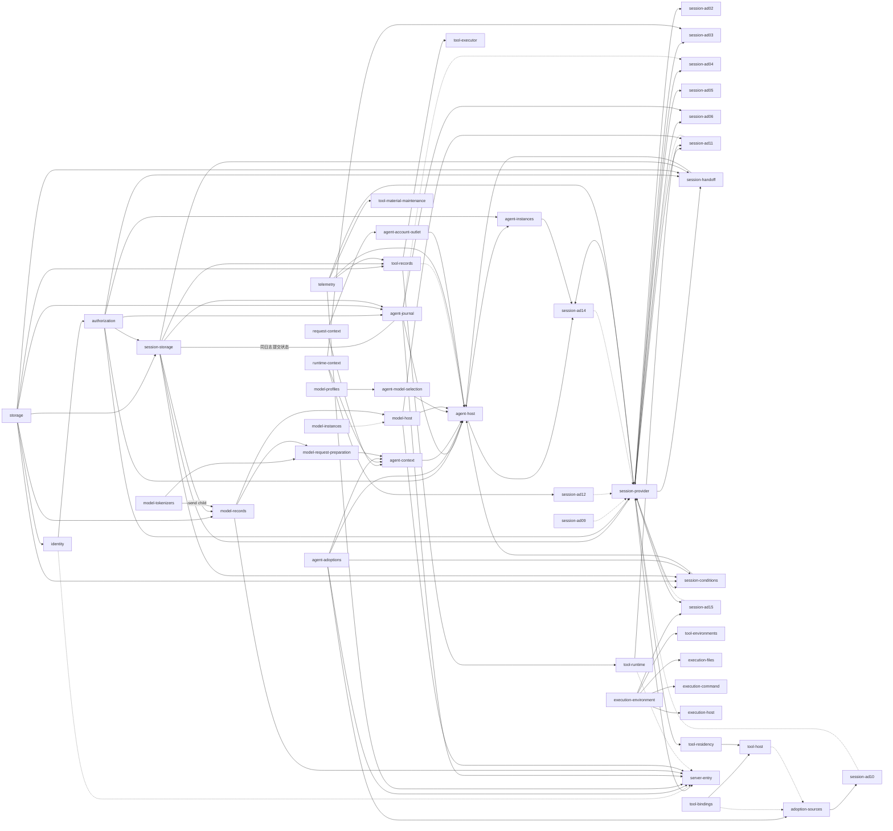

# 应用装配：单机首条租户路径

状态：[#677](https://github.com/nemori-ai/omne-harness-lite/issues/677) 的装配设计。它不表示应用成员或首条租户路径已经实现或验证；各成员的实际支持范围以成员 README 的支持范围表为准。

本页拥有单机首条租户路径的应用装配责任：进程里装哪些成员、每个成员以插件树的哪一行进入、装配入口提供哪些运行时对象、替身与真件在哪里切换，以及只能由应用装配承担的桥接。首条租户路径是：外部调用者创建租户、登录、发出第一次请求，收到第一条 Agent 纯消息回复，再读到历史。首条路径先验收纯消息回复；插件树同时列出工具与本地执行环境的装配，供后续工具往返使用，实际实现与验证归 M2。

插件树的格式与层叠归 [IC-15](../cordis-integration-conventions.md#ic-15)、[IC-16](../cordis-integration-conventions.md#ic-16)；运行时对象经装配入口提供归 [IC-1](../cordis-integration-conventions.md#ic-1)；共同宿主与配置归 [Cordis 集成](runtime-contract-integration.md#配置与插件树)；采用协调与重装归[定义求值与装配交接](../../domains/assembly-and-handoff/README.md)。本页不发布可运行的插件树。

## 进程与装配入口

首条租户路径是一个单机进程，由一个私有应用成员承载，它就是本页所说的应用装配。应用成员先确定规格、成员路径、包名、启动入口和公开依赖，再按 apps 的规范建立真实成员。现有 package-template 不适用于应用，本次不扩展通用模板。名字和目录须由该应用规格及获准任务确定，不由本页叙述授予。首条租户路径的应用成员是 `apps/harness-server`。

装配入口按下面的次序启动进程：

1. 读取发行层与运维者层，按行 id 层叠出最终插件树（[IC-16](../cordis-integration-conventions.md#ic-16)）。检查每行 inject 的受信名都在该行的可见集合内（见[受信子树](#受信子树)），不成立时启动失败。
2. 提供[运行时对象](#运行时对象)：根上下文的对象，以及受信子树各作用域内的对象。运行时对象不进插件树。宿主文件责任域在这一步创建一次，早于任何行装载。
3. 按插件树装载各行插件。受信子树的行装在只为它可见的受信名建立的上下文中，其余行装在根上。插件经 `inject` 取得必需服务，按调用现取的端口不进 `inject`。插件体构造时检查不能由 `inject` 表达的装配条件，不成立时抛出，该行 `FAILED`。
4. 等待全部行就绪。某一行停在 `PENDING` 时，装配入口报告缺哪一项必需服务，进程不开始接收消息；某一行 `FAILED` 时启动失败，分别诊断（[Cordis 集成](runtime-contract-integration.md#配置与插件树)）。
5. 全部行就绪后，装配入口调用 `server-entry` 登记的开始句柄，服务端接入开始在会话位置与治理位置接收消息。
6. 计划停止按应用成员规格的「有序关闭」执行：先关接入，再停业务，再关会话存储组合，最后关存储，报告确定之后才通知存储提供者。停业务之后对宿主文件责任域跑最后一次维护，剩余未结清的份数写进关闭报告。

## 插件树

下表是首条租户路径的发行层。行 id 是对运维者的稳定承诺；改名、删一行或换一行的插件属于发行层修订，要写进应用成员的当前说明与发行说明。运维者层只按行 id 替换配置、停用或插入行。

| 行 id                       | 成员与插件                                                                                                                                                                                                                                                                                                                                                                                                                                                                                                                                                                                                                                                                  | 提供                                                                                                                                                                                                                                                                                                                                                                                                                                                                                                                                                                                                                                                                                        | 必需（`inject`）                                                                                                                                                                                                                                                                                                                                                                                                                                                                         | 按调用现取                                                                                                                                                                                                                                                                                                                                                                                                                                                                 | 配置（可序列化）                                                                                                                                                                                                                                                                                                                                                                                                                                                                                                                                                                                                                                                                                                                                                                                                                                                                                                                                                                                                                                                                                                  |
| --------------------------- | --------------------------------------------------------------------------------------------------------------------------------------------------------------------------------------------------------------------------------------------------------------------------------------------------------------------------------------------------------------------------------------------------------------------------------------------------------------------------------------------------------------------------------------------------------------------------------------------------------------------------------------------------------------------------- | ------------------------------------------------------------------------------------------------------------------------------------------------------------------------------------------------------------------------------------------------------------------------------------------------------------------------------------------------------------------------------------------------------------------------------------------------------------------------------------------------------------------------------------------------------------------------------------------------------------------------------------------------------------------------------------------- | ---------------------------------------------------------------------------------------------------------------------------------------------------------------------------------------------------------------------------------------------------------------------------------------------------------------------------------------------------------------------------------------------------------------------------------------------------------------------------------------- | -------------------------------------------------------------------------------------------------------------------------------------------------------------------------------------------------------------------------------------------------------------------------------------------------------------------------------------------------------------------------------------------------------------------------------------------------------------------------- | ----------------------------------------------------------------------------------------------------------------------------------------------------------------------------------------------------------------------------------------------------------------------------------------------------------------------------------------------------------------------------------------------------------------------------------------------------------------------------------------------------------------------------------------------------------------------------------------------------------------------------------------------------------------------------------------------------------------------------------------------------------------------------------------------------------------------------------------------------------------------------------------------------------------------------------------------------------------------------------------------------------------------------------------------------------------------------------------------------------------- |
| `telemetry`                 | `@omne-harness/telemetry-node` 的 `./cordis` 插件（`node` 实现 `TelemetryNodePlugin`，或禁用实现 `DisabledTelemetryPlugin`），由装配入口按每次运行绑定的工厂行。整行是候选，待 [RFC-0013](../../rfcs/RFC-0013-engineering-telemetry.md) 接受                                                                                                                                                                                                                                                                                                                                                                                                                                | `telemetry`：工程遥测的端口（`bind` 一个作用域绑定得到发射器）                                                                                                                                                                                                                                                                                                                                                                                                                                                                                                                                                                                                                              | 无                                                                                                                                                                                                                                                                                                                                                                                                                                                                                       | 无                                                                                                                                                                                                                                                                                                                                                                                                                                                                         | 只放数据：`implementation`（`node` 或 `disabled`）、`outlet`（`stdout`、`stderr` 或带绝对路径的 `file`）、六项预算 `budgets`（发行层不写数值，运维者层给，R2-D229）。运行时对象（运行时、Cordis 日志桥、记录写函数）不进树。没有阶段：关闭是四个阶段之后、报告确定之前的一个显式步骤。行页见 [telemetry 行](../../../apps/harness-server/docs/rows/telemetry.md)                                                                                                                                                                                                                                                                                                                                                                                                                                                                                                                                                                                                                                                                                                                                                  |
| `storage`                   | 存储契约的 SQLite 提供者                                                                                                                                                                                                                                                                                                                                                                                                                                                                                                                                                                                                                                                    | `storage`：按事务域登记的存储服务（只在[受信存储子树](#受信子树)内可见）                                                                                                                                                                                                                                                                                                                                                                                                                                                                                                                                                                                                                    | `storageHost`、`assemblyLifecycle`                                                                                                                                                                                                                                                                                                                                                                                                                                                       | 无                                                                                                                                                                                                                                                                                                                                                                                                                                                                         | 存储根目录；[SQLite 提供者配置](../../../packages/storage/sqlite-provider/SPEC.md#121-配置)要求的四项数值（`admissionQueueLimit`、`lockWaitMs`、`maxCommandsPerCommit`、`maxCommandBytes`）；组提交与关闭期限的数值，按 SQL 提供者的配置。读结果上限 `maxReadResultBytes` 取 20971520（20 MiB，R2-D81），`globalReadResultBytes` 随之取 134217728；提供者在构造期拒绝任何 `maxOutputBytes` 超过它的读 handler。JSON 嵌套上限 `maxJsonDepth` 由发行配置给 128（R2-D270）：带首条输入的 `create` 约 69 层，提供者初值 64 会拒绝它；A2 的 Tool 意图材料按块保存，只有个位数层（R2-D372、R2-D380）；核对用例是 harness-server 的 `tests/rows/storage/release-depth.spec.ts`                                                                                                                                                                                                                                                                                                                                                                                                                                           |
| `identity`                  | `@omne-harness/identity-sql` 的 `./cordis` 插件                                                                                                                                                                                                                                                                                                                                                                                                                                                                                                                                                                                                                             | `identityOperations`（注册激活、签发登录、识别登录）；`tenantStanding`（受信）；`identityGovernance`（ID-18 治理端口，受信）。三项出自同一个提供者实例、同一份 identity 记录，治理端口的撤销与切换对登录识别生效                                                                                                                                                                                                                                                                                                                                                                                                                                                                            | `storage`、`identityClock`                                                                                                                                                                                                                                                                                                                                                                                                                                                               | 无                                                                                                                                                                                                                                                                                                                                                                                                                                                                         | 登录期限与空闲期限；邀请默认时长 `invitationDefaultDuration` 与最长时长 `invitationMaxDuration`（发行层初值 7 天与 30 天，R2-D204 第 7 项）。迁移 `identity/002-governance` 与读 handler `identity.governance`（输出上限 1 MiB，不超过 `storage` 行的 `maxReadResultBytes`）随本行材料进入发行目录；已有的发行数据库在本行 `registerCombination` 时执行 002                                                                                                                                                                                                                                                                                                                                                                                                                                                                                                                                                                                                                                                                                                                                                       |
| `authorization`             | 应用成员的授权适配插件                                                                                                                                                                                                                                                                                                                                                                                                                                                                                                                                                                                                                                                      | Session 身份桥使用的准入裁定；`agentAccessCheck`、`sessionAccessCheck`（含作用域释放恢复的三项系统请求：`scope-release-receive`、`scope-release-load` 与 `scope-release-query`）；`agentActionAdmission`；`systemActionAuthorization`（系统动作授权，受信，见[系统动作授权](#system-action-authorization)）                                                                                                                                                                                                                                                                                                                                                                                 | `tenantStanding`（受信）、`principalVerifier`（受信）、`identityClock`（维护授予到期的判定时钟，每次判断到期时重新读取）                                                                                                                                                                                                                                                                                                                                                                 | 无                                                                                                                                                                                                                                                                                                                                                                                                                                                                         | `actionRules`；`maintenanceGrants`：运维者对随版本内置的维护授予表只能收回某项（`revoked: true`）或设到期（`expiresAt`），不能新增；表外授予项、改用途、主体或范围的配置让本行启动失败（R2-D204 第 2 项）。收回与到期对本行的三个访问裁定和 `systemActionAuthorization` 同样生效。发行层写空对象                                                                                                                                                                                                                                                                                                                                                                                                                                                                                                                                                                                                                                                                                                                                                                                                                  |
| `session-storage`           | 应用成员的会话存储组合插件：在同一插件体内构造租户到事务域的目录与 `@omne-harness/session-storage-sql` 根入口的纯提供者，目录的存储构造能力只经闭包交给后者                                                                                                                                                                                                                                                                                                                                                                                                                                                                                                                 | `sessionTransactions`；`sessionDelegatedTransactions`（会话委派事务，受信）；`tenantDomains`（只含部署枚举 `enumerate`）；`tenantDomainLookup`（已发布快照的只读查找，受信）；`sessionPrincipalBindings`（会话归属读口，受信）                                                                                                                                                                                                                                                                                                                                                                                                                                                              | `storage`、`sessionAccessCheck`、`assemblyLifecycle`                                                                                                                                                                                                                                                                                                                                                                                                                                     | `sessionCursorSigning`；`systemActionAuthorization`（受信；部署枚举每次调用都经它判断，缺席或答 `unavailable` 时枚举答 `unavailable`，不放行；本行不持有授予表，R2-D245）                                                                                                                                                                                                                                                                                                  | 事务域推导规则；组合版本；登记表的文件位置（在存储根目录下）；介质（与 `storage` 行相同的 SQLite）；`pageBytes` 上限；`maxScanPerPage`；`maxRegistrationRetries`；快照重建方式。其余字段取 Session SQL 纯工厂配置的初值。见[租户到事务域的目录](#租户到事务域的目录)                                                                                                                                                                                                                                                                                                                                                                                                                                                                                                                                                                                                                                                                                                                                                                                                                                              |
| `session-provider`          | `@omne-harness/session-cordis` 的插件                                                                                                                                                                                                                                                                                                                                                                                                                                                                                                                                                                                                                                       | `session`（四个面）；协调器与调度器，含推进触发调度器 S1                                                                                                                                                                                                                                                                                                                                                                                                                                                                                                                                                                                                                                    | `sessionAccessCheck`、`sessionDelegatedTransactions`（受信）、`sessionPrincipals`、`sessionWorkPrincipals`（受信）、`assemblyLifecycle`、`telemetry`（候选，待 RFC-0013 接受：行体在它上面构造 Session 遥测 facade，把 `measure` 与 `diagnose` 交给插件；记录按访问的租户作用域）                                                                                                                                                                                                        | `sessionIdentity`、`sessionEvidence`、`sessionContextInput`、`sessionIdleInput`、`sessionAgentDrive`、`sessionScopeRelease`、`sessionClock`、`sessionNotifier`、`sessionTransactions`（只服务 `pending`、`references`、`releasedScopes` 三项目录读取）                                                                                                                                                                                                                     | `admission: 'none'`（本部署没有命令域与 hooks）                                                                                                                                                                                                                                                                                                                                                                                                                                                                                                                                                                                                                                                                                                                                                                                                                                                                                                                                                                                                                                                                   |
| `session-ad02`              | AD-02 Agent 同日志解释（session-adapters 的 `createSessionJournalInterpretationPlugin`，B1 已接）                                                                                                                                                                                                                                                                                                                                                                                                                                                                                                                                                                           | 无                                                                                                                                                                                                                                                                                                                                                                                                                                                                                                                                                                                                                                                                                          | `session`（`'coordinator'`）、`sessionTransactions`（`commitLog` 所在的端口，日志解释的写口，与 AD-05 同构）；`storage`、`tenantDomainLookup`（受信，只读该 execution 的执行记录分区）；`sessionWorkPrincipals`（受信，取协调者主体）                                                                                                                                                                                                                                                    | 协调者主体来源（经受信 `sessionWorkPrincipals` 的 `forSession` 构造）                                                                                                                                                                                                                                                                                                                                                                                                      | 无：插件不取配置                                                                                                                                                                                                                                                                                                                                                                                                                                                                                                                                                                                                                                                                                                                                                                                                                                                                                                                                                                                                                                                                                                  |
| `session-ad03`              | AD-03 持有者与生产者（session-adapters 的 `createSessionContextHolder`，B1 已接：持有者、回放与事实三个子插件来自同一次工厂调用）                                                                                                                                                                                                                                                                                                                                                                                                                                                                                                                                           | `runtimeContextReaderEligibility`（K-RC，模型类读者资格）；`sessionReplayFacts`、`sessionScopeLookup`（事实子插件）                                                                                                                                                                                                                                                                                                                                                                                                                                                                                                                                                                         | `runtimeContext`、`session`（`'reader'`，R2-D238）                                                                                                                                                                                                                                                                                                                                                                                                                                       | `sessionWorkPrincipals`（受信，取协调者主体）；提交翻译取发行采用定义的 Context 声明表                                                                                                                                                                                                                                                                                                                                                                                     | `scopeIndexEntries`（索引上界）、`pageBytes`（历史读页大小），由运维者层给                                                                                                                                                                                                                                                                                                                                                                                                                                                                                                                                                                                                                                                                                                                                                                                                                                                                                                                                                                                                                                        |
| `session-ad04`              | AD-04 历史源（session-adapters 的 `createSessionHistorySource`，B1 已接）                                                                                                                                                                                                                                                                                                                                                                                                                                                                                                                                                                                                   | `contextHolderSources`（K-RQ 持有者部件）                                                                                                                                                                                                                                                                                                                                                                                                                                                                                                                                                                                                                                                   | `session`（`'reader'`；下界子插件 `'coordinator'`）                                                                                                                                                                                                                                                                                                                                                                                                                                      | 历史头解码 `historySessionOf`；`sessionAdoptedRequests`（会话自己记录的固定请求事实，`agent-journal` 行的提供者给出），窄采用来源 `adopted` 每次读取时现取，缺席时答不可用                                                                                                                                                                                                                                                                                                 | `scopeIndexEntries`、`pageBytes`，由运维者层给                                                                                                                                                                                                                                                                                                                                                                                                                                                                                                                                                                                                                                                                                                                                                                                                                                                                                                                                                                                                                                                                    |
| `session-ad05`              | AD-05 Model 日志消费适配（session-adapters 的 `createSessionModelLogConsumptionPlugin`，B1 已接）                                                                                                                                                                                                                                                                                                                                                                                                                                                                                                                                                                           | 无                                                                                                                                                                                                                                                                                                                                                                                                                                                                                                                                                                                                                                                                                          | `session`（`'coordinator'`）；`agentJournal`、`agentJournalEntries`（条目端口）、`agentMaterials`（同一 Journal 提供者）；`sessionTransactions`（`commitEntries` 所在的端口）；`sessionWorkPrincipals`（受信，取协调者主体）                                                                                                                                                                                                                                                             | 协调者主体来源                                                                                                                                                                                                                                                                                                                                                                                                                                                             | 无：插件不取配置                                                                                                                                                                                                                                                                                                                                                                                                                                                                                                                                                                                                                                                                                                                                                                                                                                                                                                                                                                                                                                                                                                  |
| `session-ad06` | AD-06 Tool 日志消费适配 | 无 | `session`（`'coordinator'`）；同一 Journal 提供者的 results、条目与材料视图（`agentJournal`、`agentJournalEntries`、`agentMaterials`）；`sessionTransactions`（`commitEntries` 所在的端口，后果、进度与答案的同批提交只经它）；`sessionWorkPrincipals`（受信，取协调者主体） | 协调者主体来源；Agent 自有交付材料解码 | 超时与重试退避 |
| `session-ad09`              | AD-09 身份桥                                                                                                                                                                                                                                                                                                                                                                                                                                                                                                                                                                                                                                                                | `sessionIdentity`                                                                                                                                                                                                                                                                                                                                                                                                                                                                                                                                                                                                                                                                           | `principalVerifier`（受信）                                                                                                                                                                                                                                                                                                                                                                                                                                                              | 无                                                                                                                                                                                                                                                                                                                                                                                                                                                                         | 无                                                                                                                                                                                                                                                                                                                                                                                                                                                                                                                                                                                                                                                                                                                                                                                                                                                                                                                                                                                                                                                                                                                |
| `session-ad10`              | AD-10 证据桥                                                                                                                                                                                                                                                                                                                                                                                                                                                                                                                                                                                                                                                                | `sessionEvidence`                                                                                                                                                                                                                                                                                                                                                                                                                                                                                                                                                                                                                                                                           | 装配采用、生产来源与保管来源的服务（键见缺口表）                                                                                                                                                                                                                                                                                                                                                                                                                                         | 无                                                                                                                                                                                                                                                                                                                                                                                                                                                                         | 无                                                                                                                                                                                                                                                                                                                                                                                                                                                                                                                                                                                                                                                                                                                                                                                                                                                                                                                                                                                                                                                                                                                |
| `session-ad11`              | AD-11 空闲输入                                                                                                                                                                                                                                                                                                                                                                                                                                                                                                                                                                                                                                                              | `sessionIdleInput`                                                                                                                                                                                                                                                                                                                                                                                                                                                                                                                                                                                                                                                                          | `modelRuntime`、`toolRuntime`、`session`（`'maintainer'`）                                                                                                                                                                                                                                                                                                                                                                                                                               | 无                                                                                                                                                                                                                                                                                                                                                                                                                                                                         | 无                                                                                                                                                                                                                                                                                                                                                                                                                                                                                                                                                                                                                                                                                                                                                                                                                                                                                                                                                                                                                                                                                                                |
| `session-ad12`              | AD-12 Context 输入                                                                                                                                                                                                                                                                                                                                                                                                                                                                                                                                                                                                                                                          | `sessionContextInput`                                                                                                                                                                                                                                                                                                                                                                                                                                                                                                                                                                                                                                                                       | `runtimeContext`                                                                                                                                                                                                                                                                                                                                                                                                                                                                         | `sessionWorkPrincipals`（受信，取协调者主体）                                                                                                                                                                                                                                                                                                                                                                                                                              | 无                                                                                                                                                                                                                                                                                                                                                                                                                                                                                                                                                                                                                                                                                                                                                                                                                                                                                                                                                                                                                                                                                                                |
| `session-ad14`              | AD-14 `AgentDrivePort`（session-adapters 的 `createSessionAgentDrivePlugin`，SC4 已接，R2-D162）                                                                                                                                                                                                                                                                                                                                                                                                                                                                                                                                                                            | `sessionAgentDrive`                                                                                                                                                                                                                                                                                                                                                                                                                                                                                                                                                                                                                                                                         | `agentInstances`、`agentInstanceProvision`、`agentExecutionRecovery`、`agentExecutionControl`、`session`（`'coordinator'`）                                                                                                                                                                                                                                                                                                                                                              | `sessionWorkPrincipals`（受信，取协调者主体）                                                                                                                                                                                                                                                                                                                                                                                                                              | 无                                                                                                                                                                                                                                                                                                                                                                                                                                                                                                                                                                                                                                                                                                                                                                                                                                                                                                                                                                                                                                                                                                                |
| `session-ad15`              | AD-15 作用域释放，含重新释放子插件                                                                                                                                                                                                                                                                                                                                                                                                                                                                                                                                                                                                                                          | `sessionScopeRelease`                                                                                                                                                                                                                                                                                                                                                                                                                                                                                                                                                                                                                                                                       | `executionEnvironment`（`caller: 'maintainer'`）；子插件还需 `session`（`'maintainer'`）                                                                                                                                                                                                                                                                                                                                                                                                 | 构造时交入恢复授权                                                                                                                                                                                                                                                                                                                                                                                                                                                         | 超时、重试退避与重新释放页大小                                                                                                                                                                                                                                                                                                                                                                                                                                                                                                                                                                                                                                                                                                                                                                                                                                                                                                                                                                                                                                                                                    |
| `session-handoff`           | session-adapters 的 J06 消息准入插件（`createSessionMessageHandoffPlugin`，B1 已接）                                                                                                                                                                                                                                                                                                                                                                                                                                                                                                                                                                                        | `agentMessageHandoff`                                                                                                                                                                                                                                                                                                                                                                                                                                                                                                                                                                                                                                                                       | `session`（`'coordinator'`）、`agentAccessCheck`；`storage`、`tenantDomainLookup`（受信存储子树；只对已登记租户查找事务域，不触发登记）；`sessionWorkPrincipals`（受信，取协调者主体）                                                                                                                                                                                                                                                                                                   | 协调者主体来源；调用者稳定身份文本；本提供者的采用身份                                                                                                                                                                                                                                                                                                                                                                                                                     | `combinationVersion`、`manifestDigest`：与 `agent-journal` 行相同的会话日志组合。准入记录落 `execution-record` 参加者的 `er_preadmission` 表，见[租户到事务域的目录](#租户到事务域的目录)                                                                                                                                                                                                                                                                                                                                                                                                                                                                                                                                                                                                                                                                                                                                                                                                                                                                                                                         |
| `session-conditions`        | session-adapters 的 J06 当前条件插件（`createSessionConditionsPlugin`，最小实现，SC1 已接，R2-D145）。以原 Authority 经执行索引定位会话，Run 持有该 execution 且 Journal 记录的 attempt 为当前 attempt 才读；`configuration` 取 Run 采用，`progression` 由协作模式投影（`co-work` → `evaluate-completion`，`auto-drive` → `continue`），`model` 取已保存路由的采用依据，`context` 取未结束的 Runtime Context 作用域，`bindings` 取常驻工具；缺任何来源答 `unavailable`，不补默认。完整设计（`adoptionCoordinator` 读口）归波 4，形状不变                                                                                                                                    | `agentConditions`                                                                                                                                                                                                                                                                                                                                                                                                                                                                                                                                                                                                                                                                           | `session`（`'coordinator'`，调用方 Access 只经此面核访问）；子插件 `session-conditions-selection` 另 `inject` `session`（`'maintainer'`），只读保存的模型选择，因为 `readModelSelection` 只接受 `intake` 与 `maintainer`，每个插件只用一个调用方类（session-adapters AD-00 第 1 条）；`storage`、`tenantDomainLookup`（受信存储子树；执行索引与 Journal 的 attempt 记录）；`definitionMappings`（受信；解出 `tenant-default` 模式的值，映射条目的模式采用须与创建所记来源逐字相等）      | 租户默认模式解析器（基于受信 `definitionMappings` 构造）                                                                                                                                                                                                                                                                                                                                                                                                                   | 无                                                                                                                                                                                                                                                                                                                                                                                                                                                                                                                                                                                                                                                                                                                                                                                                                                                                                                                                                                                                                                                                                                                |
| `agent-journal`             | session-adapters 的会话日志 Journal 提供者                                                                                                                                                                                                                                                                                                                                                                                                                                                                                                                                                                                                                                  | `agentJournal`；同一提供者兑现 `AgentJournalEntries` 与 `AgentMaterials`，并兑现 AD-01 Agent 同日志提交参加者（不另装 `session-ad01` 行）；`agentReceivedCommits`、`agentModelReceptionTargets`（Model 结果接收方的两个面：接收共同提交与稳定目标查询，`agent-host` 注入，R2-D237）；`agentToolReceptionTargets`（Tool 结果接收方的稳定目标查询，`agent-host` 的 Tool 接收子插件注入，R2-D273）；`agentReceivedRecords`（同一份接收记录的只读面，受信，只对本行与 `model-records` 可见；Agent consumer owner 的证据适配器经它核验 Model 的 ACK，R2-D257）；`sessionAdoptedRequests`（会话日志里主用途 M0 记下的固定请求事实，`session-ad04` 按调用现取；根上的名字，不在受信表里，R2-D246） | `sessionAccessCheck`（派生的 Session 参加按 Session 操作裁定）；`storage`、`tenantDomainLookup`（受信存储子树；只对已登记租户查找事务域，不触发登记）；与 `session-storage` 共用会话日志提交状态                                                                                                                                                                                                                                                                                         | 无                                                                                                                                                                                                                                                                                                                                                                                                                                                                         | 组合版本与清单摘要，取自会话存储组合的声明（提交请求要带它们）                                                                                                                                                                                                                                                                                                                                                                                                                                                                                                                                                                                                                                                                                                                                                                                                                                                                                                                                                                                                                                                    |
| `agent-adoptions`           | 应用成员的采用适配插件                                                                                                                                                                                                                                                                                                                                                                                                                                                                                                                                                                                                                                                      | `agentAdoptions`；`definitionMappings`（受信，与 `agentAdoptions` 出自同一份解析表与内容身份）                                                                                                                                                                                                                                                                                                                                                                                                                                                                                                                                                                                              | 无                                                                                                                                                                                                                                                                                                                                                                                                                                                                                       | 无                                                                                                                                                                                                                                                                                                                                                                                                                                                                         | [定义名映射](#桥接责任)                                                                                                                                                                                                                                                                                                                                                                                                                                                                                                                                                                                                                                                                                                                                                                                                                                                                                                                                                                                                                                                                                           |
| `adoption-sources`          | 应用成员的采用来源插件，实现 Session 的 `SessionAdoptionSource`。对 `create` 出具 Session 的初始化守卫（[初始化守卫编码](../../../packages/session/session-contract/SPEC.md#初始化守卫编码)）：初始采用是部署映射的条目，计划与要求是该条目的 `requiredIdentities`，来源与结果为空；常驻工具是条目 `residentCapabilities` 列出的工具，以本次 `SessionAccess` 经采用规划器解出，首次定义取自受信发行快照，任何一项解不出答 `unavailable`（G-RESIDENTS，R2-D159）；创建声明了映射没有的来源、结果或常驻工具时答 `invalid`。`startRun`、`reload` 仍出具映射材料，常驻工具的冻结判定经 `plan` 给出，见[桥接责任](#桥接责任)。本行也是领域角色「采用协调」的装配协调者，不另开行 | `sessionAdoptionSource`                                                                                                                                                                                                                                                                                                                                                                                                                                                                                                                                                                                                                                                                     | `definitionMappings`（受信）                                                                                                                                                                                                                                                                                                                                                                                                                                                             | `toolBindings`（`snapshot(access)` 读登记表）；`toolGenerations`（`ensureLoaded` 首装）                                                                                                                                                                                                                                                                                                                                                                                    | 无                                                                                                                                                                                                                                                                                                                                                                                                                                                                                                                                                                                                                                                                                                                                                                                                                                                                                                                                                                                                                                                                                                                |
| `agent-model-selection`     | 应用成员的模型选择适配插件，实现 Agent 的 `ModelSelection`。从 execution 经执行索引找到会话，核对活动 Run 持有该 execution，再读回会话保存的选择；找不到答 `unavailable`，Run 已结束答 `terminal`，Run 不符答 `denied`（G-SELECT，R2-D160）                                                                                                                                                                                                                                                                                                                                                                                                                                 | `agentModelSelection`                                                                                                                                                                                                                                                                                                                                                                                                                                                                                                                                                                                                                                                                       | `modelProfiles`                                                                                                                                                                                                                                                                                                                                                                                                                                                                          | `storage`、`tenantDomainLookup`（受信存储子树；读执行索引与会话保存的选择）                                                                                                                                                                                                                                                                                                                                                                                                | 无                                                                                                                                                                                                                                                                                                                                                                                                                                                                                                                                                                                                                                                                                                                                                                                                                                                                                                                                                                                                                                                                                                                |
| `agent-host`                | `@omne-harness/agent-host-local` 的宿主插件（`createAgentHostLocalPlugin`，SC4 已接，R2-D162）                                                                                                                                                                                                                                                                                                                                                                                                                                                                                                                                                                              | Agent 宿主、`agentPublicationAuthority`、`agentExecutionRecovery`、`agentExecutionControl`、`agentInstanceProvision`                                                                                                                                                                                                                                                                                                                                                                                                                                                                                                                                                                        | `agentJournal`、`agentJournalEntries`、`agentMaterials`、`agentReceivedCommits`、`agentModelReceptionTargets`、`agentAccessCheck`、`agentAdoptions`、`agentConditions`、`agentRequests`、`agentModelSelection`、`agentModelContext`、`agentMessageHandoff`、`agentAccountOutlet`、`modelRuntime`、`agentClock`、`agentHostPrincipal`、`assemblyLifecycle`、`telemetry`（候选，待 RFC-0013 接受：行体在它上面构造 Agent 遥测 facade，作为每个运行时的 `measure`；记录按执行的租户作用域） | `toolRuntime`，在工具阶段取得；Tool 接收子插件静态注入 `toolRuntime` 与 `agentToolReceptionTargets`，二者缺席时只有子插件停在 `PENDING`（R2-D273）；`toolStartFence`，要使启动失效时先预检，再在子 fiber 取得；其余局部依赖见[宿主的 Cordis 页](../../../packages/agent/agent-host-local/docs/cordis.md#局部依赖与可选依赖)                                                                                                                                                | `jointCommits`：与 Journal 提供者支持的共同提交种类一致，必须含 `message`，行 schema 在装载时核对（R2-D93）；`coordination`：与 Journal 绑定声明的协调能力相等。这两项由发行层写出，运维者层整行替换时必须重抄（R2-D162）。`instanceIdleMs`：实例空闲回收时长；Agent [工厂配置](../../../packages/agent/agent/docs/public-api.md#工厂配置)的其余项由运维者层给                                                                                                                                                                                                                                                                                                                                                                                                                                                                                                                                                                                                                                                                                                                                                    |
| `agent-instances`           | `@omne-harness/agent-cordis-contract` 的 `agentInstancesPlugin`                                                                                                                                                                                                                                                                                                                                                                                                                                                                                                                                                                                                             | `agentInstances`                                                                                                                                                                                                                                                                                                                                                                                                                                                                                                                                                                                                                                                                            | `agentPublicationAuthority`、`agentAccessCheck`                                                                                                                                                                                                                                                                                                                                                                                                                                          | 无                                                                                                                                                                                                                                                                                                                                                                                                                                                                         | 无                                                                                                                                                                                                                                                                                                                                                                                                                                                                                                                                                                                                                                                                                                                                                                                                                                                                                                                                                                                                                                                                                                                |
| `model-host`                | `@omne-harness/model-host-local` 的 `ModelRuntimeLocalPlugin`                                                                                                                                                                                                                                                                                                                                                                                                                                                                                                                                                                                                               | `modelRuntime`、`modelInstanceHost`                                                                                                                                                                                                                                                                                                                                                                                                                                                                                                                                                                                                                                                         | `modelCommands`、`modelClock`、`modelHostAuthority`                                                                                                                                                                                                                                                                                                                                                                                                                                      | 发送、重试与目录由局部阶段子插件取得，发送阶段取 `model-records` 行提供的 `modelSendBoundary`；推送阶段按 `ConsumerRef.owner` 读本插件的接收登记表                                                                                                                                                                                                                                                                                                                         | 并发上限、唤醒容量、扫描批次与扫描间隔，按[Model 装配设计](../../../packages/model/model/docs/cordis.md#单机提供者的插件划分)；`ModelConfiguration` 的 8 个数与结果推送限额 `ResultPushLimits` 的 5 个数，行体自校验，值注明来源为 E9 初值乘 1.5，首测后按曲线改运维者层配置；发行层不写数值，全部由运维者层给。不进配置的对象：`qualifyObservation` 复用应用 Model 模块权威的 `observe`（先核验观察者）；`modelRetryPolicy` 以恒 `unavailable` 的对象注入，M2 不做重试策略，首内容前停顿长期显示 `running`，用户仍可取消，记已知限制；`executionChannel` 与 `releaseExecution` 取自入口运行级组合。行体承载 `business` 阶段：业务停止 dispose 宿主子 fiber。接线见[Model 生产接线](../../../apps/harness-server/docs/rows/model-release.md)                                                                                                                                                                                                                                                                                                                                                                      |
| `model-instances`           | `@omne-harness/model-host-local` 的 `ModelInstancesLocalPlugin`                                                                                                                                                                                                                                                                                                                                                                                                                                                                                                                                                                                                             | `modelInstances`                                                                                                                                                                                                                                                                                                                                                                                                                                                                                                                                                                                                                                                                            | `modelPublicationAuthority`                                                                                                                                                                                                                                                                                                                                                                                                                                                              | 无                                                                                                                                                                                                                                                                                                                                                                                                                                                                         | 无；失去目录只影响路由取得                                                                                                                                                                                                                                                                                                                                                                                                                                                                                                                                                                                                                                                                                                                                                                                                                                                                                                                                                                                                                                                                                        |
| `model-converters`          | 同成员的 `ModelConvertersLocalPlugin`                                                                                                                                                                                                                                                                                                                                                                                                                                                                                                                                                                                                                                       | `modelConverters`。M2 内没有消费方，不被任何行 `inject`；目录独立于运行时与结果查询                                                                                                                                                                                                                                                                                                                                                                                                                                                                                                                                                                                                         | `modelConverterAuthority`                                                                                                                                                                                                                                                                                                                                                                                                                                                                | 无                                                                                                                                                                                                                                                                                                                                                                                                                                                                         | 无；独立于运行时与结果查询                                                                                                                                                                                                                                                                                                                                                                                                                                                                                                                                                                                                                                                                                                                                                                                                                                                                                                                                                                                                                                                                                        |
| `model-tokenizers`          | 应用持有一个有界本地分词执行器，固定加载本发行的词表；服务定义来自 `tokenizer-tiktoken/cordis`                                                                                                                                                                                                                                                                                                                                                                                                                                                                                                                                                                              | `modelTokenizers`                                                                                                                                                                                                                                                                                                                                                                                                                                                                                                                                                                                                                                                                           | 无                                                                                                                                                                                                                                                                                                                                                                                                                                                                                       | 无                                                                                                                                                                                                                                                                                                                                                                                                                                                                         | 线程数、租约数、任务/队列/输入/缓存上限、作业截止与故障替换限额均由运维者给出。两个家族装配点借同一服务，不各建池。`composition` 阶段关闭并等待真实worker退出；准备行撤除不关闭池                                                                                                                                                                                                                                                                                                                                                                                                                                                                                                                                                                                                                                                                                                                                                                                                                                                                                                                                 |
| `model-profiles`            | Model 档案读取提供者，继承 `ModelProfilesService`                                                                                                                                                                                                                                                                                                                                                                                                                                                                                                                                                                                                                           | `modelProfiles`                                                                                                                                                                                                                                                                                                                                                                                                                                                                                                                                                                                                                                                                             | 档案读取、当前身份与设置、凭据状态元数据适配器，精确跨域键归提供者                                                                                                                                                                                                                                                                                                                                                                                                                       | 无                                                                                                                                                                                                                                                                                                                                                                                                                                                                         | 无                                                                                                                                                                                                                                                                                                                                                                                                                                                                                                                                                                                                                                                                                                                                                                                                                                                                                                                                                                                                                                                                                                                |
| `model-request-preparation` | `@omne-harness/model-host-local` 的准备插件，继承 `ModelRequestPreparationService`                                                                                                                                                                                                                                                                                                                                                                                                                                                                                                                                                                                          | `modelRequestPreparation`                                                                                                                                                                                                                                                                                                                                                                                                                                                                                                                                                                                                                                                                   | `modelCommands`、`modelTokenizers`                                                                                                                                                                                                                                                                                                                                                                                                                                                       | `modelCredential`：补全供应商的凭据引用。租户有自己的绑定时给租户引用，没有时给 factory 引用。读不出绑定是否存在时准备失败，不退回 factory                                                                                                                                                                                                                                                                                                                                 | `maxCitedCalls`（一条世系最多指名的调用数）；`openai.maxSerializedBytes`（完整计量JSON的UTF-8上限）；`openai.limits`（工具参数解码的六项上限与 `maxReasoningText`）与 `openai.margin`（输入估计的百分比余量 `percent` 及其采用来源 `source`）。每项都由运维者给出，没有初值；不依赖 `modelRuntime` 或供应商网络。同一 OpenAI 家族配置在 `model-records` 行的发送子插件里也用，装载器断言两处相等                                                                                                                                                                                                                                                                                                                                                                                                                                                                                                                                                                                                                                                                                                                  |
| `model-credential`          | `@omne-harness/model-host-local` 的受管凭据插件（`createLocalCredentialPlugin`），行体以子 fiber 装载                                                                                                                                                                                                                                                                                                                                                                                                                                                                                                                                                                       | `modelCredential`；`modelCredentialCustody`（受信，本应用的服务键，见[模型凭据管理](#model-credential-custody)）                                                                                                                                                                                                                                                                                                                                                                                                                                                                                                                                                                            | 无                                                                                                                                                                                                                                                                                                                                                                                                                                                                                       | `principalVerifier`、`tenantStanding`（受信，凭据管理的准入）。缺席时管理答 `basis-unavailable`，行不停在 `PENDING`                                                                                                                                                                                                                                                                                                                                                        | 保管库配置，见[凭据插件](../../../packages/model/model-host-local/docs/cordis.md#生命周期与清理)                                                                                                                                                                                                                                                                                                                                                                                                                                                                                                                                                                                                                                                                                                                                                                                                                                                                                                                                                                                                                  |
| `model-records`             | 应用成员的 Model 耐久记录仓插件：`ModelCommands` 的 SQL 实现与迁移片段由 Model 线交付，插件接线由应用成员交付。行体以子 fiber 装 `ModelSendStagePlugin`，`coordinator` 只经闭包交给它；发送子 fiber 另注入 `modelTokenizers`；凭据或分词服务缺席只让子 fiber 停在 `PENDING`，不卸 `modelCommands`。同一插件体再装 model-storage-sql 的 `createSqlModelDiagnosticsPlugin`，提供 `modelDiagnostics`（RFC-0013 revision 2 本地范围）                                                                                                                                                                                                                                                 | `modelCommands`、`modelSendBoundary`、`modelDiagnostics`（候选）。三键读同一租户域的同一份记录，由同一插件体提供，属同提供者组 `model-records`                                                                                                                                                                                                                                                                                                                                                                                                                                                                                                                                              | `storage`、`tenantDomainLookup`（受信存储子树；只对已登记租户查找事务域，不触发登记）、`modelClock`、`principalVerifier`（受信）、`tenantStanding`（受信）                                                                                                                                                                                                                                                                                                                               | `agentReceivedRecords`（受信，`agent-journal` 行提供）：Agent consumer owner 的证据适配器按调用现取，按耐久接收记录核验 ACK 的 retained 证据；缺席或读不到时 ACK 答 `unavailable`（R2-D257）                                                                                                                                                                                                                                                                               | 行配置只放数据：成员部分 `owners`（`work` 取 `exempt`，M2 没有 Model 与 Agent 的共同提交）、`limits`、`maxCallBytes`、`maxCommandBytes`、`combinationVersion`（与 `session-storage` 行相等）、`send` 的镜像上限；应用部分 `initial`（首次执行记录的上限）与 `sendStage`（发送子插件的上限、工厂凭据查询 id、官方档案输入、准备与 OpenAI 家族配置、网络、路由、传输上限）；诊断部分 `diagnostics`（候选，待 RFC-0013 接受；`diagnosticsRead` 只取 `tenant-self`，`retention` 是保留采用；缺 `retention` 时 `modelDiagnostics.list` 一律答 `unavailable`）。全部由运维者层给，发行层不写数值。`authority`、`evidence`、`send.sources`、`initialRun` 由应用成员的 Model 应用模块（`src/model/`）以对象构造，不进配置。装载时核跨行相等：`limits.resultPageTargetBytes`、`readIdleMs` 与 `model-host.runtime` 同名值，`combinationVersion` 与 `session-storage`，`sendStage.preparation` 与 `model-request-preparation`，`sendStage.profiles` 与 `model-profiles`。与会话日志同一事务域，见[租户到事务域的目录](#租户到事务域的目录)；接线见[Model 生产接线](../../../apps/harness-server/docs/rows/model-release.md) |
| `tool-records`              | 耐久 Tool 记录仓插件：一个插件体、一个记录仓、一个启动协调器；成员是 `@omne-harness/tool-storage-sql`。装 `createLocalToolRuntimePlugins` 一次调用所建 bundle 的 records 插件，Tool 五行共用这个 bundle（Tool B 段，R2-D185，见 [Tool 运行时行页](../../../apps/harness-server/docs/rows/tool-runtime.md)）                                                                                                                                                                                                                                                                                                                                                                 | `toolCommands`、`toolReads`、`toolStartAuthority`、`toolStartFence`。后两键是同一启动协调器的两个视图，属同提供者组 `tool-start`                                                                                                                                                                                                                                                                                                                                                                                                                                                                                                                                                            | `storage`、`tenantDomainLookup`（受信存储子树；只对已登记租户查找事务域，不触发登记）、`telemetry`、`tenantDomains`、`systemActionAuthorization`、`tenantDomainScannerPrincipal`、`toolHistoryUpgraderPrincipal` | 无                                                                                                                                                                                                                                                                                                                                                                                                                                                                         | 整组 Tool 运行时的运维者配置都在本行：`maxCommandBytes`（装配把交给 `storage` 行的同一个值交给本行，两行不得不同）；`filesRoot`（与 `execution-host` 行相同）；`combinationVersion`（与 `session-storage` 行相同）；`maxChunkBytes`；`history`（默认只检查，显式升级才转换）；`configuration`（`ToolConfiguration` 的全部字段）；`capacity` 与观察者的三项上限（`observersPerCall`、`observerQueueFrames`、`observerResidenceMs`）。发行层写空对象，缺任何一项装载失败。与会话日志同一事务域，`tool` 参加者并入会话存储组合，见[租户到事务域的目录](#租户到事务域的目录)                                                                                                                                                                                                                                                                                                                                                                                                                                                                                                                                                                                   |
| `tool-material-maintenance` | Tool 材料后台维护应用行；复用 Tool/Host/SQL 工厂；business 关闭阶段 | 无公开服务 | `storage`、`tenantDomainLookup`、`tenantDomains`、`systemActionAuthorization`、`tenantDomainScannerPrincipal`、`toolMaterialMaintainerPrincipal`、`toolInstanceHost`、`telemetry` | 当前授权每次从行上下文取得 | `combinationVersion`、`maxCommandBytes`、`maxChunkBytes`、`ledgerCommitAttempts`、`intervalMs`、`pageSize`；同存储组合，页大小 1–128，定时器为有限正数 |
| `tool-bindings`             | 绑定登记表与 Catalog 的插件：tool-host-local 的 `createLocalToolBindingsPlugin`，应用成员导出 `toolBindingsRow`。一个插件、一个 fiber 提供两个服务：类静态提供 `toolBindings`，构造时注册 `toolCatalog`                                                                                                                                                                                                                                                                                                                                                                                                                                                                     | `toolBindings`、`toolCatalog`                                                                                                                                                                                                                                                                                                                                                                                                                                                                                                                                                                                                                                                               | `toolContributionAuthority`（运行时对象）                                                                                                                                                                                                                                                                                                                                                                                                                                                | `principalVerifier`（受信，可用性核验主体）；`toolStartAuthority`（启动权威的窄代理，波 2 B 段改接 Tool 运行时组的同一组插件）                                                                                                                                                                                                                                                                                                                                             | 无。与 `tool-records` 分行，Catalog 不与持久 Commands/Reads 共用一个会连带卸载的 fiber                                                                                                                                                                                                                                                                                                                                                                                                                                                                                                                                                                                                                                                                                                                                                                                                                                                                                                                                                                                                                            |
| `tool-runtime`              | `@omne-harness/tool-host-local` 的门面插件（同一 bundle，Tool B 段已接）；不带关闭阶段，门面不持有在途工作                                                                                                                                                                                                                                                                                                                                                                                                                                                                                                                                                                  | `toolRuntime`                                                                                                                                                                                                                                                                                                                                                                                                                                                                                                                                                                                                                                                                               | `toolCommands`、`toolReads`                                                                                                                                                                                                                                                                                                                                                                                                                                                              | `toolCatalog`、`toolInstances` 的稳定窄代理逐次现取                                                                                                                                                                                                                                                                                                                                                                                                                        | 按[宿主阶段装配](../../../packages/tool/tool-host-local/docs/cordis.md#阶段装配与换代)                                                                                                                                                                                                                                                                                                                                                                                                                                                                                                                                                                                                                                                                                                                                                                                                                                                                                                                                                                                                                            |
| `tool-executor`             | tool-host-local 的实例宿主与长期执行宿主（同一 bundle，Tool B 段已接）：实例宿主装在行 fiber，执行宿主装在子 fiber；行体承载 `business` 阶段，业务停止时关闭 bundle                                                                                                                                                                                                                                                                                                                                                                                                                                                                                                         | `toolInstanceHost`；Tool 的独立执行驱动                                                                                                                                                                                                                                                                                                                                                                                                                                                                                                                                                                                                                                                     | `toolCommands`、`toolClock`（子 fiber 另 `inject` `toolInstanceHost`）                                                                                                                                                                                                                                                                                                                                                                                                                   | 准备、环境、等待与输出能力在各自阶段取得                                                                                                                                                                                                                                                                                                                                                                                                                                   | 有界调度策略，见[宿主规格](../../../packages/tool/tool-host-local/SPEC.md)                                                                                                                                                                                                                                                                                                                                                                                                                                                                                                                                                                                                                                                                                                                                                                                                                                                                                                                                                                                                                                        |
| `tool-host`                 | tool-host-local 的换代协调者插件 `createLocalToolHostPlugin`，应用成员导出 `toolHostRow`；作者来源只取发行内置的 Shell、Files，见[发行内置 Tool](../../../apps/harness-server/docs/rows/tool-release.md)                                                                                                                                                                                                                                                                                                                                                                                                                                                                    | `toolGenerations`                                                                                                                                                                                                                                                                                                                                                                                                                                                                                                                                                                                                                                                                           | `toolBindings`、`toolContributionAuthority`、`toolResidencyReader`                                                                                                                                                                                                                                                                                                                                                                                                                       | `toolReleaseRegistrant`（作者闭包的登记者）                                                                                                                                                                                                                                                                                                                                                                                                                                | 运维者层的 `construction`：Shell 的 `resultMaxBytes`、`executable`、`argsPrefix`、`cwd`、`env`，Files 的 `resultMaxBytes` 与可选的 `cwd`（工作区根，相对路径按它解析）。发行层不写默认值，缺值的作者装载时答 `unavailable`。冻结不由换代协调者判定                                                                                                                                                                                                                                                                                                                                                                                                                                                                                                                                                                                                                                                                                                                                                                                                                                                                |
| `tool-residency`            | 应用成员的常驻引用桥接插件                                                                                                                                                                                                                                                                                                                                                                                                                                                                                                                                                                                                                                                  | `toolResidencyReader`（键与形状归 [tool-cordis-contract](../../../packages/tool/tool-cordis-contract/docs/cordis.md#换代协调者契约)）                                                                                                                                                                                                                                                                                                                                                                                                                                                                                                                                                       | `session`（`caller: 'maintainer'`）、`toolResidencyPrincipal`（常驻引用读取主体，装配入口提供的运行时对象，见[运行时对象](#运行时对象)）                                                                                                                                                                                                                                                                                                                                                 | 无                                                                                                                                                                                                                                                                                                                                                                                                                                                                         | 每页读取上限，交给 `references` 的 `limit`                                                                                                                                                                                                                                                                                                                                                                                                                                                                                                                                                                                                                                                                                                                                                                                                                                                                                                                                                                                                                                                                        |
| `tool-instances`            | Tool 实例目录提供者，构造定义入口的 `ToolInstancesService`（同一 bundle，Tool B 段已接）                                                                                                                                                                                                                                                                                                                                                                                                                                                                                                                                                                                    | `toolInstances`                                                                                                                                                                                                                                                                                                                                                                                                                                                                                                                                                                                                                                                                             | `toolPublicationAuthority`                                                                                                                                                                                                                                                                                                                                                                                                                                                               | 无                                                                                                                                                                                                                                                                                                                                                                                                                                                                         | 无                                                                                                                                                                                                                                                                                                                                                                                                                                                                                                                                                                                                                                                                                                                                                                                                                                                                                                                                                                                                                                                                                                                |
| `tool-environments`         | 工具宿主侧的执行环境适配插件（同一 bundle，Tool B 段已接）；本行建执行域的 schema-provider，行撤除时关闭                                                                                                                                                                                                                                                                                                                                                                                                                                                                                                                                                                    | `toolEnvironments`                                                                                                                                                                                                                                                                                                                                                                                                                                                                                                                                                                                                                                                                          | `executionEnvironment`（`caller: 'integrator'`）                                                                                                                                                                                                                                                                                                                                                                                                                                         | 原获取与释放记录按 Tool P03 保存与认回                                                                                                                                                                                                                                                                                                                                                                                                                                     | 环境目标按调用的固定采用进入，不写共享租户覆盖表                                                                                                                                                                                                                                                                                                                                                                                                                                                                                                                                                                                                                                                                                                                                                                                                                                                                                                                                                                                                                                                                  |
| `execution-environment`     | `@omne-harness/execution-environment-host-local` 的 `ExecutionEnvironmentRegistry`（Tool B 段已接）                                                                                                                                                                                                                                                                                                                                                                                                                                                                                                                                                                         | `executionEnvironment`                                                                                                                                                                                                                                                                                                                                                                                                                                                                                                                                                                                                                                                                      | 无                                                                                                                                                                                                                                                                                                                                                                                                                                                                                       | `executionEnvironmentAuthority`、`executionScopeBinding`、`executionRecoveryAuthority`，从提供者装载上下文现取；可信作用域绑定的 Scope 归属经受信 `sessionScopeLookup` 读出，再经受信 `sessionPrincipalBindings` 核对                                                                                                                                                                                                                                                      | 空配置                                                                                                                                                                                                                                                                                                                                                                                                                                                                                                                                                                                                                                                                                                                                                                                                                                                                                                                                                                                                                                                                                                            |
| `execution-files`           | 同成员的 `filesFacilityPlugin`（Tool B 段已接）                                                                                                                                                                                                                                                                                                                                                                                                                                                                                                                                                                                                                             | `files` 设施声明，不另提供服务键                                                                                                                                                                                                                                                                                                                                                                                                                                                                                                                                                                                                                                                            | `executionEnvironment`（`caller: 'provider'`）                                                                                                                                                                                                                                                                                                                                                                                                                                           | 无                                                                                                                                                                                                                                                                                                                                                                                                                                                                         | 空配置                                                                                                                                                                                                                                                                                                                                                                                                                                                                                                                                                                                                                                                                                                                                                                                                                                                                                                                                                                                                                                                                                                            |
| `execution-command`         | 同成员 `./cordis` 的 `command` 设施声明插件，加 Shell 要的持久终端设施声明（Tool B 段已接；插件树没有单独的终端行，两个声明同生同灭）                                                                                                                                                                                                                                                                                                                                                                                                                                                                                                                                       | `command` 与 `terminal` 设施声明，不另提供服务键                                                                                                                                                                                                                                                                                                                                                                                                                                                                                                                                                                                                                                            | `executionEnvironment`（`caller: 'provider'`）                                                                                                                                                                                                                                                                                                                                                                                                                                           | 无                                                                                                                                                                                                                                                                                                                                                                                                                                                                         | 空配置                                                                                                                                                                                                                                                                                                                                                                                                                                                                                                                                                                                                                                                                                                                                                                                                                                                                                                                                                                                                                                                                                                            |
| `execution-host`            | 同成员的宿主提供者插件工厂（现名 `createHostFilesPlugin(domain)`，加入 `command` 后以交付的导出名为准）所产插件。这是工厂行，见具名偏离 [`HOSTFILE-FACTORY-ROW`](#hostfile-factory-row)                                                                                                                                                                                                                                                                                                                                                                                                                                                                                     | `host_machine` 的 `files` 与 `command` 提供者，不另提供服务键                                                                                                                                                                                                                                                                                                                                                                                                                                                                                                                                                                                                                               | `executionEnvironment`（`caller: 'provider'`）                                                                                                                                                                                                                                                                                                                                                                                                                                           | 无                                                                                                                                                                                                                                                                                                                                                                                                                                                                         | `drainBoundMs`；`filesRoot`（宿主文件根，不声称隔离）；`stateDirectory`；`listPageLimit`；三项搜索预算；`startBoundMs`、`graceMs`、`stopBoundMs`、`probeRetryMs`；`command` 的缓冲上限、单块上限与等待上界。字段的精确含义归 execution-environment-host-local 的 SPEC，代码里的数值只是初值；责任域是工厂参数，不进配置                                                                                                                                                                                                                                                                                                                                                                                                                                                                                                                                                                                                                                                                                                                                                                                           |
| `request-context`           | `@omne-harness/request-context-cordis` 的插件（B1 已接，行体以子 fiber 装 `RequestContextProvider`）                                                                                                                                                                                                                                                                                                                                                                                                                                                                                                                                                                        | `requestContext`、`contextAccountingInbox`                                                                                                                                                                                                                                                                                                                                                                                                                                                                                                                                                                                                                                                  | `requestContextTrust`（受信）                                                                                                                                                                                                                                                                                                                                                                                                                                                            | `principalVerifier`（受信，账目来源核验）；`contextHolderSources`（读取资格，短租借后转问持有者的 `eligibility`）。两项都按调用现取，不 `inject`（SC2，R2-D163）。窄采用来源按调用短租借持有者，转问它的 `adopted` 部件。账目四个端口里恢复授权在发行里没有生产来源，由行以具名缺件答不可用，见 [B1 行页](../../../apps/harness-server/docs/rows/session-run-release.md)                                                                                                   | `limits`（账目收件口上限，运维者层）；可选 `selection`（两个策略的选择，缺省为成员初值）                                                                                                                                                                                                                                                                                                                                                                                                                                                                                                                                                                                                                                                                                                                                                                                                                                                                                                                                                                                                                          |
| `agent-context`             | Context 一侧的 Agent 适配集成包（[适配方案](../../../packages/context/request-context-contract/docs/context.md#适配方案)，B1 已接）                                                                                                                                                                                                                                                                                                                                                                                                                                                                                                                                         | `agentRequests`、`agentModelContext`                                                                                                                                                                                                                                                                                                                                                                                                                                                                                                                                                                                                                                                        | `requestContext`、`contextHolderSources`（K-RQ，`session-ad04`）、`runtimeContextReaderEligibility`（K-RC，`session-ad03`）、`runtimeContext`、`modelRequestPreparation`、`modelPreparationResources`（X-3，同一行提供）、`agentAdoptions`（读所采用定义的 `instructions` 作系统提示词首批段）                                                                                                                                                                                           | `toolCatalog`（第六组按 conditions 的 bindings 经 `inspect` 取完整定义，G-TOOLS6，R2-D165）、`toolContributionAuthority`（读受信发行快照里确认的文本消费者）；两者都不是受信名，缺席时第六组整组失败                                                                                                                                                                                                                                                                       | `owner`（采用身份）、`resultCapacity`（三项十进制文本）、可选 `materials`，由运维者层给                                                                                                                                                                                                                                                                                                                                                                                                                                                                                                                                                                                                                                                                                                                                                                                                                                                                                                                                                                                                                           |
| `agent-account-outlet`      | Context 一侧的 Agent 集成提供者的账目出站插件，继承 `AgentAccountOutletService`                                                                                                                                                                                                                                                                                                                                                                                                                                                                                                                                                                                             | `agentAccountOutlet`                                                                                                                                                                                                                                                                                                                                                                                                                                                                                                                                                                                                                                                                        | `requestContext`、`contextAccountingInbox`（两键由 `request-context` 行在同一 fiber 提供，见 [request-context-cordis 的 Cordis 页](../../../packages/context/request-context-cordis/docs/cordis.md#插件与服务)）                                                                                                                                                                                                                                                                         | 无                                                                                                                                                                                                                                                                                                                                                                                                                                                                         | `sender`：出站插件作为每条账目事实的发送方给出的采用身份（`owner`、`name`、`revision`、`digest`，都是文本）                                                                                                                                                                                                                                                                                                                                                                                                                                                                                                                                                                                                                                                                                                                                                                                                                                                                                                                                                                                                       |
| `runtime-context`           | `@omne-harness/runtime-context-cordis` 的插件                                                                                                                                                                                                                                                                                                                                                                                                                                                                                                                                                                                                                               | `runtimeContext`                                                                                                                                                                                                                                                                                                                                                                                                                                                                                                                                                                                                                                                                            | `runtimeContextTrust`（受信）                                                                                                                                                                                                                                                                                                                                                                                                                                                            | 无                                                                                                                                                                                                                                                                                                                                                                                                                                                                         | `retention`（初值 64）；`replayCapacity`（初值 10000）；`supplyBoundMs`（初值 30000）；`settleBoundMs`（初值 1000）；`readCacheEntries`（初值 256，0 表示不缓存）；`diagnostics`（诊断级别）。初值由装配给                                                                                                                                                                                                                                                                                                                                                                                                                                                                                                                                                                                                                                                                                                                                                                                                                                                                                                        |
| `server-entry`              | `@omne-harness/server-entry` 的插件                                                                                                                                                                                                                                                                                                                                                                                                                                                                                                                                                                                                                                         | 治理位置与会话位置的接入                                                                                                                                                                                                                                                                                                                                                                                                                                                                                                                                                                                                                                                                    | `session`（`caller: 'intake'` 与 `'reader'`）、`principalIssuer`（受信）、`definitionMappings`（受信）、`telemetry`（候选，待 RFC-0013 接受；入口诊断经它发出，`system` 作用域）、`assemblyLifecycle`；会话诊断投影的三个读口（RFC-0013 revision 2 本地范围）：`agentJournal`（只用 `readFinish`）、`modelRuntime`（只用 `calls.inspect` 与 `calls.dispatches`）、`modelDiagnostics`                                                                                                           | `identityOperations`；`identityGovernance`（受信，治理位置 18 个操作与成功业务访问的报告；服务缺席时 19 个方法都答 `basis-unavailable`，不抛出）。两项与 `identity` 行同一份记录；`modelCredentialCustody`（受信，治理位置的 3 个模型凭据操作；服务缺席时 3 个方法都答 `basis-unavailable`）；`toolRuntime`（候选，待 RFC-0013 接受；局部，只用 `queries.lookup`、`queries.account` 与 `queries.readDiagnostics`；服务缺席时投影的 Tool 读答 `unavailable`，成员记为缺口） | `listenPort`（初值 8787）；`maxBodyBytes.small`（治理路径，初值 16384）；`maxBodyBytes.input`（会话路径，初值 1048576）；`heartbeatIntervalMs`（初值 15000）；`pageBytes` 上界；读历史的条目种类清单（默认 `message.user`、`message.assistant`）；会话诊断投影的 `diagnosticsKinds`、`maxRuns`、`maxCallsPerRun`（候选，待 RFC-0013 接受；三项一起给，没有初值；缺席时 `read-session-diagnostics` 答 `basis-unavailable`）；[定义名映射](#桥接责任)的选择                                                                                                                                                                                                                                                                                                                                                                                                                                                                                                                                                                                                                                                         |

每行装一个插件（[IC-16](../cordis-integration-conventions.md#ic-16)）；插件自己的子插件随父插件装载。`session-ad*` 各行的 `inject` 以 [session-adapters 的 Cordis 页](../../../packages/session/session-adapters/docs/cordis.md#插件注入与提供的键)为准，运维者可以按行 id 单独替换其中一行。

`sessionAccessCheck` 由 `authorization` 行提供，`session-provider` 把它列为必需 `inject`，缺席时停在 `PENDING`。Session 的十一个依赖键以 [session-cordis-contract 的端口服务键](../../../packages/session/session-cordis-contract/docs/cordis.md#端口服务键)为唯一表，本页各行只引用它。每次公开读写在实际执行处调用一次检查，事务 `commit` 显式携带本次 `SessionAccess`，规则见[访问检查](../../../packages/session/session-contract/docs/access-check.md)。各成员已经接入的范围以成员的支持范围表为准；`authorization` 行与 `session-provider` 行列在本表中，不表示这条路径已经可运行。

`agentActionAdmission` 也由 `authorization` 行提供。它与 `agentAccessCheck`、`sessionAccessCheck` 读同一份角色映射与同一组 identity 读口，失败语义相同。`agent-host` 的阶段适配器以局部依赖取得它。它没有默认放行：规则来源缺席或读不到时答 `unavailable`。M2 不装许可解释器与决定卡解释器，`permissions` 非空或带 `decision` 时答 `unavailable`。有效禁止不改代码即可配置，被禁止的动作答 `deny`。

`agent-host` 在实例之外持有结果接收方，经 `inject` 取得同一会话日志提供者的 Journal、entries、materials、接收共同提交 `agentReceivedCommits`、稳定目标查询 `agentModelReceptionTargets` 与账目出站，构造时交给它（R2-D237）。这两个键是同一 Journal 提供者给结果接收方的两个面，不是结果接收方本身的服务键：结果接收方仍不另设服务键。`agent-host` 在插件体内经 `modelRuntime` 的接收登记，把接收方登记到它的 consumer owner 下。登记落在 `agent-host` 的 fiber，撤除时随之撤除（[IC-13](../cordis-integration-conventions.md#ic-13)）。`model-host` 的推送阶段按受理时冻结的 `ConsumerRef.owner` 在本进程登记表中解析接收方；没有登记时不推送，交付保持待推并出具名诊断，登记出现后重推。同一 owner 出现新登记时，旧登记属于已撤除或正在撤除的 fiber，新登记直接替换它；两个都还存活的 fiber 争同一 owner 是装配错误，后登记者 `FAILED`。接收登记是装配给的保证：登记表只在本进程，拆成多个进程时推送目标的到达协议本版不定义。任何 `inject` 了 `modelRuntime` 的插件都能为尚无登记的 owner 登记，这一点不靠可见性约束，由装配测试核对登记者是 `agent-host` 行。Model 经登记的接收方推送，`received`、完整材料、消费绑定与 `saved` 同次提交可见，Agent loop 只从 Journal 采用结果；Agent 对 Model 只发 `admit`、`cancel`，`inspect` 仅用于恢复对账。Model 在 `saved` 之后自己取得 ACK，Agent 不代发 ACK，见 [#787 已接受的接收边界](../../../packages/agent/agent-host-local/docs/cordis.md#接收组件的宿主寿命)。Tool 结果同样经结果接收方推送进入这份日志，接收方只返回 `saved`，Tool 宿主收到 `saved` 后自己解除交付责任。Tool 一侧的登记在 `agent-host` 插件体挂的子插件里：它注入 `toolRuntime` 与稳定目标查询 `agentToolReceptionTargets`（同一 Journal 提供者的面），经 `toolRuntime` 的接收登记把 Tool 结果接收方登记到同一 consumer owner 下，登记随子插件 fiber 撤除，有序停止时与 Model 登记一起先撤（R2-D273）。`tool-runtime` 的推送阶段没有登记时不推送，交付保持待推，出具名 warn，按退避重试（R2-D273）。Session 的 AD-05 与 AD-06 只读这份日志，不注入 Model 或 Tool。完整 Tool 收场材料（[`TOOL-SETTLEMENT-SCHEMA`](#tool-settlement-schema)）、Model 确认到达（`MODEL-ACK-ARRIVAL`）与 Tool 解除回执进入日志的方式（`JC-RELEASE-TOOL-PATH`）都有具名承接者，见缺口表。

`agent-host` 把 Agent 公开接口列为必需的十项，加生产者接收面所需的 `agentJournalEntries`、`agentMaterials`、`agentAccountOutlet`，以及宿主维护主体 `agentHostPrincipal`，全部放进 `inject`。`toolStartFence` 是局部依赖，与 `toolRuntime` 同类：缺席时按 `invalidate` 返回 `unavailable` 处置，不写 `start-fence` 条目，不声称新的发起已被阻止，保留任务，之后用原 operation 与原守卫重试。`tool-records` 缺席时 `agent-host` 照常就绪。Agent 的[开放问题](../../../packages/agent/agent/docs/architecture/open-questions.md)里「静态 inject 还是在使用点取得」一项，本部署按 `inject` 裁定：缺任一项时 Agent 宿主停在 `PENDING`，不在首次使用时才失败。`agentJournal`、`agentJournalEntries`、`agentMaterials` 必须由同一行提供，否则启动失败（[生产者接收面的服务](../../../packages/agent/agent-cordis-contract/SPEC.md#生产者接收面的服务)）。

工具与执行环境各行按上表装载。`toolRuntime` 由 `tool-runtime` 提供，Agent 在工具阶段取得它，AD-11 静态注入它，AD-06 只读会话日志而不注入它；`toolEnvironments` 由工具宿主侧适配器提供，Tool 准备与安全恢复阶段取得它；适配器以 `integrator` 调用 `executionEnvironment`，取得落点、租约与设施。工具执行者只拿设施，不接管租约。三个键的定义分别归 Tool 与执行环境的定义入口；[获取、认回与释放映射](../../../packages/execution/execution-environment-contract/docs/context.md#邻域交接)及[执行环境寿命对应](../../domains/sessions-and-work/architecture.md#执行环境的寿命对应)约束其组合。Agent 退出或重装配不释放 Tool 的环境。`files` 的读、写与编辑组合沿 [#791 的执行环境契约](../../../packages/execution/execution-environment-contract/SPEC.md#设施协议)，`command` 真实宿主、`terminal` 设施、Windows 执行环境后端与 `Shell()`、`Files()` 两个多命令工具仍是 M2 缺口，都进 M2 波 2，由 L-TOOL 交付。`command` 设施由 `execution-command` 行声明，由 `execution-host` 行的同一宿主提供者兑现；声明的生灭不随宿主提供者。`terminal` 设施若需要新行，按 `execution-*` 前缀命名，由 Reduce 在 L-TOOL 交付后写进插件树；行装上之前，需要终端的工具在落点解析时得到 `missingFacility`。`toolCommands`、`toolReads` 与两个启动键由 `tool-records` 行提供，`toolBindings`、`toolCatalog` 由 `tool-bindings` 行提供。`toolDecisions`、`toolResourceResponses`、`toolChildren`、`toolOffloader`、`toolAccounts` 在 M2 不装行，阶段适配器在它们缺席时答 `unavailable` 并保留任务。

`tool-host` 与 `tool-residency` 同装载，不装 `tool-host` 时也不装桥接行。桥接以 `toolResidencyPrincipal` 出示装配入口签发的常驻引用读取主体，调用 Session 的公开 `SessionReconciliation.references`，把每个引用投影为 `{ holder, tenant, shape }`。`tenant` 原样取自每条 `ResidentReference`，不按会话标识经目录反查。调用输入显式带系统作用域与登记键，只读持有者引用，不读取业务正文，不授普通租户装载、冻结或执行权（[IC-18](../cordis-integration-conventions.md#ic-18)）。桥接缺席或未就绪时换代协调者停在 `PENDING`，不提供 `toolGenerations`、不撤贡献；读取失败交为 `unavailable`，协调者 `reopen(key)` 并返回 `retained`。桥接撤除路径把尚未返回的读取结算为 `unavailable`，后续重跑与保留规则见[持有者引用桥接](tool-runtime.md#持有者引用由应用装配桥接)。

AD-06、AD-11、AD-15 按表装载，AD-13 不装载，由 `tool-residency` 承接 Reader；插件树中没有驻留动作端口。桥接读到的每个常驻引用都自带 tenant，桥接不按会话反查租户，也不按租户换用别的调用方类。会话历史源由 `session-ad04` 提供，常驻引用桥不提供历史。模型选择不属于 Session 组：`agent-model-selection` 行的应用侧适配器实现 Agent 的[模型选择](../../../packages/agent/agent-contract/SPEC.md#模型选择)，会话只保存选择及其来源。AD-08 仍待 NP-07，本部署 `admission: 'none'`。AD-16 与 AD-17 对应的两个出站端口已被替代，不装载，见 [被替代的协议](../../../packages/session/session-contract/SPEC.md#被替代的协议)。启动围栏是 Agent 日志的 `start-fence` 条目。交付责任解除不经 Session 的出站端口：生产者收到 `saved` 后自己解除，结果接收方只返回 `saved`。Tool 一侧原生产者确认怎样写入日志见缺口表的 `JC-RELEASE-TOOL-PATH`，Model 一侧见缺口表的 `MODEL-ACK-ARRIVAL`。

`sessionIdleInput` 或 `sessionScopeRelease` 缺席时，按 [Session 的端口表](../../../packages/session/session-contract/SPEC.md#构造依赖端口与出站端口)返回 `unavailable` 或保留任务，不把缺席当空闲或释放完成。本部署不提供 `sessionNotifier`，每次提交后它缺席不回滚提交；它也不是观察通道的事实源。

| 通道     | 组合与边界                                                                                                                                                                                                                                                                                                                                                                                                                                                                                      |
| -------- | ----------------------------------------------------------------------------------------------------------------------------------------------------------------------------------------------------------------------------------------------------------------------------------------------------------------------------------------------------------------------------------------------------------------------------------------------------------------------------------------------- |
| 观察通道 | `server-entry` 从 Session 公开日志读面取得稳定 `ModelInvocationRef`，携带观察者自己的 `Access` 查询 Model `current`，再向目标生产者先取快照、后观察增量。各边界分别核权，Agent 不在重附着链路；接入拥有有界刷新、迟到响应隔离与本地观察资源清理。脱离、取消或撤权停止观察，不控制、不重发 Model 或 Tool，不推进 Session。完整约束见[观察脱离与重附着](runtime-contract-handoff.md#观察脱离与重附着)，运行连续证据归 #790 H3。显示只接公共观察端口，观察流不作控制、结果保管或交付责任解除的输入 |

箭头从提供方指向使用方。除 `session-storage` 到 `agent-journal` 表示同一会话日志提交状态外，实线是 `inject`（必需，缺席时使用方停在 `PENDING`）；虚线是按调用现取（缺席时只让需要它的操作返回 `unavailable`）。`session-provider` 对 `session-ad*` 提供的端口按调用现取，`agent-host` 与 `session-ad14` 之间的方向也只有一条实线，所以插件树没有 `inject` 环。`session-ad10` 的来源服务、`session-ad04` 的 RQ 来源登记服务、Tool 内部后端与 Model 除目录阶段以外的阶段依赖未在图中展开，以表及成员 Cordis 页为准。运行时对象不进插件树，图中不画。受信名的 `inject` 也画实线；哪些行在受信作用域内见[受信子树](#受信子树)。装配入口提供的对象（签发者、会话工作主体、Agent 宿主维护主体、Context 信任、`assemblyLifecycle`）是运行时对象，图中不画。`tool-records` 到 `agent-host` 是虚线：`toolStartFence` 是局部依赖。`tool-runtime` 到 `server-entry` 是虚线：会话诊断投影按调用现取 `toolRuntime`；`agent-journal`、`model-records`、`model-host` 到 `server-entry` 的实线是投影注入的 `agentJournal`、`modelDiagnostics`、`modelRuntime`。`model-records`、`tool-records`、`session-handoff` 与 `session-conditions` 对 `session-storage` 的实线是受信的 `tenantDomainLookup`；`agent-adoptions` 到 `session-conditions` 的实线是受信的 `definitionMappings`。`adoption-sources` 的两条虚线是按调用现取的 `toolBindings` 与 `toolGenerations`。

### 受信子树

下列服务名只在受信作用域内可见。装配入口为每个作用域持有一个 isolate 标签；一行插件装在只对它可见的受信名做过 isolate 的上下文中（[IC-6](../cordis-integration-conventions.md#ic-6)）。根上的插件按名取得受信名时得到 `undefined`，`inject` 它时停在 `PENDING`；根上的同名提供者不替换受信作用域内的实现。

隔离不是权限（[basis](../../../.meta_harness/design/basis/cordis/isolate-hides-instances-not-data.md)）。同进程的代码仍能经反射取得实例。受信子树阻止的是按名取得与按名替换；保护靠「受信作用域的成员只由受信装配安装」。成员是发行层的代码事实，不是插件树配置。运维者层插入的行一律装在根上；运维者对受信行只能替换配置或停用，不能换插件。

| 作用域        | 受信名                                                      | 提供者                                                                                                                                                                                                          |
| ------------- | ----------------------------------------------------------- | --------------------------------------------------------------------------------------------------------------------------------------------------------------------------------------------------------------- |
| 受信存储子树  | `storage`、`tenantDomainLookup`                             | `storage` 行；`session-storage` 行                                                                                                                                                                              |
| 签发          | `principalIssuer`                                           | 装配入口                                                                                                                                                                                                        |
| 定义名映射    | `definitionMappings`                                        | `agent-adoptions` 行                                                                                                                                                                                            |
| 会话工作主体  | `sessionWorkPrincipals`                                     | 装配入口                                                                                                                                                                                                        |
| 会话归属      | `sessionPrincipalBindings`                                  | `session-storage` 行；只由装配入口按调用读取                                                                                                                                                                    |
| 会话委派事务  | `sessionDelegatedTransactions`                              | `session-storage` 行                                                                                                                                                                                            |
| 会话回放事实  | `sessionReplayFacts`、`sessionScopeLookup`                  | `session-ad03` 行（事实子插件）；只由装配入口按调用读取，没有行 `inject`（session-cordis-contract [受信服务键](../../../packages/session/session-cordis-contract/docs/cordis.md#受信服务键)，R2-D163、R2-D168） |
| Context 信任  | `runtimeContextTrust`、`requestContextTrust`                | 装配入口                                                                                                                                                                                                        |
| 系统动作授权  | `systemActionAuthorization`                                 | `authorization` 行；只有 `session-storage` 行按调用读取（R2-D245）                                                                                                                                              |
| 模型凭据管理  | `modelCredentialCustody`                                    | `model-credential` 行；只有 `server-entry` 行按调用读取                                                                                                                                                         |
| 接收记录读面  | `agentReceivedRecords`                                      | `agent-journal` 行；只有 `model-records` 行按调用读取，用于 Agent consumer owner 的 ACK 证据核验（R2-D257）                                                                                                     |
| identity 读口 | `principalVerifier`、`tenantStanding`、`identityGovernance` | 核验器：装配入口；资格读口与治理端口：`identity` 行（R2-D203 P-9）。入口对象只经 `env.readTrusted` 读取；Tool 运行时组与 Tool 请求来源不在可见表里，由入口对象 `toolClock` 交给 Tool 共享状态的逐次读法读取     |

`tenantDomainLookup` 是正式键，服务定义归 `@omne-harness/sql-contract` 的 `./cordis`。

`systemActionAuthorization` 是本应用自己定义的第一个服务键（R2-D247），服务定义在 `apps/harness-server/src/rows/authorization/system-action-service.ts`：

- 拥有者是 `authorization` 行。它是唯一的提供者，按随版本内置的维护授予表及运维者的 `maintenanceGrants`（收回、到期）判断某个系统主体可不可以做某个系统动作（authorization SPEC AU-12）；到期每次判断时读 `identityClock`。系统动作的授予表只有这一份，`session-storage` 行不另建。
- 不放进 `@omne-harness/authorization`：授予表是本应用的发行常量，提供者和唯一的消费者都是本应用的行，那个包也没有 Cordis 入口。
- 本应用以外的成员需要这个键时，按 [IC-4](../cordis-integration-conventions.md#ic-4) 新开 `@omne-harness/authorization/cordis`，键名与形状不变，本应用改为引用它。

`modelCredentialCustody` 是本应用自己定义的第二个服务键，服务定义在 `apps/harness-server/src/rows/model-credential/custody-service.ts`：

- 拥有者是 `model-credential` 行，它是唯一的提供者。形状是 server-entry 的 `ModelCredentialCustody` 端口：绑定或更换、解绑、查看行事租户自己的模型凭据。秘密只经绑定进入，任何结果都不带秘密。
- 每次调用先做准入。只有代该租户行事的登录主体可以管理，经 authorization 的租户准入（AU-11，`requires` 为空）。会话工作主体和系统主体一律拒绝。
- 本宿主按租户一份绑定。发行内置的官方档案都发往同一个接收方，所以一份绑定覆盖本宿主能发出的全部调用。键与派生规则在 `apps/harness-server/src/model/tenant-credential.ts`。
- 不放进 model-host-local 或 model-cordis-contract：Model 凭据服务不带管理成员（model-cordis-contract「凭据服务」），提供者和唯一的消费者都是本应用的行。本应用以外的成员需要这个键时，按 [IC-4](../cordis-integration-conventions.md#ic-4) 移到届时拥有它的成员的 `./cordis`，键名与形状不变。

| 行 id                   | 可见的受信名                                                                                                             |
| ----------------------- | ------------------------------------------------------------------------------------------------------------------------ |
| `storage`               | `storage`、`storageHost`                                                                                                 |
| `identity`              | `storage`、`tenantStanding`、`identityGovernance`                                                                        |
| `authorization`         | `principalVerifier`、`tenantStanding`、`systemActionAuthorization`                                                       |
| `session-storage`       | `storage`、`tenantDomainLookup`、`sessionPrincipalBindings`、`sessionDelegatedTransactions`、`systemActionAuthorization` |
| `session-provider`      | `sessionWorkPrincipals`、`sessionDelegatedTransactions`                                                                  |
| `session-ad02`          | `storage`、`tenantDomainLookup`、`sessionWorkPrincipals`                                                                 |
| `session-ad03`          | `sessionWorkPrincipals`、`sessionReplayFacts`、`sessionScopeLookup`                                                      |
| `session-ad04`          | `sessionWorkPrincipals`                                                                                                  |
| `session-ad05`          | `sessionWorkPrincipals`                                                                                                  |
| `session-ad06` | `sessionWorkPrincipals` |
| `session-ad09`          | `principalVerifier`                                                                                                      |
| `session-ad12`          | `sessionWorkPrincipals`                                                                                                  |
| `session-ad14`          | `sessionWorkPrincipals`                                                                                                  |
| `agent-journal`         | `storage`、`tenantDomainLookup`、`agentReceivedRecords`                                                                  |
| `session-handoff`       | `storage`、`tenantDomainLookup`、`sessionWorkPrincipals`                                                                 |
| `session-conditions`    | `storage`、`tenantDomainLookup`、`definitionMappings`                                                                    |
| `model-credential`      | `principalVerifier`、`tenantStanding`、`modelCredentialCustody`                                                          |
| `model-records`         | `storage`、`tenantDomainLookup`、`principalVerifier`、`tenantStanding`、`agentReceivedRecords`                           |
| `tool-records`          | `storage`、`tenantDomainLookup`、`systemActionAuthorization`、`tenantDomainScannerPrincipal`、`toolHistoryUpgraderPrincipal`                                                                                          |
| `tool-material-maintenance` | `storage`、`tenantDomainLookup`、`systemActionAuthorization`、`tenantDomainScannerPrincipal`、`toolMaterialMaintainerPrincipal` |
| `tool-bindings`         | `principalVerifier`                                                                                                      |
| `agent-adoptions`       | `definitionMappings`                                                                                                     |
| `adoption-sources`      | `definitionMappings`                                                                                                     |
| `agent-model-selection` | `storage`、`tenantDomainLookup`                                                                                          |
| `request-context`       | `requestContextTrust`、`principalVerifier`                                                                               |
| `runtime-context`       | `runtimeContextTrust`                                                                                                    |
| `server-entry`          | `principalIssuer`、`definitionMappings`、`identityGovernance`、`modelCredentialCustody`                                  |

表中未列的行可见集合为空。受信子树内的行提供的其他服务名不受隔离，根上的行照常 `inject`。

受信表的读法由 `check:aa-rows` 机读拦截：受信名只经入口对象的 `env.readTrusted` 读取，或由上表列为可见的行在自己的行上下文里读取；`issueActingForTenant(` 与 `issueSystem(` 只出现在白名单文件里（`apps/harness-server/scripts/aa-trust-config.json`）。

代租户行事主体的持有者与关系核对位置（[ID-16 持有者与关系核对位置](../../../packages/identity/identity/SPEC.md#持有者与关系核对位置)）。进程内参考件的持有约束在本发行里由受信表与上述两项检查兑现：

| 持有者                                       | 位置                                                                                              | 签发前的关系核对                                      |
| -------------------------------------------- | ------------------------------------------------------------------------------------------------- | ----------------------------------------------------- |
| server-entry 的登录步骤                      | `packages/access/server-entry/src/identity-steps.ts`（`server-entry` 行，受信 `principalIssuer`） | 账号相等：识别出的账号等于目标租户的账号（ID-16:291） |
| 会话工作主体的签发者 `sessionWorkPrincipals` | `apps/harness-server/src/entry/session-work-principals.ts`                                        | 会话的归属读口 `sessionPrincipalBindings`             |
| Model 宿主权威                               | `apps/harness-server/src/entry/model-authorities.ts`                                              | 原受理记录；核对不成立时不签发                        |

两个已知限制同属这一类，约束都不靠可见性：

- `contextAccountingInbox` 由受信子树内的 `request-context` 行提供，是普通名，登记在根标签下。收件口的约束是逐次访问判定与账目输入校验。
- `toolStartAuthority` 与 `toolStartFence` 都登记在根标签下，任何根上插件都能按名取得 `toolStartAuthority`。「Agent 不取得 authority」靠声明与评审（Agent J03 第 1 条）。

## 缺口与承接者

下列行的插件或服务在本页写定时还没有提供者，承接者负责交付：

应用成员 `apps/harness-server` 整个归 app-access 线写。Session、Model、Tool 各线在自己的成员里交 `./cordis` 插件工厂与成员级测试，并把行事实（工厂、`inject` 与 `provide` 的键、配置形状与取值来源、受信可见性）列进线父卡的事实清单；这些线的行目录与接线，以及本页、受信表快照和替身表，由 Reduce 在联调时写入。下表里「M2 应用装配实现」一类承接者按此分工理解。

| 缺口                                                                                                                                                                                                                                                                                                                                                                                                                                                                                                                                                                                                                                                                                                                                                                                                                                                                                                                                                                                                                                                                                                                          | 承接者                                                                                                                                                                                                                                                                                                                                                   |
| ----------------------------------------------------------------------------------------------------------------------------------------------------------------------------------------------------------------------------------------------------------------------------------------------------------------------------------------------------------------------------------------------------------------------------------------------------------------------------------------------------------------------------------------------------------------------------------------------------------------------------------------------------------------------------------------------------------------------------------------------------------------------------------------------------------------------------------------------------------------------------------------------------------------------------------------------------------------------------------------------------------------------------------------------------------------------------------------------------------------------------- | -------------------------------------------------------------------------------------------------------------------------------------------------------------------------------------------------------------------------------------------------------------------------------------------------------------------------------------------------------- |
| `storage` 行：存储契约的 SQLite 提供者                                                                                                                                                                                                                                                                                                                                                                                                                                                                                                                                                                                                                                                                                                                                                                                                                                                                                                                                                                                                                                                                                        | [#687](https://github.com/nemori-ai/omne-harness-lite/issues/687)（SQL 契约）、[#786](https://github.com/nemori-ai/omne-harness-lite/issues/786)（存储线）、[#280](https://github.com/nemori-ai/omne-harness-lite/issues/280)（真实存储）                                                                                                                |
| `identity` 行：持久提供者与插件；identity 自己的记录落在哪个事务域（租户在注册时才产生，[ID-16](../../../packages/identity/identity/SPEC.md#id-16-首批公开形状主体与资格事实) 未写）                                                                                                                                                                                                                                                                                                                                                                                                                                                                                                                                                                                                                                                                                                                                                                                                                                                                                                                                          | identity 持久提供者，待建卡                                                                                                                                                                                                                                                                                                                              |
| `session-storage`、`session-provider`、`session-ad*` 行的源码与 `session` 服务键                                                                                                                                                                                                                                                                                                                                                                                                                                                                                                                                                                                                                                                                                                                                                                                                                                                                                                                                                                                                                                              | Session 实现，待建卡；目标形状已在 [session-cordis-contract 的 Cordis 页](../../../packages/session/session-cordis-contract/docs/cordis.md)固定                                                                                                                                                                                                          |
| `session-storage` 行的会话存储组合插件：目录、首次 `create` 时的组合登记与迁移、Session SQL 纯工厂接线与共同关闭。成员 `./cordis` 及其加载时一次登记的步骤删除，不再提供 `sessionTransactions`                                                                                                                                                                                                                                                                                                                                                                                                                                                                                                                                                                                                                                                                                                                                                                                                                                                                                                                                | Session 实现交纯工厂、登记材料与实例关闭契约；M2 应用装配实现交组合插件与登记表                                                                                                                                                                                                                                                                          |
| 登记表重建的两个前提：存储提供者文件名与事务域标识的对应、推导规则可逆                                                                                                                                                                                                                                                                                                                                                                                                                                                                                                                                                                                                                                                                                                                                                                                                                                                                                                                                                                                                                                                        | 存储提供者（[#687](https://github.com/nemori-ai/omne-harness-lite/issues/687)、[#786](https://github.com/nemori-ai/omne-harness-lite/issues/786) 存储线）与应用装配实现；前提不成立时登记表丢失只能人工恢复                                                                                                                                              |
| `session-conditions` 行的完整设计：`adoptionCoordinator` 服务键尚不存在，依赖 [#688](https://github.com/nemori-ai/omne-harness-lite/issues/688) 与 app-access 线的提供者行；agent-context 第六组的工具来源（Tool B 段）也还没有。常驻工具已在 create 时按映射填充（G-RESIDENTS，R2-D159），但发行树里还没有一方以发行登记者装载 Shell、Files，列了常驻工具的定义在发行树里创建答 `unavailable`                                                                                                                                                                                                                                                                                                                                                                                                                                                                                                                                                                                                                                                                                                                                | 波 4 J06 完整设计把 `configuration` 的来源换成采用协调者的读口，公开形状不变；最小实现（SC1，R2-D145）已在波 2 换成真件，`bindings` 取已提交的常驻工具。不以默认允许或空条件的插件冒充就绪：缺来源仍答 `unavailable`                                                                                                                                     |
| Session 一侧 `release` 的记账，Tool 一侧：具名偏离 [`JC-RELEASE-TOOL-PATH`](../../../packages/session/session-contract/SPEC.md#jc-release-tool-path)。Tool 宿主收到 `saved` 后自己解除，解除回执怎样进入日志未定。日志中已有原生产者确认时，AD-05 按 [JC-Release](../../../packages/session/session-contract/SPEC.md#jc-release) 经 `receive(release)` 写 SE19。没有确认时保持 pending，`judgeIdle` 为 not-due，该项不进入 `openWork`。闭合前推送路径没有回执进日志，所以用过工具的会话都不会自动归档                                                                                                                                                                                                                                                                                                                                                                                                                                                                                                                                                                                                                         | Agent 契约与宿主拥有者；闭合放在 M2 之后的里程碑                                                                                                                                                                                                                                                                                                         |
| Session 一侧 `release` 的记账，Model 一侧：`MODEL-ACK-ARRIVAL` 未决，保持 pending，`judgeIdle` 为 not-due，该项不进入 `openWork`，闭合前有 Model 结果的会话不会自动归档                                                                                                                                                                                                                                                                                                                                                                                                                                                                                                                                                                                                                                                                                                                                                                                                                                                                                                                                                       | Agent 契约与宿主拥有者承接 Model 确认到达，闭合放在 M2 之后的里程碑；不把 Tool 的 `recordResult` 路径套给 Model                                                                                                                                                                                                                                          |
| 具名偏离 `TOOL-SETTLEMENT-SCHEMA`：Agent 已采用并生产完整 `received-tool-delivery/1` facts 材料。生产 `session-ad06` 行已交入 Agent 自有 schema 解码与受信 coordinator 来源；材料缺席仍返回 `unavailable`。完整 W3 交接释放与日志补读验收尚未完成，当前接线不关闭该偏离。 | 应用装配与 Session 适配拥有者；W3 的生产组合补齐并验收，不以测试接线代替 |
| `session-ad10` 行：所 `inject` 的装配采用与保管来源服务的键未定。候选采用材料里的冻结判定由装配协调者在采用点调用 Tool 的 `planAdoption` 得出（[工具运行时](tool-runtime.md#冻结判定只随采用材料到达)）                                                                                                                                                                                                                                                                                                                                                                                                                                                                                                                                                                                                                                                                                                                                                                                                                                                                                                                       | Session 实现                                                                                                                                                                                                                                                                                                                                             |
| `agent-journal` 行：Session 会话日志上的生产 Journal 插件；已接受的同日志角色组只有非耐久 `./testing` 提供者                                                                                                                                                                                                                                                                                                                                                                                                                                                                                                                                                                                                                                                                                                                                                                                                                                                                                                                                                                                                                  | Session 实现；按 [#756 的同日志提供者](../../../packages/session/session-adapters/SPEC.md#agent-journal-提供者与非耐久替身)兑现，不另建 Agent 存储                                                                                                                                                                                                       |
| `agent-host` 行：宿主插件已换真件（SC4，R2-D162）。缺件：有序停止（AH-STOP）；`loopGuardPolicy` 没有生产采用来源，现在只有运维者层的测试值；M2 的临时兜底是 Agent 工厂配置 `maxRunSteps`，缺省 50，发行层可以不写（R2-D221）；`toolRequestsOf` 的生产组合归 Tool B 段；`measure` 已接 `telemetry` 行（RFC-0013 revision 2 本地范围）                                                                                                                                                                                                                                                                                                                                                                                                                                                                                                                                                                                                                                                                                                                                                                                                | [#502](https://github.com/nemori-ai/omne-harness-lite/issues/502)；`loopGuardPolicy` 的采用来源与完整的循环判断归 L-RUN 波 3（计划 D-24）                                                                                                                                                                                                                |
| `agent-model-selection` 行：应用侧模型选择适配器已换真件（G-SELECT，R2-D160），以受信 `storage`、`tenantDomainLookup` 读执行索引与会话保存的选择。缺件：模型选择的采用身份                                                                                                                                                                                                                                                                                                                                                                                                                                                                                                                                                                                                                                                                                                                                                                                                                                                                                                                                                    | 采用身份归 L-RUN、L-MODEL 波 3                                                                                                                                                                                                                                                                                                                           |
| `sessionAccessCheck` 的生产提供者（含系统作用域读取所需的系统授权；缺席时 `references` 与 `releasedScopes` 返回 `unavailable`），以及 Session 生产服务与存储工厂对它的必需接线                                                                                                                                                                                                                                                                                                                                                                                                                                                                                                                                                                                                                                                                                                                                                                                                                                                                                                                                                | 授权适配器的拥有者（authorization 后继）与 Session 实现                                                                                                                                                                                                                                                                                                  |
| 具名真实提供者：AD-03 的可信绑定与同步 current，AD-04 的完整历史与采用顺序，AD-15 的原获取与目录来源                                                                                                                                                                                                                                                                                                                                                                                                                                                                                                                                                                                                                                                                                                                                                                                                                                                                                                                                                                                                                          | Session 实现与 M2 应用装配实现；认领前对应行不宣称可运行                                                                                                                                                                                                                                                                                                 |
| `runtimeContextTrust` 的两个来源：作用域绑定（作用域文本是 Session 铸造的单向摘要，入口解码不了；作用域到会话的索引是 AD-03 持有者的派生物）与持有者事实（`session-ad03` 以服务键 `sessionReplayFacts` 提供，R2-D5）。作用域绑定的来源：波 2 由 L-RUN 在交 `session-ad03` 时给出，持有者以新服务键导出作用域到 `(tenant, session, generation)` 的查找，与 `sessionReplayFacts` 同形、同批（session-cordis-contract 可加改动）；入口的 `bindings` 用它解出会话，再经受信 `sessionPrincipalBindings` 核对归属，答 `bound{tenant}` 或 `unbound`，查找缺席仍答 `unavailable`（R2-D14）。`authority` 允许的主体类别由 L-RUN 作为设计点报批，批复前放行名单为空，即全部拒绝。交付前入口对象对两者都答 `unavailable`，带目标的 Runtime Context 操作一律 `unavailable`（cause `scope-binding`）；`current()` 由进程代次桥兑现，撤权、原工作失效与 Request Context 换代没有同步来源到达它（[#677](https://github.com/nemori-ai/omne-harness-lite/issues/677) 不闭合）                                                                                                                                                                  | Session 实现（`session-ad03` 行，波 2）；#677 归资格与组合拥有者                                                                                                                                                                                                                                                                                         |
| `agent-adoptions` 行：采用适配                                                                                                                                                                                                                                                                                                                                                                                                                                                                                                                                                                                                                                                                                                                                                                                                                                                                                                                                                                                                                                                                                                | 首条路径由应用成员按定义名映射提供；采用协调契约归 [#688](https://github.com/nemori-ai/omne-harness-lite/issues/688)                                                                                                                                                                                                                                     |
| `agent-context`、`request-context`、`agent-account-outlet` 与 `session-ad02/03/04/05`、`session-handoff` 行：B1（R2-D136）已换真件；发行里没有生产来源的参数以具名缺件答不可用，见 [B1 行页](../../../apps/harness-server/docs/rows/session-run-release.md)                                                                                                                                                                                                                                                                                                                                                                                                                                                                                                                                                                                                                                                                                                                                                                                                                                                                   | 缺件归 Reduce 批次 E 之后；`agent-host`、`agent-instances`、`session-ad14` 已由 SC4 换真件（R2-D162）                                                                                                                                                                                                                                                    |
| `model-host`、`model-instances`、`model-converters`、`model-profiles` 行及 Model 局部阶段插件：运行、档案与宿主生产实现                                                                                                                                                                                                                                                                                                                                                                                                                                                                                                                                                                                                                                                                                                                                                                                                                                                                                                                                                                                                       | [#446](https://github.com/nemori-ai/omne-harness-lite/issues/446)（L-MODEL 线父卡；原 #795 的范围并入本波 attempt，#795 不复用）；按[Model 插件划分](../../../packages/model/model/docs/cordis.md#单机提供者的插件划分)保留目录与查询的故障隔离                                                                                                          |
| Tool 门面、执行宿主、实例目录与执行环境适配的生产插件；`tool-records` 行的插件；`tool-bindings` 行的启动权威、执行作用域与收场（波 2 A 段答 `unavailable`，B 段接 Tool 运行时组）；`execution-command` 行与 `execution-host` 行的 `command` 提供者；`Shell()`、`Files()` 两个多命令工具的定义与 Catalog；terminal 设施与 Windows 执行环境后端                                                                                                                                                                                                                                                                                                                                                                                                                                                                                                                                                                                                                                                                                                                                                                                 | M2 Tool 与执行环境实现拥有者（L-TOOL，波 2）；现有 [#791](https://github.com/nemori-ai/omne-harness-lite/issues/791) 只交契约核对与 `./testing`，不关闭宿主缺口                                                                                                                                                                                          |
| `toolInstanceHost` 的提供方式：已定，由 `tool-executor` 行在行 fiber 自供，执行宿主子 fiber `inject` 它（Tool B 段，R2-D185）                                                                                                                                                                                                                                                                                                                                                                                                                                                                                                                                                                                                                                                                                                                                                                                                                                                                                                                                                                                                 | 已闭合                                                                                                                                                                                                                                                                                                                                                   |
| 主体服务（含 Agent 宿主维护主体）与三个环境授权及绑定服务的应用侧提供者                                                                                                                                                                                                                                                                                                                                                                                                                                                                                                                                                                                                                                                                                                                                                                                                                                                                                                                                                                                                                                                       | M2 应用装配实现；精确成员导出名未定义的插件不以本表职责名冒充已交付导出                                                                                                                                                                                                                                                                                  |
| `server-entry` 行：接入实现与会话编解码                                                                                                                                                                                                                                                                                                                                                                                                                                                                                                                                                                                                                                                                                                                                                                                                                                                                                                                                                                                                                                                                                       | 会话编解码归 [#685](https://github.com/nemori-ai/omne-harness-lite/issues/685)；接入实现待建卡                                                                                                                                                                                                                                                           |
| AD-09 身份桥对 ID-11 与 AU-09 的前提                                                                                                                                                                                                                                                                                                                                                                                                                                                                                                                                                                                                                                                                                                                                                                                                                                                                                                                                                                                                                                                                                          | identity 与 authorization 后继                                                                                                                                                                                                                                                                                                                           |
| `adoption-sources` 行之外，`session-ad10` 必需的生产来源与保管来源（`sessionProductionSource`、`sessionCustodySource`）的提供行                                                                                                                                                                                                                                                                                                                                                                                                                                                                                                                                                                                                                                                                                                                                                                                                                                                                                                                                                                                               | 各原事实拥有者（Journal、Model、Tool、AD-15、材料保管者）。交付前装配入口以两个同名入口对象在根上提供来源，每次 `prepare` 答 `unavailable` 并点名来源，不给任何守卫：`session-ad10` 行 ACTIVE，`create` 只问采用来源所以不受影响，`receive`、`preserveResult`、`completeInitialization`、`completeConsumption`、`completeExternalConsumption` 如实不可用 |
| `model-records` 行：`ModelCommands` 的 SQL 实现与迁移片段，以及提供 `modelCommands` 的应用侧插件                                                                                                                                                                                                                                                                                                                                                                                                                                                                                                                                                                                                                                                                                                                                                                                                                                                                                                                                                                                                                              | [#446](https://github.com/nemori-ai/omne-harness-lite/issues/446) L-MODEL 线交 SQL 实现与迁移片段；插件接线由 Reduce 在联调时写入                                                                                                                                                                                                                        |
| `server-entry` 的 Cordis 入口与 Cordis 页（`./cordis` 导出、inject、开始与停止句柄、符合性映射）                                                                                                                                                                                                                                                                                                                                                                                                                                                                                                                                                                                                                                                                                                                                                                                                                                                                                                                                                                                                                              | 接入实现卡                                                                                                                                                                                                                                                                                                                                               |
| `assemblyLifecycle`、`definitionMappings`、`sessionWorkPrincipals`、`sessionPrincipalBindings`、`sessionDelegatedTransactions` 的服务定义                                                                                                                                                                                                                                                                                                                                                                                                                                                                                                                                                                                                                                                                                                                                                                                                                                                                                                                                                                                     | 依次为 kernel-basis、server-entry、session-cordis-contract（三项）的拥有者                                                                                                                                                                                                                                                                               |
| 具名偏离 `HOSTFILE-FACTORY-ROW`。[IC-1](../cordis-integration-conventions.md#ic-1) 与 [IC-16](../cordis-integration-conventions.md#ic-16) 要求运行时对象经服务定义交付，入口 provide、插件 inject。`execution-host` 行改由装配入口把宿主文件责任域作为工厂参数交给宿主提供者插件工厂。范围只限发行代码工厂绑定表里的这一条；运维者层不能新增工厂行，也不能把工厂导出写到别的行上，违反时装载前退出码 2。这不按装配例外扩大到别的对象。不改成服务，因为要在 execution-environment-cordis-contract 新增定义，而该成员写明不新增服务或包；成员已接受的 Cordis 设计（[#278](https://github.com/nemori-ai/omne-harness-lite/issues/278)）就是工厂参数。IC 的机读采用对这一行读作偏离，不读作符合，也不为它放宽检查。它与 D-ASSEMBLY B1 阻断的跨行闭包不同：责任域由装配入口创建，没有产出行；寿命与进程相同，行重载交同一个对象；绑定表写明依赖，装载器静态核对；它是进程内的文件容量与描述符账本，不授予资格，租户与授权仍随每次操作参数进入（[IC-18](../cordis-integration-conventions.md#ic-18)）；只有绑定表里的一行带运行时参数。所以它不重开 B1，也不是 B1 的先例，别的敏感对象仍走服务定义 | IC 约定的拥有者（[Cordis 集成约定](../cordis-integration-conventions.md)）裁定修订 IC-16 承认发行代码固定的工厂参数，或要求成员改成服务定义；M2 内按偏离保留。关闭条件是作出其中一种裁定，并同步成员 `docs/cordis.md` 的 IC 符合性映射                                                                                                                   |
| 耐久拒绝记录：`tool-host` 的 `recordRejection` 没有拒绝记录仓，返回被拒绝的 Promise，协调者答 `unavailable`                                                                                                                                                                                                                                                                                                                                                                                                                                                                                                                                                                                                                                                                                                                                                                                                                                                                                                                                                                                                                   | 波 3                                                                                                                                                                                                                                                                                                                                                     |
| 单实例部署：跨进程 writer 排除没有提供者                                                                                                                                                                                                                                                                                                                                                                                                                                                                                                                                                                                                                                                                                                                                                                                                                                                                                                                                                                                                                                                                                      | M2 按已知限制交付（见[宿主身份、生命周期与旧数据](runtime-contract-handoff.md#宿主身份生命周期与旧数据)）；跨进程排除归后续存储提供者卡                                                                                                                                                                                                                  |

## 运行时对象

下列对象由装配入口提供，不进插件树：

| 对象                                             | 使用者                                                                                                                                                                                                                                  | 要求                                                                                                                                                                                                                                                                                                                                                                                                                                                                                                                                                                                                                                                                                                                                                                                                                                                                                                              |
| ------------------------------------------------ | --------------------------------------------------------------------------------------------------------------------------------------------------------------------------------------------------------------------------------------- | ----------------------------------------------------------------------------------------------------------------------------------------------------------------------------------------------------------------------------------------------------------------------------------------------------------------------------------------------------------------------------------------------------------------------------------------------------------------------------------------------------------------------------------------------------------------------------------------------------------------------------------------------------------------------------------------------------------------------------------------------------------------------------------------------------------------------------------------------------------------------------------------------------------------- |
| identity 的签发者                                | `server-entry`（为登录请求签发代租户行事主体）；装配入口自己（签发系统主体：`SessionInternalPrincipals`、常驻引用读取主体、恢复与扫描的维护者、AD-14 的出站主体、Agent 宿主维护主体）                                                   | 装配入口在签发作用域 provide `principalIssuer`，只有 `server-entry` 可见并 `inject`；未提供时 `server-entry` 停在 `PENDING`。装配入口自己持有同一签发者签发系统主体与会话工作主体。identity 的登录流程不持有它（[ID-16](../../../packages/identity/identity/SPEC.md#id-16-首批公开形状主体与资格事实)）                                                                                                                                                                                                                                                                                                                                                                                                                                                                                                                                                                                                           |
| identity 的核验器（`principalVerifier`）         | `authorization`、`session-ad09`、`session-storage`、`model-records`、`tool-bindings`；`request-context`（按调用现取，账目来源核验，SC2，R2-D163）；Tool 运行时组与 Tool 请求来源（经入口对象 `toolClock` 交给 Tool 共享状态的逐次读法） | 入口对象，由装配入口在受信作用域「identity 读口」提供，不进插件树与插件配置。只证明来源，不证明成员资格                                                                                                                                                                                                                                                                                                                                                                                                                                                                                                                                                                                                                                                                                                                                                                                                           |
| `storageHost`                                    | `storage`                                                                                                                                                                                                                               | 入口对象，只交给 `storage` 行，不进插件树与插件配置。它把存储控制接到装配的有序关闭                                                                                                                                                                                                                                                                                                                                                                                                                                                                                                                                                                                                                                                                                                                                                                                                                               |
| `identityClock`                                  | `identity`（`identity-sql` 插件 `inject`）；`authorization`（`inject`，判定维护授予的到期）                                                                                                                                             | 入口对象，在根上 provide，不受信，不进插件树与插件配置。它是 identity 契约 `./cordis` 的 `IdentityClockService` 子类；两行必须注入它，缺席时停在 `PENDING`                                                                                                                                                                                                                                                                                                                                                                                                                                                                                                                                                                                                                                                                                                                                                        |
| `SessionInternalPrincipals`                      | `session-provider` 的 `sessionPrincipals`                                                                                                                                                                                               | 由装配入口签发，Session 身份桥核实                                                                                                                                                                                                                                                                                                                                                                                                                                                                                                                                                                                                                                                                                                                                                                                                                                                                                |
| 会话工作主体（`SessionWorkPrincipals`）          | `session-provider` 的 `sessionWorkPrincipals`                                                                                                                                                                                           | 装配入口在会话工作主体作用域 provide。按会话签发前按调用读取 `session-storage` 提供的会话归属读口，核对 tenant 与 session；读口缺席或不符时不签发                                                                                                                                                                                                                                                                                                                                                                                                                                                                                                                                                                                                                                                                                                                                                                 |
| `RuntimeContextTrust`、`RequestContextTrust`     | `runtime-context`、`request-context`                                                                                                                                                                                                    | 装配入口在 Context 信任作用域 provide，两行 `inject`                                                                                                                                                                                                                                                                                                                                                                                                                                                                                                                                                                                                                                                                                                                                                                                                                                                              |
| `assemblyLifecycle`                              | 参加有序关闭的行                                                                                                                                                                                                                        | 装配入口在根上 provide。行在插件体内登记开始与停止句柄，登记落在该行 fiber，撤除时退登记                                                                                                                                                                                                                                                                                                                                                                                                                                                                                                                                                                                                                                                                                                                                                                                                                          |
| 请求上下文信任                                   | `request-context`                                                                                                                                                                                                                       | 入口在受信子树装载 `RequestContextTrustService` 的子类，提供 `requestContextTrust`，内容是主体绑定与来源登记授权两个适配。来源登记的放行名单只有一格（R2-D202）：`sessionWorkPrincipals` 签发的会话工作主体，以发行固定的 agent-context owner 做 `register`，目标作用域经受信 `sessionScopeLookup` 与 `sessionPrincipalBindings` 解出的会话须是主体的工作、租户须相同；作用域归属读不到时答 `unavailable` 或 `unknown`，不放行。必需注入，缺席时插件停在 `PENDING`。不进插件树，不进插件配置                                                                                                                                                                                                                                                                                                                                                                                                                      |
| 运行时上下文信任                                 | `runtime-context`                                                                                                                                                                                                                       | 入口在受信子树装载 `RuntimeContextTrustService` 的子类，提供 `runtimeContextTrust`，内容由 `createSessionRuntimeContextTrust` 组合四个端口：`authority` 照请求上下文信任的次序（核验器先答，只放行代租户行事主体，主体的租户等于动作里的租户，再按动作类别放行；表外类别与不带租户的 `revoke` 拒绝，默认拒绝）；`replayFacts` 取 `session-ad03` 提供的 `sessionReplayFacts`，`bindings` 用 `session-ad03` 持有者导出的作用域查找解出会话再经受信 `sessionPrincipalBindings` 核对归属；两个来源交付前、或来源缺席时答 `unavailable`（见缺口表）；`current` 是进程代次桥，绑定读取行的 fiber，行撤除后此前的答案不当前，不闭合 #677。必需注入，缺席时插件停在 `PENDING`。不进插件树，不进插件配置                                                                                                                                                                                                                   |
| 证据桥的生产来源与保管来源                       | `session-ad10` 的 `sessionProductionSource`、`sessionCustodySource`                                                                                                                                                                     | 入口在根上装载 `SessionProductionSourceService`、`SessionCustodySourceService` 的子类。原事实拥有者的来源行交付前，每次 `prepare` 答 `unavailable`、`owner` 是该键、诊断点名来源，不给任何守卫（见缺口表）。不进插件树，不进插件配置                                                                                                                                                                                                                                                                                                                                                                                                                                                                                                                                                                                                                                                                              |
| Agent 宿主维护主体                               | `agent-host` 的 `agentHostPrincipal`                                                                                                                                                                                                    | 由装配入口签发的系统主体，在根上 provide，`agent-host` 静态 `inject`。宿主用它代实例所属租户发布实例、quiesce 实例并在交清后撤登记，每件都按现行规则核 `publish`、`quiesce`、`withdraw`。被拒或不可用时不声称已发布或已回收。不进插件树，不进插件配置                                                                                                                                                                                                                                                                                                                                                                                                                                                                                                                                                                                                                                                             |
| 常驻引用读取主体                                 | `tool-residency` 的 `toolResidencyPrincipal`                                                                                                                                                                                            | 由装配入口签发的系统主体。桥接插件以调用方类 `maintainer` 调用 `references` 时出示它，作为系统作用域的读取资格。不进插件树，不进插件配置                                                                                                                                                                                                                                                                                                                                                                                                                                                                                                                                                                                                                                                                                                                                                                          |
| Tool maintenance principals | `tool-material-maintenance` only | Entry modules `tenantDomainScannerPrincipal` and `toolMaterialMaintainerPrincipal` issue distinct deployment principals after `principalIssuer`. Enumeration uses the scanner; material scan/expiry/reclaim uses the maintainer. Neither principal is visible to ordinary tools. |
| Tool 贡献来源权威（`toolContributionAuthority`） | `tool-bindings`、`tool-host`                                                                                                                                                                                                            | 入口在根上装载 `ToolContributionAuthorityService` 的子类。启动时读发行清单 `config/tool-release.json`，按包产物清单重算已安装 tool-definitions 的摘要，全等才得到带发行代次的受信快照。`verify` 只认与快照全等的官方层 Shell、Files 来源；`admits` 只认本运行的发行登记者。快照不可用时两方法都答 `unavailable`，不放行。不进插件树，不进插件配置                                                                                                                                                                                                                                                                                                                                                                                                                                                                                                                                                                 |
| 发行登记者（`toolReleaseRegistrant`）            | `tool-host`（作者闭包的 `context.access`）；`toolContributionAuthority` 的 `admits`                                                                                                                                                     | 由装配入口签发的系统主体加发行登记租户，在根上 provide。签发方式与常驻引用读取主体相同，二者不互借。不在维护授予表里，登记官方贡献只经 `admits` 放行。不进插件树，不进插件配置                                                                                                                                                                                                                                                                                                                                                                                                                                                                                                                                                                                                                                                                                                                                    |
| 环境授权、可信作用域绑定与恢复授权               | `execution-environment`；AD-15 另在构造时接收恢复授权                                                                                                                                                                                   | 入口装载 `ExecutionEnvironmentAuthorityService`、`ExecutionScopeBindingService`、`ExecutionRecoveryAuthorityService` 的子类，提供 `executionEnvironmentAuthority`、`executionScopeBinding`、`executionRecoveryAuthority`。逐次现取，缺席按[环境端口规则](../../../packages/execution/execution-environment-host-local/docs/cordis.md#插件与配置)不可用                                                                                                                                                                                                                                                                                                                                                                                                                                                                                                                                                            |
| 宿主文件责任域                                   | `execution-host`                                                                                                                                                                                                                        | 进程宿主只创建一次，重载仍交同一责任域；插件卸载只退役这一代，不删除原获取与占用。保管：装配入口在第 2 步、装载任何行之前用 `createHostFilesDomain` 创建它，存在入口的进程级状态里，不进插件树与插件配置，不 provide 成服务，进程退出时丢弃。分发：发行代码的工厂绑定表只有一条，把 `execution-host` 映射到宿主提供者工厂与这个责任域；装载器每次装这一行都用同一个责任域调用工厂（见 [`HOSTFILE-FACTORY-ROW`](#hostfile-factory-row)）。维护：入口配置 `maintainIntervalMs`（初值 60000）给出间隔，前一次 `maintain()` 返回后才排下一次；抛出时写诊断，循环继续，不当作已结清；`execution-host` 行卸载之后立即补跑一次；有序关闭在停业务之后跑最后一次，剩余份数大于 0 时关闭报告写具名剩余 `host-files-unsettled` 与份数，不写成已结清，也不改变关闭的退出码。配额：入口配置 `quotaDomain`（初值 `host-files`）、按租户上界（初值 64）与全局上界（初值无），创建责任域时交入；M2 读启动时的值，改上界要重启进程 |
| Model 与 Tool 的原事实、权威与时钟适配对象       | `model-host`、`model-instances`、`model-converters`、`tool-runtime`、`tool-executor` 等                                                                                                                                                 | 按各成员的唯一服务定义提供；`toolClock` 由 `createLocalToolClock` 构成。Tool 启动授权与启动围栏由同一提供者兑现同一排序域，不以同名键证明同权威：`toolStartAuthority` 与 `toolStartFence` 由 `tool-records` 行在同一插件体里从同一启动协调器的两个视图提供，不是运行时对象；装载器把两键登记为同提供者组 `tool-start`，两键出自不同行时装载前退出码 2                                                                                                                                                                                                                                                                                                                                                                                                                                                                                                                                                             |
| `toolClock`                                      | `tool-executor`                                                                                                                                                                                                                         | 入口对象，由 `createLocalToolClock` 构成，与 Tool 运行时 bundle 用同一个实例，按运行的根共享（Tool B 段，R2-D185）                                                                                                                                                                                                                                                                                                                                                                                                                                                                                                                                                                                                                                                                                                                                                                                                |
| 实例发布核验（`toolPublicationAuthority`）       | `tool-instances`                                                                                                                                                                                                                        | 入口对象，同步核验实例发布：执行的租户合法、实例与代次与句柄一致，且记录仓读到过这个原调用的这次执行与来源证据才答允许，其余答 `denied`。见证只在本进程内（Tool B 段，R2-D185）                                                                                                                                                                                                                                                                                                                                                                                                                                                                                                                                                                                                                                                                                                                                   |
| Tool 结果策略                                    | Tool 宿主的输出适配阶段（`toolResultPolicy`）                                                                                                                                                                                           | 值是 tool-contract 的 `defaultResultPolicy`；无状态，不成行                                                                                                                                                                                                                                                                                                                                                                                                                                                                                                                                                                                                                                                                                                                                                                                                                                                       |
| 游标签名密钥                                     | `session-storage`                                                                                                                                                                                                                       | 只经取用入口交入，不进插件配置（[装配边界](../../../packages/session/session-storage-sql/docs/cordis.md#应用承担什么)）                                                                                                                                                                                                                                                                                                                                                                                                                                                                                                                                                                                                                                                                                                                                                                                           |
| 时钟                                             | `session-provider`（`sessionClock`）、`agent-host`（`agentClock`）、`identity` 与 `authorization`（经入口对象 `identityClock`，不受信，在根上）                                                                                         | 缺席时按各成员规定返回 `unavailable`。`identity` 的时钟由 identity 自己的 `./cordis` 定义 `identityClock` 提供，装配入口在根上 provide 入口对象，不进受信子树。见 [SessionClock](../../../packages/session/session-contract/SPEC.md#sessionclock-与-sessionidleinput)                                                                                                                                                                                                                                                                                                                                                                                                                                                                                                                                                                                                                                             |
| 凭据解析                                         | `model-host`                                                                                                                                                                                                                            | 只交凭据引用，不交秘密副本                                                                                                                                                                                                                                                                                                                                                                                                                                                                                                                                                                                                                                                                                                                                                                                                                                                                                        |
| 供应商传输适配                                   | `model-host`                                                                                                                                                                                                                            | 经注入交给 Model 宿主，不设供应商全局键                                                                                                                                                                                                                                                                                                                                                                                                                                                                                                                                                                                                                                                                                                                                                                                                                                                                           |

## 桥接责任

下列桥接只能由应用装配承担，因为它们连接两个互不依赖的成员：

| 桥接                         | 输入                                                                                                                                                     | 输出                                                                                                                                                                                                                                                                                                    | 失败时                                                                                                                                                                                                                                                                                                                                                 |
| ---------------------------- | -------------------------------------------------------------------------------------------------------------------------------------------------------- | ------------------------------------------------------------------------------------------------------------------------------------------------------------------------------------------------------------------------------------------------------------------------------------------------------- | ------------------------------------------------------------------------------------------------------------------------------------------------------------------------------------------------------------------------------------------------------------------------------------------------------------------------------------------------------ |
| 授权适配                     | 准入输入；identity 的核验器与 `TenantStandingSource`                                                                                                     | `AdmissionDecision`；`agentAccessCheck`、`sessionAccessCheck`、`agentActionAdmission`                                                                                                                                                                                                                   | 读口或核验器不可答时是 `unavailable`，不改写成已知无权                                                                                                                                                                                                                                                                                                 |
| 签发者安装                   | identity 的签发者                                                                                                                                        | `server-entry` 经 `inject` 取得的签发者（签发作用域）                                                                                                                                                                                                                                                   | 未安装时 `server-entry` 行停在 `PENDING`；运行中签发失败时按[会话判断次序](../../../packages/access/public-contract/SPEC.md#会话判断次序)第 4 步返回 `basis-unavailable`                                                                                                                                                                               |
| 登录门的证据                 | `server-entry` 受理普通输入时写下的 `origin`（`owner` 为 `login-entry`，见[普通输入的来源与登录门](runtime-contract-handoff.md#普通输入的来源与登录门)） | Session 在 `startRun` 的提交事务里由存储参加者读首条输入保存的 `origin`，`decide` 核对；装配不另建桥，证据桥与采用来源都不经手（R2-D198）                                                                                                                                                               | `origin` 不是登录入口证据时 Session 返回 `login-required`；它不进入公开结果                                                                                                                                                                                                                                                                            |
| 采用点冻结判定（装配协调者） | 本次 `SessionAccess` 的租户、常驻工具首次定义 shape 与精确采用事实；登记表快照（`toolBindings`）与重装回答（`toolGenerations`）                          | 新 Run 与显式 reload 均调用 `planAdoption`，把判定放进候选采用材料；由 `session-provider` 的 C2 提交命令及 `freeze`                                                                                                                                                                                     | 收集依据不可用时不补造判定。`toolGenerations` 缺席或 `ensureLoaded` 答 `unavailable` 时，协调者按暂时失败给替换件，不判冻结。登记表缺席时整份材料答 `unavailable` 还是按未知处理，读法待裁（L-TOOL 与 L-RUN 出候选，Reduce 批，波 2 联调前定）。完整失败按[采用点判定](../../../packages/tool/tool-contract/SPEC.md#采用点判定)与 Session 命令契约处理 |
| 定义名映射                   | 公开消息的定义名                                                                                                                                         | 每个定义名一条：定义候选、执行类型与入口契约的采用，`requiredIdentities`，`modes` 的默认值，以及常驻工具的能力名 `residentCapabilities`（取自定义里 `resident` 的 Tool 引用；首装用的 `ToolAuthority` 由受信发行快照按名字解出，映射不另存）；同一条也是 `agent-adoptions` 投影 `agentAdoptions` 的依据 | 定义名不在映射内时，服务端接入按会话判断次序第 5 步返回 `invalid`                                                                                                                                                                                                                                                                                      |

定义名映射是发行层数据，放在 `agent-adoptions` 行的配置里；`server-entry` 只选择用哪一份。`agent-adoptions` 只解析一次映射数据，用同一份只读表提供 `agentAdoptions` 与 `definitionMappings`；`server-entry` 与 `adoption-sources` `inject` `definitionMappings`，不再读第二份配置。映射非法时 `agent-adoptions` 行 `FAILED`。`modes` 的默认值来自映射条目，首条路径不读取租户设置。登录门与定义名映射的公开一侧见[公开接入与宿主](runtime-contract-handoff.md#318-公开接入与宿主)。

装配协调者是 `adoption-sources` 行的适配器，不新开行。它按调用现取 `toolBindings`（`snapshot(access)`，`access` 是本次的 `SessionAccess`，不用系统作用域取登记表）与 `toolGenerations`，经 `SessionAdoptionSource` 的 `plan(access, { recorded, capabilities })` 把事实交给 Session：C2 在 `startRun` 前调用它，判定经 `ResidentAdoption` 的 `verdict` 槽进入；槽只加在 `startRun` 与 `reload` 的输入上，`create` 不加；`decide` 读到 `verdict` 即答 `frozen{verdict}`，不提交。波 2 的范围是首装与单份胜出：采用点发现某能力在登记表里没有胜出者时，适配器带本租户 `access` 与该能力的 `ToolAuthority` 调 `ensureLoaded`；同能力只有一份 live 且非 draining 的条目时取它，多于一份答 `unavailable`，不用 `ordinal` 选版，记已知限制。重装（已冻结后 `planAdoption` 答 `reload`）波 2 恒答 `unavailable` 并给替换件，冻结与重装配对及选版规则在波 3。

装配协调者在新 Run 与显式 reload 的采用点，按本次 `SessionAccess` 的租户收集采用事实并调用 Tool 的纯函数 `planAdoption`，把冻结判定放进候选采用材料。它不经驻留动作端口回送。Session 的 C2 协调器取得材料，以同一会话、同一 `SessionAccess` 和调用方类 `coordinator` 提交 `startRun` 或 `reload`；得到 `frozen` 后用同一判定提交 `freeze`。`create` 的材料不带冻结判定，换代协调者的 `sweep` 也不判冻结。协调契约仍归 [#688](https://github.com/nemori-ai/omne-harness-lite/issues/688)，顺序与 `maintainer` 分支的边界见[冻结判定路径](tool-runtime.md#冻结判定只随采用材料到达)。

## 租户到事务域的目录

存储只把事务域绑定当作不透明分区键的守卫，一个事务域只服务一个租户（[存储契约](../../../packages/storage/sql-contract/SPEC.md)）。目录由应用装配维护：

- 推导规则：每个租户一个事务域，事务域标识由租户的 tenantCodec 文本按 `session-storage` 行配置的规则推导。运行时新建的租户不需要改配置。
- 一租户一事务域：Model 与 Tool 的耐久记录仓（`model-records`、`tool-records` 行）与会话日志在同一事务域，共用该事务域的写队列。它们经受信的 `tenantDomainLookup` 取得已登记租户的事务域，没有登记时不写入、不触发登记；它们的参加者与迁移材料进入下一条的组合登记。写队列争用是已知限制；存储测量超过阈值时重开分域。
- 组合登记：会话存储组合内的 Session SQL 只在 `create` 提交通过 `sessionAccessCheck`、且目录已发布的快照里没有该租户时，调用目录的解析。解析先以该租户、推导出的事务域和配置的组合版本调用 `registerCombination`。参加者清单与登记材料（参加者模块与迁移片段）取自会话日志存储提供者的公开导出，以及 Model 与 Tool 耐久记录仓实现的公开导出。`agent-journal` 与 Session 共用同一日志发布根，每个事务域只登记一个组合；生产存储的具体参加者材料仍由其实现拥有者交付。`session-handoff` 的准入记录是 `execution-record` 参加者的新独立表与迁移，`model` 参加者与 `modelStorageMaterials()`、Tool 记录仓的 `tool` 参加者与迁移也并入这次登记，组合版本随之更换（发行现为 `session-composite/4`：R2-D185 换到 `/3`，Agent Journal 事实族的迁移加入后换到 `/4`，R2-D342）；M2 无发行，开发环境清存储根。已登记租户由 `session-storage` 行在启动时逐个确认当前组合登记，全部成功后才发布服务；失败、最终未知或依赖撤除阻止发布。此屏障不等于 Tool 历史结果已转换。应用成员在构建时导入材料，不经插件树，也不另写一份名字。登记成功、该事务域的迁移片段按存储契约的期望 XP-5 执行完毕之后，才返回事务域；所以第一次提交之前登记与迁移都已完成。再次登记同一组合是幂等的；参加者清单与已登记的不一致时得到 `registration_conflict`，解析返回 `unavailable` 并报告诊断。读取与其他提交只查已发布快照，不登记、不迁移。`agent-host` 的 `jointCommits` 是共同提交的种类，另行与 Journal 提供者核对，不与这份名字清单比较。
- 登记表：目录在第一次登记成功、返回事务域之前，把该租户写进登记表。登记表是存储根目录下由应用装配持有的一个文件，以先写临时文件、刷盘、再改名并刷盘目录的方式整体替换；它不是事务域，不经存储契约，只记租户的 tenantCodec 文本。登记表只记解析过的租户，不按 identity 核对租户是否存在：[TenantStandingSource](../../../packages/identity/identity/SPEC.md#当前资格读口) 不区分未知租户与非成员，而进入 Session 的租户已经经过身份桥的资格判断。登记表只增不删、不改。
- 系统读取：Session SQL 经会话存储组合闭包内的只读快照遍历全部已登记租户的事务域（[XP-6](../../../packages/session/session-storage-sql/SPEC.md#xp-table)），不经 `tenantDomains`。目录缺席、重建中或任何事务域不可读时，`references` 与 `releasedScopes` 返回 `unavailable`，不返回空页或部分租户；AD-15 的重新释放保留任务并重试，换代协调者不能据此撤贡献。未登记租户的读取不触发登记。`agent-journal` 写共同提交之前，经受信的 `tenantDomainLookup` 取得已登记租户的事务域；没有登记时不写入、不触发登记。
- 启动扫描与周期扫描的扫描者以部署扫描主体调用 `tenantDomains.enumerate`，取得一个修订的完整租户集合，再逐个租户读 `pending`。一轮只覆盖该修订的集合，扫描中目录变化不重启本轮；之后登记的租户由它的首次提交通知与下一轮覆盖。登记表丢失或损坏时，按存储根目录下的事务域文件重建；重建完成之前启动扫描不开始。重建有两个前提：存储提供者的文件名能还原事务域标识，推导规则能从事务域标识还原租户。两者都还没有承诺，见缺口表。
- 隔离：本部署每个事务域一个数据库文件。写者 Worker 是否按租户分开归存储提供者；不分开时，按[存储契约](../../../packages/storage/sqlite-provider/SPEC.md#135-进程内写者排除)记为该部署的已知限制。

## 替身与真件

切换在插件树的行上完成。M1 首次联合验收与 M1.5 [关闭门 H3](https://github.com/nemori-ai/omne-harness-lite/issues/783) 都不经插件树：契约骨架验证应用（CS）在进程内直接组合各成员的公开导出与 `./testing` 替身。

| 能力             | 首次联合验收                         | 首条租户路径的真件               | 切换的行                                             |
| ---------------- | ------------------------------------ | -------------------------------- | ---------------------------------------------------- |
| 注册、登录与识别 | identity 的 `./testing` 替身         | identity 持久提供者              | `identity`                                           |
| 准入             | `decideAdmission` 与测试读口         | 授权适配插件与 identity 真实读口 | `authorization`                                      |
| 会话操作         | 各契约成员的 `./testing` 替身        | Session 实现、存储与适配         | `session-storage`、`session-provider`、`session-ad*` |
| Agent 推进与回复 | Agent 契约的 `./testing` 替身        | Agent 宿主与 Journal             | `agent-journal`、`agent-host`                        |
| 模型调用         | model-contract 的脚本化提供者        | `pi-ai-openai` 经 `model-host`   | `model-host`                                         |
| 公开接入         | public-contract 的纯函数与进程内环回 | `server-entry` 经 HTTP           | `server-entry`                                       |

替身只证明契约形状与判断次序，不证明持久性、跨进程主体来源、同一事务域的共同提交或真实供应商行为。

## CS 的终位

CS 是私有验证应用 `apps/m2-contract-skeleton`，用于 M1 首次联合验收，在 M1.5 是[关闭门 H3](https://github.com/nemori-ai/omne-harness-lite/issues/783) 的证据（CS v2）。CS v2 逐跳报告首条租户路径：H01～H08 连通；H09～H13（多轮中的第二个 Run、工具往返、重装配、推理回放、从会话日志读 Agent 记录）记为具名缺口，它们的验收在 M2 首条路径上接续。它只消费公开导出与 `./testing` 替身，不是本页的应用装配，也不被别的成员依赖。在它退出之前，由 integration 交付线维护。首条租户路径的应用成员经插件树完成同样的端到端验收（创建租户、登录、首次请求、纯消息回复、读历史，以及上面 H09～H13 的各跳）之后，CS 按[删除替代实现的政策](../../engineering/publication.md#当前演进与消费者)退出。

## 后继实现的环境与证据

上表各承接者的验收须包含下列环境与证据。缺环境时保留为未执行，不写成通过。

- 固定：组件版本、Node 与数据库环境、进程拓扑（单进程）、持久目录（`storage` 行的根目录）、独立 QA 与原始证据的入口。
- 公开场景覆盖：没有活体时的推进、进程重启、权限失效、原 J 查询、最终权威读取，以及目录登记表的退出与重建。
- 同一事务域的共同提交：`agent-journal` 与 `session-storage` 共用同一租户、同一会话日志的发布状态与存储组合，首次共同发布与后续 Session 解释提交分别验证；会话存储组合中目录登记所用的参加者与迁移材料由会话日志存储提供者给出，不另登记 Journal 存储；`agent-host` 的 `jointCommits` 与 Journal 提供者支持的共同提交种类一致，否则 Agent 工厂返回 `unsupported`，Session 服务构造时报告 `unavailable`（[P-1](../../../packages/session/session-contract/SPEC.md#具名前提与明确缺项)）。
- 契约套件对真实提供者运行：Session、identity、存储与 Agent Journal 各自的套件。契约通过不证明耐久，耐久另由崩溃与查询未知的认回用例证明。

Session 实现的后继任务尚未建立；在它们写成可派发材料之前，不标为就绪。本页的接受不宣称上述运行保证已经兑现。

## 不在本页

- 采用协调契约：[#688](https://github.com/nemori-ai/omne-harness-lite/issues/688)。
- 本页各行的生产装配实现与端到端运行证据，归 M2。
- 扩展、人在回路与 MCP 的装配。

## 修订说明

应用装配尚无发行。本次修订按 [IC-16](../cordis-integration-conventions.md#ic-16) 记录插件树的行变更一次，应用首个发行说明沿用：

- 删除行 `tenant-domains`。目录并入 `session-storage` 行，原 `tenant-domains` 行的配置并入 `session-storage` 行。运维者层若有指向 `tenant-domains` 的覆盖，按 IC-16 启动失败，不静默忽略。
- 新增行 `adoption-sources`、`model-request-preparation`、`agent-account-outlet`。
- 行 `execution-host-files` 改名为 `execution-host`：同一宿主提供者兑现 `files` 与 `command`。运维者层若有指向 `execution-host-files` 的覆盖，按 IC-16 启动失败。
- 新增行 `model-records`、`tool-records`、`tool-bindings`、`execution-command`。

波 2 修订（按 Reduce 裁定 R2-D4、R2-D5、R2-D6、R2-D9、R2-D13、R2-D14、R2-D16）：

- 删除行 `session-ad01`，由 `agent-journal` 行兑现。运维者层若有指向 `session-ad01` 的覆盖，按 IC-16 启动失败。
- 行 `session-ad02`、`session-ad05` 的必需列加 `sessionTransactions`；`session-ad03`、`session-ad04`、`session-ad05`、`session-ad12`、`session-ad14` 对 `sessionWorkPrincipals` 可见。
- 行 `session-handoff` 进受信存储子树；行 `session-conditions` 移到波 4，后由 R2-D145 以最小实现提前到波 2（SC1）：进受信存储子树，并对 `definitionMappings` 可见。
- 行 `model-records` 加 `modelClock`、`principalVerifier`、`tenantStanding` 与 `modelSendBoundary`；行 `adoption-sources` 加两个按调用现取的键。
- 行 `model-host`、`model-records`、`model-request-preparation` 换成真件（B3-M，R2-D6、R2-D33）；`model` 参加者并入会话存储组合，发行 `combinationVersion` 换到 `session-composite/2`（R2-D65）；`modelHostAuthority` 成为真件，持有入口运行级的 Model 组合。
- 行 `tool-bindings`、`tool-host`、`tool-residency` 换成真件（B3-T2a，R2-D66）；`tool-bindings` 加两个按调用现取的键，`tool-host` 加一个按调用现取的键与运维者层构造配置；运行时对象表加 Tool 贡献来源权威与发行登记者。
- 行 `agent-host`、`agent-instances`、`session-ad14` 换成真件（SC4，R2-D162）；`agent-host` 的 `jointCommits` 与 `coordination` 由发行层写出。
- 行 `agent-model-selection` 进受信存储子树，按调用现取 `storage`、`tenantDomainLookup`（G-SELECT，R2-D160）；行 `agent-context` 加两个按调用现取的键（G-TOOLS6，R2-D165）。
- 受信子树加作用域「会话回放事实」：`sessionReplayFacts`、`sessionScopeLookup` 对 `session-ad03` 行可见，提供在受信作用域内，根上的同名提供者不再替换它（R2-D163、R2-D168）。
- 行 `request-context` 加两个按调用现取的键 `principalVerifier`、`contextHolderSources`（SC2，R2-D163）；入口对象 `runtimeContextTrust` 经受信作用域读 `sessionReplayFacts`（R2-D168）。
- 行 `tool-records`、`tool-runtime`、`tool-executor`、`tool-instances`、`tool-environments` 与 `execution-environment`、`execution-files`、`execution-command`、`execution-host` 换成真件（Tool B 段，R2-D185）；`tool-executor` 自供 `toolInstanceHost`，必需列去掉它；`tool` 参加者并入会话存储组合，发行 `combinationVersion` 换到 `session-composite/3`；入口对象表加 `toolClock`、`toolPublicationAuthority`；`agent-host` 的发行导出交入 Tool 请求来源。
- 受信子树加作用域「identity 读口」：`principalVerifier`、`tenantStanding`、`identityGovernance` 进受信表（R2-D203 P-9），`check:aa-rows` 的 `pending` 清空。行 `identity` 提供 `identityGovernance`，邀请时长进配置；行 `authorization` 注入 `identityClock`，配置加 `maintenanceGrants`；行 `server-entry` 按调用现取 `identityGovernance`；登记代租户行事主体的持有者表（身份治理 K9，R2-D208、R2-D210、R2-D226）。
- 行 `session-ad03` 只用 `session` 的 `'reader'` 调用方类（SCOPE-NARROW，R2-D238）。
  工程遥测修订（采用 [RFC-0013](../../rfcs/RFC-0013-engineering-telemetry.md) revision 2 本地范围）：

- 新增行 `telemetry`，提供 `telemetry`，没有阶段；关闭是四个阶段之后、报告确定之前的显式步骤。
- 行 `server-entry`、`session-provider`、`agent-host` 的必需列加 `telemetry`。缺 `telemetry` 行时三行停在 `PENDING`；禁用实现是在场的提供者。
- 行 `model-records` 提供 `modelDiagnostics`，三键属同提供者组 `model-records`，配置加 `diagnostics`；行 `server-entry` 加三个必需键 `agentJournal`、`modelDiagnostics`、`modelRuntime` 与一个按调用现取的键 `toolRuntime`，配置加会话诊断投影的三项。受信表不变：这些键在根上可见，不是受信名。

Tool 历史升级在 `tool-records` 创建共享 bundle 之前执行。扫描覆盖持久租户的全部 Tool 调用与 host 私有交付域。默认 `history.mode=verify` 不转换历史；显式 `upgrade` 使用独立入口主体与 `tool-history-upgrade` 授予，沿 Tool 原计划继续转换。旧写者必须先停写并排空。任何旧格式、未完成转换、未知或不可用输入都阻断执行宿主启动。流程、配置与撤除条件见 [Tool 运行时行](../../../apps/harness-server/docs/rows/tool-runtime.md)。
