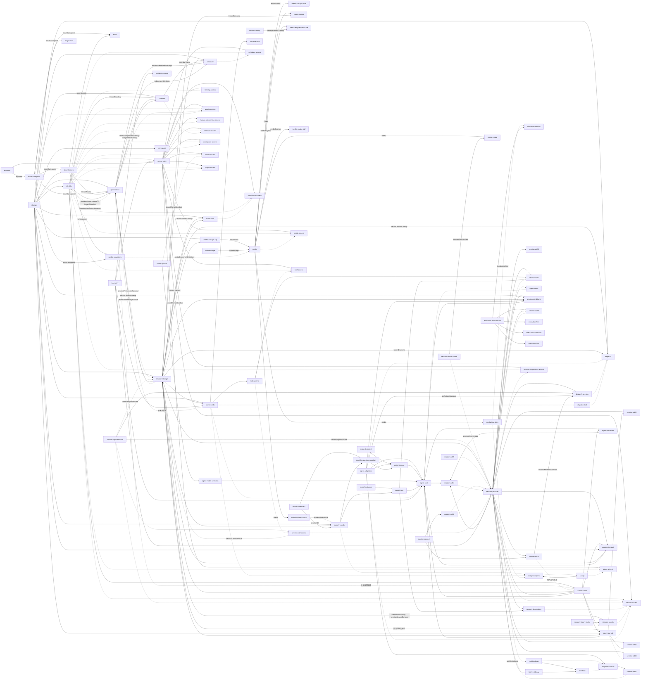

# 应用装配：单机首条租户路径

本页拥有单机首条租户路径的应用装配责任：进程里装哪些成员、每个成员以插件树的哪一行进入、装配入口提供哪些运行时对象、替身与真件在哪里切换，以及只能由应用装配承担的桥接。首条租户路径是：外部调用者创建租户、登录、发出第一次请求，收到第一条 Agent 纯消息回复，再读到历史。

插件树的格式与层叠归 [IC-15](../cordis-integration-conventions.md#ic-15)、[IC-16](../cordis-integration-conventions.md#ic-16)；运行时对象经装配入口提供归 [IC-1](../cordis-integration-conventions.md#ic-1)；共同宿主与配置归 [Cordis 集成](runtime-contract-integration.md#配置与插件树)；采用协调与重装归[定义求值与装配交接](../../domains/assembly-and-handoff/README.md)。

## 进程与装配入口

首条租户路径是一个单机进程，由一个私有应用成员承载，它就是本页所说的应用装配。首条租户路径的应用成员是 `apps/harness-server`。

装配入口按下面的次序启动进程：

1. 读取发行层与运维者层，按行 id 层叠出最终插件树（[IC-16](../cordis-integration-conventions.md#ic-16)）。检查每行 inject 的受信名都在该行的可见集合内（见[受信子树](#受信子树)），不成立时启动失败。
2. 提供[运行时对象](#运行时对象)：根上下文的对象，以及受信子树各作用域内的对象。运行时对象不进插件树。宿主文件责任域在这一步创建一次，早于任何行装载。
3. 按插件树装载各行插件。受信子树的行装在只为它可见的受信名建立的上下文中，其余行装在根上。插件经 `inject` 取得必需服务，按调用现取的端口不进 `inject`。插件体构造时检查不能由 `inject` 表达的装配条件，不成立时抛出，该行 `FAILED`。
4. 等待全部行就绪。某一行停在 `PENDING` 时，装配入口报告缺哪一项必需服务，进程不开始接收消息；某一行 `FAILED` 时启动失败，分别诊断（[Cordis 集成](runtime-contract-integration.md#配置与插件树)）。
5. 全部行就绪后，装配入口调用 `server-entry` 登记的开始句柄，服务端接入开始在新地址 `/api/<协议名>/v<主版本>/<操作名>` 上接收调用与观察。
6. 计划停止按应用成员规格的「有序关闭」执行：先关接入，再停业务，再关会话存储组合，最后关存储，报告确定之后才通知存储提供者。停业务之后对宿主文件责任域跑最后一次维护，剩余未结清的份数写进关闭报告。

## 插件树

下表是首条租户路径的发行层。行 id 是对运维者的稳定承诺；改名、删一行或换一行的插件属于发行层修订，要写进应用成员的当前说明与发行说明。运维者层只按行 id 替换配置、停用或插入行。

| 行 id | 成员与插件 | 提供 | 必需（`inject`） | 按调用现取 | 配置（可序列化） |
| --- | --- | --- | --- | --- | --- |
| `telemetry` | `@omne-harness/telemetry-node` 的 `./cordis` 插件（`node` 实现 `TelemetryNodePlugin`，或禁用实现 `DisabledTelemetryPlugin`），由装配入口按每次运行绑定的工厂行 | `telemetry`：工程遥测的端口（`bind` 一个作用域绑定得到发射器） | 无 | 无 | 只放数据：`implementation`（`node` 或 `disabled`）、`outlet`（`stdout`、`stderr` 或带绝对路径的 `file`）、六项预算 `budgets`（发行层不写数值，运维者层给）。运行时对象（运行时、Cordis 日志桥、记录写函数）不进树。没有阶段：关闭是四个阶段之后、报告确定之前的一个显式步骤。行页见 [发行应用规格](../../../apps/harness-server/SPEC.md#其他各行) |
| `storage` | 存储契约的 SQLite 提供者 | `storage`：按事务域登记的存储服务（只在[受信存储子树](#受信子树)内可见） | `storageHost`、`assemblyLifecycle` | 无 | 存储根目录；[SQLite 提供者配置](../../../packages/storage/SPEC.md#wal-与配置)要求的四项数值（`admissionQueueLimit`、`lockWaitMs`、`maxCommandsPerCommit`、`maxCommandBytes`）；组提交与关闭期限的数值，按 SQL 提供者的配置。读结果上限 `maxReadResultBytes` 取 20971520（20 MiB），`globalReadResultBytes` 随之取 134217728；提供者在构造期拒绝任何 `maxOutputBytes` 超过它的读 handler。JSON 嵌套上限 `maxJsonDepth` 由发行配置给 128：带首条输入的 `create` 约 69 层，提供者初值 64 会拒绝它；A2 的 Tool 意图材料按块保存，只有个位数层；核对用例是 harness-server 的 `tests/rows/storage/release-depth.spec.ts` |
| `identity` | `@omne-harness/identity-sql` 的 `./cordis` 插件 | `identityOperations`（注册激活、签发登录、识别登录）；`tenantStanding`（受信）；`identityGovernance`（ID-18 治理端口，受信）。三项出自同一个提供者实例、同一份 identity 记录，治理端口的撤销与切换对登录识别生效；`standingReservations`（原资格保留与结算） | `storage`、`identityClock` | 无 | 登录期限与空闲期限；访问刷新粒度 `accessRefreshGranularity`（必须短于空闲期限，发行层初值 1 小时）；邀请默认时长 `invitationDefaultDuration` 与最长时长 `invitationMaxDuration`（发行层初值 7 天与 30 天）。迁移 `identity/002-governance` 与读 handler `identity.governance`（输出上限 1 MiB，不超过 `storage` 行的 `maxReadResultBytes`）随本行材料进入发行目录；已有的发行数据库在本行 `registerCombination` 时执行 002 |
| `authorization` | 应用成员的授权适配插件 | Session 身份桥使用的准入裁定；`agentAccessCheck`、`sessionAccessCheck`（含作用域释放恢复的三项系统请求：`scope-release-receive`、`scope-release-load` 与 `scope-release-query`）；`agentActionAdmission`；`systemActionAuthorization`（系统动作授权，受信，见[系统动作授权](#system-action-authorization)） | `tenantStanding`（受信）、`principalVerifier`（受信）、`identityGovernance`（受信，核对会话权限配值的原登录当前有效性）、`identityClock`（维护授予到期的判定时钟，每次判断到期时重新读取） | `toolCatalog`（归一与放行卡的标签按调用取所判的定义）；`toolReleaseDetails`（放行判断答要人决定时取一次放行详情；缺席时卡照发，写明工具没能给出详情） | `actionRules`；`maintenanceGrants`：运维者对随版本内置的维护授予表只能收回某项（`revoked: true`）或设到期（`expiresAt`），不能新增；表外授予项、改用途、主体或范围的配置让本行启动失败。收回与到期对本行的三个访问裁定和 `systemActionAuthorization` 同样生效。发行层写空对象 |
| `session-storage` | 应用成员的会话存储组合插件：在同一插件体内构造租户到事务域的目录与 `@omne-harness/session-storage-sql` 根入口的纯提供者，目录的存储构造能力只经闭包交给后者 | `sessionTransactions`；`sessionDelegatedTransactions`（会话委派事务，受信）；`tenantDomains`（只含部署枚举 `enumerate`）；`tenantDomainLookup`（已发布快照的只读查找，受信）；`sessionPrincipalBindings`（会话归属读口，受信）；`sessionScopeOwners`（作用域归属读口：铸作用域的提交写下的归属，受信）；`tenantDomainRegistration`（确保租户的事务域已登记，受信，适配 governance 行声明的端口）；`sessionHistoryLog`（搜历史读日志的口：两个读处理函数，不问资格，受信）；`sessionSearchCursors`（搜历史的游标：用会话的游标签名封装，绑定租户） | `storage`、`sessionAccessCheck`、`assemblyLifecycle` | `sessionPermissionBackend`（受信；权限配值委派提交按调用现取，缺席返回不可用，普通命令不消费）；`sessionCursorSigning`；`systemActionAuthorization`（受信；部署枚举每次调用都经它判断，缺席或答 `unavailable` 时枚举答 `unavailable`，不放行；本行不持有授予表）；`sessionNotifier`（本行在发布服务之前登记在存储上的提交叫醒接口每一批现取它，在时转交同一份载荷）；`sessionInputSources`、`sessionDerivedInputs`（每次提交现取，算这次受理的条款；缺席时要它的受理答 `unavailable`，已受理的照样认回） | 事务域推导规则；组合版本；登记表的文件位置（在存储根目录下）；介质（与 `storage` 行相同的 SQLite）；`pageBytes` 上限；`maxScanPerPage`；`maxRegistrationRetries`；快照重建方式。其余字段取 Session SQL 纯工厂配置的初值。见[租户到事务域的目录](#租户到事务域的目录) |
| `session-input-sources` | `@omne-harness/session-cordis-contract` 的 `./cordis` 插件 `sessionInputSourcesPlugin`：会话输入来源的登记面 `session.input-sources`。各贡献方的插件注入它，登记自己的来源声明，贡献方卸下就撤走 | `sessionInputSources`：登记面的服务；`lookup` 按名字查一份声明 | 无 | 无 | 无 |
| `session-before-intake` | `@omne-harness/session-cordis-contract` 的 `./cordis` 插件 `sessionBeforeIntakePlugin`：会话受理前处理的登记面 `session.before-intake`。各贡献方的插件注入它，登记自己的处理件，贡献方卸下就撤走 | `sessionBeforeIntake`：登记面的服务；`current` 按名字的码元序给出当下登记着的处理件 | 无 | 无 | 无 |
| `session-history-index` | 行体：`@omne-harness/session-search-sqlite` 的 `createSqliteHistoryIndex`。历史索引是会话日志的投影，有自己的目录与两个工作线程，不进存储提供者；丢了能从日志重建 | `sessionHistoryIndex`：历史索引的端口（状态、候选、覆盖位置、追加、重建、换代、整理） | 无 | 无 | `root`：索引文件的目录，绝对路径；运维者层给 `<状态目录>/history-index` |
| `session-search` | `@omne-harness/session-cordis` 的 `./cordis` 插件 `createSessionSearchPlugin`：搜历史的服务与追日志的任务。提交叫醒只叫醒追日志的任务，丢了由按间隔的检查补上；受理、开 Run 与提交这条路不读索引、不写它、不等它。去掉这一行，会话照常对话，只是不能搜 | `sessionSearch`：一页搜索；每一页问当前资格（列会话的资格，与每个命中所在会话读历史的资格） | `sessionAccessCheck`、`sessionHistoryIndex`、`sessionHistoryLog`、`sessionSearchCursors` | 无 | 无（一次搜索的上界与追日志的节奏取 `LOCAL_HISTORY_SEARCH`） |
| `dynamis` | [`dynamis-cordis`](../../../packages/dynamis/SPEC.md#接到-cordis-上dynamis-cordis) 的 `./cordis` 服务 `DynamisService`：这棵树的登记表。在这棵树上开拓展点的行经它声明点、放条目；它不认识任何领域 | `dynamis`：登记表服务（放一批条目是调用方作用域上的效应；读当前的登记表；变化有事件） | 无 | 无 | 无 |
| `asset-categories` | `@omne-harness/assets-cordis-contract` 的 `./cordis` 插件 `assetCategoriesPlugin`：资产类别的拓展点。各领域的贡献插件注入它，把自己的类别（正文契约加名字与一句说明）放进去，贡献方卸下就撤走。类别名另是登记表上点 `assets.categories` 的键，键公开，跟类别的登记同生同灭 | `assetCategories`：拓展点的服务；只读面 `view` 查找与列出类别 | `dynamis` | 无 | 无 |
| `tenant-assets` | 应用成员的租户资产行：每个租户的本机资产只开一份（类别从 `assetCategories` 现取，包目录是 `<包根>/<事务域名的 UTF-8 十六进制>`），按调用里的租户现取；同一租户并发的第一次调用只开一份，开好时先登记资产的存储组合、跑一次包的恢复扫描；行卸载时关闭它开的每一份。资产的发布服务按调用现取这个租户的那一份，授权端口用身份的核验器与资格读口适配租户这一层列出时并上点上这个租户范围里一份 plugin 带着的定义（项带 `within`，账本里没有），按账本的次序，游标仍是名字。 | `tenantAssets`（本应用的服务键，见[租户的本机资产](#tenant-assets)）；`assetPublishing`（资产的发布服务，服务键在 `assets-cordis-contract`） | `storage`、`tenantDomainLookup`、`principalVerifier`、`tenantStanding`（受信）；`assetCategories` | 无 | 包根 `packageRoot` |
| `governance` | 应用租户治理装配，复用 Governance 本地提供者；把按发行收窄的工具类别贡献给 `assetCategories`；租户这一层的本机资产从 `tenantAssets` 取，不自己开；提供独立设置的贡献口，每个租户按贡献口的当前清单逐组开通独立目标 | `sessionPermissionBackend`、`standingDestinationResolver`（均受信）、`currentToolPermission`、`independentSettings`（独立设置的贡献口，服务键在 `assets-cordis-contract`）、`tenantSettings`（本应用的服务键，见[租户层设置读写面](#tenant-settings)）、`tenantIndependentSettings`（本应用的服务键，见[领域读自己的独立设置](#tenant-independent-settings)） | `storage`、`tenantDomainLookup`、`principalVerifier`、`identityGovernance`、`tenantStanding`、`standingReservations`、`governanceDirectoryPrincipals`、`governanceInstallationPrincipals`、`toolContributionAuthority`、`assetCategories`、`tenantAssets` | `tenantDomainRegistration`（受信；只在租户层设置读写面准入调用者之后按调用现取，缺席时只开启已登记租户）；`composition`，行体承载 | `deploymentId`、`logicalServiceId`、`recoveryPagesPerPass`、`closeTimeoutMs`。只开启已登记租户，配置身份不由会话推导 |
| `calendar` | 应用成员的日历组合：`@omne-harness/calendar` 的查询、计算服务与供应应用，`@omne-harness/calendar-local` 的系统范围存储、发行种子、随发行的来源材料与本地供应提供者，`@omne-harness/calendar-adapters` 的两个租户级块 | `calendarQuery`、`calendarCalculator`、`calendarSupply` | `storage`、`tenantStanding`、`tenantIndependentSettings` | `supplyIntervalMs`（初值 3600000）、`supplyDrainTimeoutMs`（初值 10000）、`sourceTestOrigins`（只许本机回环，测试用）；`composition`，行体承载。行体把日历的独立设置声明装成子插件，经 `independentSettings` 贡献，贡献口不在时只是这一组不在。行体登记 `system.calendar` 组合（日历存储、供应存储与本应用的日历授权参加者），以系统归属导入发行种子一次（幂等，失败只记告警；种子材料随供应存储的答复返回，`storage` 行的单个参加者答复上限 `maxResponseBytes` 要不小于 1048576，本机缺省即此值），再把供应应用交给本地供应提供者：它建运行器，按间隔跟进来源，只向日历政策声明的 HTTPS 域名发请求，停机先拒新的再排空。供应授权只放行本应用的系统归属。查询资格是调用方所属租户的成员资格；健康经健康投影端口以系统归属读。行体在租户级登记面 `runtimeContextTenantBlocks` 出现时登记租户级块 `calendar.environment`（值读这个租户的日历独立设置）与 `calendar.supply-risk`（值由供应健康算出），登记面不在时日历照常、生效环境答不可用；生效环境经租户级作用域读，主体由 `tenantScopePrincipals` 按租户签发 | 无 |
| `schedule` | 应用成员的日程组合：每个租户一个 `@omne-harness/schedule-local` 应用，事务域是这个租户的域（`tenantDomainLookup` 查，未登记时经 `tenantDomainRegistration` 先登记）；本应用的资格组合（权威端口，核 owner 与作者的当前资格）与守卫参加者 `harness-server.schedule.guards` | `scheduleCommands`、`scheduleQueries`：按调用上下文的租户转给这个租户的应用，别的租户的存储不被问到 | `storage`、`tenantDomainLookup`、`calendarQuery`、`tenantIndependentSettings` | `tenantDomainRegistration`（受信；第一次要某个租户的日程时现取）；`composition`，行体承载。agent 让安排生效许不许，在 agent 发起时由放行判断判过，日程不另记同意；安排记创建者，agent 时带会话与工具调用，经 Runtime Context 取得。守卫参加者核需求与命令重算一致、按 owner 与作者计非终态日程的占额（容量 100），不重读。不做到点派发 | 无 |
| `notification` | 应用成员的通知组合：`@omne-harness/notification-local` 的 `./cordis` 插件 `createNotificationLocalPlugin`，一个提供者服务全部租户；每个租户的通知存在这个租户自己的事务域里（`tenantDomainLookup` 查，未登记时经 `tenantDomainRegistration` 先登记），第一次问到时在那里登记通知的存储组合，摘要从存储目录现算。本应用在这一行接上通知留的端口：资格是一张表（owner 只管人的收件箱、只以 `owner.posts` 发送；agent 只管自己的、只以 `agent.posts` 发送）；agent 的订阅许不许，在 agent 发起时由放行判断判过，通知不另记同意；订阅记创建者，agent 时带会话与工具调用，经 Runtime Context 取得；持续事项的读者经租户级作用域读绑到通知的需要上的各个块（持有者不在、没有块绑上来、有一个块读不到，都不答成「没有事项」）。行体登记本应用的来源 `owner.posts`，并向登记面 `runtime-context.tenant-blocks` 贡献通知自己的块 `notification.delivery-blocked` 与它到这个需要的绑定 | `notificationSending`、`notificationInbox`、`notificationSubscriptions`、`notificationDestinations`、`notificationCatalog`、`notificationSources`、`notificationChannels`、`notificationChanges`、`notificationStanding` | `storage`、`tenantDomainLookup`、`tenantDomains`、`tenantDomainScannerPrincipal`（受信；启动时与定期的到期扫描以部署扫描主体枚举租户） | `tenantDomainRegistration`（受信；第一次要某个租户的通知时现取）；`composition`，行体承载，停止时先停准入、等在途的各有结局，再撤登记，不删事实 | 策略 `policy`：一整份，由运维层给，发行层不写数值；缺失或无效时这一行不启动 |
| `calendar-notification` | 行体：向通知的来源登记面登记 `@omne-harness/calendar-adapters` 的来源 `calendar.supply`（三种持续事项：覆盖到警告线、覆盖到严重线、供应失败），并向租户级登记面贡献一条不经翻译的需要绑定：通知的「一组持续事项」← 块 `calendar.supply-risk`，块本身就是通知的事项形状，不经翻译。两个登记面出现时登记、撤下时随之收回，不是必需：通知的两行不在时这一行照常启动、什么也不登记。去掉这一行，日历照常，通知没有日历的事项 | 无 | 无 | 无（`notificationSources`、`runtimeContextTenantBlocks` 出现时登记） | 无 |
| `media-storage-sql` | 应用成员的行：把 `@omne-harness/media-storage-sql` 的 `createSqlMediaIndex` 绑成媒体的元数据服务。每个租户的媒体元数据存在这个租户自己的事务域里（`tenantDomainLookup` 查，未登记时经 `tenantDomainRegistration` 先登记），第一次问到时在那里登记媒体的存储组合，摘要从存储目录现算 | `mediaIndex` | `storage`、`tenantDomainLookup` | `tenantDomainRegistration` | 无 |
| `media-image` | 应用成员的行：把 `@omne-harness/media-image` 的 `createImageCodec` 绑成媒体的图像服务，底下是执行环境的有界图像成员 | `mediaImage` | 无 | 无 | `maxWidth`、`maxHeight`、`maxDecodedBytes`、`concurrency`，都有缺省值 |
| `media` | `@omne-harness/media` 的 `./cordis`：存放的登记表 `MediaStoresProvider`、转换引擎的登记表 `MediaEnginesProvider` 与保管服务 `createMediaPlugin`。「备好表示」每次现取转换件定义的端口 `mediaConverterDefinitions` 与引擎：端口不在答依据不可用，引擎不在答引擎不可用；时限的计时用装配的时间源。存放按名字每次调用现取：`writeTo` 指的存放不在时，开始上传与存入答依据不可用 | `mediaStores`、`mediaEngines`、`media` | `mediaIndex`、`mediaImage` | 登记表里的存放 | `writeTo`、`maxBytes`（按模态）、`partBytes`、`uploadTtlMs`、`stagingTtlMs`、`variantCacheBytes`、`conversion`（转换的时限、排队上限、文字兜底的行内界线），都有缺省值 |
| `media-storage-local` | 应用成员的行：向 `mediaStores` 登记 `@omne-harness/media-storage-local` 的本机文件存放，名字 `local`；行卸载时登记撤回 | 无公开服务 | `mediaStores` | 无 | `root`：绝对路径，本机档由运维者层给成状态目录下的 `media` |
| `media-sweep` | 媒体的维护行：启动时与之后每个节拍，枚举有事务域的租户，逐个调 `media` 的 `custody.sweep`（到期的先标记删除，再接着删停在删除中的对象），一个节拍没跑完不起下一个 | 无公开服务 | `media`、`tenantDomains`、`tenantDomainScannerPrincipal` | 无 | `intervalMs`、`limit`，都有缺省值；批量 1–1000 |
| `media-intake` | `@omne-harness/media-adapters` 的 `./cordis` 插件 `mediaIntakePlugin`：媒体对 Session 受理的适配。向 `session.before-intake` 登记处理件 `media.references`：对输入里每个带内容引用的块先持有，再补上媒体事实；引用无效就拦下并点名那一块，媒体答不可用就答不可用。这一行不在时，带内容引用的输入不被受理 | 无公开服务 | `media`、`sessionBeforeIntake` | 无 | 无 |
| `media-model-source` | `@omne-harness/media-adapters` 的 `./cordis` 插件 `MediaModelSourcePlugin`：媒体对 Model 读媒体端口的适配。发出一次模型请求时，按这次发出的访问身份的租户、请求里的引用与型号的限额向 `media` 要字节：原件在限额内交原件，超过时交限额内的版本；做不出答超限，引用无效或字节读不到答材料不可用，媒体答不可用就答不可用。媒体每次读时现取。这一行不在时，带媒体引用的请求答依据不可用，纯文字的请求照常 | `modelMediaSource` | `media` | 无 | 无 |
| `media-tool-store` | `@omne-harness/media-adapters` 的 `./cordis` 插件 `MediaToolStorePlugin`：媒体对 Tool「存产出」端口的适配。工具的一次调用交来媒体类型与字节时，用 `media` 的保管一步存入并持有，持有方是这次调用，租户是这次调用的；媒体拒绝、不可用或结果不知道各照实答。媒体每次存时现取。这一行不在时，结果带非文字模态的命令在原位不可用（原因 `products-unstorable`），别的命令照常 | `toolMediaStore` | `media` | 无 | 无 |
| `media-converters` | 应用成员的行：向资产登记类别 `converter`（`@omne-harness/media-adapters` 的 `./cordis` 插件 `converterCategoryPlugin`，数据型、可新建），并提供转换件定义的端口：按资产的 `collectCandidates` 与 `evaluate` 对具体媒体类型的名字、再对模态的名字求值，层是发行版自带的官方层（只有 `converter` 这一类，语音与 PDF 两份，不进资产页的列出）与这个租户的本机资产；胜出的那一份读不到正文或判不过，答依据不可用，不退到别的层。租户的资产每次调用现取 | `mediaConverterDefinitions` | `tenantAssets`、`assetCategories` | 无 | 无 |
| `media-engine-transcribe` | 应用成员的行：向 `mediaEngines` 登记 `@omne-harness/media-engine-transcribe` 的引擎 `voice.transcribe`（语音转文字，经 OpenRouter 的转写接口，数据去向远端）。密钥是这次转换的租户在 OpenRouter 这个发行供应商上配的凭据，没配就用部署的，每次转换现取（`src/assets/provider-keys.ts`）；行卸载时登记撤回 | 无公开服务 | `mediaEngines`、`settingsSecretCustody` | 无 | `endpoint`：转写接口的地址，缺省 OpenRouter |
| `media-engine-pdf` | 应用成员的行：向 `mediaEngines` 登记 `@omne-harness/media-engine-pdf` 的引擎 `pdf.extract-text`（本机用 `unpdf` 提文字层，部首区的字按 Unicode 换成统一表意字）；行卸载时登记撤回 | 无公开服务 | `mediaEngines` | 无 | 无 |
| `workspace` | 应用成员的工作区组合：`@omne-harness/workspace-local` 的 `./cordis` 插件 `createWorkspaceLocalPlugin`，一个提供者服务全部租户。工作区的事实不属于任何一个租户，存在系统作用域的事务域 `system.workspace` 里，隔离靠仓储的每个入口按租户过滤；第一次用到时在那里登记工作区的存储组合，摘要从存储目录现算。本应用在这一行接上工作区留的端口：成员资格与动作准入用身份域适配（操作与目标由工作区命名，拥有者 `@omne-harness/workspace`）；身份域的服务不在时答依据不可用。来源面读两个来源根用文件系统成员的读文件端口，版本的摘要取资产的算法（由适配成员 `@omne-harness/workspace-asset-source` 交来）。行体向登记面 `workspace.types` 贡献文件系统型与拓展它的 Git 型 | `workspaceGovernance`、`workspaceInstances`、`workspaceCatalog`、`workspaceSources`、`workspaceTypes` | `storage` | `principalVerifier`、`tenantStanding`（受信；每次调用现取）；`composition`，行体承载，停止时撤下提供者，不删事实 | 节点名 `node`：由运维层给，发行层不写数值；缺失或为空时这一行不启动 |
| `usage` | 用量的查询服务与来源登记表：`@omne-harness/usage` 的 `./cordis` 插件 `UsageSourcesProvider` 与 `createUsagePlugin`。上限由本行显式给出：向来源每页至多 200 笔，一次查询至多读 2000 页、至多 1000 个时间桶。去掉这一行，核心照常，用量的查询不在 | `usage`、`usageSources` | 无 | `usageSessionScope`（范围是会话时按查询现取；缺席时答依据不可用，依据是会话范围） | 无 |
| `usage-adapters` | `@omne-harness/usage-adapters` 的 `./cordis` 插件 `createUsageAdaptersPlugin`：装上时向 `usageSources` 登记模型与工具两个来源、提供会话范围，卸下时撤回自己那两份。会话范围读会话日志的 Run 开始与压缩消息，答出 Agent 拥有者下的执行与压缩提供者拥有者下的压缩任务；两个拥有者名由本行显式给出（`@omne-harness/agent`、`@omne-harness/context-compaction`） | `usageSessionScope` | `usageSources` | `modelDispatchFacts`、`toolAccounts`、`session`（以 `reader` 调用方）。取不到时那一个来源或会话范围答依据不可用 | 无 |
| `session-provider` | `@omne-harness/session-cordis` 的插件 | `session`（四个面）；协调器与调度器，含推进触发调度器 S1 | `sessionAccessCheck`、`sessionDelegatedTransactions`（受信）、`sessionPrincipals`、`sessionWorkPrincipals`（受信）、`assemblyLifecycle`、`telemetry`（行体在它上面构造 Session 遥测 facade，把 `measure` 与 `diagnose` 交给插件；记录按访问的租户作用域）、`tenantDomains`、`tenantDomainScannerPrincipal`（受信；行体以部署扫描主体调用 `tenantDomains.enumerate`，在只对插件可见的子作用域里提供 `sessionTenants`，插件在有序启动时据此给每个租户绑定扫描者） | `sessionIdentity`、`sessionEvidence`、`sessionContextInput`、`sessionIdleInput`、`sessionAgentDrive`、`sessionScopeRelease`、`sessionClock`、`sessionTransactions`（只服务 `pending`、`references`、`releasedScopes` 三项目录读取）；`sessionBeforeIntake`、`sessionInputSources`（每次受理现取：处理件按当下登记着的运行；登记着处理件时，来源声明定这条输入过不过处理；要用到而缺席时这条输入答 `unavailable`，已受理的照样认回） | `admission`：省略；写 `'none'` 表示本部署声明没有处理件，这时不取登记面 |
| `session-ad02` | AD-02 Agent 同日志解释（session-adapters 的 `createSessionJournalInterpretationPlugin`） | 无 | `session`（`'coordinator'`）、`sessionTransactions`（`commitLog` 所在的端口，日志解释的写口，与 AD-05 同构）；`agentJournal`（会话收完一个执行之后向它确认）；`storage`、`tenantDomainLookup`（受信，只读该 execution 的执行记录分区）；`sessionWorkPrincipals`（受信，取协调者主体） | 协调者主体来源（经受信 `sessionWorkPrincipals` 的 `forSession` 构造） | 无：插件不取配置 |
| `session-ad03` | AD-03 持有者、回放、事实及按租户装配的模式生产者。注册成功后刷新；提交事件仅唤醒原来源重读。另装配会话工作目录的步前动作：它只在一步开始之前被叫到，核验得到的值和块里的不同时把一条步提交写进会话日志；提交事件不刷新它 | `runtimeContextReaderEligibility`、`sessionReplayFacts`、`sessionScopeLookup`、`sessionModesInstallation`、`sessionWorkingDirectory` | `runtimeContext`、`session`、`sessionWorkPrincipals`、`sessionModesPrincipals`、`principalVerifier`、`storage`、`tenantDomainLookup`、`definitionMappings` | 协调者主体及模式租户主体；共享精确采用定义表；`sessionModesInstallation` 是应用装配口，不授予权限 | `scopeIndexEntries`、`pageBytes`、`defaultDirectory`（没有附着工作区的会话的工作目录；运维者层给服务端工作区设置的真实路径） |
| `session-ad04` | AD-04 历史源（session-adapters 的 `createSessionHistorySource`） | `contextHolderSources`（K-RQ 持有者部件） | `session`（`'reader'`；下界子插件 `'coordinator'`） | 历史头解码 `historySessionOf`；`sessionAdoptedRequests`（会话自己记录的固定请求事实，`agent-journal` 行的提供者给出），窄采用来源 `adopted` 每次读取时现取，缺席时答不可用 | `scopeIndexEntries`、`pageBytes`，由运维者层给 |
| `session-ad05` | AD-05 Model 日志消费适配（session-adapters 的 `createSessionModelLogConsumptionPlugin`） | 无 | `session`（`'coordinator'`）；`agentJournal`、`agentJournalEntries`（条目端口）、`agentMaterials`（同一 Journal 提供者）；`sessionTransactions`（`commitEntries` 所在的端口）；`sessionWorkPrincipals`（受信，取协调者主体） | 协调者主体来源 | 无：插件不取配置 |
| `session-ad06` | AD-06 Tool 日志消费适配 | 无 | `session`（`'coordinator'`）；同一 Journal 提供者的 results、条目与材料视图（`agentJournal`、`agentJournalEntries`、`agentMaterials`）；`sessionTransactions`（`commitEntries` 所在的端口，后果、进度与答案的同批提交只经它）；`sessionWorkPrincipals`（受信，取协调者主体） | 协调者主体来源；Agent 自有交付材料解码 | 超时与重试退避 |
| `session-ad09` | AD-09 身份桥 | `sessionIdentity` | `principalVerifier`（受信） | 无 | 无 |
| `session-ad10` | AD-10 证据桥 | `sessionEvidence` | 装配采用、生产来源与保管来源的服务（键见缺口表） | 无 | 无 |
| `session-ad11` | AD-11 空闲输入 | `sessionIdleInput` | `modelRuntime`、`toolRuntime`、`session`（`'maintainer'`） | 无 | 无 |
| `session-ad12` | AD-12 Context 输入 | `sessionContextInput` | `runtimeContext` | `sessionWorkPrincipals`（受信，取协调者主体） | 无 |
| `session-ad14` | AD-14 `AgentDrivePort`（session-adapters 的 `createSessionAgentDrivePlugin`） | `sessionAgentDrive` | `agentInstances`、`agentInstanceProvision`、`agentExecutionRecovery`、`agentExecutionControl`、`session`（`'coordinator'`） | `sessionWorkPrincipals`（受信，取协调者主体） | 无 |
| `session-call-control` | session-adapters 的 `createSessionCallControlPlugin`：停或撤回一次转了后台的 Tool 调用时，Session 凭调用引用直交 Tool；列出后台调用时，Session 凭调用引用向 Tool 现问它的状态 | `sessionCallControl`、`sessionCallStates`；`sessionDerivedInputs`（后台结局与停止提醒这两种派生输入的受理依据）。子插件在 `sessionInputSources` 在场时登记来源 `session.background-outcome` 与 `session.background-stop` | 无 | `toolRuntime`；`sessionWorkPrincipals`（受信，取协调者主体）。任一缺席时这次控制答 `unavailable`，Session 按控制重放规则再送。`sessionInputSources` 缺席时两个来源没有登记，派生输入的受理答 `unavailable` | 无 |
| `session-ad15` | AD-15 作用域释放，含重新释放子插件 | `sessionScopeRelease` | `executionEnvironment`（`caller: 'maintainer'`）；子插件还需 `session`（`'maintainer'`） | 构造时交入恢复授权 | 超时、重试退避与重新释放页大小 |
| `session-handoff` | session-adapters 的 J06 消息准入插件（`createSessionMessageHandoffPlugin`） | `agentMessageHandoff` | `session`（`'coordinator'`）、`agentAccessCheck`；`storage`、`tenantDomainLookup`（受信存储子树；只对已登记租户查找事务域，不触发登记）；`sessionWorkPrincipals`（受信，取协调者主体） | 协调者主体来源；调用者稳定身份文本；本提供者的采用身份 | `combinationVersion`、`manifestDigest`：与 `agent-journal` 行相同的会话日志组合。准入记录落 `execution-record` 参加者的 `er_preadmission` 表，见[租户到事务域的目录](#租户到事务域的目录) |
| `session-conditions` | session-adapters 的 J06 当前条件插件（`createSessionConditionsPlugin`）。以原 Authority 经执行索引定位会话，Run 持有该 execution 且 Journal 记录的 attempt 为当前 attempt 才读；`configuration` 取 Run 采用，`progression` 由协作模式投影（`co-work` → `evaluate-completion`，`auto-drive` → `continue`），`model` 取已保存路由的采用依据，`context` 取未结束的 Runtime Context 作用域，`bindings` 取常驻工具；缺任何来源答 `unavailable`，不补默认。 | `agentConditions` | `session`（`'coordinator'`，调用方 Access 只经此面核访问）；子插件 `session-conditions-selection` 另 `inject` `session`（`'maintainer'`），只读保存的模型选择，因为 `readModelSelection` 只接受 `intake` 与 `maintainer`，每个插件只用一个调用方类（session-adapters AD-00 第 1 条）；`storage`、`tenantDomainLookup`（受信存储子树；执行索引与 Journal 的 attempt 记录）；`definitionMappings`（受信；解出 `tenant-default` 模式的值，映射条目的模式采用须与创建所记来源逐字相等） | 租户默认模式解析器（基于受信 `definitionMappings` 构造） | 无 |
| `agent-journal` | session-adapters 的会话日志 Journal 提供者 | `agentJournal`；同一提供者兑现 `AgentJournalEntries` 与 `AgentMaterials`，并兑现 AD-01 Agent 同日志提交参加者（不另装 `session-ad01` 行）；`agentReceivedCommits`、`agentModelReceptionTargets`（Model 结果接收方的两个面：接收共同提交与稳定目标查询，`agent-host` 注入）；`agentToolReceptionTargets`（Tool 结果接收方的稳定目标查询，`agent-host` 的 Tool 接收子插件注入）；`agentReceivedRecords`（同一份接收记录的只读面，受信，只对本行与 `model-records` 可见；Agent consumer owner 的证据适配器经它核验 Model 的 ACK）；`agentCompactionInputs`（压缩输入的读取与冻结，`agent-host` 注入）；`sessionAdoptedRequests`（会话日志里 M0 记下的固定请求事实，`session-ad04` 取最新的一条，`session-diagnostics-access` 按模型调用的引用取那一次的，都按调用现取；根上的名字，不在受信表里）；`sessionExecutionLog`（执行日志按租户打开租户域：`openTenant` 只做本写者代际第一次打开时的清扫与唤醒，不读写任何执行；本行在服务就绪时调用） | `sessionAccessCheck`（派生的 Session 参加按 Session 操作裁定）；`storage`、`tenantDomainLookup`（受信存储子树；只对已登记租户查找事务域，不触发登记）；`tenantDomains`、`tenantDomainScannerPrincipal`（受信；服务就绪后以部署扫描主体枚举已登记租户，逐个经 `openTenant` 打开执行日志的租户域，同时至多 4 个，枚举失败与单个失败只记告警）；`runtimeContext`（以 `'model'` 读者注入）与 `runtimeContextReaderEligibility`（`session-ad03` 的持有者交出模型的读取资格）：一步开始之前把模型能读的块写成提醒，单独提交在这一步之前，读不到时这一步失败；与 `session-storage` 共用会话日志提交状态 | 无 | 组合版本与清单摘要，取自会话存储组合的声明（提交请求要带它们）；模型能读的供给块的描述（发行装配给出 `session.modes`） |
| `agent-adoptions` | 应用成员的采用适配插件 | `agentAdoptions`；`definitionMappings`（受信，与 `agentAdoptions` 出自同一份解析表与内容身份）；`agentDefinitionCatalog`（定义的目录读口：按租户列出当时可见的定义，每项只有名字、类型与给模型看的说明，答的是当前这份解析表，表换了答的就换） | 无 | 无 | [定义名映射](#桥接责任) |
| `adoption-sources` | 应用采用来源。新 create 核部署定义、原常驻工具及应用固定的上下文块注册（会话模式、会话工作目录）；同值重传从 Session 原初始化事实认回，不重新要求当前映射或生产者准备。原准备记录与初始 SE07 同批保存 | `sessionAdoptionSource` | `definitionMappings`、`sessionWorkPrincipals` | `toolBindings`、`toolGenerations`；`sessionModesInstallation` 按调用准备；`session` 的 coordinator 只读原初始化，不形成启动注入环 | 无 |
| `agent-model-selection` | 应用成员的模型选择适配插件，实现 Agent 的 `ModelSelection`。从 execution 经执行索引找到会话，核对活动 Run 持有该 execution，再读回会话保存的选择；找不到答 `unavailable`，Run 已结束答 `terminal`，Run 不符答 `denied` | `agentModelSelection` | `modelProfiles` | `storage`、`tenantDomainLookup`（受信存储子树；读执行索引与会话保存的选择） | 无 |
| `agent-cards` | 应用成员的 Agent 卡片提供者，实现 Agent 的 `DecisionCards`。Agent 循环要人决定时，一轮卡片登记成一个 HITL 请求；回查按原操作身份与原输入认回；读卡时接手已决定的卡；作废使这一轮的等待失效。它与 Tool 的 Ask 等待共用同一个 HITL 宿主、受众与登记主体（由 `tool-records` 行与入口对象 `toolClock` 填入按根保存的 holder）；这三样缺席时各操作答 `unavailable` | `agentDecisionCards` | `session` | 无。`session` 以调用方类 `coordinator` 读会话快照，取调用方执行所在的 Run | 无 |
| `agent-host`                 | `@omne-harness/agent-host-local` 的宿主插件（`createAgentHostLocalPlugin`）                                                                                                                                                                                                                                                                                                                                                                           | Agent 宿主、`agentPublicationAuthority`、`agentExecutionRecovery`、`agentExecutionControl`、`agentInstanceProvision`                                                                                                                                                                                                                                                                                                                                                                                                                                                                                                                                                                                                        | `agentJournal`、`agentJournalEntries`、`agentMaterials`、`agentReceivedCommits`、`agentModelReceptionTargets`、`agentAccessCheck`、`agentAdoptions`、`agentConditions`、`agentRequests`、`agentCompaction`、`agentCompactionInputs`、`agentModelSelection`、`agentMessageHandoff`、`modelRuntime`、`agentClock`、`agentHostPrincipal`、`assemblyLifecycle`、`telemetry`（行体在它上面构造 Agent 遥测 facade，作为每个运行时的 `measure`；记录按执行的租户作用域）                   | `toolRuntime`，在工具阶段取得；Tool 请求来源在 Ask 的命令处按调用读 `session`（coordinator）、`runtimeContext`、`runtimeContextReaderEligibility` 与受信名 `sessionModesInstallation`，取会话的人机交互投影，缺席答 unavailable；Tool 接收子插件静态注入 `toolRuntime` 与 `agentToolReceptionTargets`，二者缺席时只有子插件停在 `PENDING`；`toolStartFence`，要使启动失效时先预检，再在子 fiber 取得；其余局部依赖见[宿主的 Cordis 页](../../../packages/agent/SPEC.md#宿主)            | `jointCommits`：与 Journal 提供者支持的共同提交种类一致，必须含 `message`，行 schema 在装载时核对；`coordination`：与 Journal 绑定声明的协调能力相等。这两项由发行层写出，运维者层整行替换时必须重抄。`instanceIdleMs`：实例空闲回收时长；Agent [工厂配置](../../../packages/agent/SPEC.md#领域边界)的其余项由运维者层给                                                                                                                                                                                                                                                                                                                                                                                                                                                                                                                                                                                                                                                                                                                                                                                                                                                                                                                                                                                                                                                                                                           |
| `agent-instances` | `@omne-harness/agent-cordis-contract` 的 `agentInstancesPlugin` | `agentInstances` | `agentPublicationAuthority`、`agentAccessCheck` | 无 | 无 |
| `model-host` | `@omne-harness/model-host-local` 的 `ModelRuntimeLocalPlugin` | `modelRuntime`、`modelInstanceHost`、`modelStreamReferences`、`modelStreamObservation`（模型的公共流：按调用引用取当前的流、订阅它；不是受信名） | `modelCommands`、`modelClock`、`modelHostAuthority`；`tenantDomains`、`tenantDomainScannerPrincipal`（受信；启动扫描以部署扫描主体枚举租户，每个租户换一个只许读恢复记录的扫描主体） | 发送、重试与目录由局部阶段子插件取得，发送阶段取 `model-records` 行提供的 `modelSendBoundary`；推送阶段按 `ConsumerRef.owner` 读本插件的接收登记表 | 并发上限、唤醒容量、扫描批次与扫描间隔，按[Model 装配规则](../../../packages/model/SPEC.md#资源寿命与装配)；`ModelConfiguration` 的 7 个数与结果推送限额 `ResultPushLimits` 的 5 个数，行体自校验；`retry` 是重试策略的采用与数值（最多发出几次、总时长上限、各次间隔与抖动），缺了或非法时这一行加载失败；发行层不写数值，全部由运维者层给。不进配置的对象：`qualifyObservation` 复用应用 Model 模块权威的 `observe`（先核验观察者）；重试策略是行体按 `retry` 配置构造的默认策略（`@omne-harness/model` 的 `createDefaultRetryPolicy`），请求采用的策略不是这一份时答 `unavailable`，调用以 `policy-unavailable` 收场；`executionChannel` 与 `releaseExecution` 取自入口运行级组合；`observation` 是同次 `model-records` 激活的观察配对，也取自入口运行级组合，其确认源套着应用 Model 模块的准入点（每次取流、每段订阅期间按观察的检查间隔核观察者当前资格）。行体承载 `business` 阶段：业务停止 dispose 宿主子 fiber。接线见[Model 生产接线](../../../apps/harness-server/SPEC.md#model-的宿主权威) |
| `model-instances` | `@omne-harness/model-host-local` 的 `ModelInstancesLocalPlugin` | `modelInstances` | `modelPublicationAuthority` | 无 | 无；失去目录只影响路由取得 |
| `model-tokenizers` | 应用持有一个有界本地分词执行器，固定加载本发行的词表；服务定义来自 `tokenizer-tiktoken/cordis` | `modelTokenizers` | 无 | 无 | 线程数、租约数、任务/队列/输入/缓存上限、作业截止与故障替换限额均由运维者给出。各家族装配点借同一服务，不各建池；Qwen 与 OpenAI 两个家族用同一份 o200k 代理词表，只加载一次。`composition` 阶段关闭并等待真实worker退出；准备行撤除不关闭池 |
| `model-profiles` | Model 档案读取提供者，继承 `ModelProfilesService` | `modelProfiles` | 档案读取、当前身份与设置、凭据状态元数据适配器，精确跨域键归提供者 | 无 | 无 |
| `model-request-preparation` | `@omne-harness/model-host-local` 的准备插件，继承 `ModelRequestPreparationService` | `modelRequestPreparation` | `modelCommands`、`modelTokenizers` | `modelCredential`：补全供应商的凭据引用。租户有自己的绑定时给租户引用，没有时给 factory 引用。读不出绑定是否存在时准备失败，不退回 factory | `maxCitedCalls`（一条世系最多指名的调用数）；[发行装配的每个家族](../../../apps/harness-server/SPEC.md#model-的宿主权威)各有 `limits`（工具参数解码的六项上限与 `maxReasoningText`）与 `margin`（输入估计的百分比余量 `percent` 及其采用来源 `source`）。每项都由运维者给出，没有初值；不依赖 `modelRuntime` 或供应商网络。同一组配置在 `model-records` 行的发送子插件里也用，装载器逐家族断言两处相等 |
| `model-credential` | `@omne-harness/model-host-local` 的 Model 凭据端口（`createSecretCredentialPort`），由 `serveModelCredential` 提供；在受信 `settingsSecretCustody` 的读面与使用面上，按发行模型供应商的绑定键读其秘密设置项（OpenRouter 的 `apiKey`）；并把 `modelProviderCategoryPlugin` 装成子插件，把模型供应商这一类贡献给 `assetCategories`：子插件自己注入它，拓展点不在时这一类不在，凭据照常 | `modelCredential` | `settingsSecretCustody`（受信） | 无 | 无。供应商、凭据项与绑定键来自发行供应商正文，见[模型凭据](../../../apps/harness-server/SPEC.md#model-的宿主权威) |
| `secret-custody` | 应用成员的秘密保管行：settings-local `./secrets` 的秘密保管库作为受信服务（`secretCustodyRow`），`model-credential` 行经本行读同一个保管库文件。本机单用户档由 `setup` 建库，测试树由测试支撑在开树前建库，本行在装载时打开它 | `settingsSecretCustody`（受信，本应用的服务键，见[秘密保管](#settings-secret-custody)）：Settings 的管理面与使用面在一个服务上 | 无 | 无 | `path`（保管库文件的绝对路径，本机单用户档从位置解析填 `<状态目录>/model-vault.json`）；`lockWaitMs`（写入等文件锁的上限，初值 2000）。发行层写空对象。行页见[发行应用规格](../../../apps/harness-server/SPEC.md#设置秘密与-web-凭据) |
| `settings` | 应用成员的设置行（`settingsRow`）：官方持有的设置定义登记表（`createSettingsRegistry`）、Settings 的秘密项入口（`createSettingsSecretItems`）与受准入的设置管理。登记跟随发行：`tool-host` 行装好一个作者后，该作者的定义（含设置声明）为本进程所知，本行在下一次读登记表时把它写成资产正文，经类别契约的 `settings` 钩子与 `projectAssetSettings` 推出并登记；持有是（具体资产引用 `official/<类别>/<名字>`，定义号），本行不认识类别 | `settingsSecretItems`（受信，本应用的服务键，见[秘密设置项](#settings-secret-items)）：本应用的 `SecretSettings`，`assets-access` 行按调用读取 | `settingsSecretCustody`（受信） | `principalVerifier`、`tenantStanding`（受信，设置管理的准入；缺席时管理答 `basis-unavailable`，行不停在 `PENDING`）；`toolContributionAuthority`（运行时对象，读受信发行快照与已装作者的定义） | 无。登记表容量是发行清单的条目数。行页见[发行应用规格](../../../apps/harness-server/SPEC.md#设置秘密与-web-凭据) |
| `model-records` | 应用成员的 Model 耐久记录仓插件：`ModelCommands` 的 SQL 实现与迁移片段由 Model 线交付，插件接线由应用成员交付。行体以子 fiber 装 `ModelSendStagePlugin`，`coordinator` 只经闭包交给它；发送子 fiber 另注入 `modelTokenizers`；凭据或分词服务缺席只让子 fiber 停在 `PENDING`，不卸 `modelCommands`。同一插件体再装 model-storage-sql 的 `createSqlModelDiagnosticsPlugin`，提供 `modelDiagnostics` | `modelCommands`、`modelSendBoundary`、`modelDiagnostics`、`modelDispatchFacts`。四键读同一租户域的同一份记录，由同一插件体提供，属同提供者组 `model-records` | `storage`、`tenantDomainLookup`（受信存储子树；只对已登记租户查找事务域，不触发登记）、`modelClock`、`principalVerifier`（受信）、`tenantStanding`（受信） | `agentReceivedRecords`（受信，`agent-journal` 行提供）：Agent consumer owner 的证据适配器按调用现取，按耐久接收记录核验 ACK 的 retained 证据；缺席或读不到时 ACK 答 `unavailable`。`modelMediaSource`（`media-model-source` 行提供）：发送子插件在物化时按引用读媒体，每次读时现取；缺席时带媒体引用的请求答依据不可用 | 行配置只放数据：成员部分 `owners`（`work` 取 `exempt`，M2 没有 Model 与 Agent 的共同提交）、`limits`、`combinationVersion`（与 `session-storage` 行相等）、`send` 的镜像上限、`observation`（模型公共流确认源的十二个上限；成员视它为可选，发行要求它在，正式装配总是发布模型的公共流）；应用部分 `initial`（首次执行记录的上限）与 `sendStage`（发送子插件的上限、工厂凭据查询 id、官方档案输入、准备与 OpenAI 家族配置、网络、路由、传输上限）；诊断部分 `diagnostics`（`diagnosticsRead` 只取 `tenant-self`，`retention` 是保留采用；缺 `retention` 时 `modelDiagnostics.list` 一律答 `unavailable`）。全部由运维者层给，发行层不写数值。`authority`、`evidence`、`send.sources`、`initialRun` 由应用成员的 Model 应用模块（`src/model/`）以对象构造，不进配置。`evidence` 的接收证明问发送子插件的接收记录读口（`installReceive` 交出；子插件没装上时答 `unavailable`，首内容保持不确定）；重试决定的依据按 `@omne-harness/model` 的 `verifyRetryDecision` 核验。装载时核跨行相等：`limits.resultPageTargetBytes`、`readIdleMs` 与 `model-host.runtime` 同名值，`combinationVersion` 与 `session-storage`，`sendStage.preparation` 与 `model-request-preparation`，`sendStage.profiles` 与 `model-profiles`，`sendStage.profiles.retryPolicy` 与 `model-host.retry.adoption`。与会话日志同一事务域，见[租户到事务域的目录](#租户到事务域的目录)；接线见[Model 生产接线](../../../apps/harness-server/SPEC.md#model-的宿主权威) |
| `tool-records` | 耐久 Tool 记录仓插件：一个插件体、一个记录仓、一个启动协调器；成员是 `@omne-harness/tool-storage-sql`。装 `createLocalToolRuntimePlugins` 一次调用所建 bundle 的 records 插件，Tool 五行共用这个 bundle（见 [发行应用规格](../../../apps/harness-server/SPEC.md#tool-的运行时组与发行内置工具)） | `toolCommands`、`toolReads`、`toolAccounts`、`toolStartAuthority`、`toolStartFence`。后两键是同一启动协调器的两个视图，属同提供者组 `tool-start` | `storage`、`tenantDomainLookup`（受信存储子树；只对已登记租户查找事务域，不触发登记）、`telemetry`；`tenantDomains`、`tenantDomainScannerPrincipal`（跨租户的待办扫描以这个扫描者主体枚举已登记租户） | 无 | 整组 Tool 运行时的运维者配置都在本行：`combinationVersion`（与 `session-storage` 行相同）；`configuration`（`ToolConfiguration` 的全部字段）；`capacity` 与观察者的三项上限（`observersPerCall`、`observerQueueFrames`、`observerResidenceMs`）。发行层写空对象，缺任何一项装载失败。与会话日志同一事务域，`tool` 参加者并入会话存储组合，见[租户到事务域的目录](#租户到事务域的目录) |
| `tool-body-sweep` | Tool 正文到期清扫的调度行；清扫由 Tool 运行时执行（`createToolSweep`），本行只按间隔与批量调度；business 关闭阶段 | 无公开服务 | `storage`、`tenantDomainLookup`、`tenantDomains`、`tenantDomainScannerPrincipal`、`telemetry` | 枚举租户用扫描者主体；清扫本身不带主体 | `combinationVersion`、`ledgerCommitAttempts`、`intervalMs`、`limit`；同存储组合，批量 1–1000，定时器为有限正数 |
| `tool-bindings` | 绑定登记表与 Catalog 的插件：tool-host-local 的 `createLocalToolBindingsPlugin`，应用成员导出 `toolBindingsRow`。一个插件、一个 fiber 提供三个服务：类静态提供 `toolBindings`，构造时注册 `toolCatalog` 与 `toolReleaseDetails`（向实现方要一次调用的放行详情的只读路径，用自己的结构校验实例，插件卸载时关掉） | `toolBindings`、`toolCatalog`、`toolReleaseDetails` | `toolContributionAuthority`（运行时对象） | `principalVerifier`（受信，可用性核验主体）；`toolStartAuthority`（启动权威的窄代理）；`settingsSecretCustody`（受信，Web 附着按调用读保管的管理面与使用面，解析行事租户的 Web 设置 `exa.apiKey`；缺席时只有 search 答 `unavailable`）；`skillCatalog`、`skillAccess`（Skills 附着按调用现取；缺席时答 `unavailable`）；`calendarCalculator`、`scheduleCommands`、`scheduleQueries`（受信，Calendar 与 Schedules 附着按调用现取，并按调用核租户；缺席时这两个工具不可用，别的工具照常）；`notificationSending`、`notificationInbox`、`notificationSubscriptions`、`notificationCatalog`（Notifications 附着按调用现取，并按调用核租户；缺席时这个工具不可用，别的工具照常）；`session`（以 `reader` 调用方）、`sessionSearch`（Sessions 附着按调用现取，并按调用核会话工作主体与租户；缺席时这个工具不可用，别的工具照常）；`dispatching`、`agentDefinitionCatalog`、`session`（以 `reader` 调用方）（Agents 附着按调用现取，并按调用核会话工作主体与租户；`dispatching` 缺席时这个工具的每个命令答依据不可用，别的工具照常） | 无。与 `tool-records` 分行，Catalog 不与持久 Commands/Reads 共用一个会连带卸载的 fiber |
| `skills` | 应用成员的 Skill 行：每个租户一套 Skill 的目录与读取服务，这个租户的本机资产从 `tenantAssets` 取，不自己开；活体按租户缓存，同一租户并发的第一次调用只建一套。并把 `skillCategoryPlugin` 装成子插件，把 Skill 这一类贡献给 `assetCategories`。应用成员导出 `skillsRow`候选带 `within` 时（一份 plugin 带着的技能），正文用技能的正文契约在那个子目录上读出，读口只看得见那个子目录。 | `skillCatalog`、`skillAccess`（按调用里的租户选那一套；租户域没有登记或查不到、行已卸载时答 `unknown`） | `tenantAssets`；`assetCategories` | 无 | 检索参数 `ranking.k1`、`ranking.b` |
| `tool-runtime` | `@omne-harness/tool-host-local` 的门面插件（同一 bundle）；不带关闭阶段，门面不持有在途工作 | `toolRuntime` | `toolCommands`、`toolReads` | `toolCatalog`、`toolInstances` 的稳定窄代理逐次现取 | 按[宿主阶段装配](../../../packages/tool/SPEC.md#装载登记与换代) |
| `tool-executor` | tool-host-local 的实例宿主与长期执行宿主（同一 bundle）：实例宿主装在行 fiber，执行宿主装在子 fiber；行体承载 `business` 阶段，业务停止时关闭 bundle | `toolInstanceHost`；Tool 的独立执行驱动 | `toolCommands`、`toolClock`（子 fiber 另 `inject` `toolInstanceHost`） | 准备、环境、等待与输出能力在各自阶段取得 | 有界调度策略，见[宿主规格](../../../packages/tool/SPEC.md#总体架构) |
| `tool-host` | tool-host-local 的换代协调者插件 `createLocalToolHostPlugin`，应用成员导出 `toolHostRow`；作者来源只取发行内置的 Shell、Files、Tools、TodoItems、Web，见[发行内置 Tool](../../../apps/harness-server/SPEC.md#tool-的运行时组与发行内置工具)。另提供运维者给发行工具所声明设置的值，请求来源在受理前按调用现取 | `toolGenerations`、`toolOperatorSettings` | `toolBindings`、`toolContributionAuthority`、`toolResidencyReader` | `toolReleaseRegistrant`（作者闭包的登记者） | 运维者层的 `construction`：Shell 的 `resultMaxBytes`、`executable`、`argsPrefix`、`env`，Files 的 `resultMaxBytes`（两者的构造值里都没有目录：工作目录随每次调用的固定请求给出），Tools 的 `resultMaxBytes`、`outputModalities`，TodoItems 的 `resultMaxBytes`，Web 的 `resultMaxBytes`、`maxSearchResults`。发行层不写默认值，缺值的作者装载时答 `unavailable`。可选的 `settings`：按工具名与设置项给值，例如 Shell 的 `backgroundAfterMs`、`foregroundMs`；不给时用定义里的缺省值。冻结不由换代协调者判定 |
| `tool-residency` | 应用成员的常驻引用桥接插件 | `toolResidencyReader`（键与形状归 [tool-cordis-contract](../../../packages/tool/SPEC.md#装载登记与换代)） | `session`（`caller: 'maintainer'`）、`toolResidencyPrincipal`（常驻引用读取主体，装配入口提供的运行时对象，见[运行时对象](#运行时对象)） | 无 | 每页读取上限，交给 `references` 的 `limit` |
| `tool-instances` | Tool 实例目录提供者，构造定义入口的 `ToolInstancesService`（同一 bundle） | `toolInstances` | `toolPublicationAuthority` | 无 | 无 |
| `tool-environments` | 工具宿主侧的执行环境适配插件（同一 bundle）；本行建执行域的 schema-provider，行撤除时关闭 | `toolEnvironments` | `executionEnvironment`（`caller: 'integrator'`） | 原获取与释放记录按 Tool P03 保存与认回 | 环境目标按调用的固定采用进入，不写共享租户覆盖表 |
| `execution-environment` | `@omne-harness/execution-environment-host-local` 的 `ExecutionEnvironmentRegistry` | `executionEnvironment` | 无 | `executionEnvironmentAuthority`、`executionScopeBinding`、`executionRecoveryAuthority`，从提供者装载上下文现取；可信作用域绑定的 Scope 归属经受信 `sessionScopeLookup` 读出，它没答出时读受信 `sessionScopeOwners`，再经受信 `sessionPrincipalBindings` 核对 | 空配置 |
| `execution-files` | 同成员的 `filesFacilityPlugin` | `files` 设施声明，不另提供服务键 | `executionEnvironment`（`caller: 'provider'`） | 无 | 空配置 |
| `execution-command` | 同成员 `./cordis` 的 `command` 设施声明插件，加 Shell 要的持久终端设施声明与 Screen 要的屏幕设施声明（插件树没有单独的终端行与屏幕行，三个声明同生同灭） | `command`、`terminal` 与 `screen` 设施声明，不另提供服务键 | `executionEnvironment`（`caller: 'provider'`） | 无 | 空配置 |
| `execution-host` | 同成员的宿主提供者插件工厂（现名 `createHostFilesPlugin(domain)`，加入 `command` 后以交付的导出名为准）所产插件。这是工厂行，见具名偏离 [`HOSTFILE-FACTORY-ROW`](#hostfile-factory-row) | `host_machine` 的 `files`、`command` 与 `terminal` 提供者；所在的系统有屏幕后端、屏幕清单自洽时另提供 `screen`（装载时先选后端，所以这一行的装载是异步的；配置 `screen: false` 时不找后端）。不另提供服务键 | `executionEnvironment`（`caller: 'provider'`） | 无 | `drainBoundMs`；`stateDirectory`（宿主的文件范围不是本行的配置：它随每次获取的落点给出，不声称隔离）；`listPageLimit`；三项搜索预算；`startBoundMs`、`graceMs`、`stopBoundMs`、`probeRetryMs`；`command` 的缓冲上限、单块上限与等待上界。字段的精确含义归 execution-environment-host-local 的 SPEC，代码里的数值只是初值；责任域是工厂参数，不进配置 |
| `request-context`            | `@omne-harness/request-context-cordis` 的插件（行体以子 fiber 装 `RequestContextProvider`）                                                                                                                                                                                                                                                                                                                                                           | `requestContext`                                                                                                                                                                                                                                                                                                                                                                                                                                                                                                                                                                                                                                                                                                            | `requestContextTrust`（受信）                                                                                                                                                                                                                                                                                                                                                                                                                                                       | 无                                                                                                                                                                                                                                                                                                                                                                                                                                                                                      | 可选 `selection`（两个策略的选择，缺省为成员初值）                                                                                                                                                                                                                                                                                                                                                                                                                                                                                                                                                                                                                                                                                                                                                                                                                                                                                                                                                                                                                                                                                                                                                                                                                                                                                                                                                                                 |
| `agent-context`              | Context 一侧的 Agent 适配集成包（[适配方案](../../../packages/context/SPEC.md#适配)）                                                                                                                                                                                                                                                                                                                                                                 | `agentRequests`                                                                                                                                                                                                                                                                                                                                                                                                                                                                                                                                                                                                                                                                                                             | `requestContext`、`contextHolderSources`（K-RQ，`session-ad04`）、`modelRequestPreparation`、`modelPreparationResources`（X-3，同一行提供）、`agentAdoptions`（读所采用定义的 `instructions` 作系统提示词首批段）                                                                                                                                                                                                                                                                   | `toolCatalog`（工具侧这一组按 conditions 的 bindings 经 `inspect` 取完整定义）、`toolContributionAuthority`（读受信发行快照里确认的文本消费者）；两者都不是受信名，缺席时工具侧这一组整组失败。定义里有命令声明了调用条件的工具，另按调用读会话发布的模式块里的值守事实（`session`、`runtimeContext`、`runtimeContextReaderEligibility`，受信的 `sessionModesInstallation`），按它裁给模型的命令表；读不到时这个工具答不可用，不当成条件成立                                                                                                                                                                                                                                                                                           | `owner`（采用身份），由运维者层给                                                                                                                                                                                                                                                                                                                                                                                                                                                                                                                                                                                                                                                                                                                                                                                                                                                                                                                                                                                                                                                                                                                                                                                                                                                                                                                                                                                                  |
| `context-compaction` | Context 的独立压缩提供者。默认实现迁移既有保留与摘要算法 | `agentCompaction`、`compactionModelEvidence`（受信的模型结果处理证明） | `storage`、`agentAccessCheck`、`agentReceivedRecords`、`principalIssuer`、`modelRuntime`、`modelPreparationResources`、`modelRequestPreparation` | 无 | 提供者采用在 Agent 宿主配置中固定。任务、内部摘要意图和处理证明耐久保存。四个消费操作分别授权，默认实现用自己的代租户工作主体调用 Model |
| `runtime-context` | `@omne-harness/runtime-context-cordis` 的插件 | `runtimeContext` | `runtimeContextTrust`（受信） | 无 | `retention`（初值 64）；`replayCapacity`（初值 10000）；`supplyBoundMs`（初值 30000）；`settleBoundMs`（初值 1000）；`readCacheEntries`（初值 256，0 表示不缓存）；`diagnostics`（诊断级别）。初值由装配给 |
| `runtime-context-tenant-scope` | 一个行内插件，加载 `@omne-harness/runtime-context-cordis-contract` 的 `runtimeContextTenantBlocksPlugin` 与 `@omne-harness/static-scope-holder` 的 `./cordis` 插件 `tenantScopePlugin`：租户级作用域的登记面与持有者。登记面在 Runtime Context 不在时也在；持有者随 Runtime Context 来去 | `runtimeContextTenantBlocks`：登记面 `runtime-context.tenant-blocks`，拥有块的行贡献块声明与供值函数，要读的行贡献需要绑定，贡献方卸下就撤走；`runtimeContextTenantScope`：持有者，确保一个租户的作用域、签发读者、读 | `runtimeContext` | 无 | 无 |
| `session-intake-budget` | 行体：加载 `@omne-harness/session-adapters` 的 `sessionIntakeSettingsPlugin`（会话自己带的一项按租户的设置「待处理输入的上限」），并向登记面贡献块 `session.intake-budget`，供值时经 `tenantIndependentSettings` 读这个租户此刻的值，读不到答依据不可用 | 无 | `runtimeContextTenantBlocks`、`tenantIndependentSettings` | 无 | 无 |
| `session-observation` | `@omne-harness/session-observation` 的 `./cordis` 插件 `createSessionObservationPlugin` | `sessionObservation`：会话观察的领域面，登录的人以自己的主体对一个会话建立观察，得到状态帧、快照与增量 | `session`（`caller: 'reader'`，只用日志读取面的 `begin`、`next`、`since`）、`modelStreamReferences`、`modelStreamObservation` | 无 | `policy`（刷新策略 `ObservationRefreshPolicy` 的部分字段）与 `locatePages`，都可省，省掉的取成员的默认初值（间隔 1000 ms、退避 1.5、次数 60、累计等待 30 分钟、取流等待 5 s、翻页 4）；发行层不写。唤醒定位的种类集合是 `call.bound`、`run.started`、`run.terminal` 加本部署读历史的种类（运维者层 `LOCAL_HISTORY_KINDS`，与读历史同一个来源）；刷新策略取成员的默认初值。插件在树上只挂一个 `session-cordis-contract/committed` 监听者，按租户与会话分发给各次观察。见[会话观察的 Cordis 页](../../../packages/session/SPEC.md#会话观察) |
| `dispatch` | 应用成员的派发组合：`@omne-harness/dispatch-local` 的 `./cordis` 插件 `createDispatchLocalPlugin`，一个提供者服务全部租户；每个租户的派发登记存在这个租户自己的事务域里（`tenantDomainLookup` 查，未登记时经 `tenantDomainRegistration` 先登记），第一次问到时在那里登记派发的存储组合。本应用在这一行接上派发留的端口：资格（调用方是不是它所说的那个会话核验过的工作主体；派发的系统主体只许读）、Agent 定义的类型（读 `agentDefinitionCatalog`）；会话端口与报告等待端口由 `dispatch-session`、`dispatch-tool` 两行挂上来，每次调用现取，没挂着时读答依据不可用、写不发生 | `dispatching`、`dispatchReconciling` | `storage`、`tenantDomainLookup`、`tenantDomains`、`tenantDomainScannerPrincipal`（受信；启动时与按间隔的对账以部署扫描主体枚举租户）、`dispatchPrincipal`（受信） | `tenantDomainRegistration`（受信；第一次要某个租户的派发时现取）；`agentDefinitionCatalog`；`composition`，行体承载，停止时先不接新的、等在途的各有结局，再停对账，不取消任何派发 | 策略 `policy`：同时开着的派发数上限与对账间隔，由运维层给，发行层不写数值；缺失或无效时这一行不启动 |
| `dispatch-session` | 行体：`@omne-harness/dispatch-session` 的 `createDispatchSessions`，派发认识会话的那一侧。向 `sessionInputSources` 登记三个来源（`dispatch.instruction`、`dispatch.report`、`dispatch.message`），把会话端口挂给 `dispatch` 行。建会话、送输入、读输入的去向以派发的系统主体经调用方类 `intake` 调；读一个会话的工作快照与当前模式、取消一轮、读一轮的最终回复，以装配签发的该会话的工作主体经调用方类 `maintainer` 与 `reader` 调。建会话时照定义映射补齐定义固定的部分，并带上初始上下文的登记 | 无公开服务 | `session`、`sessionInputSources`、`definitionMappings`（受信）、`sessionModesInstallation`（受信）、`dispatchPrincipal`（受信） | 会话工作主体的签发口（经 Tool 共享状态的逐次读法）；`composition`，行体承载，停止时撤下会话端口与三个来源 | 无 |
| `dispatch-tool` | 行体：`@omne-harness/dispatch-tool` 的 `createReportBridge` 与 `createReportWaits`，派发认识 Tool 的那一侧。把报告等待的契约与桥登记到 Tool 的决定桥表上，把「交到了没有」的读挂给 `dispatch` 行。桥读派发登记用派发的系统主体；读一次调用的等待记录用该会话的工作主体 | 无公开服务 | `dispatchPrincipal`（受信） | `toolCommands`、`toolInstanceHost`、`dispatching`、`dispatchReconciling`；会话工作主体的签发口；`composition`，行体承载，停止时撤下桥与读 | 无 |
| `server-entry` | `@omne-harness/server-entry` 的插件入口拿到「租户的范围」（资产的 `scopeOfLayer`）：整个部署这一层没挂、调用者为一个租户签发了主体时，在这个租户的范围里再问一次。 | 入口：监听、管道、登记表与观察中枢，不认识任何领域；`accessRegistry`（成员 `./cordis` 的 `AccessRegistryProvider`，装在本行作用域里：领域的接入插件经它挂协议，入口用同一个登记表；各 `*-access` 行 `inject` 它）。一份协议是 `dynamis` 行的登记表上点 `access.protocols` 的一个条目，接入插件就绪时出现、离开时先撤下再取走。新地址的身份端口是身份的 `createAccessIdentity`，本行用按调用读的 `identityOperations`、`identityGovernance` 与受信 `principalIssuer` 构造 | `principalIssuer`（受信）、`telemetry`（管道诊断经它发出，`system` 作用域）、`dynamis` | `identityOperations`；`identityGovernance`（受信，新地址身份端口的认出、复核与成功业务访问的报告；服务缺席时答 `basis-unavailable`，不抛出）。两项与 `identity` 行同一份记录 | `listenPort`（初值 8787）；`maxBodyBytes.small`（初值 16384）；`maxBodyBytes.input`（初值 1048576）；`maxInFlightRequests`（初值 64）；`heartbeatIntervalMs`（初值 15000）；`jsonBudgets`；`observation.perLogin`、`observation.perInstance` |
| `identity-access` | `@omne-harness/identity-access` 的 `./cordis` 插件 `identityAccessPlugin` | 无服务；把 `identity/v1` 挂上 `accessRegistry`，新地址由此开放身份的六个操作（装这一行就是开放这个协议，卸下这一行协议随之撤下） | `accessRegistry` | `identityOperations`；`identityGovernance`（受信）。两项每次调用现取，缺席时调用答 `basis-unavailable`，协议不撤 | 无 |
| `session-access` | `@omne-harness/session-access` 的 `./cordis` 插件 `createSessionAccessPlugin`：`session/v1` 的接入插件。装上这一行，新地址才开放 `session/v1` | 无。插件把 `session/v1` 的贡献（18 个操作与观察 `observe-session`）挂上 `accessRegistry`；子插件在 `sessionInputSources` 在场时登记来源 `session.member` | `accessRegistry`；`principalIssuer`（受信，本行用它与按调用读的 `identityOperations`、`tenantStanding`（受信）构造身份的 `createAccessIdentity` 与 `createMemberActing`，为目标租户换主体只经后者；资格读口缺席时换不出，调用答 `basis-unavailable`） | `session`（`caller: 'intake'` 取管理与工作面，`'reader'` 取历史面）；`sessionObservation`；`sessionSearch`（搜历史；缺席时 `search-history` 答 `basis-unavailable`）；`definitionMappings`（受信）；读与改权限处理模式按调用读 `sessionModesInstallation`（受信），当前值与权限修订按 `session.modes` 发布物的同一算法现算。读工作区选择按调用以 `caller: 'coordinator'` 读工作快照（`intake` 不能读工作），目录与状态按调用读 `sessionWorkingDirectory`（受信），按步前动作的同一算法现算。换型号时按调用读 `modelProfiles` 与 `sessionWorkPrincipals`（受信）：这次调用的登录已核过可以对这个会话行事，本行再以这个会话的协调者主体读它的模型视图，算出这段历史的原生要求交给档案求值，型号盖不住时把挡路的块带回；模型视图读不到时答 `basis-unavailable`，不当成空历史放行。任一项缺席时，需要它的调用答 `basis-unavailable`，协议不撤下 | `defaultDefinition`（不给定义名的「建会话」用它；缺席时这样的调用答 `invalid`）；`maxPageBytes`（初值 1048576）；`historyKinds`（初值运维者层 `LOCAL_HISTORY_KINDS`） |
| `assets-access` | `@omne-harness/assets-access` 的 `./cordis` 插件 `createAssetsAccessPlugin`：`assets/v1` 的接入插件。装上这一行，新地址才开放 `assets/v1` | 无。插件把 `assets/v1` 的贡献（设置的 4 个操作与列出类别）挂上 `accessRegistry` | `accessRegistry`；`principalIssuer`（受信，本行用它与按调用读的 `identityOperations`、`tenantStanding`（受信）构造身份的 `createAccessIdentity` 与 `createMemberActing`，为目标租户换主体只经后者；资格读口缺席时换不出，调用答 `basis-unavailable`） | `settingsSecretItems`（受信，[秘密设置项](#settings-secret-items)）与 `tenantSettings`（[租户层设置读写面](#tenant-settings)），本行并成一个设置端口。需要问到的那一个缺席时调用答 `basis-unavailable`，协议不撤下；`assetCategories`，列出类别时取它的只读面，缺席时答 `basis-unavailable` | 无 |
| `human-intervention-access` | `@omne-harness/human-intervention-access` 的 `./cordis` 插件 `createHitlAccessPlugin`：`human-intervention/v1` 的接入插件。装上这一行，新地址才开放 `human-intervention/v1` | 无。插件把 `human-intervention/v1` 的贡献（列卡、读卡、提交答复、认回提交 4 个操作与观察 `observe-cards`）挂上 `accessRegistry` | `accessRegistry`；`principalIssuer`（受信，本行用它与按调用读的 `identityOperations`、`tenantStanding`（受信）构造身份的 `createAccessIdentity` 与 `createMemberActing`，只经后者核对登录可为目标租户行事；资格读口缺席时核不出，调用与建立观察答 `basis-unavailable`；入口主体经 `createHitlEntryPrincipals` 签发） | HITL 入口面与卡有变化的信号（都取自工具人工介入宿主的 `holder`）。取不到时调用与建立观察答 `basis-unavailable`，协议不撤下 | `locationRef`：HITL 位置引用，缺省为 HITL 宿主的位置 |
| `session-diagnostics-access` | `@omne-harness/session-diagnostics-access` 的 `./cordis` 插件 `createSessionDiagnosticsAccessPlugin`：`session-diagnostics/v1` 的接入插件。装上这一行，新地址才开放 `session-diagnostics/v1` | 无。插件把 `session-diagnostics/v1` 的贡献（读会话诊断页 1 个操作）挂上 `accessRegistry` | `accessRegistry`；`principalIssuer`（受信，本行用它与按调用读的 `identityOperations`、`tenantStanding`（受信）构造身份的 `createAccessIdentity` 与 `createMemberActing`，把登录换成为目标租户行事的主体只经后者；资格读口缺席时换不出，调用答 `basis-unavailable`） | 会话的读者面（`session`，调用者 `reader`，Run 的收尾也从这里读）；`modelRuntime`、`modelDiagnostics`、`toolRuntime`、`sessionAdoptedRequests` 四个只读来源。取不到时调用答 `basis-unavailable`，协议不撤下 | `maxPageBytes`：一页的字节上限，缺省 1048576；`diagnosticsKinds`、`maxRuns`、`maxCallsPerRun`：投影的范围，三项一起给或都不给 |
| `calendar-access` | `@omne-harness/calendar-access` 的 `./cordis` 插件 `createCalendarAccessPlugin`：`calendar/v1` 的接入插件。装上这一行，新地址才开放 `calendar/v1` | 无。插件把 `calendar/v1` 的贡献（列日历、读生效环境、读供应健康、答日期问题 4 个操作）挂上 `accessRegistry` | `accessRegistry`；`principalIssuer`（受信，同 `session-diagnostics-access`：经 `createMemberActing` 把登录换成为目标租户行事的主体） | `calendarQuery`、`calendarCalculator`。取不到时调用答 `basis-unavailable`，协议不撤下 | 无 |
| `schedule-access` | `@omne-harness/schedule-access` 的 `./cordis` 插件 `createScheduleAccessPlugin`：`schedule/v2` 的接入插件。装上这一行，新地址才开放 `schedule/v2` | 无。插件把 `schedule/v2` 的贡献（列、读、修订历史、视图、预览、建与认回、管理与认回 9 个操作）挂上 `accessRegistry` | `accessRegistry`；`principalIssuer`（受信，同 `calendar-access`） | `scheduleCommands`、`scheduleQueries`。取不到时调用答 `basis-unavailable`，协议不撤下 | 无 |
| `notification-access` | `@omne-harness/notification-access` 的 `./cordis` 插件 `createNotificationAccessPlugin`：`notification/v2` 的接入插件。装上这一行，新地址才开放 `notification/v2`。登录能为租户行事时，行事者是这个租户的 owner | 无。插件把 `notification/v2` 的贡献（以一个来源发送与查一次发送，收件、订阅与节拍、去处、目录共 16 个操作，一条观察）挂上 `accessRegistry` | `accessRegistry`；`principalIssuer`（受信，同 `calendar-access`） | 通知的五个服务面与 `notificationChanges`。服务面取不到时调用答 `basis-unavailable`，协议不撤下；变化源取不到时观察以不可用结束 | 无 |
| `media-access` | `@omne-harness/media-access` 的 `./cordis` 插件 `createMediaAccessPlugin`：`media/v1` 的接入插件。装上这一行，新地址才开放 `media/v1` | 无。插件把 `media/v1` 的贡献（开始上传、追加分片、提交上传、认回上传、分页读字节、描述一份媒体（带预处理的现状）、触发预处理共 7 个操作；观察一份媒体的预处理，帧只说变了）挂上 `accessRegistry` | `accessRegistry`；`principalIssuer`（受信，同 `calendar-access`） | `media`。不在时每个操作答依据不可用，协议不撤下 | 无 |
| `workspace-access` | `@omne-harness/workspace-access` 的 `./cordis` 插件 `createWorkspaceAccessPlugin`：`workspace/v1` 的接入插件。装上这一行，新地址才开放 `workspace/v1`。登录能为租户行事时，行事的主体是这个租户的成员主体 | 无。插件把 `workspace/v1` 的贡献（登记与查一次登记，列出，查看，共 4 个操作，没有观察）挂上 `accessRegistry` | `accessRegistry`；`principalIssuer`（受信，同 `calendar-access`） | 工作区的治理面与目录面。服务面取不到时调用答 `basis-unavailable`，协议不撤下 | 无 |
| `tool-access` | `@omne-harness/tool-access` 的 `./cordis` 插件 `createToolAccessPlugin`：`tool/v1` 的接入插件。装上这一行，新地址才开放 `tool/v1` | 无。插件把 `tool/v1` 的贡献（按调用引用读一次调用与读结果 2 个操作、观察 `observe-call`）挂上 `accessRegistry` | `accessRegistry`；`principalIssuer`（受信，本行用它与按调用读的 `identityOperations`、`tenantStanding`（受信）构造身份的 `createMemberActing`，把登录换成为目标租户行事的主体；资格读口缺席时换不出，调用答 `basis-unavailable`） | `toolRuntime` 的查询、实例与观察。取不到时调用答 `basis-unavailable`，协议不撤下 | 无 |
| `model-access` | `@omne-harness/model-access` 的 `./cordis` 插件 `createModelAccessPlugin`：`model/v1` 的接入插件。装上这一行，新地址才开放 `model/v1` | 无。插件把 `model/v1` 的贡献（列出模型 1 个操作）挂上 `accessRegistry` | `accessRegistry`；`principalIssuer`（受信，同 `session-diagnostics-access`：经 `createMemberActing` 把登录换成为目标租户行事的主体） | `modelProfiles`。取不到时调用答 `basis-unavailable`，协议不撤下 | 无 |
| `usage-access` | `@omne-harness/usage-access` 的 `./cordis` 插件 `createUsageAccessPlugin`：`usage/v1` 的接入插件。装上这一行，新地址才开放 `usage/v1` | 无。插件把 `usage/v1` 的贡献（统计、逐笔记录、上下文占比 3 个读操作）挂上 `accessRegistry` | `accessRegistry`；`principalIssuer`（受信，同 `session-diagnostics-access`：经 `createMemberActing` 把登录换成为目标租户行事的主体） | `usage`。取不到时调用答 `basis-unavailable`，协议不撤下 | 无 |
| `plugin-access` | `@omne-harness/plugin-access` 的 `./cordis` 插件 `createPluginAccessPlugin`：`plugin/v1` 的接入插件。装上这一行，新地址才开放 `plugin/v1`另向 `plugin.guest-forms` 放 `access.protocols` 的客人写法：plugin 写的协议翻成一份贡献，再用入口的 `protocolItem` 做成那个点的一项。 | `pluginReports`：每个租户连着的客户端最后报的样子，给 agent 的工具读客户端那棵树用；不受信，`tool-bindings` 行按调用读取。插件把 `plugin/v1` 的贡献（列出一侧要装的、分页读一份的文件 2 个读操作，报告装成了没有 1 个提交操作；观察要装的，帧只说可能变了）挂上 `accessRegistry`。要装的来自两个来源：这个租户持有的 plugin（按调用现取 `tenantAssets` 与 `assetChanges`，不在时答取不到）与本行的开发目录；回报记在本进程里 | `accessRegistry`；`principalIssuer`（受信，同 `calendar-access`）；按调用读取 `tenantAssets`、`assetChanges` | 无 | `devDirectory`：可选的绝对路径，开发目录，下面每个子目录是一份 plugin，对所有租户给出同一组；缺省时要装的是空表，观察照常开着 |
| `plugin-host` | `@omne-harness/plugin-host-local` 的 `./cordis` 插件 `pluginCategory(端口)`：把 Plugin 这一类贡献给 `assetCategories`，连同它的点 `plugin.plugins`。它的正文契约在判一份包时现问别的类别：清单里指向一个类别的点的成员，交给那个类别的正文契约判 | 无 | `assetCategories` | 无 | 无 |
| `plugin-notification` | 行体：向通知的来源登记面登记来源 `extensions.changes`（一种持续事项：这个租户在持并启用的一份拓展，有客户端装不上它或把它停掉了），并向租户级登记面贡献块 `plugin.load-failures` 与一条不经翻译的需要绑定：通知的「一组持续事项」← 这个块。块按调用现读：在持的 plugin 读自 `tenantAssets`，客户端的回报读自 `pluginReports`，只认在持那一版的回报；任一边读不到答不知道，不答成没有。两个登记面出现时登记、撤下时随之收回，不是必需：通知的行不在时这一行照常启动、什么也不登记。去掉这一行，plugin 照常，通知没有拓展的事项 |另向 `plugin.ports` 放口 `notifications`：plugin 经它发一条通知，进的是通知自己的发送入口，以这次调用者的名义，上下文的租户是持有这份 plugin 的租户。另在所有行起来之后记下此刻服务端声明的点与登记的类别；之后登记表一变，多出来的点与类别作为一次性事件（`point-added`、`category-added`）以来源 `extensions.changes` 自己的身份发给每个已登记的租户（列租户用 `tenantDomainScannerPrincipal`），事件标识就是那个点或类别，再发一遍是认回。
| `plugin-server` | 应用成员的服务端装载行：每个已登记的租户在持并启用的 plugin，清单里 `server` 一段的成员装在服务端。一份 plugin 是这一行下的一个 fiber，名字是 `plugin:<名字>@<版本>`，撤下 fiber 就撤下它放的全部条目。数据成员作为条目放上登记表，作用域由这一行打上（这个租户的范围），清单里写不出作用域；代码成员只放在给了客人写法的点上，文件先核摘要，再从这一版在本机的包目录导入，导出的函数只拿到口。plugin 的 fiber 造在把 `tenantDomainScannerPrincipal` 也隔离掉的上下文里，那里取不到任何受信名。服务端的底：每个租户一个标记文件，连着两次在装载中倒下，下一次起来不装那几份，诊断写明，有了新版本或被禁用再启用就放开；有序的停止不算倒下。起来之后列出已登记的租户逐个跟上，登记表变了再列一次以跟上新的租户；一个租户的资产变了，重算它要装的；读不到时不改已装的它声明 `plugin.ports` 与 `plugin.guest-forms`；装一份之前在它的作用域里钉住 `needs` 写的口，每次调用用调用者的主体打开、返回时关上。一个类别的点上的目录成员放成那个类别的 `HeldItem`：资产引用与版本是这份 plugin 在持的那一版，`within` 是成员写的目录。 | `pluginServer`：每个租户的每份 plugin 在服务端的状态，给 Plugin 类别答「生效了没有」；不受信 | `dynamis`、`tenantAssets`、`assetChanges`、`tenantDomains`、`tenantDomainScannerPrincipal` | `assetCategories` | `floorDirectory`：标记文件的目录，运维者层给绝对路径（本机缺省 `<状态目录>/plugin-floor`） |

每行装一个插件（[IC-16](../cordis-integration-conventions.md#ic-16)）；插件自己的子插件随父插件装载。`session-ad*` 各行的 `inject` 以 [session-adapters 的 Cordis 页](../../../packages/session/SPEC.md#领域边界)为准，运维者可以按行 id 单独替换其中一行。

`sessionAccessCheck` 由 `authorization` 行提供，`session-provider` 把它列为必需 `inject`，缺席时停在 `PENDING`。Session 的十二个依赖键以 [session-cordis-contract 的端口服务键](../../../packages/session/SPEC.md#装配)为唯一表，本页各行只引用它。每次公开读写在实际执行处调用一次检查，事务 `commit` 显式携带本次 `SessionAccess`，规则见[访问检查](../../../packages/session/SPEC.md#访问裁定)。

`agentActionAdmission` 也由 `authorization` 行提供。它与 `agentAccessCheck`、`sessionAccessCheck` 读同一份角色映射与同一组 identity 读口，失败语义相同。`agent-host` 的阶段适配器以局部依赖取得它。它没有默认放行：规则来源缺席或读不到时答 `unavailable`。M2 不装许可解释器与决定卡解释器，`permissions` 非空或带 `decision` 时答 `unavailable`。有效禁止不改代码即可配置，被禁止的动作答 `deny`。

`agent-host` 在实例之外持有结果接收方，经 `inject` 取得同一会话日志提供者的 Journal、entries、materials、接收共同提交 `agentReceivedCommits`、稳定目标查询 `agentModelReceptionTargets`，构造时交给它。这两个键是同一 Journal 提供者给结果接收方的两个面，不是结果接收方本身的服务键：结果接收方仍不另设服务键。`agent-host` 在插件体内经 `modelRuntime` 的接收登记，把接收方登记到它的 consumer owner 下。登记落在 `agent-host` 的 fiber，撤除时随之撤除（[IC-13](../cordis-integration-conventions.md#ic-13)）。`model-host` 的推送阶段按受理时冻结的 `ConsumerRef.owner` 在本进程登记表中解析接收方；没有登记时不推送，交付保持待推并出具名诊断，登记出现后重推。同一 owner 出现新登记时，旧登记属于已撤除或正在撤除的 fiber，新登记直接替换它；两个都还存活的 fiber 争同一 owner 是装配错误，后登记者 `FAILED`。接收登记是装配给的保证：登记表只在本进程，拆成多个进程时推送目标的到达协议本版不定义。任何 `inject` 了 `modelRuntime` 的插件都能为尚无登记的 owner 登记，这一点不靠可见性约束，由装配测试核对登记者是 `agent-host` 行。Model 经登记的接收方推送，`received`、完整材料、消费绑定与 `saved` 同次提交可见，Agent loop 只从 Journal 采用结果；Agent 对 Model 只发 `admit`、`cancel`，`inspect` 仅用于恢复对账。Model 在 `saved` 之后自己取得 ACK，Agent 不代发 ACK，见[接收边界](../../../packages/agent/SPEC.md#结果接收)。Tool 结果同样经结果接收方推送进入这份日志，接收方只返回 `saved`，Tool 宿主收到 `saved` 后自己解除交付责任。Tool 一侧的登记在 `agent-host` 插件体挂的子插件里：它注入 `toolRuntime` 与稳定目标查询 `agentToolReceptionTargets`（同一 Journal 提供者的面），经 `toolRuntime` 的接收登记把 Tool 结果接收方登记到同一 consumer owner 下，登记随子插件 fiber 撤除，有序停止时与 Model 登记一起先撤。`tool-runtime` 的推送阶段没有登记时不推送，交付保持待推，出具名 warn，按退避重试。Session 的 AD-05 与 AD-06 只读这份日志，不注入 Model 或 Tool。完整 Tool 收场材料（[`TOOL-SETTLEMENT-SCHEMA`](#tool-settlement-schema)）、Model 确认到达（`MODEL-ACK-ARRIVAL`）与 Tool 解除回执进入日志的方式（`JC-RELEASE-TOOL-PATH`）都有具名承接者，见缺口表。

`agent-host` 把 Agent 公开接口列为必需的十项，加压缩的两项 `agentCompaction`（`context-compaction` 行提供）与 `agentCompactionInputs`（`agent-journal` 行提供），加生产者接收面所需的 `agentJournalEntries`、`agentMaterials`，以及宿主维护主体 `agentHostPrincipal`，全部放进 `inject`。`toolStartFence` 是局部依赖，与 `toolRuntime` 同类：缺席时按 `invalidate` 返回 `unavailable` 处置，不写 `start-fence` 条目，不声称新的发起已被阻止，保留任务，之后用原 operation 与原守卫重试。`tool-records` 缺席时 `agent-host` 照常就绪。本部署按 `inject` 裁定：缺任一项时 Agent 宿主停在 `PENDING`，不在首次使用时才失败。`agentJournal`、`agentJournalEntries`、`agentMaterials` 必须由同一行提供，否则启动失败（[生产者接收面的服务](../../../packages/agent/SPEC.md#结果接收)）。

工具与执行环境各行按上表装载。`toolRuntime` 由 `tool-runtime` 提供，Agent 在工具阶段取得它，AD-11 静态注入它，AD-06 只读会话日志而不注入它；`toolEnvironments` 由工具宿主侧适配器提供，Tool 准备与安全恢复阶段取得它；适配器以 `integrator` 调用 `executionEnvironment`，取得落点、租约与设施。工具执行者只拿设施，不接管租约。三个键的定义分别归 Tool 与执行环境的定义入口；[获取、认回与释放映射](../../../packages/execution/SPEC.md#领域边界)及[执行环境寿命对应](../../domains/sessions-and-work/architecture.md#执行环境的寿命对应)约束其组合。Agent 退出或重装配不释放 Tool 的环境。`files` 的读、写与编辑组合沿[执行环境契约](../../../packages/execution/SPEC.md#设施协议)。`command` 设施由 `execution-command` 行声明，由 `execution-host` 行的同一宿主提供者兑现；声明的生灭不随宿主提供者。`terminal` 设施若需要新行，按 `execution-*` 前缀命名，由 Reduce 在 L-TOOL 交付后写进插件树；行装上之前，需要终端的工具在落点解析时得到 `missingFacility`。`toolCommands`、`toolReads` 与两个启动键由 `tool-records` 行提供，`toolBindings`、`toolCatalog`、`toolReleaseDetails` 由 `tool-bindings` 行提供。`toolAccounts`（按范围列账，读用量事实）也由 `tool-records` 行提供。`toolDecisions`、`toolResourceResponses`、`toolChildren`、`toolOffloader` 在 M2 不装行，阶段适配器在它们缺席时答 `unavailable` 并保留任务。

`tool-host` 与 `tool-residency` 同装载，不装 `tool-host` 时也不装桥接行。桥接以 `toolResidencyPrincipal` 出示装配入口签发的常驻引用读取主体，调用 Session 的公开 `SessionReconciliation.references`，把每个引用投影为 `{ holder, tenant, shape }`。`tenant` 原样取自每条 `ResidentReference`，不按会话标识经目录反查。调用输入显式带系统作用域与登记键，只读持有者引用，不读取业务正文，不授普通租户装载、冻结或执行权（[IC-18](../cordis-integration-conventions.md#ic-18)）。桥接缺席或未就绪时换代协调者停在 `PENDING`，不提供 `toolGenerations`、不撤贡献；读取失败交为 `unavailable`，协调者 `reopen(key)` 并返回 `retained`。桥接撤除路径把尚未返回的读取结算为 `unavailable`，后续重跑与保留规则见[持有者引用桥接](tool-runtime.md#持有者引用由应用装配桥接)。

AD-06、AD-11、AD-15 按表装载，AD-13 不装载，由 `tool-residency` 承接 Reader；插件树中没有驻留动作端口。桥接读到的每个常驻引用都自带 tenant，桥接不按会话反查租户，也不按租户换用别的调用方类。会话历史源由 `session-ad04` 提供，常驻引用桥不提供历史。模型选择不属于 Session 组：`agent-model-selection` 行的应用侧适配器实现 Agent 的[模型选择](../../../packages/agent/SPEC.md#请求准备与压缩)，会话只保存选择及其来源。本部署 `admission: 'none'`。AD-16 与 AD-17 对应的两个出站端口已被替代，不装载，见 [被替代的协议](../../../packages/session/SPEC.md#等待与结果交接)。启动围栏是 Agent 日志的 `start-fence` 条目。交付责任解除不经 Session 的出站端口：生产者收到 `saved` 后自己解除，结果接收方只返回 `saved`。Tool 一侧原生产者确认怎样写入日志见缺口表的 `JC-RELEASE-TOOL-PATH`，Model 一侧见缺口表的 `MODEL-ACK-ARRIVAL`。

`sessionIdleInput` 或 `sessionScopeRelease` 缺席时，按 [Session 的端口表](../../../packages/session/SPEC.md#领域边界)返回 `unavailable` 或保留任务，不把缺席当空闲或释放完成。本部署不提供 `sessionNotifier`：会话存储行登记的提交叫醒接口照常派发 `session-cordis-contract/committed`，只是不转交；它的缺席或失败不影响提交，它也不是观察通道的事实源。

| 通道 | 组合与边界 |
| --- | --- |
| 观察通道 | `session-access` 行（经 `sessionObservation`）从 Session 公开日志读面取得稳定 `ModelInvocationRef`，携带观察者自己的 `Access` 查询 Model `current`，再向目标生产者先取快照、后观察增量。各边界分别核权，Agent 不在重附着链路；接入拥有有界刷新、迟到响应隔离与本地观察资源清理。脱离、取消或撤权停止观察，不控制、不重发 Model 或 Tool，不推进 Session。完整约束见[观察脱离与重附着](runtime-contract-handoff.md#观察脱离与重附着)。显示只接公共观察端口，观察流不作控制、结果保管或交付责任解除的输入 |

箭头从提供方指向使用方。除 `session-storage` 到 `agent-journal` 表示同一会话日志提交状态外，实线是 `inject`（必需，缺席时使用方停在 `PENDING`）；虚线是按调用现取（缺席时只让需要它的操作返回 `unavailable`）。`session-provider` 对 `session-ad*` 提供的端口按调用现取，`agent-host` 与 `session-ad14` 之间的方向也只有一条实线，所以插件树没有 `inject` 环。`session-ad10` 的来源服务、`session-ad04` 的 RQ 来源登记服务、Tool 内部后端与 Model 除目录阶段以外的阶段依赖未在图中展开，以表及成员 Cordis 页为准。运行时对象不进插件树，图中不画。受信名的 `inject` 也画实线；哪些行在受信作用域内见[受信子树](#受信子树)。装配入口提供的对象（签发者、会话工作主体、Agent 宿主维护主体、Context 信任、`assemblyLifecycle`）是运行时对象，图中不画。`tool-records` 到 `agent-host` 是虚线：`toolStartFence` 是局部依赖。`tool-runtime` 到 `server-entry` 是虚线：会话诊断投影按调用现取 `toolRuntime`；`model-records`、`model-host` 到 `server-entry` 的实线是投影注入的 `modelDiagnostics`、`modelRuntime`。`model-records`、`tool-records`、`session-handoff` 与 `session-conditions` 对 `session-storage` 的实线是受信的 `tenantDomainLookup`；`agent-adoptions` 到 `session-conditions` 的实线是受信的 `definitionMappings`。`adoption-sources` 的两条虚线是按调用现取的 `toolBindings` 与 `toolGenerations`。

### 受信子树

下列服务名只在受信作用域内可见。装配入口为每个作用域持有一个 isolate 标签；一行插件装在只对它可见的受信名做过 isolate 的上下文中（[IC-6](../cordis-integration-conventions.md#ic-6)）。根上的插件按名取得受信名时得到 `undefined`，`inject` 它时停在 `PENDING`；根上的同名提供者不替换受信作用域内的实现。

隔离不是权限（探针用例 `isolate-hides-instances-not-data.spec.ts`）。同进程的代码仍能经反射取得实例。受信子树阻止的是按名取得与按名替换；保护靠「受信作用域的成员只由受信装配安装」。成员是发行层的代码事实，不是插件树配置。运维者层插入的行一律装在根上；运维者对受信行只能替换配置或停用，不能换插件。

| 作用域        | 受信名                                                      | 提供者                                                                                                                                                                                                          |
| ------------- | ----------------------------------------------------------- | --------------------------------------------------------------------------------------------------------------------------------------------------------------------------------------------------------------- |
| 受信存储子树  | `storage`、`tenantDomainLookup`                             | `storage` 行；`session-storage` 行                                                                                                                                                                              |
| 签发          | `principalIssuer`                                           | 装配入口                                                                                                                                                                                                        |
| 定义名映射    | `definitionMappings`                                        | `agent-adoptions` 行                                                                                                                                                                                            |
| 会话工作主体  | `sessionWorkPrincipals`                                     | 装配入口                                                                                                                                                                                                        |
| 会话归属      | `sessionPrincipalBindings`、`sessionScopeOwners`            | `session-storage` 行；只由装配入口按调用读取                                                                                                                                                                    |
| 会话委派事务  | `sessionDelegatedTransactions`                              | `session-storage` 行                                                                                                                                                                                            |
| 会话回放事实  | `sessionReplayFacts`、`sessionScopeLookup`                  | `session-ad03` 行（事实子插件）；只由装配入口按调用读取，没有行 `inject`（session-cordis-contract [受信服务键](../../../packages/session/SPEC.md#装配)） |
| Context 信任  | `runtimeContextTrust`、`requestContextTrust`                | 装配入口                                                                                                                                                                                                        |
| 系统动作授权  | `systemActionAuthorization`                                 | `authorization` 行；只有 `session-storage` 行按调用读取                                                                                                                                              |
| 租户事务域登记 | `tenantDomainRegistration` | 端口由 governance 行声明，session-storage 行提供；只有 governance 行在租户层设置读写面准入调用者之后按调用读取。登记幂等，不授予任何读写权。 |
| 会话权限写入后端 | `sessionPermissionBackend` | 由 governance 行提供；session-storage 在提交权限配值时按调用读取。后端给出 Session 提交的依据计划，不授予写权限。 |
| 当前 Tool 权限依据 | `currentToolPermission` | governance 行提供，authorization 按调用读取；原 Session 工作主体及租户资格核验先于租户懒安装。只读当前依据，不发执行许可。 |
| 治理装配权威 | `governanceDirectoryPrincipals`、`governanceInstallationPrincipals`、`standingReservations`、`standingDestinationResolver` | 目录与安装主体的独立窄签发能力归入口，只给 governance；保留端口归 identity；结算 resolver 归 governance，identity 按调用读取 |
| 秘密保管 | `settingsSecretCustody` | `secret-custody` 行；`settings` 行 `inject`，`tool-bindings` 行按调用读取（Web 附着），`media-engine-transcribe` 行 `inject`（转写的密钥） |
| 秘密设置项 | `settingsSecretItems` | `settings` 行；`assets-access` 行按调用读取，与 `tenantSettings` 并成 `assets/v1` 的设置端口 |
| 租户层设置读写面 | `tenantSettings` | `governance` 行；不受信，`assets-access` 行按调用读取 |
| 租户的本机资产 | `tenantAssets` | `tenant-assets` 行；`governance`、`skills`、`media-converters` 三行注入，按调用里的租户取；`plugin-access` 行按调用读取 |
| 接收记录读面 | `agentReceivedRecords` | `agent-journal` 行；`model-records` 与 `context-compaction` 行用于各自服务的 Agent 消费者 ACK 核验 |
| 压缩服务的模型处理证明 | `compactionModelEvidence` | `context-compaction` 行提供；`model-records` 按调用读取，核对原模型调用、消费者与结果在压缩服务中的处理事实 |
| identity 读口 | `principalVerifier`、`tenantStanding`、`identityGovernance` | 核验器：装配入口；资格读口与治理端口：`identity` 行。`settings` 行按调用读核验器与资格读口做设置管理的准入。四个领域的接入行（`session-access`、`assets-access`、`human-intervention-access`、`session-diagnostics-access`）按调用读资格读口：为目标租户换主体之前，这个租户的成员资格要当前有效。`server-entry` 行不读它：入口管道给 `acting-tenant` 的操作换主体只核账号对得上，成员与资格由主体到达的服务判。入口对象只经 `env.readTrusted` 读取；Tool 运行时组与 Tool 请求来源不在可见表里，由入口对象 `toolClock` 交给 Tool 共享状态的逐次读法读取 |

`tenantDomainLookup` 是正式键，服务定义归 `@omne-harness/sql-contract` 的 `./cordis`。

`systemActionAuthorization` 是本应用自己定义的第一个服务键，服务定义在 `apps/harness-server/src/rows/authorization/system-action-service.ts`：

- 拥有者是 `authorization` 行。它是唯一的提供者，按随版本内置的维护授予表及运维者的 `maintenanceGrants`（收回、到期）判断某个系统主体可不可以做某个系统动作（authorization SPEC AU-12）；到期每次判断时读 `identityClock`。系统动作的授予表只有这一份，`session-storage` 行不另建。
- 不放进 `@omne-harness/authorization`：授予表是本应用的发行常量，提供者和唯一的消费者都是本应用的行，那个包也没有 Cordis 入口。
- 本应用以外的成员需要这个键时，按 [IC-4](../cordis-integration-conventions.md#ic-4) 新开 `@omne-harness/authorization/cordis`，键名与形状不变，本应用改为引用它。

`settingsSecretCustody` 是本应用自己定义的第二个服务键，服务定义在 `apps/harness-server/src/rows/secret-custody/index.ts`：

- 拥有者是 `secret-custody` 行，它是唯一的提供者。形状是 Settings 的 `SecretCustodyManagement & SecretCustodyUse`：按（范围、目标、用途）绑定、解绑、查看、列出与取用。读面不返回值；使用面只经本键进入受信消费方（I-6）。
- `settings` 行 `inject` 它，在它之上建秘密项入口；`tool-bindings` 行按调用读它，Web 附着以 `createLocalToolCredentials` 的三个端口解析行事租户的 Web 设置 `exa.apiKey`：租户层与官方层读管理面的 `describe`，组织层恒未配置，使用时经使用面 `use` 取值。`model-credential` 行 `inject` 它，Model 凭据端口经读面判读每一层、经使用面取选定层的秘密。`media-engine-transcribe` 行 `inject` 它，每次转写经使用面先取这次转换的租户在 OpenRouter 上的凭据，没配再取部署的；只取 OpenRouter 这一个发行供应商的那一项，不经读面，不列出。
- 不放进 settings 或 settings-local：两个包都没有 Cordis 入口，提供者和消费者都是本应用的行。本应用以外的成员需要这个键时，按 [IC-4](../cordis-integration-conventions.md#ic-4) 移到届时拥有它的成员的 `./cordis`，键名与形状不变。

`settingsSecretItems` 是本应用自己定义的第三个服务键，服务定义在 `apps/harness-server/src/rows/settings/index.ts`：

- 拥有者是 `settings` 行，它是唯一的提供者。形状是本应用 `apps/harness-server/src/rows/settings/ports.ts` 的 `SecretSettings`：列出、查看、写入、清除行事租户自己的秘密设置项，视图与答复取自 `assets/v1` 的设置端口（`SettingView` 的 `kind: 'secret'`）。修订恒为 `'0'`：保管库对一个秘密项只有现在的一份，后写的算数。秘密只经写入进入保管库，任何答复都不带秘密，也不带配置时刻。
- 它只用保管库与登记表，不依赖租户的治理运行时：还没建过会话的租户也能管理自己的秘密项。
- 每次调用先做准入。只有代该租户行事的登录主体可以管理，经 authorization 的租户准入（AU-11，`requires` 为空）。会话工作主体和系统主体一律拒绝。写入的范围恒为行事租户的租户范围：公开操作没有通往官方范围或使用面的路径。
- 目标由具体持有身份推出：发行条目的采用 owner 与工具名投影出的 `providerId` 与 `definitionId`，加项标识，编码与 settings 的秘密项入口相同（`apps/harness-server/src/rows/settings/holding.ts`，本应用内唯一的一份，Web 附着读同一份）。

`tenantSettings` 是本应用自己定义的第四个服务键，服务定义在 `apps/harness-server/src/rows/governance/tenant-settings-service.ts`：

- 拥有者是 `governance` 行，它是唯一的提供者。形状是 Settings 的 `TenantSettings`（[租户层读写面](../../../packages/assets/SPEC.md#租户层读写面)）：列出、查看、设置、清除行事租户持有的资产的设置项。
- 提供者在 `governance` 行，因为读写面要的目录读取、租户层写入、组织层来源与工具发行清单都只在本行：每个租户的治理运行时各有一份目录读取与一份写入。
- 每次调用先做准入，沿用秘密设置项的准入（`rows/authorization/settings-access.ts`）：只有代该租户行事的登录主体。会话工作主体和系统主体一律拒绝，拒绝之前不读任何存储。写入只写行事租户的租户层，计划与当前事实参与者见 [settings-local 的应用消费方](../../../packages/assets/SPEC.md#租户层读写面)。
- `assets-access` 行每次调用现取它与 `settingsSecretItems`，在 `apps/harness-server/src/rows/assets-access/settings.ts`（`unifySettings`）并成 `assets/v1` 的设置端口：查看与清除先问秘密面，秘密面看不见再问本面；秘密值只写秘密面，别的值只写本面，送错了答 `invalid`；列表秘密项在前，游标分 `s:<位置>` 与 `c:<本面游标>` 两段。一个来源缺席时，需要问到它的那一步答 `basis-unavailable`。本应用以外的成员需要这个键时，按 [IC-4](../cordis-integration-conventions.md#ic-4) 移到届时拥有它的成员的 `./cordis`，键名与形状不变。
- 还没建过会话的租户，本面照常答得出：本面准入调用者之后，治理宿主先经 `tenantDomainRegistration` 确保这个租户的事务域已登记，再打开它的治理运行时。没准入的调用不登记。端口缺席、登记答不可用或抛出时，本面答 `basis-unavailable`，列设置因此整体答 `basis-unavailable`，查看、设置、清除秘密项照常。

`tenantIndependentSettings` 是本应用自己定义的第五个服务键，服务定义在 `apps/harness-server/src/rows/governance/independent-settings-service.ts`：`governance` 行提供，给要按自己的独立设置做决定的行（`calendar` 行读生效日历与时区）读这个租户的一组独立目标，读者是这个租户的目录主体；读之前先确保这一组已开通。它不授予任何人写，也不替人读；人读写独立设置仍经 `tenantSettings`。

`tenantAssets` 是本应用自己定义的第六个服务键，服务定义在 `apps/harness-server/src/rows/tenant-assets/service.ts`：`tenant-assets` 行提供，按租户给这个租户唯一的一份本机资产。每个租户只开一份，所以启动恢复只跑一次，恢复时没有在途的发布；这是目录型发布的次序模型的前提（[已发布的包](../../../packages/assets/SPEC.md#已发布的包)）。

| 行 id | 可见的受信名 |
| --- | --- |
| `storage` | `storage`、`storageHost` |
| `identity` | `storage`、`tenantStanding`、`identityGovernance`、`standingReservations`、`standingDestinationResolver`、`principalVerifier` |
| `governance` | `storage`、`tenantDomainLookup`、`principalVerifier`、`identityGovernance`、`tenantStanding`、`standingReservations`、`governanceDirectoryPrincipals`、`governanceInstallationPrincipals`、`sessionPermissionBackend`、`standingDestinationResolver`、`currentToolPermission`、`sessionModesInstallation`、`tenantDomainRegistration` |
| `tenant-assets` | `storage`、`tenantDomainLookup`、`principalVerifier`、`tenantStanding` |
| `calendar` | `storage`、`tenantStanding`、`tenantScopePrincipals` |
| `schedule` | `storage`、`tenantDomainLookup`、`tenantDomainRegistration` |
| `notification` | `storage`、`tenantDomainLookup`、`tenantDomainRegistration`、`tenantDomainScannerPrincipal`、`tenantScopePrincipals` |
| `media-storage-sql` | `storage`、`tenantDomainLookup`、`tenantDomainRegistration` |
| `media-sweep` | `tenantDomainScannerPrincipal` |
| `workspace` | `storage`、`principalVerifier`、`tenantStanding` |
| `authorization`         | `principalVerifier`、`tenantStanding`、`identityGovernance`、`systemActionAuthorization`、`currentToolPermission`、`sessionModesInstallation` |
| `session-storage`       | `storage`、`tenantDomainLookup`、`sessionPrincipalBindings`、`sessionScopeOwners`、`sessionDelegatedTransactions`、`systemActionAuthorization`、`sessionPermissionBackend`、`tenantDomainRegistration`、`tenantScopePrincipals` |
| `session-provider`      | `sessionWorkPrincipals`、`sessionDelegatedTransactions`、`tenantDomainScannerPrincipal`                                   |
| `session-ad02`          | `storage`、`tenantDomainLookup`、`sessionWorkPrincipals`                                                                 |
| `session-ad03` | `sessionWorkPrincipals`、`sessionModesPrincipals`、`principalVerifier`、`sessionReplayFacts`、`sessionScopeLookup`、`storage`、`tenantDomainLookup`、`sessionModesInstallation`、`sessionWorkingDirectory`、`definitionMappings` |
| `session-ad04` | `sessionWorkPrincipals` |
| `session-ad05` | `sessionWorkPrincipals` |
| `session-ad06` | `sessionWorkPrincipals` |
| `session-ad09` | `principalVerifier` |
| `session-ad12` | `sessionWorkPrincipals` |
| `session-ad14` | `sessionWorkPrincipals` |
| `session-call-control` | `sessionWorkPrincipals` |
| `agent-host` | `sessionModesInstallation` |
| `agent-context` | `sessionModesInstallation` |
| `agent-journal` | `storage`、`tenantDomainLookup`、`agentReceivedRecords`、`sessionWorkingDirectory`、`tenantDomainScannerPrincipal` |
| `context-compaction` | `storage`、`agentReceivedRecords`、`principalIssuer`、`compactionModelEvidence` |
| `session-handoff` | `storage`、`tenantDomainLookup`、`sessionWorkPrincipals` |
| `session-conditions` | `storage`、`tenantDomainLookup`、`definitionMappings` |
| `model-credential` | `settingsSecretCustody` |
| `media-engine-transcribe` | `settingsSecretCustody` |
| `secret-custody` | `settingsSecretCustody` |
| `settings` | `settingsSecretCustody`、`settingsSecretItems`、`principalVerifier`、`tenantStanding` |
| `model-host` | `tenantDomainScannerPrincipal` |
| `model-records` | `storage`、`tenantDomainLookup`、`principalVerifier`、`tenantStanding`、`agentReceivedRecords`、`compactionModelEvidence` |
| `tool-records` | `storage`、`tenantDomainLookup`、`tenantDomainScannerPrincipal` |
| `tool-body-sweep` | `storage`、`tenantDomainLookup`、`tenantDomainScannerPrincipal` |
| `tool-bindings` | `principalVerifier`、`settingsSecretCustody` |
| `agent-adoptions` | `definitionMappings` |
| `adoption-sources` | `definitionMappings`、`sessionModesInstallation`、`sessionWorkPrincipals` |
| `agent-model-selection` | `storage`、`tenantDomainLookup` |
| `request-context` | `requestContextTrust`、`principalVerifier` |
| `runtime-context` | `runtimeContextTrust` |
| `dispatch` | `storage`、`tenantDomainLookup`、`tenantDomainRegistration`、`tenantDomainScannerPrincipal`、`dispatchPrincipal` |
| `dispatch-session` | `definitionMappings`、`sessionModesInstallation`、`dispatchPrincipal` |
| `dispatch-tool` | `dispatchPrincipal` |
| `server-entry` | `principalIssuer`、`identityGovernance` |
| `identity-access` | `identityGovernance` |
| `session-access` | `principalIssuer`、`tenantStanding`、`definitionMappings`、`sessionModesInstallation`、`sessionWorkingDirectory`、`sessionWorkPrincipals` |
| `assets-access` | `principalIssuer`、`tenantStanding`、`settingsSecretItems` |
| `human-intervention-access` | `principalIssuer`、`tenantStanding` |
| `session-diagnostics-access` | `principalIssuer`、`tenantStanding` |
| `calendar-access` | `principalIssuer`、`tenantStanding` |
| `schedule-access` | `principalIssuer`、`tenantStanding` |
| `notification-access` | `principalIssuer`、`tenantStanding` |
| `media-access` | `principalIssuer`、`tenantStanding` |
| `workspace-access` | `principalIssuer`、`tenantStanding` |
| `tool-access` | `principalIssuer`、`tenantStanding` |
| `model-access` | `principalIssuer`、`tenantStanding` |
| `usage-access` | `principalIssuer`、`tenantStanding` |
| `plugin-access` | `principalIssuer`、`tenantStanding` |
| `plugin-notification` | `tenantDomainScannerPrincipal` |
| `plugin-server` | `tenantDomainScannerPrincipal` |

表中未列的行可见集合为空。受信子树内的行提供的其他服务名不受隔离，根上的行照常 `inject`。

受信表的读法由 `check:aa-rows` 机读拦截：受信名只经入口对象的 `env.readTrusted` 读取，或由上表列为可见的行在自己的行上下文里读取；`issueActingForTenant(` 与 `issueSystem(` 只出现在白名单文件里（`apps/harness-server/scripts/aa-trust-config.json`）。

代租户行事主体的持有者与关系核对位置（[ID-16 持有者与关系核对位置](../../../packages/identity/SPEC.md#主体的签发与核验)）。进程内参考件的持有约束在本发行里由受信表与上述两项检查兑现：

| 持有者 | 位置 | 签发前的关系核对 |
| --- | --- | --- |
| 新地址的身份端口 | `packages/identity/identity-access/src/access-identity.ts`（`createAccessIdentity`，由 `server-entry` 行以受信 `principalIssuer` 构造） | 账号相等：识别出的账号等于目标租户的账号（ID-16:291），与上一行同一条规则 |
| 会话工作主体的签发者 `sessionWorkPrincipals` | `apps/harness-server/src/entry/session-work-principals.ts` | 会话的归属读口 `sessionPrincipalBindings` |
| Model 宿主权威 | `apps/harness-server/src/entry/model-authorities.ts` | 原受理记录；核对不成立时不签发 |

一个已知限制属于这一类，约束不靠可见性：

- `toolStartAuthority` 与 `toolStartFence` 都登记在根标签下，任何根上插件都能按名取得 `toolStartAuthority`。「Agent 不取得 authority」靠声明与评审（Agent J03 第 1 条）。

## 缺口与承接者

下列行的插件或服务在本页写定时还没有提供者，承接者负责交付：

应用成员 `apps/harness-server` 整个归 app-access 线写。Session、Model、Tool 各线在自己的成员里交 `./cordis` 插件工厂与成员级测试，并把行事实（工厂、`inject` 与 `provide` 的键、配置形状与取值来源、受信可见性）列进线父卡的事实清单；这些线的行目录与接线，以及本页、受信表快照和替身表，由 Reduce 在联调时写入。下表里「M2 应用装配实现」一类承接者按此分工理解。

| 缺口 | 承接者 |
| --- | --- |
| `storage` 行：存储契约的 SQLite 提供者 | [#687](https://github.com/nemori-ai/omne-harness-lite/issues/687)（SQL 契约）、[#786](https://github.com/nemori-ai/omne-harness-lite/issues/786)（存储线）、[#280](https://github.com/nemori-ai/omne-harness-lite/issues/280)（真实存储） |
| `identity` 行：持久提供者与插件；identity 自己的记录落在哪个事务域（租户在注册时才产生，[ID-16](../../../packages/identity/SPEC.md#主体的签发与核验) 未写） | identity 持久提供者，待建卡 |
| `session-storage`、`session-provider`、`session-ad*` 行的源码与 `session` 服务键 | Session 实现，待建卡；目标形状已在 [session-cordis-contract 的 Cordis 页](../../../packages/session/SPEC.md#装配)固定 |
| `session-storage` 行的会话存储组合插件：目录、首次 `create` 时的组合登记与迁移、Session SQL 纯工厂接线与共同关闭。成员 `./cordis` 及其加载时一次登记的步骤删除，不再提供 `sessionTransactions` | Session 实现交纯工厂、登记材料与实例关闭契约；M2 应用装配实现交组合插件与登记表 |
| 登记表重建的两个前提：存储提供者文件名与事务域标识的对应、推导规则可逆 | 存储提供者（[#687](https://github.com/nemori-ai/omne-harness-lite/issues/687)、[#786](https://github.com/nemori-ai/omne-harness-lite/issues/786) 存储线）与应用装配实现；前提不成立时登记表丢失只能人工恢复 |
| `session-conditions` 行的完整设计：`adoptionCoordinator` 服务键尚不存在，依赖 [#688](https://github.com/nemori-ai/omne-harness-lite/issues/688) 与 app-access 线的提供者行；agent-context 工具侧这一组的工具来源（Tool B 段）也还没有。常驻工具已在 create 时按映射填充（G-RESIDENTS，R2-D159），但发行树里还没有一方以发行登记者装载 Shell、Files，列了常驻工具的定义在发行树里创建答 `unavailable` | 波 4 J06 完整设计把 `configuration` 的来源换成采用协调者的读口，公开形状不变；最小实现（SC1，R2-D145）已在波 2 换成真件，`bindings` 取已提交的常驻工具。不以默认允许或空条件的插件冒充就绪：缺来源仍答 `unavailable` |
| Session 一侧 `release` 的记账，Tool 一侧：具名偏离 [`JC-RELEASE-TOOL-PATH`](../../../packages/session/SPEC.md#等待与结果交接)。Tool 宿主收到 `saved` 后自己解除，解除回执怎样进入日志未定。日志中已有原生产者确认时，AD-05 按 [JC-Release](../../../packages/session/SPEC.md#等待与结果交接) 经 `receive(release)` 写 SE19。没有确认时保持 pending，`judgeIdle` 为 not-due，该项不进入 `openWork`。闭合前推送路径没有回执进日志，所以用过工具的会话都不会自动归档 | Agent 契约与宿主拥有者；闭合放在 M2 之后的里程碑 |
| Session 一侧 `release` 的记账，Model 一侧：`MODEL-ACK-ARRIVAL` 未决，保持 pending，`judgeIdle` 为 not-due，该项不进入 `openWork`，闭合前有 Model 结果的会话不会自动归档 | Agent 契约与宿主拥有者承接 Model 确认到达，闭合放在 M2 之后的里程碑；不把 Tool 的 `recordResult` 路径套给 Model |
| 具名偏离 `TOOL-SETTLEMENT-SCHEMA`：Agent 已采用并生产完整 `received-tool-delivery/1` facts 材料。生产 `session-ad06` 行已交入 Agent 自有 schema 解码与受信 coordinator 来源；材料缺席仍返回 `unavailable`。完整 W3 交接释放与日志补读验收尚未完成，当前接线不关闭该偏离。 | 应用装配与 Session 适配拥有者；W3 的生产组合补齐并验收，不以测试接线代替 |
| `session-ad10` 行：所 `inject` 的装配采用与保管来源服务的键未定。候选采用材料里的冻结判定由装配协调者在采用点调用 Tool 的 `planAdoption` 得出（[工具运行时](tool-runtime.md#冻结判定只随采用材料到达)） | Session 实现 |
| `agent-journal` 行：Session 会话日志上的生产 Journal 插件；已接受的同日志角色组只有非耐久 `./testing` 提供者 | Session 实现；按 [#756 的同日志提供者](../../../packages/session/SPEC.md#与-agent-的同日志参加与解释)兑现，不另建 Agent 存储 |
| `agent-host` 行：宿主插件已换真件（SC4，R2-D162）。缺件：有序停止（AH-STOP）；`loopGuardPolicy` 没有生产采用来源，现在只有运维者层的测试值；M2 的临时兜底是 Agent 工厂配置 `maxRunSteps`，缺省 50，发行层可以不写（R2-D221）；`toolRequestsOf` 的生产组合归 Tool B 段；`measure` 已接 `telemetry` 行（RFC-0013 revision 2 本地范围） | [#502](https://github.com/nemori-ai/omne-harness-lite/issues/502)；`loopGuardPolicy` 的采用来源与完整的循环判断归 L-RUN 波 3（计划 D-24） |
| `agent-model-selection` 行：应用侧模型选择适配器已换真件（G-SELECT，R2-D160），以受信 `storage`、`tenantDomainLookup` 读执行索引与会话保存的选择。缺件：模型选择的采用身份 | 采用身份归 L-RUN、L-MODEL 波 3 |
| `sessionAccessCheck` 的生产提供者（含系统作用域读取所需的系统授权；缺席时 `references` 与 `releasedScopes` 返回 `unavailable`），以及 Session 生产服务与存储工厂对它的必需接线 | 授权适配器的拥有者（authorization 后继）与 Session 实现 |
| 具名真实提供者：AD-03 的可信绑定与同步 current，AD-04 的完整历史与采用顺序，AD-15 的原获取与目录来源 | Session 实现与 M2 应用装配实现；认领前对应行不宣称可运行 |
| `runtimeContextTrust` 的两个来源：作用域绑定（作用域文本是 Session 铸造的单向摘要，入口解码不了；作用域到会话的索引是 AD-03 持有者的派生物）与持有者事实（`session-ad03` 以服务键 `sessionReplayFacts` 提供，R2-D5）。作用域绑定的来源：波 2 由 L-RUN 在交 `session-ad03` 时给出，持有者以新服务键导出作用域到 `(tenant, session, generation)` 的查找，与 `sessionReplayFacts` 同形、同批（session-cordis-contract 可加改动）；入口的 `bindings` 用它解出会话，再经受信 `sessionPrincipalBindings` 核对归属，答 `bound{tenant}` 或 `unbound`，查找缺席仍答 `unavailable`（R2-D14）。`authority` 允许的主体类别由 L-RUN 作为设计点报批，批复前放行名单为空，即全部拒绝。交付前入口对象对两者都答 `unavailable`，带目标的 Runtime Context 操作一律 `unavailable`（cause `scope-binding`）；`current()` 由进程代次桥兑现，撤权、原工作失效与 Request Context 换代没有同步来源到达它（[#677](https://github.com/nemori-ai/omne-harness-lite/issues/677) 不闭合） | Session 实现（`session-ad03` 行，波 2）；#677 归资格与组合拥有者 |
| `agent-adoptions` 行：采用适配 | 首条路径由应用成员按定义名映射提供；采用协调契约归 [#688](https://github.com/nemori-ai/omne-harness-lite/issues/688) |
| `agent-context`、`request-context` 与 `session-ad02/03/04/05`、`session-handoff` 行：B1（R2-D136）已换真件；发行里没有生产来源的参数以具名缺件答不可用，见 [发行应用规格](../../../apps/harness-server/SPEC.md#其他各行)                                                                                                                                                                                                                                                                                                                                                                                                                                                                                                                                                                                                                                                                                                                                                                                                                                                                                                      | 缺件归 Reduce 批次 E 之后；`agent-host`、`agent-instances`、`session-ad14` 已由 SC4 换真件（R2-D162）                                                                                                                                                                                                                                                    |
| `model-host`、`model-instances`、`model-profiles` 行及 Model 局部阶段插件：运行、档案与宿主生产实现 | [#446](https://github.com/nemori-ai/omne-harness-lite/issues/446)（L-MODEL 线父卡；原 #795 的范围并入本波 attempt，#795 不复用）；按[Model 装配规则](../../../packages/model/SPEC.md#资源寿命与装配)保留目录与查询的故障隔离 |
| Tool 门面、执行宿主、实例目录与执行环境适配的生产插件；`tool-records` 行的插件；`tool-bindings` 行的启动权威、执行作用域与收场（波 2 A 段答 `unavailable`，B 段接 Tool 运行时组）；`execution-command` 行与 `execution-host` 行的 `command` 提供者；`Shell()`、`Files()` 两个多命令工具的定义与 Catalog；terminal 设施与 Windows 执行环境后端 | M2 Tool 与执行环境实现拥有者（L-TOOL，波 2）；现有 [#791](https://github.com/nemori-ai/omne-harness-lite/issues/791) 只交契约核对与 `./testing`，不关闭宿主缺口 |
| `toolInstanceHost` 的提供方式：已定，由 `tool-executor` 行在行 fiber 自供，执行宿主子 fiber `inject` 它（Tool B 段，R2-D185） | 已闭合 |
| 主体服务（含 Agent 宿主维护主体）与三个环境授权及绑定服务的应用侧提供者 | M2 应用装配实现；精确成员导出名未定义的插件不以本表职责名冒充已交付导出 |
| AD-09 身份桥对 ID-11 与 AU-09 的前提 | identity 与 authorization 后继 |
| `adoption-sources` 行之外，`session-ad10` 必需的生产来源与保管来源（`sessionProductionSource`、`sessionCustodySource`）的提供行 | 各原事实拥有者（Journal、Model、Tool、AD-15、材料保管者）。交付前装配入口以两个同名入口对象在根上提供来源，每次 `prepare` 答 `unavailable` 并点名来源，不给任何守卫：`session-ad10` 行 ACTIVE，`create` 只问采用来源所以不受影响，`receive`、`preserveResult`、`completeInitialization`、`completeConsumption`、`completeExternalConsumption` 如实不可用 |
| `model-records` 行：`ModelCommands` 的 SQL 实现与迁移片段，以及提供 `modelCommands` 的应用侧插件 | [#446](https://github.com/nemori-ai/omne-harness-lite/issues/446) L-MODEL 线交 SQL 实现与迁移片段；插件接线由 Reduce 在联调时写入 |
| `server-entry` 的 Cordis 入口与 Cordis 页（`./cordis` 导出、inject、开始与停止句柄、符合性映射） | 接入实现卡 |
| `assemblyLifecycle`、`definitionMappings`、`sessionWorkPrincipals`、`sessionPrincipalBindings`、`sessionDelegatedTransactions` 的服务定义 | 依次为 kernel-basis、`apps/harness-server/src/rows/agent-adoptions/`、session-cordis-contract（三项）的拥有者 |
| 具名偏离 `HOSTFILE-FACTORY-ROW`。[IC-1](../cordis-integration-conventions.md#ic-1) 与 [IC-16](../cordis-integration-conventions.md#ic-16) 要求运行时对象经服务定义交付，入口 provide、插件 inject。`execution-host` 行改由装配入口把宿主文件责任域作为工厂参数交给宿主提供者插件工厂。范围只限发行代码工厂绑定表里的这一条；运维者层不能新增工厂行，也不能把工厂导出写到别的行上，违反时装载前退出码 2。这不按装配例外扩大到别的对象。不改成服务，因为要在 execution-environment-cordis-contract 新增定义，而该成员写明不新增服务或包；成员已接受的 Cordis 设计（[#278](https://github.com/nemori-ai/omne-harness-lite/issues/278)）就是工厂参数。IC 的机读采用对这一行读作偏离，不读作符合，也不为它放宽检查。它与 D-ASSEMBLY B1 阻断的跨行闭包不同：责任域由装配入口创建，没有产出行；寿命与进程相同，行重载交同一个对象；绑定表写明依赖，装载器静态核对；它是进程内的文件容量与描述符账本，不授予资格，租户与授权仍随每次操作参数进入（[IC-18](../cordis-integration-conventions.md#ic-18)）；只有绑定表里的一行带运行时参数。所以它不重开 B1，也不是 B1 的先例，别的敏感对象仍走服务定义 | IC 约定的拥有者（[Cordis 集成约定](../cordis-integration-conventions.md)）裁定修订 IC-16 承认发行代码固定的工厂参数，或要求成员改成服务定义；M2 内按偏离保留。关闭条件是作出其中一种裁定，并同步成员 `docs/cordis.md` 的 IC 符合性映射 |
| 耐久拒绝记录：`tool-host` 的 `recordRejection` 没有拒绝记录仓，返回被拒绝的 Promise，协调者答 `unavailable` | 波 3 |
| 单实例部署：跨进程 writer 排除没有提供者 | M2 按已知限制交付（见[宿主身份、生命周期与旧数据](runtime-contract-handoff.md#宿主身份生命周期与旧数据)）；跨进程排除归后续存储提供者卡 |

## 运行时对象

下列对象由装配入口提供，不进插件树：

| 对象 | 使用者 | 要求 |
| --- | --- | --- |
| identity 的签发者 | `server-entry` 与各 `*-access` 行（经 `createAccessIdentity` 为登录请求签发代租户行事主体）；装配入口自己（签发系统主体：`SessionInternalPrincipals`、常驻引用读取主体、恢复与扫描的维护者、AD-14 的出站主体、Agent 宿主维护主体） | 装配入口在签发作用域 provide `principalIssuer`，只有 `server-entry` 可见并 `inject`；未提供时 `server-entry` 停在 `PENDING`。装配入口自己持有同一签发者签发系统主体与会话工作主体。identity 的登录流程不持有它（[ID-16](../../../packages/identity/SPEC.md#主体的签发与核验)） |
| identity 的核验器（`principalVerifier`） | `authorization`、`session-ad09`、`session-storage`、`model-records`、`tool-bindings`；`request-context`（按调用现取，账目来源核验）；Tool 运行时组与 Tool 请求来源（经入口对象 `toolClock` 交给 Tool 共享状态的逐次读法） | 入口对象，由装配入口在受信作用域「identity 读口」提供，不进插件树与插件配置。只证明来源，不证明成员资格 |
| `storageHost` | `storage` | 入口对象，只交给 `storage` 行，不进插件树与插件配置。它把存储控制接到装配的有序关闭 |
| `identityClock` | `identity`（`identity-sql` 插件 `inject`）；`authorization`（`inject`，判定维护授予的到期） | 入口对象，在根上 provide，不受信，不进插件树与插件配置。它是 identity 契约 `./cordis` 的 `IdentityClockService` 子类；两行必须注入它，缺席时停在 `PENDING` |
| `SessionInternalPrincipals` | `session-provider` 的 `sessionPrincipals` | 由装配入口签发，Session 身份桥核实 |
| 会话工作主体（`SessionWorkPrincipals`） | `session-provider` 的 `sessionWorkPrincipals` | 装配入口在会话工作主体作用域 provide。按会话签发前按调用读取 `session-storage` 提供的会话归属读口，核对 tenant 与 session；读口缺席或不符时不签发 |
| `RuntimeContextTrust`、`RequestContextTrust` | `runtime-context`、`request-context` | 装配入口在 Context 信任作用域 provide，两行 `inject` |
| `assemblyLifecycle` | 参加有序关闭的行 | 装配入口在根上 provide。行在插件体内登记开始与停止句柄，登记落在该行 fiber，撤除时退登记 |
| 请求上下文信任 | `request-context` | 入口在受信子树装载 `RequestContextTrustService` 的子类，提供 `requestContextTrust`，内容是主体绑定与来源登记授权两个适配。来源登记的放行名单只有一格：`sessionWorkPrincipals` 签发的会话工作主体，以发行固定的 agent-context owner 做 `register`，目标作用域经受信 `sessionScopeLookup` 与 `sessionPrincipalBindings` 解出的会话须是主体的工作、租户须相同；作用域归属读不到时答 `unavailable` 或 `unknown`，不放行。必需注入，缺席时插件停在 `PENDING`。不进插件树，不进插件配置 |
| 运行时上下文信任 | `runtime-context` | 入口在受信子树装载 `RuntimeContextTrustService` 的子类，提供 `runtimeContextTrust`，内容由 `createSessionRuntimeContextTrust` 组合四个端口：`authority` 照请求上下文信任的次序（核验器先答，只放行代租户行事主体，主体的租户等于动作里的租户，再按动作类别放行；表外类别与不带租户的 `revoke` 拒绝，默认拒绝）；`replayFacts` 取 `session-ad03` 提供的 `sessionReplayFacts`，`bindings` 用 `session-ad03` 持有者导出的作用域查找解出会话再经受信 `sessionPrincipalBindings` 核对归属；两个来源交付前、或来源缺席时答 `unavailable`（见缺口表）；`current` 是进程代次桥，绑定读取行的 fiber，行撤除后此前的答案不当前。必需注入，缺席时插件停在 `PENDING`。不进插件树，不进插件配置 |
| 证据桥的生产来源与保管来源 | `session-ad10` 的 `sessionProductionSource`、`sessionCustodySource` | 入口在根上装载 `SessionProductionSourceService`、`SessionCustodySourceService` 的子类。原事实拥有者的来源行交付前，每次 `prepare` 答 `unavailable`、`owner` 是该键、诊断点名来源，不给任何守卫（见缺口表）。不进插件树，不进插件配置 |
| Agent 宿主维护主体 | `agent-host` 的 `agentHostPrincipal` | 由装配入口签发的系统主体，在根上 provide，`agent-host` 静态 `inject`。宿主用它代实例所属租户发布实例、quiesce 实例并在交清后撤登记，每件都按现行规则核 `publish`、`quiesce`、`withdraw`。被拒或不可用时不声称已发布或已回收。不进插件树，不进插件配置 |
| 常驻引用读取主体 | `tool-residency` 的 `toolResidencyPrincipal` | 由装配入口签发的系统主体。桥接插件以调用方类 `maintainer` 调用 `references` 时出示它，作为系统作用域的读取资格。不进插件树，不进插件配置 |
| Deployment scanner principal | `tool-body-sweep`, `tool-records`, `session-provider`, `notification`, `media-sweep` and `dispatch` only | The entry module `tenantDomainScannerPrincipal` issues the deployment principal that enumerates tenants. The body sweep and the pending scan of the Tool ledger enumerate tenants with it. The `session-provider` row enumerates tenants with it for the startup scan of the Session provider. The `notification` row enumerates tenants with it for the scan of what is due at startup and on its interval. The sweep and the scan run as the Tool runtime and carry no other principal; the principal is not visible to ordinary tools. The `media-sweep` row enumerates tenants with it to sweep the media of each tenant. |
| 派发的系统主体（`dispatchPrincipal`） | `dispatch`、`dispatch-session`、`dispatch-tool` | 由装配入口签发的系统主体，入口对象模块 `dispatchPrincipal` 在受信作用域 provide，只对这三行可见。它持有维护授予表里建会话、送输入、读去向三项用途，每次调用都带被维护的那个租户；别的会话操作被拒 |
| Tool 贡献来源权威（`toolContributionAuthority`） | `tool-bindings`、`tool-host` | 入口在根上装载 `ToolContributionAuthorityService` 的子类。启动时读发行清单 `config/tool-release.json`，按包产物清单重算已安装 tool-definitions 的摘要，全等才得到带发行代次的受信快照。`verify` 只认与快照全等的官方层发行内置作者来源；`admits` 只认本运行的发行登记者。快照不可用时两方法都答 `unavailable`，不放行。不进插件树，不进插件配置 |
| 发行登记者（`toolReleaseRegistrant`） | `tool-host`（作者闭包的 `context.access`）；`toolContributionAuthority` 的 `admits` | 由装配入口签发的系统主体加发行登记租户，在根上 provide。签发方式与常驻引用读取主体相同，二者不互借。不在维护授予表里，登记官方贡献只经 `admits` 放行。不进插件树，不进插件配置 |
| 环境授权、可信作用域绑定与恢复授权 | `execution-environment`；AD-15 另在构造时接收恢复授权 | 入口装载 `ExecutionEnvironmentAuthorityService`、`ExecutionScopeBindingService`、`ExecutionRecoveryAuthorityService` 的子类，提供 `executionEnvironmentAuthority`、`executionScopeBinding`、`executionRecoveryAuthority`。逐次现取，缺席按[环境端口规则](../../../packages/execution/SPEC.md#cordis-装配)不可用 |
| 宿主文件责任域 | `execution-host` | 进程宿主只创建一次，重载仍交同一责任域；插件卸载只退役这一代，不删除原获取与占用。保管：装配入口在第 2 步、装载任何行之前用 `createHostFilesDomain` 创建它，存在入口的进程级状态里，不进插件树与插件配置，不 provide 成服务，进程退出时丢弃。分发：发行代码的工厂绑定表只有一条，把 `execution-host` 映射到宿主提供者工厂与这个责任域；装载器每次装这一行都用同一个责任域调用工厂（见 [`HOSTFILE-FACTORY-ROW`](#hostfile-factory-row)）。维护：入口配置 `maintainIntervalMs`（初值 60000）给出间隔，前一次 `maintain()` 返回后才排下一次；抛出时写诊断，循环继续，不当作已结清；`execution-host` 行卸载之后立即补跑一次；有序关闭在停业务之后跑最后一次，剩余份数大于 0 时关闭报告写具名剩余 `host-files-unsettled` 与份数，不写成已结清，也不改变关闭的退出码。配额：入口配置 `quotaDomain`（初值 `host-files`）、按租户上界（初值 64）与全局上界（初值无），创建责任域时交入；M2 读启动时的值，改上界要重启进程 |
| Model 与 Tool 的原事实、权威与时钟适配对象 | `model-host`、`model-instances`、`tool-runtime`、`tool-executor` 等 | 按各成员的唯一服务定义提供；`toolClock` 由 `createLocalToolClock` 构成。Tool 启动权威（资格与推进资格）与启动围栏由同一提供者兑现同一排序域，不以同名键证明同权威：`toolStartAuthority` 与 `toolStartFence` 由 `tool-records` 行在同一插件体里从同一启动协调器的两个视图提供，不是运行时对象；装载器把两键登记为同提供者组 `tool-start`，两键出自不同行时装载前退出码 2 |
| `toolClock` | `tool-executor` | 入口对象，由 `createLocalToolClock` 构成，与 Tool 运行时 bundle 用同一个实例，按运行的根共享 |
| 实例发布核验（`toolPublicationAuthority`） | `tool-instances` | 入口对象，同步核验实例发布：执行的租户合法、实例与代次与句柄一致，且记录仓读到过这个原调用的这次执行与来源证据才答允许，其余答 `denied`。见证只在本进程内 |
| Tool 结果策略 | Tool 宿主的输出适配阶段（`toolResultPolicy`） | 值是 tool-contract 的 `defaultResultPolicy`；无状态，不成行 |
| 游标签名密钥 | `session-storage` | 只经取用入口交入，不进插件配置（[装配边界](../../../packages/session/SPEC.md#存储)） |
| 会话权限写入后端 | `session-storage` | 默认 governance 行按原已登记租户域管理实例并发布后端。每次调用现取后端；同租户共用开启，不同租户独立。composition 停止新受理、等待已开始的开启并调用原关闭；超时保留 incomplete。结算目的地不等待业务开启，避免恢复回入形成等待环。原操作没有已提交的回执时重新核对原登录，已提交的原操作由 Session 按回执认回。 |
| 治理目录主体 | `governance` | 入口用本运行原主体权威签发，固定组件 governanceDirectoryPrincipals 和工作 harness.governance/directory。只接受租户参数，不暴露通用签发者。行只授予本 scope 的 catalog-management，不授予业务调用许可 |
| 治理安装主体 | `governance` | 入口用本运行原主体权威签发，固定组件 governanceInstallationPrincipals 和工作 harness.governance/installation。只接受租户参数。行按当前可信发行授予精确 contribute、adopt、catalog-management；不代替用户的权限编辑准入或业务许可 |
| 时间源 | 入口提供的各个时钟对象 | 装配入口在本次运行里只建一个，是最先准备好的运行时对象。发行的服务端装配建的是系统时间源；测试装配与实验装配经入口环境交入模拟时间源与它的时钟协议名。不进插件树，不进插件配置，不 provide 成服务。见[时间](time.md#装配) |
| 时钟 | `session-provider`（`sessionClock`）、`agent-host`（`agentClock`）、`model-host`（`modelClock`）、`identity` 与 `authorization`（经入口对象 `identityClock`，不受信，在根上） | 四个时钟对象都从本次运行的时间源适配：读数取它的墙钟，等待用它的「到几点」。会话时钟的采样带时间源的协议名。缺席时按各成员规定返回 `unavailable`。`identity` 的时钟由 identity 自己的 `./cordis` 定义 `identityClock` 提供，装配入口在根上 provide 入口对象，不进受信子树。见 [SessionClock](../../../packages/session/SPEC.md#模式自动归档与冻结) |
| 凭据解析 | `model-host` | 只交凭据引用，不交秘密副本 |
| 供应商传输适配 | `model-host` | 经注入交给 Model 宿主，不设供应商全局键 |

## 桥接责任

下列桥接只能由应用装配承担，因为它们连接两个互不依赖的成员：

| 桥接 | 输入 | 输出 | 失败时 |
| --- | --- | --- | --- |
| 授权适配 | 准入输入；identity 的核验器与 `TenantStandingSource` | `AdmissionDecision`；`agentAccessCheck`、`sessionAccessCheck`、`agentActionAdmission` | 读口或核验器不可答时是 `unavailable`，不改写成已知无权 |
| 签发者安装 | identity 的签发者 | `server-entry` 经 `inject` 取得的签发者（签发作用域） | 未安装时 `server-entry` 行停在 `PENDING`；运行中签发失败时按[会话判断次序](../../../packages/access/SPEC.md#判断次序)第 4 步返回 `basis-unavailable` |
| 登录门的证据 | `session-access` 受理普通输入时写下的 `origin`（`owner` 为 `login-entry`，见[普通输入的来源与登录门](runtime-contract-handoff.md#普通输入的来源与登录门)） | Session 在 `startRun` 的提交事务里由存储参加者读首条输入保存的 `origin`，`decide` 核对；装配不另建桥，证据桥与采用来源都不经手 | `origin` 不是登录入口证据时 Session 返回 `login-required`；它不进入公开结果 |
| 采用点冻结判定（装配协调者） | 本次 `SessionAccess` 的租户、常驻工具首次定义 shape 与精确采用事实；登记表快照（`toolBindings`）与重装回答（`toolGenerations`） | 新 Run 与显式 reload 均调用 `planAdoption`，把判定放进候选采用材料；由 `session-provider` 的 C2 提交命令及 `freeze` | 收集依据不可用时不补造判定。`toolGenerations` 缺席或 `ensureLoaded` 答 `unavailable` 时，协调者按暂时失败给替换件，不判冻结。完整失败按[采用点判定](../../../packages/tool/SPEC.md#定义采用与常驻)与 Session 命令契约处理 |
| 定义名映射 | 公开消息的定义名 | 每个定义名一条：定义候选、执行类型与入口契约的采用，`requiredIdentities`，`modes` 的默认值，以及常驻工具的能力名 `residentCapabilities`（取自定义里 `resident` 的 Tool 引用；首装用的 `ToolAuthority` 由受信发行快照按名字解出，映射不另存）；同一条也是 `agent-adoptions` 投影 `agentAdoptions` 的依据 | 定义名不在映射内时，服务端接入按会话判断次序第 5 步返回 `invalid` |

定义名映射是发行层数据，放在 `agent-adoptions` 行的配置里；`session-access` 只选择用哪一份。`agent-adoptions` 只解析一次映射数据，用同一份只读表提供 `agentAdoptions` 与 `definitionMappings`；`session-access` 按调用读取、`adoption-sources` `inject` `definitionMappings`，不再读第二份配置。映射非法时 `agent-adoptions` 行 `FAILED`。`modes` 的默认值来自映射条目，首条路径不读取租户设置。登录门与定义名映射的公开一侧见[公开接入与宿主](runtime-contract-handoff.md#公开接入与宿主)。

装配协调者是 `adoption-sources` 行的适配器，不新开行。它按调用现取 `toolBindings`（`snapshot(access)`，`access` 是本次的 `SessionAccess`，不用系统作用域取登记表）与 `toolGenerations`，经 `SessionAdoptionSource` 的 `plan(access, { recorded, capabilities })` 把事实交给 Session：C2 在 `startRun` 前调用它，判定经 `ResidentAdoption` 的 `verdict` 槽进入；槽只加在 `startRun` 与 `reload` 的输入上，`create` 不加；`decide` 读到 `verdict` 即答 `frozen{verdict}`，不提交。采用点发现某能力在登记表里没有胜出者时，适配器带本租户 `access` 与该能力的 `ToolAuthority` 调 `ensureLoaded`；同能力只有一份 live 且非 draining 的条目时取它，多于一份答 `unavailable`，不用 `ordinal` 选版。重装（已冻结后 `planAdoption` 答 `reload`）恒答 `unavailable` 并给替换件。

装配协调者在新 Run 与显式 reload 的采用点，按本次 `SessionAccess` 的租户收集采用事实并调用 Tool 的纯函数 `planAdoption`，把冻结判定放进候选采用材料。它不经驻留动作端口回送。Session 的 C2 协调器取得材料，以同一会话、同一 `SessionAccess` 和调用方类 `coordinator` 提交 `startRun` 或 `reload`；得到 `frozen` 后用同一判定提交 `freeze`。`create` 的材料不带冻结判定，换代协调者的 `sweep` 也不判冻结。顺序与 `maintainer` 分支的边界见[冻结判定路径](tool-runtime.md#冻结判定只随采用材料到达)。

## 租户到事务域的目录

存储只把事务域绑定当作不透明分区键的守卫，一个事务域只服务一个租户（[存储契约](../../../packages/storage/SPEC.md#事务域的打开与迁移)）。目录由应用装配维护：

- 推导规则：每个租户一个事务域，事务域标识由租户的 tenantCodec 文本按 `session-storage` 行配置的规则推导。运行时新建的租户不需要改配置。
- 一租户一事务域：Model 与 Tool 的耐久记录仓（`model-records`、`tool-records` 行）与会话日志在同一事务域，共用该事务域的写队列。它们经受信的 `tenantDomainLookup` 取得已登记租户的事务域，没有登记时不写入、不触发登记；它们的参加者与迁移材料进入下一条的组合登记。写队列争用是已知限制；存储测量超过阈值时重开分域。
- 组合登记：目录的解析有两个入口，谁先到谁登记，后到的看到已登记。一是会话存储组合内的 Session SQL 在 `create` 提交通过 `sessionAccessCheck`、且目录已发布的快照里没有该租户时调用；二是 governance 行的[租户层设置读写面](#tenant-settings)准入调用者之后经 `tenantDomainRegistration` 调用。解析先以该租户、推导出的事务域和配置的组合版本调用 `registerCombination`。参加者清单与登记材料（参加者模块与迁移片段）取自会话日志存储提供者的公开导出，以及 Model 与 Tool 耐久记录仓实现的公开导出。`agent-journal` 与 Session 共用同一日志发布根，每个事务域只登记一个组合；生产存储的具体参加者材料仍由其实现拥有者交付。`session-handoff` 的准入记录是 `execution-record` 参加者的新独立表与迁移，`model` 参加者与 `modelStorageMaterials()`、Tool 记录仓的 `tool` 参加者与迁移也并入这次登记，组合版本随之更换（发行现为 `session-composite/4`）；M2 无发行，开发环境清存储根。已登记租户由 `session-storage` 行在启动时逐个确认当前组合登记，全部成功后才发布服务；失败、最终未知或依赖撤除阻止发布。此屏障不等于 Tool 历史结果已转换。应用成员在构建时导入材料，不经插件树，也不另写一份名字。登记成功、该事务域的迁移片段按存储契约的期望 XP-5 执行完毕之后，才返回事务域；所以第一次提交之前登记与迁移都已完成。再次登记同一组合是幂等的；参加者清单与已登记的不一致时得到 `registration_conflict`，解析返回 `unavailable` 并报告诊断。读取与其他提交只查已发布快照，不登记、不迁移。`agent-host` 的 `jointCommits` 是共同提交的种类，另行与 Journal 提供者核对，不与这份名字清单比较。
- 登记表：目录在第一次登记成功、返回事务域之前，把该租户写进登记表。登记表是存储根目录下由应用装配持有的一个文件，以先写临时文件、刷盘、再改名并刷盘目录的方式整体替换；它不是事务域，不经存储契约，只记租户的 tenantCodec 文本。登记表只记解析过的租户，不按 identity 核对租户是否存在：[TenantStandingSource](../../../packages/identity/SPEC.md#资格与当前资格读口) 不区分未知租户与非成员，而进入 Session 的租户已经经过身份桥的资格判断。登记表只增不删、不改。
- 系统读取：Session SQL 经会话存储组合闭包内的只读快照遍历全部已登记租户的事务域（[XP-6](../../../packages/session/SPEC.md#存储)），不经 `tenantDomains`。目录缺席、重建中或任何事务域不可读时，`references` 与 `releasedScopes` 返回 `unavailable`，不返回空页或部分租户；AD-15 的重新释放保留任务并重试，换代协调者不能据此撤贡献。未登记租户的读取不触发登记。`agent-journal` 写共同提交之前，经受信的 `tenantDomainLookup` 取得已登记租户的事务域；没有登记时不写入、不触发登记。
- 启动扫描与周期扫描的扫描者以部署扫描主体调用 `tenantDomains.enumerate`，取得一个修订的完整租户集合，再逐个租户读 `pending`。一轮只覆盖该修订的集合，扫描中目录变化不重启本轮；之后登记的租户由它的首次提交叫醒与下一轮覆盖。登记表丢失或损坏时，按存储根目录下的事务域文件重建；重建完成之前启动扫描不开始。重建有两个前提：存储提供者的文件名能还原事务域标识，推导规则能从事务域标识还原租户。两者都还没有承诺，见缺口表。
- 隔离：本部署每个事务域一个数据库文件。写者 Worker 是否按租户分开归存储提供者；不分开时，按[存储契约](../../../packages/storage/SPEC.md#写者读屏障与-worker)记为该部署的已知限制。

### 治理材料与租户组合

默认 `storageHost` 在核心材料之外合入 Governance、Assets、prepared Settings 与应用的治理投影。应用只消费各拥有者公开导出的材料；不同时安装 Settings 原修改写者和 prepared 写者。prepared Settings 显式启用原组织来源捕获实现。governance 行将来源组合登记在 system.settings，并将目录读者登记在原租户域；来源与目录终态仍由原提供者拥有。Tool 发行材料的协议钉住已核验代次，发行不可用仅使依赖它的治理组合不可登记，不阻止原 Session 存储装配。

核心会话组合仍取原参加者，摘要不因目录中新增未选材料而变化。治理组合分别检查事实依赖、唯一表拥有者和迁移闭包；在租户原事务域显式登记，重复登记遵循 SQL 契约。材料与组合描述不产生资产持有、声明采用或用户许可。实际租户实例、来源路由及结算寿命由治理装配拥有。默认发行安装治理行，由租户宿主按需开启实例并保管其关闭责任。

## 替身与真件

切换在插件树的行上完成。M1 首次联合验收与 M1.5 [关闭门 H3](https://github.com/nemori-ai/omne-harness-lite/issues/783) 都不经插件树：契约骨架验证应用（CS）在进程内直接组合各成员的公开导出与 `./testing` 替身。

| 能力 | 首次联合验收 | 首条租户路径的真件 | 切换的行 |
| --- | --- | --- | --- |
| 注册、登录与识别 | identity 的 `./testing` 替身 | identity 持久提供者 | `identity` |
| 准入 | `decideAdmission` 与测试读口 | 授权适配插件与 identity 真实读口 | `authorization` |
| 会话操作 | 各契约成员的 `./testing` 替身 | Session 实现、存储与适配 | `session-storage`、`session-provider`、`session-ad*` |
| Agent 推进与回复 | Agent 契约的 `./testing` 替身 | Agent 宿主与 Journal | `agent-journal`、`agent-host` |
| 模型调用 | model-contract 的脚本化提供者 | `pi-ai-openai`、`pi-ai-anthropic` 与 `pi-ai-qwen` 经 `model-host` | `model-host` |
| 公开接入 | public-contract 的纯函数与进程内环回 | `server-entry` 的管道加各 `*-access` 行，经 HTTP | `server-entry`、`*-access` |

替身只证明契约形状与判断次序，不证明持久性、跨进程主体来源、同一事务域的共同提交或真实供应商行为。

## CS 的终位

CS 是 M1 首次联合验收与 M1.5 [关闭门 H3](https://github.com/nemori-ai/omne-harness-lite/issues/783) 用的私有验证应用。首条租户路径的应用成员经插件树完成端到端验收之后，CS 已按[删除替代实现的政策](../../requirements.md#当前研发阶段sys-experiment)退出，随旧的三个接入位置一起删除。
