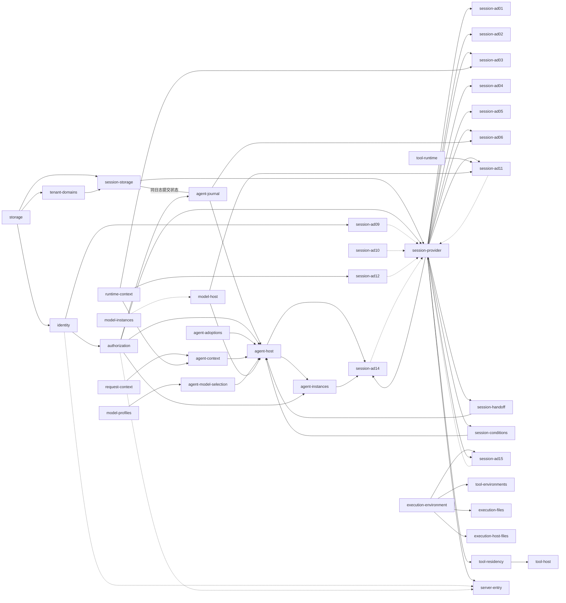

# 应用装配：单机首条租户路径

状态：[#677](https://github.com/nemori-ai/omne-harness-lite/issues/677) 的装配设计。它不表示应用成员或首条租户路径已经实现或验证；各成员的实际支持范围以成员 README 的支持范围表为准。

本页拥有单机首条租户路径的应用装配责任：进程里装哪些成员、每个成员以插件树的哪一行进入、装配入口提供哪些运行时对象、替身与真件在哪里切换，以及只能由应用装配承担的桥接。首条租户路径是：外部调用者创建租户、登录、发出第一次请求，收到第一条 Agent 纯消息回复，再读到历史。首条路径先验收纯消息回复；插件树同时列出工具与本地执行环境的装配，供后续工具往返使用，实际实现与验证归 M2。

插件树的格式与层叠归 [IC-15](../cordis-integration-conventions.md#ic-15)、[IC-16](../cordis-integration-conventions.md#ic-16)；运行时对象经装配入口提供归 [IC-1](../cordis-integration-conventions.md#ic-1)；共同宿主与配置归 [Cordis 集成](runtime-contract-integration.md#配置与插件树)；采用协调与重装归[定义求值与装配交接](../../domains/assembly-and-handoff/README.md)。本页不发布可运行的插件树。

## 进程与装配入口

首条租户路径是一个单机进程，由一个私有应用成员承载，它就是本页所说的应用装配。应用成员的名字和目录由实现时用包模板生成，不由本页的叙述授予。

装配入口按下面的次序启动进程：

1. 读取发行层与运维者层，按行 id 层叠出最终插件树（[IC-16](../cordis-integration-conventions.md#ic-16)）。
2. 提供[运行时对象](#运行时对象)。运行时对象不进插件树。
3. 按插件树装载各行插件。插件经 `inject` 取得必需服务，按调用现取的端口不进 `inject`。
4. 等待全部行就绪。某一行停在 `PENDING` 时，装配入口报告缺哪一项必需服务，进程不开始接收消息；某一行 `FAILED` 时启动失败，分别诊断（[Cordis 集成](runtime-contract-integration.md#配置与插件树)）。
5. 全部行就绪后，服务端接入开始在会话位置与治理位置接收消息。

## 插件树

下表是首条租户路径的发行层。行 id 是对运维者的稳定承诺；改名、删一行或换一行的插件属于发行层修订，要写进应用成员的当前说明与发行说明。运维者层只按行 id 替换配置、停用或插入行。

| 行 id | 成员与插件 | 提供 | 必需（`inject`） | 按调用现取 | 配置（可序列化） |
| --- | --- | --- | --- | --- | --- |
| `storage` | 存储契约的 SQLite 提供者 | 按事务域登记的存储服务 | 无 | 无 | 存储根目录；[存储契约](../../../packages/storage/docs/storage-contract/SPEC.md#提供者义务)要求的四项数值（`admissionQueueLimit`、`lockWaitMs`、`maxCommandsPerCommit`、`maxCommandBytes`） |
| `tenant-domains` | 应用成员的目录插件 | `tenantDomains`：租户到事务域的解析，含首次解析时的组合登记 | `storage` | 无 | 事务域推导规则；组合版本；登记表的文件位置（在存储根目录下）。见[租户到事务域的目录](#租户到事务域的目录) |
| `identity` | `@omne-harness/identity` 的提供者插件 | 注册激活、签发登录、识别登录；`TenantStandingSource` | `storage` | 无 | 登录期限与空闲期限 |
| `authorization` | 应用成员的授权适配插件 | Session 身份桥使用的准入裁定；`agentAccessCheck`、`sessionAccessCheck` | `identity` | 无 | 角色映射的选择 |
| `session-storage` | `@omne-harness/session-storage-sql` 的提供者插件 | `sessionTransactions` | `storage`、`tenantDomains` | 游标签名密钥的取用入口 | 介质（与 `storage` 行相同的 SQLite）；`pageBytes` 上限；`maxScanPerPage`；快照重建方式。其余字段取[成员配置](../../../packages/session/session-storage-sql/docs/cordis.md#配置)的初值 |
| `session-provider` | `@omne-harness/session-cordis` 的插件 | `session`（四个面）；协调器与调度器，含推进触发调度器 S1 | `sessionAccessCheck`、`sessionTransactions`、`sessionPrincipals` | `sessionIdentity`、`sessionEvidence`、`sessionContextInput`、`sessionIdleInput`、`sessionAgentDrive`、`sessionScopeRelease`、`sessionClock`、`sessionNotifier` | `admission: 'none'`（本部署没有命令域与 hooks） |
| `session-ad01` | session-adapters 的 AD-01 Agent 同日志提交参加者 | 无（与 Journal 提供者共用会话日志的发布边界） | `session`（`caller: 'coordinator'`） | 无 | 无 |
| `session-ad02` | AD-02 Agent 同日志解释 | 无 | `session`（`'coordinator'`） | Journal 提供者的 `output.read`、`output.events` 与 `load` | 每次读取事件数上限；超时与重试退避 |
| `session-ad03` | AD-03 持有者与生产者，含回放与变化提醒两个子插件 | 无 | `runtimeContext`、`session`（`'coordinator'`、`'reader'`） | 无 | 无 |
| `session-ad04` | AD-04 历史源 | 无 | `session`（`'reader'`；下界子插件 `'coordinator'`）；RQ 来源登记服务 | 无 | 无 |
| `session-ad05` | AD-05 Model 日志消费适配，含 Tool 原生产者确认投影 | 无 | `session`（`'coordinator'`） | 同一 Journal 提供者的 `received` 条目、材料与 `load().results` | 超时与重试退避 |
| `session-ad06` | AD-06 Tool 日志消费适配 | 无 | `session`（`'coordinator'`）；同一 Journal 提供者的 entries、results 与材料视图 | 无 | 超时与重试退避 |
| `session-ad09` | AD-09 身份桥 | `sessionIdentity` | identity 的核验器所在的服务 | 无 | 无 |
| `session-ad10` | AD-10 证据桥 | `sessionEvidence` | 装配采用、生产来源与保管来源的服务（键见缺口表） | 无 | 无 |
| `session-ad11` | AD-11 空闲输入 | `sessionIdleInput` | `modelRuntime`、`toolRuntime`、`session`（`'maintainer'`） | 无 | 无 |
| `session-ad12` | AD-12 Context 输入 | `sessionContextInput` | `runtimeContext` | 无 | 无 |
| `session-ad14` | AD-14 `AgentDrivePort` | `sessionAgentDrive` | `agentInstances`、`agentExecutionRecovery`、`agentExecutionControl`、`session`（`'coordinator'`） | 无 | 无 |
| `session-ad15` | AD-15 作用域释放，含重新释放子插件 | `sessionScopeRelease` | `executionEnvironment`（`caller: 'maintainer'`）；子插件还需 `session`（`'maintainer'`） | 构造时交入恢复授权 | 超时、重试退避与重新释放页大小 |
| `session-handoff` | session-adapters 的 J06 消息准入插件 | `agentMessageHandoff` | `session`（`'coordinator'`） | 无 | 无 |
| `session-conditions` | session-adapters 的 J06 当前条件插件 | `agentConditions` | `session`（`'coordinator'`） | 实际已采用配置、模型选择、Context 与 bindings 的原来源（见缺口表） | 无 |
| `agent-journal` | session-adapters 的会话日志 Journal 提供者 | `agentJournal`；同一提供者兑现 `AgentJournalEntries` 与 `AgentMaterials` | `sessionAccessCheck`（派生的 Session 参加按 Session 操作裁定）；与 `session-storage` 共用会话日志提交状态 | 无 | 无 |
| `agent-adoptions` | 应用成员的采用适配插件 | `agentAdoptions` | 无 | 无 | [定义名映射](#桥接责任) |
| `agent-model-selection` | 应用成员的模型选择适配插件，实现 Agent 的 `ModelSelection` | `agentModelSelection` | `modelProfiles` | 会话保存的选择及其来源，读取面见缺口表 | 无 |
| `agent-host` | `@omne-harness/agent-host-local` 的宿主插件 | Agent 宿主、`agentPublicationAuthority`、`agentExecutionRecovery`、`agentExecutionControl` | `agentJournal`、`agentAccessCheck`、`agentAdoptions`、`agentConditions`、`agentRequests`、`agentModelSelection`、`agentModelContext`、`agentMessageHandoff`、`modelRuntime`、`agentClock` | `toolRuntime`，在工具阶段取得；其余局部依赖见[宿主的 Cordis 页](../../../packages/agent/agent-host-local/docs/cordis.md#局部依赖与可选依赖) | `jointCommits`：与 Journal 提供者支持的共同提交种类一致；Agent [工厂配置](../../../packages/agent/agent/docs/public-api.md#工厂配置)的其余项 |
| `agent-instances` | `@omne-harness/agent-cordis-contract` 的 `agentInstancesPlugin` | `agentInstances` | `agentPublicationAuthority`、`agentAccessCheck` | 无 | 无 |
| `model-host` | `@omne-harness/model-host-local` 的 `ModelRuntimeLocalPlugin` | `modelRuntime`、`modelInstanceHost` | `modelCommands`、`modelClock`、`modelHostAuthority` | 发送、重试与目录由局部阶段子插件取得 | 并发上限、唤醒容量、扫描批次与扫描间隔，按[Model 装配设计](../../../packages/model/model/docs/cordis.md#单机提供者的插件划分) |
| `model-instances` | `@omne-harness/model-host-local` 的 `ModelInstancesLocalPlugin` | `modelInstances` | `modelPublicationAuthority` | 无 | 无；失去目录只影响路由取得 |
| `model-converters` | 同成员的 `ModelConvertersLocalPlugin` | `modelConverters` | `modelConverterAuthority` | 无 | 无；独立于运行时与结果查询 |
| `model-profiles` | Model 档案读取提供者，继承 `ModelProfilesService` | `modelProfiles` | 档案读取、当前身份与设置、凭据状态元数据适配器，精确跨域键归提供者 | 无 | 无 |
| `model-credential` | `@omne-harness/model-host-local` 的 `LocalCredentialPlugin` | `modelCredential` | 无 | 无 | 保管库配置，见[凭据插件](../../../packages/model/model-host-local/docs/cordis.md#生命周期与清理) |
| `tool-runtime` | `@omne-harness/tool-host-local` 的门面插件 | `toolRuntime` | `toolCommands`、`toolReads` | `toolCatalog`、`toolInstances` 的稳定窄代理逐次现取 | 按[宿主阶段装配](../../../packages/tool/tool-host-local/docs/cordis.md#阶段装配与换代) |
| `tool-executor` | tool-host-local 的长期执行宿主插件 | Tool 的独立执行驱动 | `toolCommands`、`toolInstanceHost`、`toolClock` | 准备、环境、等待与输出能力在各自阶段取得 | 有界调度策略，见[宿主规格](../../../packages/tool/tool-host-local/SPEC.md) |
| `tool-host` | tool-host-local 的换代协调者插件 | `toolGenerations` | `toolBindings`、`toolContributionAuthority`、`toolResidencyReader` | 无 | 无；冻结不由换代协调者判定 |
| `tool-residency` | 应用成员的常驻引用桥接插件 | `toolResidencyReader`（键与形状归 [tool-cordis-contract](../../../packages/tool/tool-cordis-contract/docs/cordis.md#换代协调者契约)） | `session`（`caller: 'maintainer'`）、`toolResidencyPrincipal`（常驻引用读取主体，装配入口提供的运行时对象，见[运行时对象](#运行时对象)） | 无 | 每页读取上限，交给 `references` 的 `limit` |
| `tool-instances` | Tool 实例目录提供者，构造定义入口的 `ToolInstancesService` | `toolInstances` | `toolPublicationAuthority` | 无 | 无 |
| `tool-environments` | 工具宿主侧的执行环境适配插件 | `toolEnvironments` | `executionEnvironment`（`caller: 'integrator'`） | 原获取与释放记录按 Tool P03 保存与认回 | 环境目标按调用的固定采用进入，不写共享租户覆盖表 |
| `execution-environment` | `@omne-harness/execution-environment-host-local` 的 `ExecutionEnvironmentRegistry` | `executionEnvironment` | 无 | `executionEnvironmentAuthority`、`executionScopeBinding`、`executionRecoveryAuthority`，从提供者装载上下文现取 | 空配置 |
| `execution-files` | 同成员的 `filesFacilityPlugin` | `files` 设施声明，不另提供服务键 | `executionEnvironment`（`caller: 'provider'`） | 无 | 空配置 |
| `execution-host-files` | 同成员的 `createHostFilesPlugin(domain)` 所产 `hostFiles` 插件 | `host_machine` 的 `files` 提供者，不另提供服务键 | `executionEnvironment`（`caller: 'provider'`） | 无 | `drainBoundMs`；责任域是工厂参数，不进配置 |
| `request-context` | `@omne-harness/request-context-cordis` 的插件 | `requestContext` | 无 | 按 [request-context-cordis 的 Cordis 页](../../../packages/context/request-context-cordis/docs/cordis.md)现取 | 压缩策略的选择 |
| `agent-context` | Context 一侧的 Agent 适配集成包（[适配方案](../../../packages/context/request-context-contract/docs/context.md#适配方案)） | `agentRequests`、`agentModelContext` | `requestContext`、`runtimeContext` | 无 | 无 |
| `runtime-context` | `@omne-harness/runtime-context-cordis` 的插件 | `runtimeContext` | 无 | 无 | 无 |
| `server-entry` | `@omne-harness/server-entry` 的插件 | 治理位置与会话位置的接入 | `session`（`caller: 'intake'` 与 `'reader'`） | identity 的三项操作、准入裁定 | 两个位置的承载地址；`pageBytes` 上界；读历史的条目种类清单（默认 `message.user`、`message.assistant`）；[定义名映射](#桥接责任)的选择 |

每行装一个插件（[IC-16](../cordis-integration-conventions.md#ic-16)）；插件自己的子插件随父插件装载。`session-ad*` 各行的 `inject` 以 [session-adapters 的 Cordis 页](../../../packages/session/session-adapters/docs/cordis.md#插件注入与提供的键)为准，运维者可以按行 id 单独替换其中一行。

`sessionAccessCheck` 由 `authorization` 行提供，`session-provider` 把它列为必需 `inject`，缺席时停在 `PENDING`。Session 的十一个依赖键以 [session-cordis-contract 的端口服务键](../../../packages/session/session-cordis-contract/docs/cordis.md#端口服务键)为唯一表，本页各行只引用它。每次公开读写在实际执行处调用一次检查，事务 `commit` 显式携带本次 `SessionAccess`，规则见[访问检查](../../../packages/session/session-contract/docs/access-check.md)。各成员已经接入的范围以成员的支持范围表为准；`authorization` 行与 `session-provider` 行列在本表中，不表示这条路径已经可运行。

`agent-host` 在实例之外持有结果接收方，构造时把同一会话日志提供者的 Journal、entries、materials 与接收共同提交能力交给它，不新增结果接收服务键。Model 经固定接收目标推送，`received`、完整材料、消费绑定与 `saved` 同次提交可见，Agent loop 只从 Journal 采用结果；Agent 对 Model 只发 `admit`、`cancel`，`inspect` 仅用于恢复对账。Model 在 `saved` 之后自己取得 ACK，Agent 不代发 ACK，见 [#787 已接受的接收边界](../../../packages/agent/agent-host-local/docs/cordis.md#接收组件的宿主寿命)。Tool 结果同样经结果接收方推送进入这份日志，接收方只返回 `saved`，Tool 宿主收到 `saved` 后自己解除交付责任。Session 的 AD-05 与 AD-06 只读这份日志，不注入 Model 或 Tool。完整 Tool 收场材料（[`TOOL-SETTLEMENT-SCHEMA`](#tool-settlement-schema)）、Model 确认到达（`MODEL-ACK-ARRIVAL`）与 Tool 解除回执进入日志的方式（`JC-RELEASE-TOOL-PATH`）都有具名承接者，见缺口表。

`agent-host` 把 Agent 公开接口列为必需的十项全部放进 `inject`。Agent 的[开放问题](../../../packages/agent/agent/docs/architecture/open-questions.md)里「静态 inject 还是在使用点取得」一项，本部署按 `inject` 裁定：缺任一项时 Agent 宿主停在 `PENDING`，不在首次使用时才失败。

工具与执行环境各行按上表装载。`toolRuntime` 由 `tool-runtime` 提供，Agent 在工具阶段取得它，AD-11 静态注入它，AD-06 只读会话日志而不注入它；`toolEnvironments` 由工具宿主侧适配器提供，Tool 准备与安全恢复阶段取得它；适配器以 `integrator` 调用 `executionEnvironment`，取得落点、租约与设施。工具执行者只拿设施，不接管租约。三个键的定义分别归 Tool 与执行环境的定义入口；[获取、认回与释放映射](../../../packages/execution/execution-environment-contract/docs/context.md#邻域交接)及[执行环境寿命对应](../../domains/sessions-and-work/architecture.md#执行环境的寿命对应)约束其组合。Agent 退出或重装配不释放 Tool 的环境。`files` 的读、写与编辑组合沿 [#791 的执行环境契约](../../../packages/execution/execution-environment-contract/SPEC.md#设施协议)，`command` 真实宿主及四个工具仍是 M2 缺口。

`tool-host` 与 `tool-residency` 同装载，不装 `tool-host` 时也不装桥接行。桥接以 `toolResidencyPrincipal` 出示装配入口签发的常驻引用读取主体，调用 Session 的公开 `SessionReconciliation.references`，把每个引用投影为 `{ holder, tenant, shape }`。`tenant` 原样取自每条 `ResidentReference`，不按会话标识经目录反查。调用输入显式带系统作用域与登记键，只读持有者引用，不读取业务正文，不授普通租户装载、冻结或执行权（[IC-18](../cordis-integration-conventions.md#ic-18)）。桥接缺席或未就绪时换代协调者停在 `PENDING`，不提供 `toolGenerations`、不撤贡献；读取失败交为 `unavailable`，协调者 `reopen(key)` 并返回 `retained`。桥接撤除路径把尚未返回的读取结算为 `unavailable`，后续重跑与保留规则见[持有者引用桥接](tool-runtime.md#持有者引用由应用装配桥接)。

AD-06、AD-11、AD-15 按表装载，AD-13 不装载，由 `tool-residency` 承接 Reader；插件树中没有驻留动作端口。桥接读到的每个常驻引用都自带 tenant，桥接不按会话反查租户，也不按租户换用别的调用方类。会话历史源由 `session-ad04` 提供，常驻引用桥不提供历史。模型选择不属于 Session 组：`agent-model-selection` 行的应用侧适配器实现 Agent 的[模型选择](../../../packages/agent/agent-contract/SPEC.md#模型选择)，会话只保存选择及其来源。AD-08 仍待 NP-07，本部署 `admission: 'none'`。AD-16 与 AD-17 对应的两个出站端口已被替代，不装载，见 [被替代的协议](../../../packages/session/session-contract/SPEC.md#被替代的协议)。启动围栏是 Agent 日志的 `start-fence` 条目。交付责任解除不经 Session 的出站端口：生产者收到 `saved` 后自己解除，结果接收方只返回 `saved`。Tool 一侧原生产者确认怎样写入日志见缺口表的 `JC-RELEASE-TOOL-PATH`，Model 一侧见缺口表的 `MODEL-ACK-ARRIVAL`。

`sessionIdleInput` 或 `sessionScopeRelease` 缺席时，按 [Session 的端口表](../../../packages/session/session-contract/SPEC.md#构造依赖端口与出站端口)返回 `unavailable` 或保留任务，不把缺席当空闲或释放完成。本部署不提供 `sessionNotifier`，每次提交后它缺席不回滚提交；它也不是观察通道的事实源。

| 通道 | 组合与边界 |
| --- | --- |
| 观察通道 | `server-entry` 从 Session 公开日志读面取得稳定 `ModelInvocationRef`，携带观察者自己的 `Access` 查询 Model `current`，再向目标生产者先取快照、后观察增量。各边界分别核权，Agent 不在重附着链路；接入拥有有界刷新、迟到响应隔离与本地观察资源清理。脱离、取消或撤权停止观察，不控制、不重发 Model 或 Tool，不推进 Session。完整约束见[观察脱离与重附着](runtime-contract-handoff.md#观察脱离与重附着)，运行连续证据归 #790 H3。显示只接公共观察端口，观察流不作控制、结果保管或交付责任解除的输入 |

箭头从提供方指向使用方。除 `session-storage` 到 `agent-journal` 表示同一会话日志提交状态外，实线是 `inject`（必需，缺席时使用方停在 `PENDING`）；虚线是按调用现取（缺席时只让需要它的操作返回 `unavailable`）。`session-provider` 对 `session-ad*` 提供的端口按调用现取，`agent-host` 与 `session-ad14` 之间的方向也只有一条实线，所以插件树没有 `inject` 环。`session-ad10` 的来源服务、`session-ad04` 的 RQ 来源登记服务、`session-conditions` 的原来源、Tool 内部后端与 Model 除目录阶段以外的阶段依赖未在图中展开，以表及成员 Cordis 页为准。运行时对象不进插件树，图中不画。

## 缺口与承接者

下列行的插件或服务在本页写定时还没有提供者，承接者负责交付：

| 缺口 | 承接者 |
| --- | --- |
| `storage` 行：存储契约的 SQLite 提供者 | [#687](https://github.com/nemori-ai/omne-harness-lite/issues/687)（SQL 契约）、[#786](https://github.com/nemori-ai/omne-harness-lite/issues/786)（存储线）、[#280](https://github.com/nemori-ai/omne-harness-lite/issues/280)（真实存储） |
| `tenant-domains` 行：目录插件与登记表 | 应用成员的实现，随首条路径的应用装配实现 |
| `identity` 行：持久提供者与插件；identity 自己的记录落在哪个事务域（租户在注册时才产生，[ID-16](../../../packages/identity/identity/SPEC.md#id-16-首批公开形状主体与资格事实) 未写） | identity 持久提供者，待建卡 |
| `session-storage`、`session-provider`、`session-ad*` 行的源码与 `session` 服务键 | Session 实现，待建卡；目标形状已在 [session-cordis-contract 的 Cordis 页](../../../packages/session/session-cordis-contract/docs/cordis.md)固定 |
| `session-storage` 的组合登记时机：成员 Cordis 页的[加载次序](../../../packages/session/session-storage-sql/docs/cordis.md#加载与组合登记)第 3 步在插件加载时登记一次，与每租户一个事务域不符 | Session 实现：改为由 `tenant-domains` 在租户首次解析时用本成员给出的登记材料登记，与成员[装配须知](../../../packages/session/session-storage-sql/docs/context.md)第 2 条一致 |
| 登记表重建的两个前提：存储提供者文件名与事务域标识的对应、推导规则可逆 | 存储提供者（[#687](https://github.com/nemori-ai/omne-harness-lite/issues/687)、[#786](https://github.com/nemori-ai/omne-harness-lite/issues/786) 存储线）与应用装配实现；前提不成立时登记表丢失只能人工恢复 |
| `session-handoff` 与 `session-conditions` 行：session-adapters J06 的两个生产插件，以及当前条件读取的原来源 | Session 实现；不以默认允许或空条件的插件冒充就绪。交付前 `agent-host` 停在 `PENDING`，首条路径不能开始接收消息 |
| Session 一侧 `release` 的记账，Tool 一侧：具名偏离 [`JC-RELEASE-TOOL-PATH`](../../../packages/session/session-contract/SPEC.md#jc-release-tool-path)。Tool 宿主收到 `saved` 后自己解除，解除回执怎样进入日志未定。日志中已有原生产者确认时，AD-05 按 [JC-Release](../../../packages/session/session-contract/SPEC.md#jc-release) 经 `receive(release)` 写 SE19。没有确认时保持 pending，`judgeIdle` 为 not-due，该项不进入 `openWork`。闭合前推送路径没有回执进日志，所以用过工具的会话都不会自动归档 | Agent 契约与宿主拥有者；闭合放在里程碑 M2 |
| Session 一侧 `release` 的记账，Model 一侧：`MODEL-ACK-ARRIVAL` 未决，保持 pending 并计入未结工作，闭合前有 Model 结果的会话不会自动归档 | Agent 契约与宿主拥有者承接 Model 确认到达，闭合放在里程碑 M2；不把 Tool 的 `recordResult` 路径套给 Model |
| 具名偏离 `TOOL-SETTLEMENT-SCHEMA`：Tool 收场的完整 schema（`terminal`、`actualTerminal`、`effect`）未采用。AD-06 缺少可读的完整材料时返回 `unavailable` 并保留任务 | Agent 契约与宿主拥有者；补采用放在里程碑 M2 |
| `session-ad10` 行：所 `inject` 的装配采用与保管来源服务的键未定。候选采用材料里的冻结判定由装配协调者在采用点调用 Tool 的 `planAdoption` 得出（[工具运行时](tool-runtime.md#冻结判定只随采用材料到达)） | Session 实现 |
| `agent-journal` 行：Session 会话日志上的生产 Journal 插件；已接受的同日志角色组只有非耐久 `./testing` 提供者 | Session 实现；按 [#756 的同日志提供者](../../../packages/session/session-adapters/SPEC.md#agent-journal-提供者与非耐久替身)兑现，不另建 Agent 存储 |
| `agent-host` 行：宿主插件 | [#502](https://github.com/nemori-ai/omne-harness-lite/issues/502) |
| `agent-model-selection` 行：应用侧模型选择适配器，以及它读取会话保存的选择所用的 Session 读面 | M2 应用装配实现 |
| `sessionAccessCheck` 的生产提供者（含系统作用域读取所需的系统授权；缺席时 `references` 与 `releasedScopes` 返回 `unavailable`），以及 Session 生产服务与存储工厂对它的必需接线 | 授权适配器的拥有者（authorization 后继）与 Session 实现 |
| 具名真实提供者：AD-03 的可信绑定与同步 current，AD-04 的完整历史与采用顺序，AD-15 的原获取与目录来源 | Session 实现与 M2 应用装配实现；认领前对应行不宣称可运行 |
| `agent-adoptions` 行：采用适配 | 首条路径由应用成员按定义名映射提供；采用协调契约归 [#688](https://github.com/nemori-ai/omne-harness-lite/issues/688) |
| `agent-context` 行：Context 一侧的 Agent 适配集成包 | 已登记在 Context 运行时实现卡 [#542](https://github.com/nemori-ai/omne-harness-lite/issues/542) |
| `model-host`、`model-instances`、`model-converters`、`model-profiles` 行及 Model 局部阶段插件：运行、档案与宿主生产实现 | [#795](https://github.com/nemori-ai/omne-harness-lite/issues/795)；按[Model 插件划分](../../../packages/model/model/docs/cordis.md#单机提供者的插件划分)保留目录与查询的故障隔离 |
| Tool 门面、执行宿主、换代协调者、实例目录与执行环境适配的生产插件；四工具定义与 Catalog、`command` 真实提供者 | M2 Tool 与执行环境实现拥有者；现有 [#791](https://github.com/nemori-ai/omne-harness-lite/issues/791) 只交契约核对与 `./testing`，不关闭宿主缺口 |
| `tool-residency`、主体服务与三个环境授权及绑定服务的应用侧提供者 | M2 应用装配实现；精确成员导出名未定义的插件不以本表职责名冒充已交付导出 |
| `server-entry` 行：接入实现与会话编解码 | 会话编解码归 [#685](https://github.com/nemori-ai/omne-harness-lite/issues/685)；接入实现待建卡 |
| AD-09 身份桥对 ID-11 与 AU-09 的前提 | identity 与 authorization 后继 |

## 运行时对象

下列对象由装配入口提供，不进插件树：

| 对象 | 使用者 | 要求 |
| --- | --- | --- |
| identity 的签发者 | `server-entry`（为登录请求签发代租户行事主体）；装配入口自己（签发系统主体：`SessionInternalPrincipals`、常驻引用读取主体、恢复与扫描的维护者、AD-14 的出站主体） | 签发者只交给这两处，即 [ID-16](../../../packages/identity/identity/SPEC.md#id-16-首批公开形状主体与资格事实) 所说「装配授权的系统部件」；identity 的登录流程不持有它 |
| identity 的核验器 | `authorization`、`session-ad09`、`server-entry` | 只证明来源，不证明成员资格 |
| `SessionInternalPrincipals` | `session-provider` 的 `sessionPrincipals` | 由装配入口签发，Session 身份桥核实 |
| 常驻引用读取主体 | `tool-residency` 的 `toolResidencyPrincipal` | 由装配入口签发的系统主体。桥接插件以调用方类 `maintainer` 调用 `references` 时出示它，作为系统作用域的读取资格。不进插件树，不进插件配置 |
| 环境授权、可信作用域绑定与恢复授权 | `execution-environment`；AD-15 另在构造时接收恢复授权 | 入口装载 `ExecutionEnvironmentAuthorityService`、`ExecutionScopeBindingService`、`ExecutionRecoveryAuthorityService` 的子类，提供 `executionEnvironmentAuthority`、`executionScopeBinding`、`executionRecoveryAuthority`。逐次现取，缺席按[环境端口规则](../../../packages/execution/execution-environment-host-local/docs/cordis.md#插件与配置)不可用 |
| 宿主文件责任域 | `execution-host-files` | 进程宿主只创建一次，重载仍交同一责任域；插件卸载只退役这一代，不删除原获取与占用 |
| Model 与 Tool 的原事实、权威与时钟适配对象 | `model-host`、`model-instances`、`model-converters`、`tool-runtime`、`tool-executor` 等 | 按各成员的唯一服务定义提供；Tool 启动授权与启动围栏由同一提供者兑现同一排序域，不以同名键证明同权威 |
| 游标签名密钥 | `session-storage` | 只经取用入口交入，不进插件配置（[成员配置](../../../packages/session/session-storage-sql/docs/cordis.md#配置)） |
| 时钟 | `identity`、`session-provider`（`sessionClock`）、`agent-host`（`agentClock`） | 缺席时按各成员规定返回 `unavailable`，见 [SessionClock](../../../packages/session/session-contract/SPEC.md#sessionclock-与-sessionidleinput) |
| 凭据解析 | `model-host` | 只交凭据引用，不交秘密副本 |
| 供应商传输适配 | `model-host` | 经注入交给 Model 宿主，不设供应商全局键 |

## 桥接责任

下列桥接只能由应用装配承担，因为它们连接两个互不依赖的成员：

| 桥接 | 输入 | 输出 | 失败时 |
| --- | --- | --- | --- |
| 授权适配 | 准入输入；identity 的核验器与 `TenantStandingSource` | `AdmissionDecision`；`agentAccessCheck`、`sessionAccessCheck` | 读口或核验器不可答时是 `unavailable`，不改写成已知无权 |
| 签发者安装 | identity 的签发者 | `server-entry` 持有的签发者 | 未安装时 `server-entry` 行停在 `PENDING`；运行中签发失败时按[会话判断次序](../../../packages/access/public-contract/SPEC.md#会话判断次序)第 4 步返回 `basis-unavailable` |
| 登录门的证据 | 首条普通输入的 `origin`（`owner` 为 `login-entry`） | `session-ad10` 的证据桥交给 `startRun` 的登录确认 | `origin` 不是登录入口证据时不给确认，Session 返回 `login-required`；它不进入公开结果 |
| 采用点冻结判定（装配协调者） | 本次 `SessionAccess` 的租户、常驻工具首次定义 shape 与精确采用事实 | 新 Run 与显式 reload 均调用 `planAdoption`，把判定放进候选采用材料；由 `session-provider` 的 C2 提交命令及 `freeze` | 收集依据不可用时不补造判定；完整失败按[采用点判定](../../../packages/tool/tool-contract/SPEC.md#采用点判定)与 Session 命令契约处理 |
| 定义名映射 | 公开消息的定义名 | 每个定义名一条：定义候选、执行类型与入口契约的采用，`requiredIdentities`，`modes` 的默认值；同一条也是 `agent-adoptions` 投影 `agentAdoptions` 的依据 | 定义名不在映射内时，服务端接入按会话判断次序第 5 步返回 `invalid` |

定义名映射是发行层数据，放在 `agent-adoptions` 行的配置里；`server-entry` 只选择用哪一份。`modes` 的默认值来自映射条目，首条路径不读取租户设置。登录门与定义名映射的公开一侧见[公开接入与宿主](runtime-contract-handoff.md#318-公开接入与宿主)。

装配协调者在新 Run 与显式 reload 的采用点，按本次 `SessionAccess` 的租户收集采用事实并调用 Tool 的纯函数 `planAdoption`，把冻结判定放进候选采用材料。它不经驻留动作端口回送。Session 的 C2 协调器取得材料，以同一会话、同一 `SessionAccess` 和调用方类 `coordinator` 提交 `startRun` 或 `reload`；得到 `frozen` 后用同一判定提交 `freeze`。`create` 的材料不带冻结判定，换代协调者的 `sweep` 也不判冻结。协调契约仍归 [#688](https://github.com/nemori-ai/omne-harness-lite/issues/688)，顺序与 `maintainer` 分支的边界见[冻结判定路径](tool-runtime.md#冻结判定只随采用材料到达)。

## 租户到事务域的目录

存储只把事务域绑定当作不透明分区键的守卫，一个事务域只服务一个租户（[存储契约](../../../packages/storage/docs/storage-contract/SPEC.md)）。目录由应用装配维护：

- 推导规则：每个租户一个事务域，事务域标识由租户的 tenantCodec 文本按 `tenant-domains` 行配置的规则推导。运行时新建的租户不需要改配置。
- 组合登记：会话日志提供者第一次为某个租户向 `tenantDomains` 解析事务域时，`tenant-domains` 先以该租户、推导出的事务域和配置的组合版本调用 `registerCombination`。参加者清单与登记材料（参加者模块与迁移片段）取自会话日志存储提供者的公开导出。`agent-journal` 与 Session 共用同一日志发布根，每个事务域只登记会话日志存储提供者的一个组合；生产存储的具体参加者材料仍由其实现拥有者交付。应用成员在构建时导入材料，不经插件树，也不另写一份名字。登记成功、该事务域的迁移片段按存储契约的期望 XP-5 执行完毕之后，才返回事务域；所以第一次提交之前登记与迁移都已完成。再次登记同一组合是幂等的；参加者清单与已登记的不一致时得到 `registration_conflict`，解析返回 `unavailable` 并报告诊断。`agent-host` 的 `jointCommits` 是共同提交的种类，另行与 Journal 提供者核对，不与这份名字清单比较。
- 登记表：`tenant-domains` 在第一次登记成功、返回事务域之前，把该租户写进登记表。登记表是存储根目录下由应用装配持有的一个文件，以先写临时文件、刷盘、再改名并刷盘目录的方式整体替换；它不是事务域，不经存储契约，只记租户的 tenantCodec 文本。登记表只记解析过的租户，不按 identity 核对租户是否存在：[TenantStandingSource](../../../packages/identity/identity/SPEC.md#当前资格读口) 不区分未知租户与非成员，而进入 Session 的租户已经经过身份桥的资格判断。
- 系统读取：目录按 [XP-6](../../../packages/session/session-storage-sql/SPEC.md#xp-table) 枚举本部署全部租户的事务域。目录缺席、重建中或任何事务域不可读时，`references` 与 `releasedScopes` 返回 `unavailable`，不返回空页或部分租户；AD-15 的重新释放保留任务并重试，换代协调者不能据此撤贡献。
- 启动扫描与恢复的维护者以系统作用域读登记表，逐个租户扫描。登记表丢失或损坏时，按存储根目录下的事务域文件重建；重建完成之前启动扫描不开始。重建有两个前提：存储提供者的文件名能还原事务域标识，推导规则能从事务域标识还原租户。两者都还没有承诺，见缺口表。
- 隔离：本部署每个事务域一个数据库文件。写者 Worker 是否按租户分开归存储提供者；不分开时，按[存储契约](../../../packages/storage/docs/storage-contract/SPEC.md#提供者义务)记为该部署的已知限制。

## 替身与真件

切换在插件树的行上完成。M1 首次联合验收不经插件树：契约骨架验证应用（CS）在进程内直接组合各成员的公开导出与 `./testing` 替身。

| 能力 | 首次联合验收 | 首条租户路径的真件 | 切换的行 |
| --- | --- | --- | --- |
| 注册、登录与识别 | identity 的 `./testing` 替身 | identity 持久提供者 | `identity` |
| 准入 | `decideAdmission` 与测试读口 | 授权适配插件与 identity 真实读口 | `authorization` |
| 会话操作 | 各契约成员的 `./testing` 替身 | Session 实现、存储与适配 | `tenant-domains`、`session-storage`、`session-provider`、`session-ad*` |
| Agent 推进与回复 | Agent 契约的 `./testing` 替身 | Agent 宿主与 Journal | `agent-journal`、`agent-host` |
| 模型调用 | model-contract 的脚本化提供者 | `pi-ai-openai` 经 `model-host` | `model-host` |
| 公开接入 | public-contract 的纯函数与进程内环回 | `server-entry` 经 HTTP | `server-entry` |

替身只证明契约形状与判断次序，不证明持久性、跨进程主体来源、同一事务域的共同提交或真实供应商行为。

## CS 的终位

CS 是私有验证应用 `apps/m2-contract-skeleton`，用于 M1 首次联合验收。它只消费公开导出与 `./testing` 替身，不是本页的应用装配，也不被别的成员依赖。在它退出之前，由 integration 交付线维护。首条租户路径的应用成员经插件树完成同样的端到端验收（创建租户、登录、首次请求、纯消息回复、读历史）之后，CS 按[删除替代实现的政策](../../engineering/publication.md#当前演进与消费者)退出。

## 后继实现的环境与证据

上表各承接者的验收须包含下列环境与证据。缺环境时保留为未执行，不写成通过。

- 固定：组件版本、Node 与数据库环境、进程拓扑（单进程）、持久目录（`storage` 行的根目录）、独立 QA 与原始证据的入口。
- 公开场景覆盖：没有活体时的推进、进程重启、权限失效、原 J 查询、最终权威读取，以及目录登记表的退出与重建。
- 同一事务域的共同提交：`agent-journal` 与 `session-storage` 共用同一租户、同一会话日志的发布状态与存储组合，首次共同发布与后续 Session 解释提交分别验证；`tenant-domains` 的参加者与迁移材料由会话日志存储提供者给出，不另登记 Journal 存储；`agent-host` 的 `jointCommits` 与 Journal 提供者支持的共同提交种类一致，否则 Agent 工厂返回 `unsupported`，Session 服务构造时报告 `unavailable`（[P-1](../../../packages/session/session-contract/SPEC.md#具名前提与明确缺项)）。
- 契约套件对真实提供者运行：Session、identity、存储与 Agent Journal 各自的套件。契约通过不证明耐久，耐久另由崩溃与查询未知的认回用例证明。

Session 实现的后继任务尚未建立；在它们写成可派发材料之前，不标为就绪。本页的接受不宣称上述运行保证已经兑现。

## 不在本页

- 采用协调契约：[#688](https://github.com/nemori-ai/omne-harness-lite/issues/688)。
- 本页各行的生产装配实现与端到端运行证据，归 M2。
- 扩展、人在回路与 MCP 的装配。
