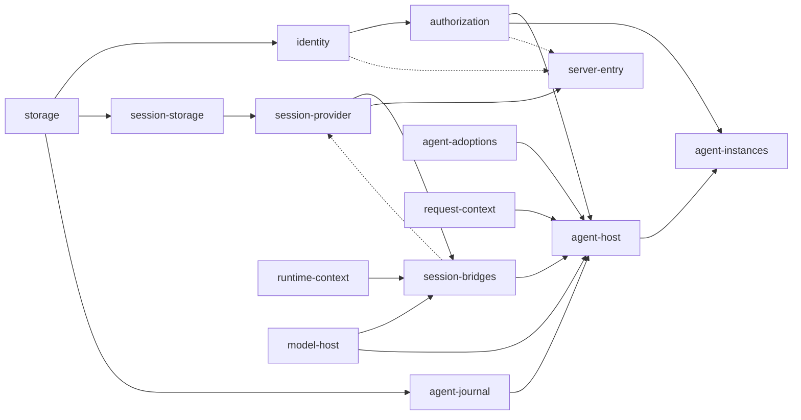

# 应用装配：单机首条租户路径

状态：[#677](https://github.com/nemori-ai/omne-harness-lite/issues/677) 的装配设计。它不表示应用成员或首条租户路径已经实现或验证；各成员的实际支持范围以成员 README 的支持范围表为准。

本页拥有单机首条租户路径的应用装配责任：进程里装哪些成员、每个成员以插件树的哪一行进入、装配入口提供哪些运行时对象、替身与真件在哪里切换，以及只能由应用装配承担的桥接。首条租户路径是：外部调用者创建租户、登录、发出第一次请求，收到第一条 Agent 纯消息回复，再读到历史。工具宿主、执行环境宿主与工具调用不在这条路径上。

插件树的格式与层叠归 [IC-15](../cordis-integration-conventions.md#ic-15)、[IC-16](../cordis-integration-conventions.md#ic-16)；运行时对象经装配入口提供归 [IC-1](../cordis-integration-conventions.md#ic-1)；共同宿主与配置归 [Cordis 集成](runtime-contract-integration.md#配置与插件树)；采用协调与重装归[定义求值与装配交接](../../domains/assembly-and-handoff/README.md)。本页不发布可运行的插件树。

## 进程与装配入口

首条租户路径是一个单机进程，由一个私有应用成员承载，它就是本页所说的应用装配。应用成员的名字和目录由实现时用包模板生成，不由本页的叙述授予。

装配入口按下面的次序启动进程：

1. 读取发行层与运维者层，按行 id 层叠出最终插件树（[IC-16](../cordis-integration-conventions.md#ic-16)）。
2. 提供[运行时对象](#运行时对象)。运行时对象不进插件树。
3. 按插件树装载各行插件。插件经 `inject` 取得必需服务，按调用现取的端口不进 `inject`。
4. 等待全部行就绪。某一行停在 `PENDING` 时，装配入口报告缺哪一项必需服务，进程不开始接收消息；某一行 `FAILED` 时启动失败，分别诊断（[Cordis 集成](runtime-contract-integration.md#配置与插件树)）。
5. 全部行就绪后，服务端接入开始在会话位置与治理位置接收消息。

## 插件树

下表是首条租户路径的发行层。行 id 是对运维者的稳定承诺；改名、删一行或换一行的插件属于发行层修订，要写进应用成员的当前说明与发行说明。运维者层只按行 id 替换配置、停用或插入行。

| 行 id | 成员与插件 | 提供 | 必需（`inject`） | 按调用现取 | 配置（可序列化） |
| --- | --- | --- | --- | --- | --- |
| `storage` | 存储契约的 SQLite 提供者 | 按事务域登记的存储服务 | 无 | 无 | 存储根目录；[事务域目录](#租户到事务域的目录)规则 |
| `identity` | `@omne-harness/identity` 的提供者插件 | 注册激活、签发登录、识别登录；`TenantStandingSource` | `storage` | 无 | 登录期限与空闲期限 |
| `authorization` | 应用成员的授权适配插件 | Session 身份桥使用的准入裁定；`agentAccessCheck` | `identity` | 无 | 角色映射的选择 |
| `session-storage` | `@omne-harness/session-storage-sql` 的提供者插件 | `sessionTransactions` | `storage` | 无 | 无 |
| `session-provider` | `@omne-harness/session-cordis` 的插件 | `session`（四个面）；协调器与调度器，含推进触发调度器 S1；`sessionNotifier` | `sessionTransactions`、`sessionPrincipals` | `sessionIdentity`、`sessionEvidence`、`sessionContextInput`、`sessionAgentDrive`、`sessionClock`、`sessionDeliveryRelease` | `admission: 'none'`（本部署没有命令域与 hooks） |
| `session-bridges` | `@omne-harness/session-adapters` 的插件 AD-01、AD-02、AD-03、AD-04、AD-05、AD-07、AD-09、AD-10、AD-12、AD-14 | `sessionIdentity`、`sessionEvidence`、`sessionContextInput`、`sessionAgentDrive`、`agentModelSelection`、`agentMessageHandoff` | 各插件的 `inject` 见 [session-adapters 的 Cordis 页](../../../packages/session/session-adapters/docs/cordis.md#插件注入与提供的键) | 无 | 无 |
| `agent-journal` | Agent Journal 提供者（带 Session 提交参加者） | `agentJournal` | `storage` | 无 | 无 |
| `agent-adoptions` | 应用成员的采用适配插件 | `agentAdoptions`、`agentConditions` | 无 | 无 | [定义名映射](#桥接责任) |
| `agent-host` | `@omne-harness/agent-host-local` 的宿主插件 | Agent 宿主、`agentPublicationAuthority` | `agentJournal`、`agentAccessCheck`、`agentAdoptions`、`agentConditions`、`agentRequests`、`agentModelSelection`、`agentModelContext`、`agentMessageHandoff`、`modelRuntime`、`agentClock` | 无 | `jointCommits`：与 `agent-journal` 声明的参加者一致；Agent [工厂配置](../../../packages/agent/agent/docs/public-api.md#工厂配置)的其余项 |
| `agent-instances` | `@omne-harness/agent-cordis-contract` 的 `agentInstancesPlugin` | `agentInstances` | `agentPublicationAuthority`、`agentAccessCheck` | 无 | 无 |
| `model-host` | `@omne-harness/model-host-local` 的宿主插件 | `modelRuntime`、`modelProfiles`、`modelCredential` | 无 | 凭据解析 | 供应商适配的选择（首条路径用 `pi-ai-openai`）、端点与模型名、凭据引用 |
| `request-context` | `@omne-harness/request-context-cordis` 的插件与 Agent 适配 | `requestContext`、`agentRequests`、`agentModelContext` | 无 | 按 [request-context-cordis 的 Cordis 页](../../../packages/context/request-context-cordis/docs/cordis.md)现取 | 压缩策略的选择 |
| `runtime-context` | `@omne-harness/runtime-context-cordis` 的插件 | `runtimeContext` | 无 | 无 | 无 |
| `server-entry` | `@omne-harness/server-entry` 的插件 | 治理位置与会话位置的接入 | `session`（`caller: 'intake'` 与 `'reader'`） | identity 的三项操作、准入裁定 | 两个位置的承载地址；`pageBytes` 上界；读历史的条目种类清单（默认 `message.user`、`message.assistant`）；[定义名映射](#桥接责任)的选择 |

发行层不含 `tool-host`、`tool-instances` 与执行环境的行，首条路径的 Agent 定义不选入工具与扩展。由此，下列 session-adapters 插件不装载：AD-06、AD-11、AD-15、AD-16，以及 AD-17（它 `inject` 了 `toolRuntime`）。对应端口按 [Session 的端口表](../../../packages/session/session-contract/SPEC.md#构造依赖端口与出站端口)处理：空闲维护与自动归档返回 `unavailable`；作用域释放与启动资格失效的任务保留；结果的交付责任解除保持 pending，Model 的 ACK 不发出。

箭头从提供方指向使用方。实线是 `inject`（必需，缺席时使用方停在 `PENDING`）；虚线是按调用现取（缺席时只让需要它的操作返回 `unavailable`）。`session-provider` 对 `session-bridges` 提供的端口按调用现取，所以两行之间没有 `inject` 环。

## 缺口与承接者

下列行的插件或服务在本页写定时还没有提供者，承接者负责交付：

| 缺口 | 承接者 |
| --- | --- |
| `storage` 行：存储契约的 SQLite 提供者 | [#687](https://github.com/nemori-ai/omne-harness-lite/issues/687)（SQL 契约）、[#540](https://github.com/nemori-ai/omne-harness-lite/issues/540)、[#280](https://github.com/nemori-ai/omne-harness-lite/issues/280)（真实存储） |
| `identity` 行：持久提供者与插件 | identity 持久提供者，待建卡 |
| `session-storage`、`session-provider`、`session-bridges` 行的源码与 `session` 服务键 | Session 实现，待建卡；目标形状已在 [session-cordis-contract 的 Cordis 页](../../../packages/session/session-cordis-contract/docs/cordis.md)固定 |
| `agent-journal` 行：Journal 入口与 Session 提交参加者 | Agent 自身的 Journal 入口归 [#502](https://github.com/nemori-ai/omne-harness-lite/issues/502)；Session 参加者与原 J 查询的桥接归 Session 实现 |
| `agent-host` 行：宿主插件 | [#502](https://github.com/nemori-ai/omne-harness-lite/issues/502) |
| `agent-adoptions` 行：采用适配 | 首条路径由应用成员按定义名映射提供；采用协调契约归 [#688](https://github.com/nemori-ai/omne-harness-lite/issues/688) |
| `request-context` 行：`agentRequests`、`agentModelContext` 的 Context 适配 | Context 后继实现，待建卡 |
| `model-host` 行：`modelRuntime`、`modelProfiles` 与宿主 | Model 后继实现，待建卡 |
| `server-entry` 行：接入实现与会话编解码 | 会话编解码归 [#685](https://github.com/nemori-ai/omne-harness-lite/issues/685)；接入实现待建卡 |
| AD-17 与 `toolRuntime` 的耦合：没有工具宿主时 Model 的交付责任解除不发出 | Session 实现：AD-17 对 `toolRuntime` 改为按调用现取后，首条路径可以装载它 |
| AD-09 身份桥对 ID-11 与 AU-09 的前提 | identity 与 authorization 后继 |

## 运行时对象

下列对象由装配入口提供，不进插件树：

| 对象 | 使用者 | 要求 |
| --- | --- | --- |
| identity 的签发者 | `server-entry`（为登录请求签发代租户行事主体）；装配入口自己（签发系统主体：`SessionInternalPrincipals`、恢复与扫描的维护者、AD-14 的出站主体） | 签发者只交给这两处，即 [ID-16](../../../packages/identity/identity/SPEC.md#id-16-首批公开形状主体与资格事实) 所说「装配授权的系统部件」；identity 的登录流程不持有它 |
| identity 的核验器 | `authorization`、`session-bridges`（AD-09）、`server-entry` | 只证明来源，不证明成员资格 |
| `SessionInternalPrincipals` | `session-provider` 的 `sessionPrincipals` | 由装配入口签发，Session 身份桥核实 |
| 时钟 | `identity`、`session-provider`（`sessionClock`）、`agent-host`（`agentClock`） | 缺席时按各成员规定返回 `unavailable`，见 [SessionClock](../../../packages/session/session-contract/SPEC.md#sessionclock-与-sessionidleinput) |
| 凭据解析 | `model-host` | 只交凭据引用，不交秘密副本 |
| 供应商传输适配 | `model-host` | 经注入交给 Model 宿主，不设供应商全局键 |

## 桥接责任

下列桥接只能由应用装配承担，因为它们连接两个互不依赖的成员：

| 桥接 | 输入 | 输出 | 失败时 |
| --- | --- | --- | --- |
| 授权适配 | 准入输入；identity 的核验器与 `TenantStandingSource` | `AdmissionDecision`；`agentAccessCheck` | 读口或核验器不可答时是 `unavailable`，不改写成已知无权 |
| 签发者安装 | identity 的签发者 | `server-entry` 持有的签发者 | 未安装时 `server-entry` 行停在 `PENDING`；运行中签发失败时按[会话判断次序](../../../packages/access/public-contract/SPEC.md#会话判断次序)第 4 步返回 `basis-unavailable` |
| 登录门的证据 | 首条普通输入的 `origin`（`owner` 为 `login-entry`） | `session-bridges` 的证据桥（AD-10）交给 `startRun` 的登录确认 | `origin` 不是登录入口证据时不给确认，Session 返回 `login-required`；它不进入公开结果 |
| 定义名映射 | 公开消息的定义名 | 每个定义名一条：定义候选、执行类型与入口契约的采用，`requiredIdentities`，`modes` 的默认值；同一条也是 `agent-adoptions` 投影 `agentAdoptions` 与 `agentConditions` 的依据 | 定义名不在映射内时，服务端接入按会话判断次序第 5 步返回 `invalid` |

定义名映射是发行层数据，放在 `agent-adoptions` 行的配置里；`server-entry` 只选择用哪一份。`modes` 的默认值来自映射条目，首条路径不读取租户设置。登录门与定义名映射的公开一侧见[公开接入与宿主](runtime-contract-handoff.md#318-公开接入与宿主)。

## 租户到事务域的目录

存储只把事务域绑定当作不透明分区键的守卫，一个事务域只服务一个租户（[存储契约](../../../packages/storage/docs/storage-contract/SPEC.md)）。目录由应用装配维护：

- 推导规则：每个租户一个事务域，事务域标识由租户的 tenantCodec 文本按 `storage` 行配置的规则推导。运行时新建的租户不需要改配置。
- 登记表：应用装配在某个租户的第一次 Session 提交成功之后，把该租户写进自己持有的登记表。写入幂等；该租户之后每次提交成功都核对一次，补上崩溃时漏写的条目。登记表只记真正提交过的租户，不按 identity 核对租户是否存在：[TenantStandingSource](../../../packages/identity/identity/SPEC.md#当前资格读口) 不区分未知租户与非成员，而进入 Session 的租户已经经过身份桥的资格判断。
- 启动扫描与恢复的维护者以系统作用域读登记表，逐个租户扫描。没有登记的租户不扫描；它的待办在下一次提交通知时恢复。

## 替身与真件

切换在插件树的行上完成。M1 首次联合验收不经插件树：契约骨架验证应用（CS）在进程内直接组合各成员的公开导出与 `./testing` 替身。

| 能力 | 首次联合验收 | 首条租户路径的真件 | 切换的行 |
| --- | --- | --- | --- |
| 注册、登录与识别 | identity 的 `./testing` 替身 | identity 持久提供者 | `identity` |
| 准入 | `decideAdmission` 与测试读口 | 授权适配插件与 identity 真实读口 | `authorization` |
| 会话操作 | 各契约成员的 `./testing` 替身 | Session 实现、存储与适配 | `session-storage`、`session-bridges`、`session-provider` |
| Agent 推进与回复 | Agent 契约的 `./testing` 替身 | Agent 宿主与 Journal | `agent-journal`、`agent-host` |
| 模型调用 | model-contract 的脚本化提供者 | `pi-ai-openai` 经 `model-host` | `model-host` |
| 公开接入 | public-contract 的纯函数与进程内环回 | `server-entry` 经 HTTP | `server-entry` |

替身只证明契约形状与判断次序，不证明持久性、跨进程主体来源、同一事务域的共同提交或真实供应商行为。

## CS 的终位

CS 是私有验证应用 `apps/m2-contract-skeleton`，用于 M1 首次联合验收。它只消费公开导出与 `./testing` 替身，不是本页的应用装配，也不被别的成员依赖。在它退出之前，由 integration 交付线维护。首条租户路径的应用成员经插件树完成同样的端到端验收（创建租户、登录、首次请求、纯消息回复、读历史）之后，CS 按[删除替代实现的政策](../../engineering/publication.md#当前演进与消费者)退出。

## 后继实现的环境与证据

上表各承接者的验收须包含下列环境与证据。缺环境时保留为未执行，不写成通过。

- 固定：组件版本、Node 与数据库环境、进程拓扑（单进程）、持久目录（`storage` 行的根目录）、独立 QA 与原始证据的入口。
- 公开场景覆盖：没有活体时的推进、进程重启、权限失效、原 J 查询、最终权威读取，以及目录登记表的退出与重建。
- 同一事务域的共同提交：`agent-journal` 与 `session-storage` 在同一租户的事务域登记同一组合版本；`agent-host` 的 `jointCommits` 与 Journal 声明的参加者逐种一致，否则 Session 服务构造时报告 `unavailable`（[P-1](../../../packages/session/session-contract/SPEC.md#具名前提与明确缺项)）。
- 契约套件对真实提供者运行：Session、identity、存储与 Agent Journal 各自的套件。契约通过不证明耐久，耐久另由崩溃与查询未知的认回用例证明。

Session 实现的后继任务尚未建立；在它们写成可派发材料之前，不标为就绪。本页的接受不宣称上述运行保证已经兑现。

## 不在本页

- reload 冻结判定与工具驻留桥接：[#753](https://github.com/nemori-ai/omne-harness-lite/issues/753)。
- 采用协调契约：[#688](https://github.com/nemori-ai/omne-harness-lite/issues/688)。
- 工具、执行环境、扩展、人在回路与 MCP 的装配。
