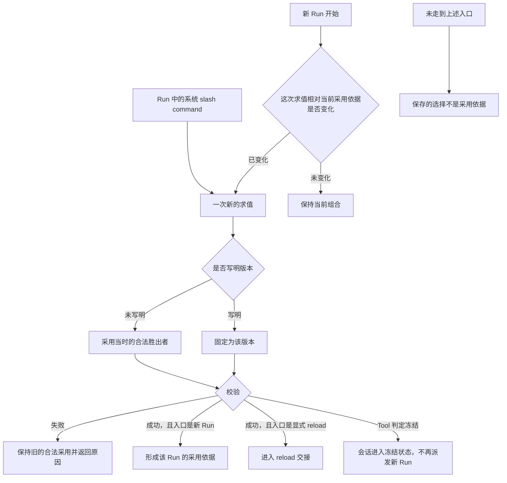
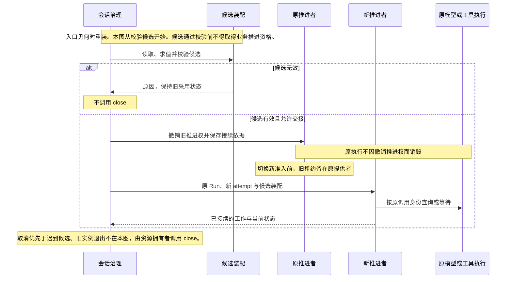

# 装配求值与动态变更

装配先确定合法能力和输入，再形成可供执行的组合。资产、设置和权限分别求值，不能用一个通用的“内层覆盖外层”算法处理。

状态：已接受的目标架构。领域模块独立于 Cordis 建模，系统集成遵循 Cordis 装配及生命周期契约；本页不预定包、服务名或物理父子关系。

## 多层来源求值

账号、组织、租户和工作区提供身份、资格与材料，具体参与规则取决于对象类别。账号全局身份不等于一份能覆盖全部租户的配置层。

| 求值对象 | 参与来源及规则 | 必须保留的边界 |
|---|---|---|
| 能力实现 | 先按持有资格、禁用及锁定筛选，再按官方、组织、租户、工作区的适用层序选择。 | 替换实现不解除能力身份上的授权约束。 |
| 设置 | 默认、组织、租户、工作区、会话按每项的合成语义求值。 | 锁定和适用范围仍有效，不总是取最内层值。 |
| 权限 | 默认、组织、租户、会话共同约束。 | 工作区不是权限来源，内层不得突破外层禁止。 |

工作区 `.omne` 与 `.omne.local` 是同层来源。local 优先不表示租户私有。权限、落点与身份类受限配置须在加载时过滤，不让仓库文件授予宿主权限。

模型档案有自己的具体程度规则，见[模型请求运行时](model-runtime.md#请求身份与输入)。不能仅因它也被称为资产就忽略其专门约束。

## 能力选入与实现解析

Skill、Tool、MCP 先选择能力身份，再解析具体实现。

1. 选入会话执行类型要求的能力。
2. 选入 AgentDefinition 显式依赖。
3. 按定义声明的来源范围和自动继承设置选入额外能力。
4. 对可选项应用继承排除及会话移除。
5. 合并同一身份的多路选入，按完整合法作用域解析实现。

任一路将能力声明为必需，该身份就是必需项，不能被可选排除移除。自动继承的来源范围与实现解析范围分别表达。这套继承规则不自动扩展成所有 Plugin 或 Loop Extension 的统一政策。

从未取得必需能力的合法定义，或 runtime 自身必要依赖无法建立时，装配失败。已有合法定义但执行实现暂不可用时，可以保留已知能力并说明不可用。必需绑定不等于远端永久可用，也不要求把 Skill 全文放入每次请求。

## 定义、清单与实例

AgentDefinition 保存声明，装配清单保存本次求值及采用依据，Agent runtime 是实际执行实例。装配可以不启动实例，实例也可复用仍有效的装配清单。清单不是可持久化的活体句柄。

会话固定 AgentDefinition 身份。新的求值没有写明版本时，采用当时的合法胜出者。这条规则适用于各类资产的求值，不限于 AgentDefinition。已有会话的常驻工具是一个例外：合法胜出者与该工具首次装载的定义同形时，会话才在采用点跟随它。规则见[Tool 契约](../../../packages/tool/tool-contract/SPEC.md#会话常驻规则r1r5)。合法胜出者是同一求值作用域里、[多层来源求值](#多层来源求值)完成资格筛选和层序选择后，每个能力身份的结果。能力身份是类别加 name。对 AgentDefinition，未写明版本就是该身份最新合法发布内容。写明版本则固定为该版本。固定版本不豁免合法性、资格、锁定或撤权。一次执行是一份采用依据从被采用到下一次成功采用之前。在此期间不改写已记入该依据的正文，也不改写已经发出的调用。显式 reload 是一次新的求值，选版规则与其他新求值相同。同一 Run 普通恢复保留原采用版本。显式 reload 可以按安全交接采用同身份的新版本，保留原 Run 并创建新的 attempt。

| 生效时刻 | 主要对象 | 不能据此推出的结论 |
|---|---|---|
| 装配时 | 本实例捕获的定义、Loop、extensions 和直接必要绑定。 | 运行期间所有工具数据和模型都被冻结。 |
| 动态数据变化时 | 模式、权限、Runtime Context、能力注册与可用性。 | 每次数据变化都必须重建 Agent runtime。 |
| 单次使用时 | 实际模型、参数、请求内容、工具实现与环境。 | 变化可以重写已经发出的调用。 |

工具在会话初始化、新 Run 开始、显式 reload 和 Run 中的提供者变化时分别允许哪些变化，由 Tool 契约的刷新点规则规定，见[刷新点允许的变化](../../../packages/tool/tool-contract/SPEC.md#刷新点允许的变化)。Run 中的提供者变化只改变工具可用性。

自身结构绑定与注入入口内部的数据分别变化。不能把所有工具实现都变成 Loop 的直接生命周期依赖。

## 何时重装

文件变化或 Git 同步本身不触发重装。下一次走到下面两个入口时，求值读取当时的来源。

- 新 Run 开始时，系统比较当前采用依据和这次求值。求值结果已变化时才重装。未变化时保持当前组合。这次重装是该 Run 的装配。它不在已有活体的执行中途更换该活体的结构绑定。
- Run 执行中，租户通过系统 slash command 显式要求 reload。该命令沿用已有的[系统工作流](../../domains/slash-commands/README.md#范围与边界)，不新增资产类别。

会话初始化和上述两个入口都是 Tool 的采用点。在采用点，会话可以把此前未装载的常驻工具加入常驻集合。Run 中途不加入常驻工具。新 Run 开始和显式 reload 还判定冻结。冻结成立的条件是：某个常驻工具固定的旧实现有耐久证据表明不可装载，并且合法胜出者与首次定义不同形。冻结成立时，会话进入冻结状态，不再派发新 Run，在途 Run 自然收场。冻结是会话自己的生命周期状态，由会话执行。Tool 只给出判定与原因 `tool-shape-lost`。

没有走到入口时，新的选择可以保存。保存的选择不是采用依据。正在运行的组合保持不变，并告知调用方新选择尚未采用。重装失败时保持旧的合法采用，并返回原因。新 Run 的成功重装形成该 Run 的采用依据。显式 reload 的成功重装进入[reload 与推进权交接](#reload-与推进权交接)。

## 工作区与能力变化

实际装配或显式 reload 读取并校验来源，失败时保留旧的合法采用状态，不发布半份新组合。入口和选版见[何时重装](#何时重装)。

工作区选择变化后，重新求值实际受影响的输入，不改变会话租户归属。组织的工作区参与限制在实际装配时判断，不能从该限制推导未定义的运行期热同步权限。

MCP 和非常驻工具的合法刷新可改变尚未发出的后续调用的定义和可用性。常驻工具的合法刷新只改变可用性与实现，不改变其 name 与参数形状，见[Tool 契约](../../../packages/tool/tool-contract/SPEC.md#会话常驻规则r1r5)。这次刷新不改写采用依据里已记下的版本和正文，也不构成新的采用。已经发出的调用保留原输入、实现、环境与工作区。Skill 已记录的正文保持不变。尚未取用的 Skill 正文，后续取用读取当时的合法版本。旧模型回复尚未执行的建议须核对当前约定。不兼容时返回具体原因，不自动改参数或暗换实现。

## reload 与推进权交接

撤销旧推进权和保存接续依据一起成立，否则换代不成立。原执行不因撤权销毁。交接必须保护原调用、未消费结果、卡片及扩展判断。旧推进者失去发起权后，不能继续执行新动作。真实执行仍可回写结果。取消优先于迟到候选，较早的候选不能覆盖较新的选择。

同动作、同绑定、同参数的已完成准入不因 reload 无条件重做。条件已经改变时也不能借旧批准放行。扩展版本、判断和卡片须保留原语义，撤除后的接续协议由实现规格明确。

重新装配和重新实例化都可以实现热加载，但不得造成系统性停机。共享更新只影响其真实消费者，不能为局部变化重启整个系统。真实资源已经失效时不承诺无限保留旧执行。

## 细化与验证责任

装配提供者须说明求值来源、锁定规则、版本与失败原因。交接实现须验证候选失败、连续 reload、取消竞争、旧推进者迟到及原调用仍在执行的场景。

一次已发出请求的快照键是调用身份加上这次固定采用。Tool 的固定采用还包含来源层：登记键由来源层、能力身份和资产版本组成。不另设全局版本号。版本校验和并发的存储协议仍待后续契约。这些机制保持上述边界，不把某一种数据库或 Cordis 组件布局升成产品要求。

## 依据

多层来源、定义与装配、工作区的产品责任分别见 [资产与规则](../../../.meta_harness/design/product/assets-and-rules/README.md)、[Agent 定义与工作推进](../../../.meta_harness/design/product/agent-progression/README.md)和[工作区](../../../.meta_harness/design/product/workspaces/README.md)。Agent 定义与工作推进已由产品负责人采用，见[技术接受与产品采用决定](https://github.com/nemori-ai/omne-harness-lite/issues/384#issuecomment-6258475204)；资产与规则、工作区两页仍为草案，不扩大本页既有架构承诺或其实际接受范围。
