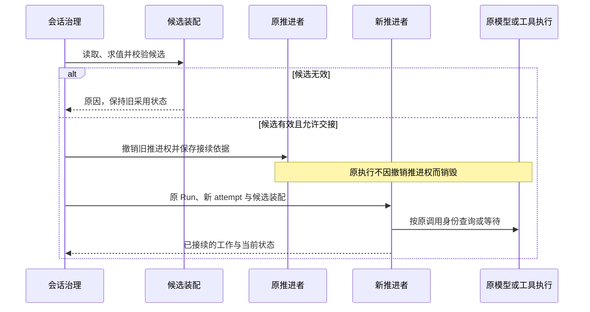

# 装配求值与动态变更

装配先确定合法能力和输入，再形成可供执行的组合。资产、设置和权限分别求值，不能用一个通用的“内层覆盖外层”算法处理。

状态：已接受的目标架构。领域模块独立于 Cordis 建模，系统集成遵循 Cordis 装配及生命周期契约；本页不预定包、服务名或物理父子关系。

## 多层来源求值

账号、组织、租户和工作区提供身份、资格与材料，具体参与规则取决于对象类别。账号全局身份不等于一份能覆盖全部租户的配置层。

| 求值对象 | 参与来源及规则 | 必须保留的边界 |
|---|---|---|
| 能力实现 | 先按持有资格、禁用及锁定筛选，再按官方、组织、租户、工作区的适用层序选择。 | 替换实现不解除能力身份上的授权约束。 |
| 设置 | 默认、组织、租户、工作区、会话按每项的合成语义求值。 | 锁定和适用范围仍有效，不总是取最内层值。 |
| 权限 | 默认、组织、租户、会话共同约束。 | 工作区不是权限来源，内层不得突破外层禁止。 |

工作区 `.omne` 与 `.omne.local` 是同层来源。local 优先不表示租户私有。权限、落点与身份类受限配置须在加载时过滤，不让仓库文件授予宿主权限。

模型档案有自己的具体程度规则，见[模型请求运行时](model-runtime.md#请求身份与输入)。不能仅因它也被称为资产就忽略其专门约束。

## 能力选入与实现解析

Skill、Tool、MCP 先选择能力身份，再解析具体实现。

1. 选入会话执行类型要求的能力。
2. 选入 AgentDefinition 显式依赖。
3. 按定义声明的来源范围和自动继承设置选入额外能力。
4. 对可选项应用继承排除及会话移除。
5. 合并同一身份的多路选入，按完整合法作用域解析实现。

任一路将能力声明为必需，该身份就是必需项，不能被可选排除移除。自动继承的来源范围与实现解析范围分别表达。这套继承规则不自动扩展成所有 Plugin 或 Loop Extension 的统一政策。

从未取得必需能力的合法定义，或 runtime 自身必要依赖无法建立时，装配失败。已有合法定义但执行实现暂不可用时，可以保留已知能力并说明不可用。必需绑定不等于远端永久可用，也不要求把 Skill 全文放入每次请求。

## 定义、清单与实例

AgentDefinition 保存声明，装配清单保存本次求值及采用依据，Agent runtime 是实际执行实例。装配可以不启动实例，实例也可复用仍有效的装配清单。清单不是可持久化的活体句柄。

会话固定 AgentDefinition 身份。新 Run 采用该身份最新合法发布内容；同一 Run 普通恢复保留原采用版本。显式 reload 可以按安全交接采用同身份的新版本，保留原 Run 并创建新的 attempt。

| 生效时刻 | 主要对象 | 不能据此推出的结论 |
|---|---|---|
| 装配时 | 本实例捕获的定义、Loop、extensions 和直接必要绑定。 | 运行期间所有工具数据和模型都被冻结。 |
| 动态数据变化时 | 模式、权限、Runtime Context、能力注册与可用性。 | 每次数据变化都必须重建 Agent runtime。 |
| 单次使用时 | 实际模型、参数、请求内容、工具实现与环境。 | 变化可以重写已经发出的调用。 |

自身结构绑定与注入入口内部的数据分别变化。不能把所有工具实现都变成 Loop 的直接生命周期依赖。

## 工作区与能力变化

文件变化或 Git 同步不自动执行资产 reload。实际装配或显式 reload 读取并校验来源，失败时保留旧的合法采用状态，不发布半份新组合。

工作区选择变化后，重新求值实际受影响的输入，不改变会话租户归属。组织的工作区参与限制在实际装配时判断，不能从该限制推导未定义的运行期热同步权限。

工具及 MCP 的合法刷新可改变后续调用的定义和可用性。已经发出的调用保留原输入、实现、环境与工作区。旧模型回复尚未执行的建议须核对当前约定；不兼容时返回具体原因，不自动改参数或暗换实现。

## reload 与推进权交接

撤销旧推进权和保存接续依据一起成立，否则换代还没发生。原执行不因撤权销毁。交接必须保护原调用、未消费结果、卡片及扩展判断。旧推进者失去发起权后，不能继续执行新动作。真实执行仍可回写结果。取消优先于迟到候选，较早的候选不能覆盖较新的选择。

同动作、同绑定、同参数的已完成准入不因 reload 无条件重做。条件已经改变时也不能借旧批准放行。扩展版本、判断和卡片须保留原语义，撤除后的接续协议由实现规格明确。

重新装配和重新实例化都可以实现热加载，但不得造成系统性停机。共享更新只影响其真实消费者，不能为局部变化重启整个系统。真实资源已经失效时不承诺无限保留旧执行。

## 细化与验证责任

装配提供者须说明求值来源、锁定规则、版本与失败原因。交接实现须验证候选失败、连续 reload、取消竞争、旧推进者迟到及原调用仍在执行的场景。

快照键、原子发起准入、版本校验和并发协议留给规格比较。采用这些机制的目标是保持上述边界，不把某一种数据库或 Cordis 组件布局升级为产品要求。

## 依据

多层来源、定义与装配、工作区的当前产品责任候选分别见 [资产与规则](../../../.meta_harness/design/product/assets-and-rules/README.md)、[Agent 定义与工作推进](../../../.meta_harness/design/product/agent-progression/README.md)和[工作区](../../../.meta_harness/design/product/workspaces/README.md)。这些草案不扩大本页既有架构承诺或其实际接受范围。
