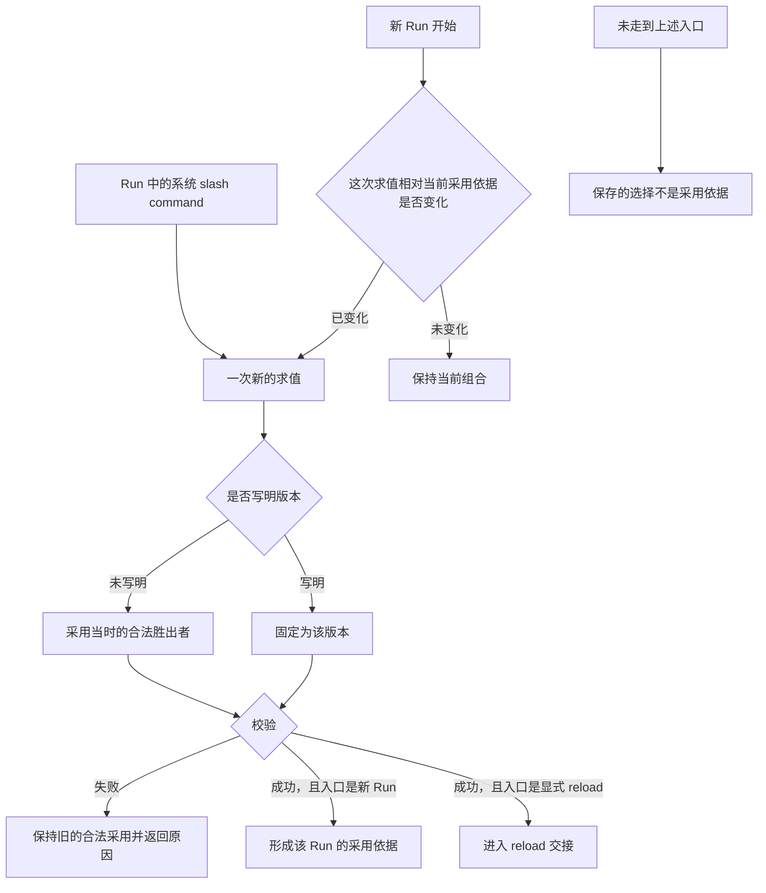
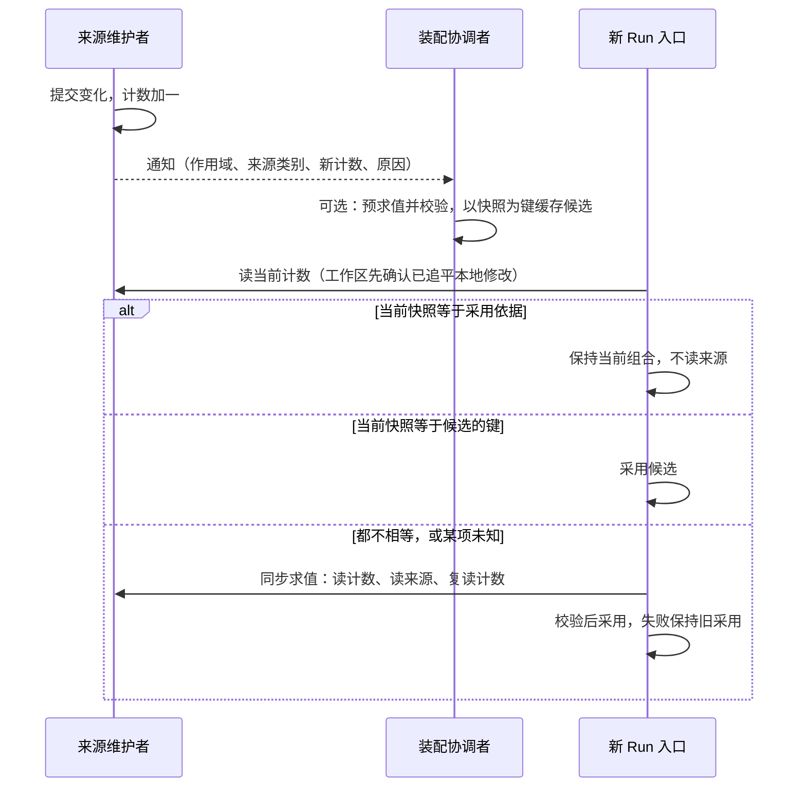
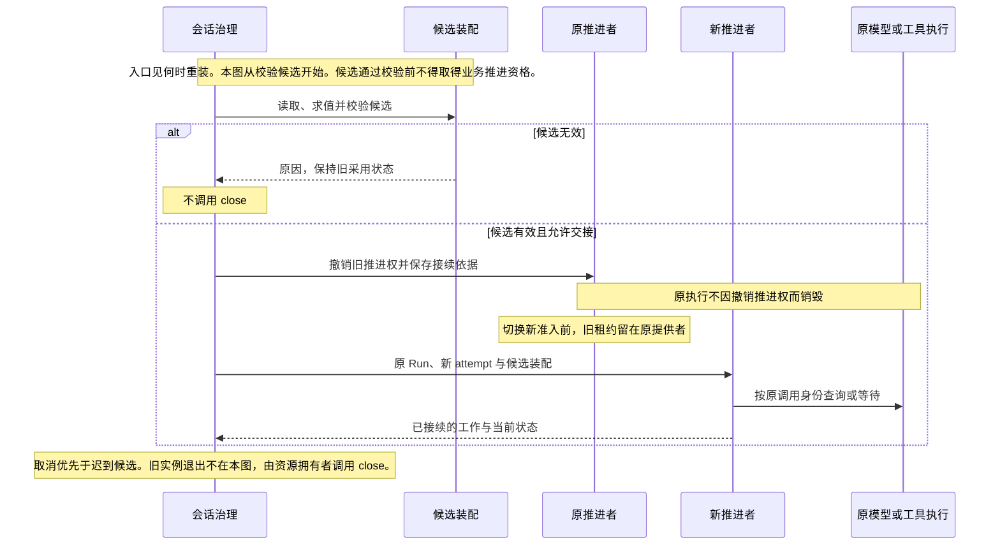

# 装配求值与动态变更

装配先确定合法能力和输入，再形成可供执行的组合。资产、设置和权限分别求值，不能用一个通用的“内层覆盖外层”算法处理。

状态：已接受的目标架构。领域模块独立于 Cordis 建模，系统集成遵循 Cordis 装配及生命周期契约；本页不预定包、服务名或物理父子关系。

## 多层来源求值

账号、组织、租户和工作区提供身份、资格与材料，具体参与规则取决于对象类别。账号全局身份不等于一份能覆盖全部租户的配置层。

| 求值对象 | 参与来源及规则 | 必须保留的边界 |
|---|---|---|
| 能力实现 | 先按持有资格、禁用及锁定筛选，再按官方、组织、租户、工作区的适用层序选择。 | 替换实现不解除能力身份上的授权约束。 |
| 设置 | 默认、组织、租户、工作区、会话按每项的合成语义求值。 | 锁定和适用范围仍有效，不总是取最内层值。 |
| 权限 | 默认、组织、租户、会话共同约束。 | 工作区不是权限来源，内层不得突破外层禁止。 |

工作区 `.omne` 与 `.omne.local` 是同层来源。local 优先不表示租户私有。权限、落点与身份类受限配置须在加载时过滤，不让仓库文件授予宿主权限。

模型档案有自己的具体程度规则，见[模型请求运行时](model-runtime.md#请求身份与输入)。不能仅因它也被称为资产就忽略其专门约束。

## 能力选入与实现解析

Skill、Tool、MCP 先选择能力身份，再解析具体实现。

1. 选入会话执行类型要求的能力。
2. 选入 AgentDefinition 显式依赖。
3. 按定义声明的来源范围和自动继承设置选入额外能力。
4. 对可选项应用继承排除及会话移除。
5. 合并同一身份的多路选入，按完整合法作用域解析实现。

任一路将能力声明为必需，该身份就是必需项，不能被可选排除移除。自动继承的来源范围与实现解析范围分别表达。这套继承规则不自动扩展成所有 Plugin 或 Loop Extension 的统一政策。

从未取得必需能力的合法定义，或 runtime 自身必要依赖无法建立时，装配失败。已有合法定义但执行实现暂不可用时，可以保留已知能力并说明不可用。必需绑定不等于远端永久可用，也不要求把 Skill 全文放入每次请求。

## 定义、清单与实例

AgentDefinition 保存声明，装配清单保存本次求值及采用依据，Agent runtime 是实际执行实例。装配可以不启动实例，实例也可复用仍有效的装配清单。清单不是可持久化的活体句柄。

会话固定 AgentDefinition 身份。新的求值没有写明版本时，采用当时的合法胜出者。这条规则适用于各类资产的求值，不限于 AgentDefinition。合法胜出者是同一求值作用域里、[多层来源求值](#多层来源求值)完成资格筛选和层序选择后，每个能力身份的结果。能力身份是类别加 name。对 AgentDefinition，未写明版本就是该身份最新合法发布内容。写明版本则固定为该版本。固定版本不豁免合法性、资格、锁定或撤权。一次执行是一份采用依据从被采用到下一次成功采用之前。在此期间不改写已记入该依据的正文，也不改写已经发出的调用。显式 reload 是一次新的求值，选版规则与其他新求值相同。同一 Run 普通恢复保留原采用版本。显式 reload 可以按安全交接采用同身份的新版本，保留原 Run 并创建新的 attempt。

| 生效时刻 | 主要对象 | 不能据此推出的结论 |
|---|---|---|
| 装配时 | 本实例捕获的定义、Loop、extensions 和直接必要绑定。 | 运行期间所有工具数据和模型都被冻结。 |
| 动态数据变化时 | 模式、权限、Runtime Context、能力注册与可用性。 | 每次数据变化都必须重建 Agent runtime。 |
| 单次使用时 | 实际模型、参数、请求内容、工具实现与环境。 | 变化可以重写已经发出的调用。 |

自身结构绑定与注入入口内部的数据分别变化。不能把所有工具实现都变成 Loop 的直接生命周期依赖。

## 何时重装

文件变化或 Git 同步本身不触发重装。下一次走到下面两个入口时，求值读取当时的来源。

- 新 Run 开始时，系统比较当前采用依据和这次求值。求值结果已变化时才重装。未变化时保持当前组合。这次重装是该 Run 的装配。它不在已有活体的执行中途更换该活体的结构绑定。
- Run 执行中，租户通过系统 slash command 显式要求 reload。该命令沿用已有的[系统工作流](../../domains/slash-commands/README.md#范围与边界)，不新增资产类别。

没有走到入口时，新的选择可以保存。保存的选择不是采用依据。正在运行的组合保持不变，并告知调用方新选择尚未采用。重装失败时保持旧的合法采用，并返回原因。新 Run 的成功重装形成该 Run 的采用依据。显式 reload 的成功重装进入[reload 与推进权交接](#reload-与推进权交接)。

### 比对代替求值

本节是候选修订，技术接受前不扩大本页既有承诺。

新 Run 入口的「比较」不重读来源，同时仍满足「求值读取当时的来源」：入口拿当前值与采用依据记下的输入快照逐项比对，相等就说明当时的来源与上次求值读到的相同。快照有两部分：会话自己的选择，以及各来源的采用变更计数。

会话自己的选择是所选工作区、会话覆盖或继承声明的修订，以及会话对可选能力的移除，由 Session 治理在会话日志里维护，入口直接比对。来源计数清单如下，每个计数都按作用域维护：

| 来源 | 计数的维护者 | 计数加一的变化 |
|---|---|---|
| 定义版本指针 | 资产共同治理的定义与版本 | 同一定义发布、撤回或改变合法最新版本 |
| 能力身份胜出者 | 资产共同治理 | 凡改变该作用域合法候选集合或生效选择的治理事实，例如发布、选版、加入或结束持有、禁用与再启用、锁定、替换、分享的确认与撤销 |
| 使用资格与权限上界 | 权限求值 | 该作用域的使用资格、「谁可以使用它」或锁定上界变化 |
| 组织锁定修订 | 资产共同治理 | 组织层锁定或解除锁定替换 |
| 设置修订 | 设置求值 | 该作用域的设置值或设置锁定变化 |
| 工作区来源修订 | 工作区来源读取；参与关系由工作区治理 | 可读材料变化，包括本地文件修改与来源同步；参与关系变化使当前主体可读的范围改变 |

快照覆盖这次求值实际读过的每个作用域层（官方、组织、租户、工作区）与每类来源的组合，每个组合一个计数，不是每份资产一个。比对次数是来源类别数乘以层数，有固定上界，不随资产数量、历史长度或工作区大小增长。全部相等时，求值结果视为未变化，保持当前组合，不读来源。

主体失去租户资格（例如账号退出组织）不靠计数发现：这时会话租户本身失效，新 Run 的准入先于装配比对拒绝它。会话层的权限事实（三轴模式、会话授权）不参与候选筛选，只在动作准入时兑现，所以不进快照。

计数由维护者按作用域维护，只增不减，进程重启后不倒退。经系统提交的变化，计数与它所计的变化在同一次提交中成立。每类来源、每个作用域各有自己的计数，彼此不比较大小，也不合成全局版本号。

不经系统发生的本地文件修改没有系统提交，工作区来源读取在发现它时把计数加一，并在进程重启后补查停机期间的修改。为了让入口仍读取当时的来源，工作区来源读取向入口报告发现是否已追平到入口时刻；没有追平时，这一项计数视为未知，入口按同步求值读取来源，不沿用旧组合。

维护者在变化提交或发现后通知订阅方，通知携带作用域、来源类别、新计数和变化原因，不携带秘密内容。

求值读取来源时，先读这次要用的各项计数，读完来源内容后再读一次，任一不同就重新求值；来源也可以在一次读取里一并返回内容和当时的计数。快照记的是读内容之前的计数，所以求值期间发生的变化一定会在下一次入口被比出来。

计数变化后，允许在下一个入口之前预先求值并校验，结果以求值时的快照为键缓存为已校验装配候选。订阅、预求值和候选缓存归装配协调者：每个会话最多缓存一份候选，新候选替换旧候选，会话归档时释放。对哪些会话预求值是装配协调者的可配置策略，例如只对近期活跃的会话预求值；默认值只是配置初值，不是契约。没有预求值的会话在入口同步求值，结论相同。候选只在入口成为采用依据：入口读到的当前快照与候选的键全等，就采用该候选；任一项不同，候选失效，入口按上面的流程同步求值。通知丢失、迟到或重复只影响是否提前算好，不影响入口比对的结论，因为入口读的是当前计数，不是通知。预求值失败不改变当前采用，入口仍按同步求值报告原因。

计数和候选只服务于新 Run 入口的比较。显式 reload 总是执行一次新的求值，不靠比对跳过，见上图。工具及 MCP 的合法刷新不改变计数驱动的采用，见[工作区与能力变化](#工作区与能力变化)。

## 工作区与能力变化

实际装配或显式 reload 读取并校验来源，失败时保留旧的合法采用状态，不发布半份新组合。入口和选版见[何时重装](#何时重装)。

工作区选择变化后，重新求值实际受影响的输入，不改变会话租户归属。组织的工作区参与限制在实际装配时判断，不能从该限制推导未定义的运行期热同步权限。

工具及 MCP 的合法刷新可改变尚未发出的后续调用的定义和可用性。这次刷新不改写采用依据里已记下的版本和正文，也不构成新的采用。已经发出的调用保留原输入、实现、环境与工作区。Skill 已记录的正文保持不变。尚未取用的 Skill 正文，后续取用读取当时的合法版本。旧模型回复尚未执行的建议须核对当前约定。不兼容时返回具体原因，不自动改参数或暗换实现。

## reload 与推进权交接

撤销旧推进权和保存接续依据一起成立，否则换代不成立。原执行不因撤权销毁。交接必须保护原调用、未消费结果、卡片及扩展判断。旧推进者失去发起权后，不能继续执行新动作。真实执行仍可回写结果。取消优先于迟到候选，较早的候选不能覆盖较新的选择。

同动作、同绑定、同参数的已完成准入不因 reload 无条件重做。条件已经改变时也不能借旧批准放行。扩展版本、判断和卡片须保留原语义，撤除后的接续协议由实现规格明确。

重新装配和重新实例化都可以实现热加载，但不得造成系统性停机。共享更新只影响其真实消费者，不能为局部变化重启整个系统。真实资源已经失效时不承诺无限保留旧执行。

## 细化与验证责任

装配提供者须说明求值来源、锁定规则、版本与失败原因。交接实现须验证候选失败、连续 reload、取消竞争、旧推进者迟到及原调用仍在执行的场景。

一次已发出请求的快照键是调用身份加上这次固定采用。不另设全局版本号。版本校验和并发的存储协议仍待后续契约。这些机制保持上述边界，不把某一种数据库或 Cordis 组件布局升成产品要求。

## 依据

多层来源、定义与装配、工作区的产品责任分别见 [资产与规则](../../../.meta_harness/design/product/assets-and-rules/README.md)、[Agent 定义与工作推进](../../../.meta_harness/design/product/agent-progression/README.md)和[工作区](../../../.meta_harness/design/product/workspaces/README.md)。Agent 定义与工作推进已由产品负责人采用，见[技术接受与产品采用决定](https://github.com/nemori-ai/omne-harness-lite/issues/384#issuecomment-6258475204)；资产与规则、工作区两页仍为草案，不扩大本页既有架构承诺或其实际接受范围。
