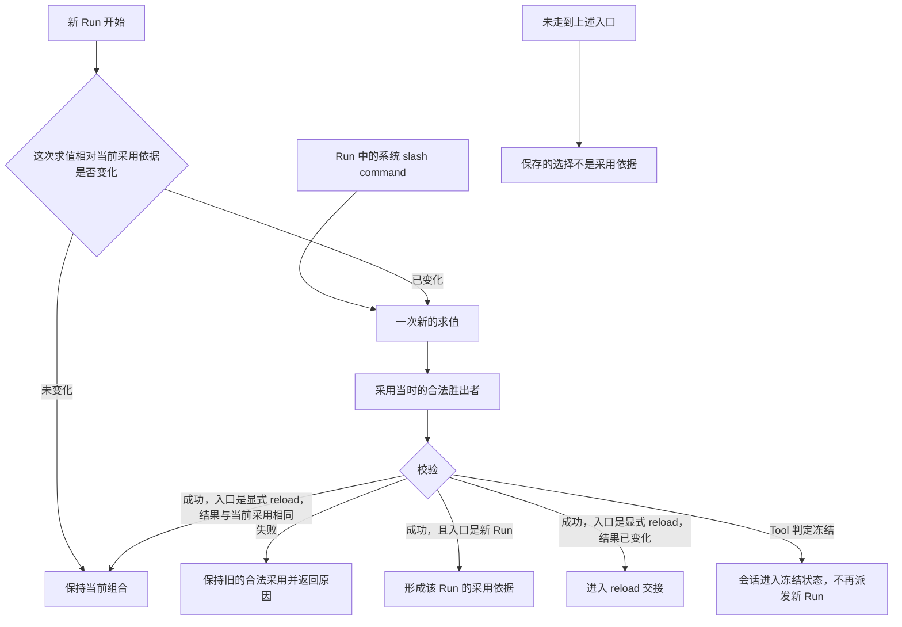
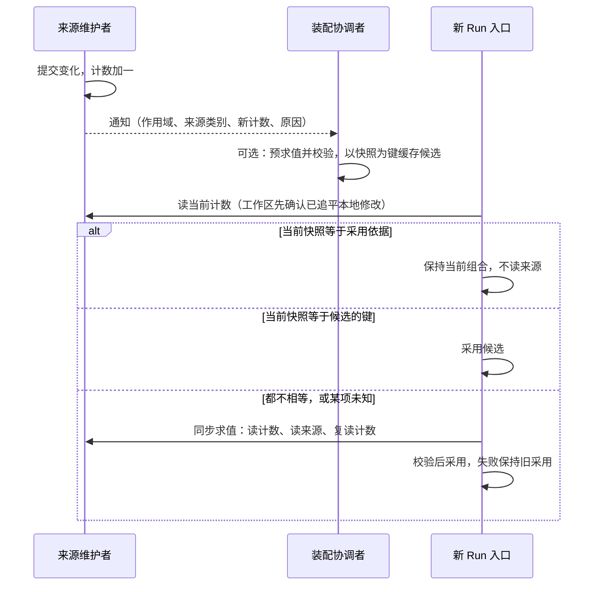
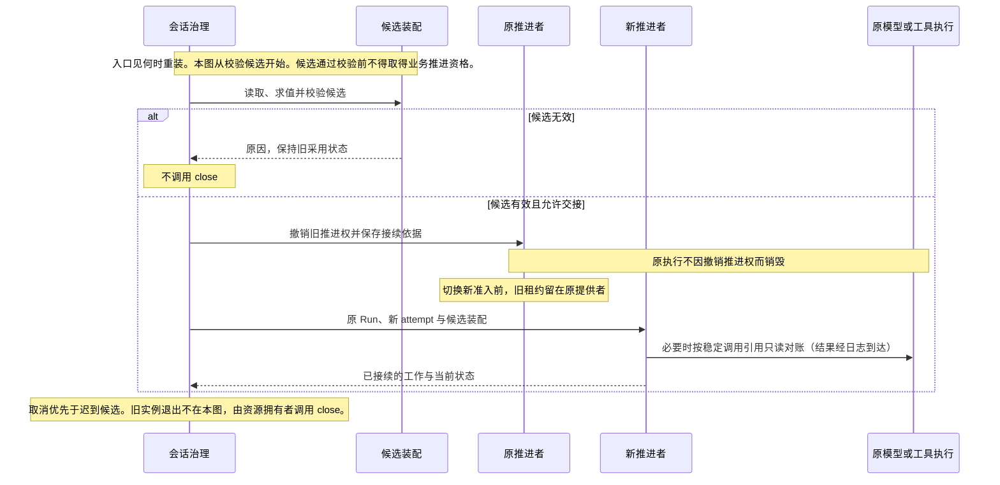

# 装配求值与动态变更

装配先确定合法能力和输入，再形成可供执行的组合。资产、设置和权限分别求值，不能用一个通用的“内层覆盖外层”算法处理。

状态：已接受的目标架构。领域模块独立于 Cordis 建模，系统集成遵循 Cordis 装配及生命周期契约；本页不预定包、服务名或物理父子关系。候选修订的节：[重装与不重装的情形](#重装与不重装的情形)、[比对代替求值](#比对代替求值)。这些节在技术接受前不扩大本页既有承诺。

## 多层来源求值

账号、组织、租户和工作区提供身份、资格与材料，具体参与规则取决于对象类别。账号全局身份不等于一份能覆盖全部租户的配置层。

| 求值对象 | 参与来源及规则 | 必须保留的边界 |
|---|---|---|
| 能力实现 | 先按持有资格、禁用及锁定筛选，再按官方、组织、租户、工作区的适用层序选择。 | 替换实现不解除能力身份上的授权约束。 |
| 设置 | 默认、组织、租户、工作区、会话按每项的合成语义求值。 | 锁定和适用范围仍有效，不总是取最内层值。 |
| 权限 | 默认、组织、租户、会话共同约束。 | 工作区不是权限来源，内层不得突破外层禁止。 |

工作区 `.omne` 与 `.omne.local` 是同层来源。local 优先不表示租户私有。权限、落点与身份类受限配置须在加载时过滤，不让仓库文件授予宿主权限。

模型档案有自己的具体程度规则，见[模型请求运行时](model-runtime.md#请求身份与输入)。不能仅因它也被称为资产就忽略其专门约束。

## 能力选入与实现解析

Skill、Tool、MCP 先选择能力身份，再解析具体实现。

1. 选入会话执行类型要求的能力。
2. 选入 AgentDefinition 显式依赖。
3. 按定义声明的来源范围和自动继承设置选入额外能力。
4. 对可选项应用继承排除及会话移除。
5. 合并同一身份的多路选入，按完整合法作用域解析实现。

任一路将能力声明为必需，该身份就是必需项，不能被可选排除移除。自动继承的来源范围与实现解析范围分别表达。这套继承规则不自动扩展成所有 Plugin 或 Loop Extension 的统一政策。

从未取得必需能力的合法定义，或 runtime 自身必要依赖无法建立时，装配失败。已有合法定义但执行实现暂不可用时，可以保留已知能力并说明不可用。必需绑定不等于远端永久可用，也不要求把 Skill 全文放入每次请求。

## 定义、清单与实例

AgentDefinition 保存声明，装配清单保存本次求值及采用依据，Agent runtime 是实际执行实例。装配可以不启动实例，实例也可复用仍有效的装配清单。清单不是可持久化的活体句柄。

会话固定 AgentDefinition 身份，不固定任何能力的版本。新的求值采用当时的合法胜出者。这条规则适用于各类资产的求值，不限于 AgentDefinition。合法胜出者是同一求值作用域里、[多层来源求值](#多层来源求值)完成资格筛选和层序选择后，每个能力身份的结果。能力身份是类别加 name。对 AgentDefinition，合法胜出者就是该身份最新合法发布内容。一次执行是一份采用依据从被采用到下一次成功采用之前。在此期间不改写已记入该依据的正文，也不改写已经发出的调用。显式 reload 是一次新的求值，选版规则与其他新求值相同。同一 Run 普通恢复保留原采用依据，不重新求值。显式 reload 可以按安全交接采用同身份的新版本，保留原 Run 并创建新的 attempt。

### 按形状核对，不钉版本

会话持续使用的能力靠形状核对延续，不靠固定版本。采用依据记下会话已经采用的每个能力的形状，例如会话开始时取得的 ToolDefinition 的形状。记下的资产版本用于追溯，不用于选版。

负责解析能力、选取或路由实现的一方，在选取时按记下的形状核对：当前装载在 Cordis 插件根上、同一能力身份的实现中，是否有与之同形且可用的实现。

- 有：选用这个实现。它的版本可以与记下的版本不同。
- 没有：按该能力拥有者规定的不兼容后果处理。不暗换成形状不同的实现，也不回头寻找旧版本。Tool 的换代协调者按保留义务重装会话记下的登记键，属于保留已采用的实现，不是为选版寻找旧版本（[接受决定](https://github.com/nemori-ai/omne-harness-lite/issues/618#issuecomment-6335123860)），见 [Tool 契约](../../../packages/tool/tool-contract/SPEC.md#采用点判定)。

需要这种核对的位置不止一处。Session 在采用点核对会话已纳入的常驻工具；Tool 判定同形，失形时给出冻结判定；常驻工具的加入与冻结判定只在采用点，规则见 [Tool 契约](../../../packages/tool/tool-contract/SPEC.md#会话常驻规则r1r5)（[常驻工具与会话冻结](../../../packages/session/session-contract/SPEC.md#常驻工具与会话冻结)）。Agent runtime 在恢复与接续时，按原采用的形状选取能解释原检查点的实现。Tool runtime 在路由调用时，按调用方交来的工具形状选取同形实现，不需要知道调用方是谁。同形判据归各能力类别的拥有者：ToolDefinition 归 Tool 契约，AgentDefinition 与 Loop 的检查点归 Agent 契约。已经发出的调用保留原实现，这是执行事实，不是选版。

| 生效时刻 | 主要对象 | 不能据此推出的结论 |
|---|---|---|
| 装配时 | 本实例捕获的定义、Loop、extensions 和直接必要绑定。 | 运行期间所有工具数据和模型都被冻结。 |
| 动态数据变化时 | 模式、权限、Runtime Context、能力注册与可用性。 | 每次数据变化都必须重建 Agent runtime。 |
| 单次使用时 | 实际模型、参数、请求内容、工具实现与环境。 | 变化可以重写已经发出的调用。 |

工具在会话初始化、新 Run 开始、显式 reload 和 Run 中的提供者变化时分别允许哪些变化，由 Tool 契约的刷新点规则规定，见[刷新点允许的变化](../../../packages/tool/tool-contract/SPEC.md#刷新点允许的变化)。Run 中的提供者变化只改变工具可用性与路由到的同形实现，不改变常驻形状与记下的登记键。

自身结构绑定与注入入口内部的数据分别变化。不能把所有工具实现都变成 Loop 的直接生命周期依赖。

## 何时重装

文件变化或 Git 同步本身不触发重装。下一次走到下面两个入口时，求值读取当时的来源。

- 新 Run 开始时，系统比较当前采用依据和这次求值。求值结果已变化时才重装。未变化时保持当前组合。这次重装是该 Run 的装配。它不在已有活体的执行中途更换该活体的结构绑定。
- Run 执行中，租户通过系统 slash command 显式要求 reload。该命令沿用已有的[系统工作流](../../domains/slash-commands/README.md#范围与边界)，不新增资产类别。

会话初始化和上述两个入口都是 Tool 的采用点。在采用点，会话可以把此前未装载的常驻工具加入常驻集合。Run 中途不加入常驻工具。新 Run 开始和显式 reload 还判定冻结。冻结成立的条件是：某个常驻工具没有同形可用的贡献，记下的实现有耐久证据表明不可装载，并且合法胜出者与首次定义不同形；完整判定表见 [Tool 契约](../../../packages/tool/tool-contract/SPEC.md#采用点判定)。冻结成立时，会话进入冻结状态，不再派发新 Run，在途 Run 自然收场。冻结是会话自己的生命周期状态，由会话执行。Tool 只给出判定与原因 `tool-shape-lost`。

没有走到入口时，新的选择可以保存。保存的选择不是采用依据。正在运行的组合保持不变，并告知调用方新选择尚未采用。重装失败时保持旧的合法采用，并返回原因。新 Run 的成功重装形成该 Run 的采用依据。显式 reload 的成功重装进入[reload 与推进权交接](#reload-与推进权交接)。

### 重装与不重装的情形

判据如下：

- 重装只有两个入口：新 Run 开始，以及 Run 中的显式 reload。
- 只有装配时生效的对象（定义、Loop、extensions、直接必要绑定）才涉及重装。动态数据变化时和单次使用时生效的对象，按各自时刻生效，不重装。
- 恢复不是重装入口。恢复按原采用依据重建实例或执行挂接，不重新求值。
- 精确采用变化时，Agent 宿主按新采用创建新实例。旧实例不再承接新 Run。正在推进的 Run 可以由旧实例推进到终态，也可以按 A2 经推进权交接交给新实例。旧实例何时排空不影响任何事实，旧实例提前退出时按 A6 接续。

表中编号只用于表内定位。

| 编号 | 情形 | 是否重装 | 理由 |
|---|---|---|---|
| A1 | 同一 AgentDefinition 发布新版本，新 Run 开始。 | 是，新建实例。 | 新 Run 采用当时最新合法发布内容，精确采用随之改变。 |
| A2 | 同 A1，但 Run 正在执行，租户显式 reload。 | 是，新建实例，原 Run 新开 attempt。 | 显式 reload 是一次新的求值，经[推进权交接](#reload-与推进权交接)采用新版本。 |
| A3 | 定义引用的必需能力的合法胜出者改变：发布新版本、锁定替换、禁用或移除。 | 是，在下一次入口。 | 能力绑定改变即清单改变。必需能力取不到合法定义时候选失败，保持旧采用。 |
| A4 | 工作区选择改变：附着、更换或解除。 | 在下一次入口，结果改变时才重装。 | 变化本身只保存选择。入口重新求值来自工作区来源的能力、偏好与绑定。 |
| A5 | 组织或租户的锁定、禁用、必需项或权限上界改变，使定义层组合不再合法或胜出者改变。 | 是，在下一次入口。 | 与 A3 相同，治理变化改变了合法胜出者。 |
| A6 | 执行实例失去连续性（崩溃、失联、宿主停用），Run 仍为活动。 | 否，按原采用新建实例或挂接。 | 恢复保留原采用，只需要一个能解释原检查点的实例。实例的实现按[形状核对](#按形状核对不钉版本)选取。 |
| N1 | 权限处理、执行环境、协作三个模式改变。 | 否。 | 动态数据。下一次动作准入与工具设置读新值，已发出的请求与调用保留原模式。 |
| N2 | 切换模型选择。 | 否。 | 单次使用时生效。切换不要求更换定义、新建 Run 或新 attempt。 |
| N3 | 模型档案、凭据或供应商能力改变。 | 否。 | 每次请求准备时求值。 |
| N4 | 工具或 MCP 合法刷新：清单或端点设置改变。 | 否。 | 只影响尚未发出的后续调用，不改采用依据中记下的版本与正文。 |
| N5 | 新 Skill 经合法登记与显式增量装载。 | 否。 | 能力注册与可用性变化，不改变 AgentDefinition。 |
| N6 | Runtime Context 块或注册集合改变。 | 否。 | 动态数据，模型在下一次请求中看到变化。 |
| N7 | 权限授权的批准、撤回或租户权限值改变。 | 否。 | 每次动作准入重新求值，缓存的批准不代替当前资格。 |
| N8 | 文件编辑、Git 同步或工作区实例同步。 | 否，等待下一次入口。 | 这些变化不是入口。 |
| N9 | 推进者交还与接续、等待唤醒、模型内部重试、工具转后台、插队、单调用控制。 | 否。 | 这些动作沿用同一采用依据。 |
| N10 | 会话关系、常驻或自动归档配置改变。 | 否。 | 治理数据，与装配无关。 |

除 A1～A5 外，任何变化都不导致 Agent runtime 重建。A6 导致重建，但不导致重装。

### 比对代替求值

新 Run 入口的「比较」不重读来源，同时仍满足「求值读取当时的来源」：入口拿当前值与采用依据记下的输入快照逐项比对，相等就说明当时的来源与上次求值读到的相同。快照有两部分：会话自己的选择，以及各来源的采用变更计数。

会话自己的选择是所选工作区、会话覆盖或继承声明的修订，以及会话对可选能力的移除，由 Session 治理在会话日志里维护，入口直接比对。来源计数清单如下，每个计数都按作用域维护：

| 来源 | 计数的维护者 | 计数加一的变化 |
|---|---|---|
| 定义版本指针 | 资产共同治理的定义与版本 | 同一定义发布、撤回或改变合法最新版本 |
| 能力身份胜出者 | 资产共同治理 | 凡改变该作用域合法候选集合或生效选择的治理事实，例如发布、选版、加入或结束持有、禁用与再启用、锁定、替换、分享的确认与撤销 |
| 使用资格与权限上界 | 权限求值 | 该作用域的使用资格、「谁可以使用它」或锁定上界变化 |
| 组织锁定修订 | 资产共同治理 | 组织层锁定或解除锁定替换 |
| 设置修订 | 设置求值 | 该作用域的设置值或设置锁定变化 |
| 工作区来源修订 | 工作区来源读取；参与关系由工作区治理 | 可读材料变化，包括本地文件修改与来源同步；参与关系变化使当前主体可读的范围改变 |

快照覆盖这次求值实际读过的每个作用域层（官方、组织、租户、工作区）与每类来源的组合，每个组合一个计数，不是每份资产一个。比对次数是来源类别数乘以层数，有固定上界，不随资产数量、历史长度或工作区大小增长。全部相等时，求值结果视为未变化，保持当前组合，不读来源。

主体失去租户资格（例如账号退出组织）不靠计数发现：这时会话租户本身失效，新 Run 的准入先于装配比对拒绝它。会话层的权限事实（三轴模式、会话授权）不参与候选筛选，只在动作准入时兑现，所以不进快照。

计数由维护者按作用域维护，只增不减，进程重启后不倒退。经系统提交的变化，计数与它所计的变化在同一次提交中成立。每类来源、每个作用域各有自己的计数，彼此不比较大小，也不合成全局版本号。

不经系统发生的本地文件修改没有系统提交，工作区来源读取在发现它时把计数加一，并在进程重启后补查停机期间的修改。为了让入口仍读取当时的来源，工作区来源读取向入口报告发现是否已追平到入口时刻；没有追平时，这一项计数视为未知，入口按同步求值读取来源，不沿用旧组合。

维护者在变化提交或发现后通知订阅方，通知携带作用域、来源类别、新计数和变化原因，不携带秘密内容。

求值读取来源时，先读这次要用的各项计数，读完来源内容后再读一次，任一不同就重新求值；来源也可以在一次读取里一并返回内容和当时的计数。快照记的是读内容之前的计数，所以求值期间发生的变化一定会在下一次入口被比出来。

计数变化后，允许在下一个入口之前预先求值并校验，结果以求值时的快照为键缓存为已校验装配候选。订阅、预求值和候选缓存归装配协调者：每个会话最多缓存一份候选，新候选替换旧候选，会话归档时释放。对哪些会话预求值是装配协调者的可配置策略，例如只对近期活跃的会话预求值；默认值只是配置初值，不是契约。没有预求值的会话在入口同步求值，结论相同。候选只在入口成为采用依据：入口读到的当前快照与候选的键全等，就采用该候选；任一项不同，候选失效，入口按上面的流程同步求值。通知丢失、迟到或重复只影响是否提前算好，不影响入口比对的结论，因为入口读的是当前计数，不是通知。预求值失败不改变当前采用，入口仍按同步求值报告原因。

计数和候选只服务于新 Run 入口的比较。显式 reload 总是执行一次新的求值，不靠比对跳过，见上图。求值结果与当前采用相同时，保持当前采用与当前 runtime 实例，不进入交接。工具及 MCP 的合法刷新不改变计数驱动的采用，见[工作区与能力变化](#工作区与能力变化)。

## 工作区与能力变化

实际装配或显式 reload 读取并校验来源，失败时保留旧的合法采用状态，不发布半份新组合。入口和选版见[何时重装](#何时重装)。

工作区选择变化后，重新求值实际受影响的输入，不改变会话租户归属。组织的工作区参与限制在实际装配时判断，不能从该限制推导未定义的运行期热同步权限。

MCP 和非常驻工具的合法刷新可改变尚未发出的后续调用的定义和可用性。常驻工具的合法刷新只改变可用性与实现，不改变其 name 与参数形状，见[Tool 契约](../../../packages/tool/tool-contract/SPEC.md#会话常驻规则r1r5)。这次刷新不改写采用依据里已记下的版本和正文，也不构成新的采用。已经发出的调用保留原输入、实现、环境与工作区。Skill 已记录的正文保持不变。尚未取用的 Skill 正文，后续取用读取当时的合法版本。旧模型回复尚未执行的建议须核对当前约定。不兼容时返回具体原因，不自动改参数或暗换实现。

## reload 与推进权交接

撤销旧推进权和保存接续依据一起成立，否则换代不成立。原执行不因撤权销毁。交接必须保护原调用、未消费结果、卡片及扩展判断。旧推进者失去发起权后，不能继续执行新动作。真实执行仍可回写结果。取消优先于迟到候选，较早的候选不能覆盖较新的选择。

同动作、同绑定、同参数的已完成准入不因 reload 无条件重做。条件已经改变时也不能借旧批准放行。扩展版本、判断和卡片须保留原语义，撤除后的接续协议由实现规格明确。

重新装配和重新实例化都可以实现热加载，但不得造成系统性停机。共享更新只影响其真实消费者，不能为局部变化重启整个系统。真实资源已经失效时不承诺无限保留旧执行。

## 细化与验证责任

装配提供者须说明求值来源、锁定规则、版本与失败原因。交接实现须验证候选失败、连续 reload、取消竞争、旧推进者迟到及原调用仍在执行的场景。

一次已发出请求的快照键是调用身份加上这次固定采用。Tool 的固定采用还包含来源层：登记键由来源层、能力身份和资产版本组成。不另设全局版本号。版本校验和并发的存储协议仍待后续契约。这些机制保持上述边界，不把某一种数据库或 Cordis 组件布局升成产品要求。

## 依据

多层来源、定义与装配、工作区的产品责任分别见 [资产与规则](../../../.meta_harness/design/product/assets-and-rules/README.md)、[Agent 定义与工作推进](../../../.meta_harness/design/product/agent-progression/README.md)和[工作区](../../../.meta_harness/design/product/workspaces/README.md)。Agent 定义与工作推进已由产品负责人采用，见[技术接受与产品采用决定](https://github.com/nemori-ai/omne-harness-lite/issues/384#issuecomment-6258475204)；资产与规则、工作区两页仍为草案，不扩大本页既有架构承诺或其实际接受范围。
