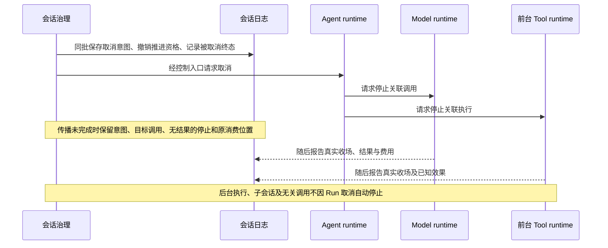
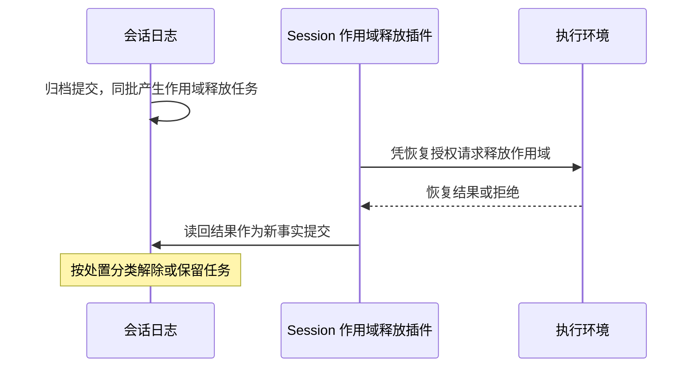
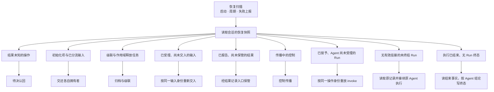

# 控制、取消与故障恢复

会话治理按业务规则控制工作，三个 runtime 分别控制自己的执行。逻辑取消、实际停止、结果消费和外部效果撤回分别记录；没有一种通用销毁动作可以代替全部责任。

状态：已接受的目标架构。本页说明跨 runtime 协调，各执行内部的终态和失败规则仍由各自专题拥有。候选修订的节：[取消与归档](#取消与归档)、[作用域释放](#作用域释放)、[恢复的发现与收束](#恢复的发现与收束)、[日志提交未知与读路径不可用](#日志提交未知与读路径不可用)。这些节在技术接受前不扩大本页既有承诺。

## 插队与单次中断

普通追加消息等待下一次承接，不自动打断当前模型或工具。用户插队走明确控制路径，保留已经形成的内容和效果，再按插队规则处理原在途工作与新输入。

单独中断模型不自动中断工具或结束 Run。模型中断后，不执行该响应中尚未发出的工具建议。单独中断工具同样不自动取消模型或整个 Run。允许转后台的工具可在适用路径转换等待关系，但不能突破工具声明。

控制请求须关联目标身份，分别记录请求到达、是否受理及实际结果。显示“已请求停止”不能冒充物理执行已经停止。

## 取消与归档

控制按范围分三条路径。每条路径都先保存控制意图，再传播。

| 路径 | 影响范围 | 不跟随的工作 | 对 Run 终态的影响 |
|---|---|---|---|
| 单个调用 | 停止一个原调用，或把它转到后台 | 兄弟调用与整个 Run | 无 |
| Run 取消 | 当前推进资格、该 Run 的模型调用与前台工具 | 后台工具、子会话、Run 外调用 | 取消生效即记录被取消终态 |
| 归档 | 本会话的待处理输入、等待、全部关联的在途模型调用与前后台工具，并按会话关系向子会话级联 | 无关会话 | 有未终结的 Run 时，同批记录被取消终态 |

Session 不直接控制 Model 或 Tool 的调用。控制按下列方式到达原执行：

1. 执行挂接存活时，Session 经 Agent 的控制入口发出控制，由 Agent 传到它的模型调用与前台工具。
2. 执行挂接不在时，恢复协调先接续原 Agent 执行并取得新挂接，再按第 1 条发出。
3. 兜底：撤销资格与取消已经提交。生产者按自己的契约记录控制。两个生产者的兜底不同：
   - Tool：Session 作为启动围栏 ToolStartAuthority 的资格版本拥有者，在撤销资格之后调用 `invalidate`，等到失效已生效。之后失效的推进者不能再启动新的工具执行，见 Tool 契约的 [P04 实际发起围栏](../../../packages/tool/tool-contract/SPEC.md#p04-实际发起围栏)。
   - Model：兜底要求 Model 的受理点在同一次提交里读 Session 守卫参加者的读数，以资格参加者协议闭合为前提，见[联合前提与具名待决](session-and-run.md#联合前提与具名待决)。协议闭合之前，会话路径上 Model 一侧没有这个保护点。失效推进者发起的新模型调用只由 Agent 的条件提交与动作发出围栏阻止。

逻辑终态与物理收场分开。控制传播在 Session 里有自己的进度：尚未核对的生产者、Agent 命令回执、生产者报回的事实，以及 Tool 的启动资格失效是否已生效。全部生产者核对、且失效已生效之后，这次控制才标为已对账。回执未知时，按同一控制操作重发。生产者报告效果未知时保持未知，不改终态。超过重放上界时，控制停在传播中并报告，不冒充已经停止。

Run 取消先保存意图，再经 Agent 控制其模型及前台工具。后台工具、子 Session 和无关的 Run 外调用不自动跟随。取消一旦生效，会话就记录 Run 的逻辑终态，并撤销新工作的推进资格。模型和工具随后另行报告真实收场。报告时间不决定逻辑终态何时成立。强制或非强制只影响停止请求有多急，不改变逻辑终态的记录时点。传播尚未完成时，会话保留取消意图、目标调用身份、还没有实际结果的停止请求，以及对应的原消费位置。治理方继续跟踪实际收场，不等待已销毁实例替自己完成最后一步。

会话归档是一项更大的业务操作。它请求停止该会话未完成的模型和前后台工具，并按产品规则级联归档子会话。归档可以撤销，但已中断执行不会自动恢复，子会话也不因父方撤销归档而一起恢复。冻结是独立于归档的会话状态，见[生命周期与工作收束](session-and-run.md#生命周期与工作收束)。冻结的会话归档后，撤销归档使会话回到冻结状态，会话仍不派发新 Run。

终态后不发起新工作。迟到结果、费用和已发生的外部效果仍归原调用，不让 Run 复活，也不能因旧推进权失效而丢弃事实。

## 作用域释放

归档的同一次提交产生作用域释放任务。执行环境契约规定作用域释放由维护者发起，维护者在本版由应用装配层的协调者担任，见[执行环境恢复](../../../packages/execution/execution-environment-contract/SPEC.md#恢复)。本版应用装配层把这个维护者角色交给 Session 的作用域释放插件。插件凭应用装配层维护拥有者签发的恢复授权，调用执行环境的作用域释放入口。恢复授权由装配注入，不是会话用户的访问身份。用户撤权或退出不阻断回收。

已释放作用域的耐久账本是 Session 日志里的释放读回事实。执行环境重启后不记得已释放的作用域。执行环境提供者换代、作用域释放插件随之重新运行时，插件对已归档会话的作用域按页重新调用作用域释放入口。执行环境重启到重新释放完成之间，已归档会话的作用域可能仍有资源。这个窗口是与执行环境契约拥有者的联合前提，见[联合前提与具名待决](session-and-run.md#联合前提与具名待决)。

释放不发起新的获取。逻辑归档在归档提交时已经成立，不等待物理全停。对人的时间线只记录「已发起释放」与读回结果。

执行环境的释放入口返回两类结果之一：

- 一份恢复结果。它分组列出已确认停止的资源、待停的资源、不支持恢复的提供者或资源，以及枚举失败的提供者。
- 一次拒绝。原因是未获授权或不可用。

Session 把读回结果归入下列处置分类。这些分类是 Session 一侧的处置，不是执行环境的类型。

| Session 一侧的处置分类 | 对应的读回结果 | 处置 |
|---|---|---|
| 已释放 | 恢复结果里没有待停资源、没有不支持项，也没有枚举失败的提供者 | 解除任务。 |
| 待续 | 恢复结果里有待停的资源 | 保留任务，由级联推进按同一操作再次驱动。 |
| 不支持 | 恢复结果里有不支持恢复的提供者或资源 | 记录这一部分并交人处理。 |
| 不可用 | 有提供者枚举失败，或释放入口以不可用拒绝 | 保留任务，按策略退避后重试。枚举失败表示资源未知，不表示没有资源。 |
| 未获授权 | 释放入口以未获授权拒绝 | 保留任务并报告维护拥有者。不改用会话用户的访问身份重试。 |

一次读回可以同时落入几个分类。只要还有待续或不可用的部分，任务就保留。再次驱动的次数与间隔有策略上限。超过上限时，任务保持未结并报告维护拥有者，不冒充已释放。这与控制重放的上界处理相同。

## Agent runtime 退出后的接续

恢复方先取得原工作身份、有效推进资格、取消状态、原消费位置及待完成调用。随后按原调用状态接续。

| 原工作状态 | 恢复动作 |
|---|---|
| 执行仍在运行 | 重新取得访问句柄，继续观察或等待。 |
| 执行已经收场，尚未完成结果交接 | 按原调用身份向生产侧取回结果，继续原消费位置。 |
| 结果已可靠交接，原处理尚未完成 | 从消费侧保存的内容或可靠引用接续。模型已 ACK 时，不再向模型侧重新领取完整结果。 |
| 查询暂时不可用 | 保持未知并按策略等待或报告，不重复发起。 |
| 执行自身确认丢失 | 按该执行契约处理，模型与工具的规则不同。 |
| 原 execution 已终态，或外部协调者判定业务不再继续 | 仅处理允许的迟到事实与交付，不恢复推进。 |

更换执行挂接或推进实例不删除扩展判断、待答卡片或已发生效果。恢复必须跨过原 Agent runtime 的内存边界；仅创建一个空实例不能称为恢复工作。

## 恢复的发现与收束

Agent 提供原执行的对账与接续。发现哪些会话需要恢复、何时扫描、怎样退避，归外部协调者，见 Agent 契约的[外部协调者的前提](../../../packages/agent/agent-contract/docs/context.md#外部协调者的前提)。在会话路径上，这一责任归 Session。

### 恢复扫描

恢复扫描在进程启动、周期到点和协调器上报失败时运行。扫描者分页读取待对账的会话，游标稳定。每个租户只有一个扫描者，由存储租约或单实例装配保证。每个会话的退避是策略配置。

恢复协调按类别处理每个会话的恢复快照：

- 结果未知的操作交给待决认回。
- 初始化项与已分流输入的投递交还各自拥有者。
- 级联任务与作用域释放任务交给归档与级联。
- 仍在传播中的控制交给控制传播。
- 执行尝试已授予、Agent 尚未受理的未终结 Run，交 Agent 推进协调器。协调器先按发起执行的操作身份查询。已排除、未提交或 Agent 尚无这次执行的记录时，按同一操作身份重放 `invoke`，不新建执行身份；已提交时，按下一条接续。
- 已受理而尚未交入执行的输入，按同一输入身份重新交入。
- 已有 Agent 执行、但没有有效执行挂接的未终结 Run 走 Agent 的接续路径：读取原记录，接续原 Agent 执行，取得新 attempt。
- Agent 执行已结束而会话没有 Run 终态的，读取结束事件或结束状态，按 Agent 的结论写 Run 终态。
- 结果已报告而尚未保管的消费，经 Agent 的结果记录入口保管，Session 参加；Agent 记录已删除时由 Session 单方保管。

任一拥有者不可用时，恢复保留该项，不把未知当作失败。

### 待决认回

提交结果未知时，待决认回按原操作身份查询。只有拥有者给出确定答复，认回才结束。查不到不等于未提交：查询失败或暂时查不到时，结果仍是未知，按策略重试。超过重试上限时保持未结并报告。认回期间不以新的操作身份重做同一意图，也不发出依赖这次提交的外部动作。

### 有界恢复者

恢复不能让一个 Run 无限期停在未终结状态。Agent 的记录无法解释这次工作时，恢复者以已保存的原事实把 Run 收束为失败。「无法解释」指读执行记录或接续按策略重试到上限，仍返回原记录不可读或精确采用不可读。Agent 尚无这次执行的记录不属于这一情形，按[恢复扫描](#恢复扫描)的「执行尝试已授予、Agent 尚未受理」重放发起。Agent 执行已经结束而会话没有 Run 终态也不属于这一情形：恢复者读取结束事实，按 Agent 的结论写完成、失败或被取消。

收束不新开执行，也不重做原调用。这条规则是 Session 与 Agent 拥有者的联合前提。Agent 契约确认之前，它不构成 Agent 一侧的承诺。

### 级联推进

归档按会话关系为每个子会话产生级联任务。每个子方有固定的子操作身份，重放保持幂等。级联推进按间隔重新驱动尚未完成的级联任务与作用域释放任务。子方拒绝时，任务与原因都保留，不伪装级联已经完成。再次驱动超过策略上限时，任务保持未结并报告维护拥有者，与控制重放的上界处理相同。撤销归档不撤销级联任务，已归档的子方保持归档。

## 模型与工具失联

[Model runtime](model-runtime.md#重试与失联边界)在确认自身失去连续性时，区分首内容前后。首内容前可按原消费位置恢复重发，保留真实尝试和费用；首内容后不重发同一逻辑回复。

[Tool runtime](tool-runtime.md#中断与失联)确认自身失去连续性后，不自动重放原动作。错误标签不能证明没有副作用，恢复方须保留已知、未知与尚待核查的结果。

[执行环境](execution-environment.md#失效重建与数据责任)重建、租户数据恢复和原执行恢复分别验证。换节点或换实现不自动给出热迁移，也不能默认把旧调用移到新资源上。

## 存储与关键服务降级

没有可靠保存必要输入、取消意图、准入依据或结果的能力时，依赖该保存保证的新动作不能假装继续成功。系统区分暂时读取失败、写入失败和写入结果未知；写入结果未知时须先对账，不能直接重复可能产生外部效果的动作。

降级按真实依赖影响相应工作，不把一个可选服务故障升级为系统性停机。准入服务不可用走全拒承接；能力不可用保留原因，扩展服务按其公开策略处理。恢复服务后重新判断当前条件，不能无条件重放停机前计划。

其他关键服务的兜底优先不产生副作用。确有必要时将副作用降至最低，并优先选服务恢复后可撤回的做法。无法撤回的效果仍须明确记录，不能统一宣称恢复等于回滚。

具体重试、退避、超时和资源限额由相应能力提供可配置策略。临时失败不授权绕过隔离、权限、数据保护或可信结果要求。

### 日志提交未知与读路径不可用

| 情形 | Session 的行为 |
|---|---|
| 日志提交结果未知 | 协调器不报告成功，也不以新身份重新提交。待决认回按原操作身份查询。认回之前，不发出依赖这次提交的外部调用。 |
| 共同提交结果未知 | 按提交方的原操作查询。Session 参加者的结果随同一次提交认回，不先生效再补日志。 |
| 历史读口不可用 | 读口答不可用，不当作空历史。组装因此无法继续时，由协调者按 Agent 的规则收束。不用未提交的派生冒充已压缩。 |
| 恢复读取不可用 | 恢复扫描保留待处理项并退避，不把读不到当作没有待办。 |
| 受理点守卫不可用 | 资格参加者协议闭合之后：Model 不形成调用，Session 不替生产者放行。协议闭合之前，会话路径上没有这一守卫，见[联合前提与具名待决](session-and-run.md#联合前提与具名待决)。 |
| 提交通知丢失 | 通知只起唤醒作用。调度器从权威读取补查，丢失通知不丢失已受理的工作。 |

## 观测身份与故障证据

记录须关联适用的租户、Session、Run、执行挂接、step、调用、实际发出、扩展位置和执行环境。其中 Session 与 Run 是外部协调者一侧的关联，由该协调者的记录提供。不是每条调用都有 Session，独立调用使用自己的调用方与工作身份，不能伪造归属。

控制意图、实际执行、消费、费用及清理状态分别可查。记录不足时报告缺口，不能从缺少终态推断仍在运行，也不能仅靠时间戳推断因果关系。

长期运行的验证覆盖并发推进者、取消与完成竞争、持久化结果未知、等待期间替换实例、迟到结果和局部服务故障。性能测量分开报告受理、排队、加载、请求及恢复耗时，不编造统一阈值。

遥测支持远程诊断，但数据采集和对外传送须分别获得授权。正文、附件和秘密不得因调试需要默认输出，普通采样也不能无声抹去必要审计与生命周期事实。

## 依据

取消与接续的产品责任见 [Agent 定义与工作推进](../../../.meta_harness/design/product/agent-progression/README.md)，该产品页已由产品负责人采用，见[技术接受与产品采用决定](https://github.com/nemori-ai/omne-harness-lite/issues/384#issuecomment-6258475204)。会话的候选责任见[会话与工作](../../../.meta_harness/design/product/sessions-and-work/README.md)。模型与工具执行边界的候选分别见[模型调用](../../../.meta_harness/design/product/model-invocation/README.md)及[工具执行](../../../.meta_harness/design/product/tool-execution/README.md)。这三个 topic 仍为草案；本页既有承诺及降级、遥测、数据保护要求继续沿[项目要求](../../requirements.md)和实际接受记录执行。

会话一侧控制、恢复与作用域释放的精确行为归[通用实现](../../../packages/session/session/SPEC.md)与[适配成员](../../../packages/session/session-adapters/SPEC.md)。会话的通用角色与总前提见[Session、Run 与输入承接](session-and-run.md#总前提)。
