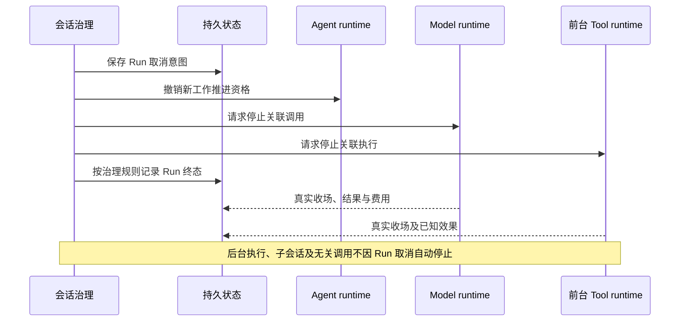

# 控制、取消与故障恢复

会话治理按业务规则控制工作，三个 runtime 分别控制自己的执行。逻辑取消、实际停止、结果消费和外部效果撤回分别记录；没有一种通用销毁动作可以代替全部责任。

状态：已接受的目标架构。本页说明跨 runtime 协调，各执行内部的终态和失败规则仍由各自专题拥有。

## 插队与单次中断

普通追加消息等待下一次承接，不自动打断当前模型或工具。用户插队走明确控制路径，保留已经形成的内容和效果，再按插队规则处理原在途工作与新输入。

单独中断模型不自动中断工具或结束 Run。模型中断后，不执行该响应中尚未发出的工具建议。单独中断工具同样不自动取消模型或整个 Run。允许转后台的工具可在适用路径转换等待关系，但不能突破工具声明。

控制请求须关联目标身份，分别记录请求到达、是否受理及实际结果。显示“已请求停止”不能冒充物理执行已经停止。

## 取消与归档

Run 取消先保存意图，再控制其 Agent、模型及前台工具。后台工具、子 Session 和无关的 Run 外调用不自动跟随。取消一旦生效，会话就记录 Run 的逻辑终态，并撤销新工作的推进资格。模型和工具随后另行报告真实收场。报告时间不决定逻辑终态何时成立。强制或非强制只影响停止请求有多急，不改变逻辑终态的记录时点。传播尚未完成时，会话保留取消意图、目标调用身份、还没有实际结果的停止请求，以及对应的原消费位置。治理方继续跟踪实际收场，不等待已销毁实例替自己完成最后一步。

会话归档是一项更大的业务操作。它请求停止该会话未完成的模型和前后台工具，并按产品规则级联归档子会话。归档可以撤销，但已中断执行不会自动恢复，子会话也不因父方撤销归档而一起恢复。

终态后不发起新工作。迟到结果、费用和已发生的外部效果仍归原调用，不让 Run 复活，也不能因旧推进权失效而丢弃事实。

## Agent runtime 退出后的接续

恢复方先取得原工作身份、有效推进资格、取消状态、原消费位置及待完成调用。随后按原调用状态接续。

| 原工作状态 | 恢复动作 |
|---|---|
| 执行仍在运行 | 重新取得访问句柄，继续观察或等待。 |
| 执行已经收场，尚未完成结果交接 | 按原调用身份向生产侧取回结果，继续原消费位置。 |
| 结果已可靠交接，原处理尚未完成 | 从消费侧保存的内容或可靠引用接续。模型已 ACK 时，不再向模型侧重新领取完整结果。 |
| 查询暂时不可用 | 保持未知并按策略等待或报告，不重复发起。 |
| 执行自身确认丢失 | 按该执行契约处理，模型与工具的规则不同。 |
| 原 Run 已终结 | 仅处理允许的迟到事实与交付，不恢复推进。 |

更换 attempt 不删除扩展判断、待答卡片或已发生效果。恢复必须跨过原 Agent runtime 的内存边界；仅创建一个空实例不能称为恢复工作。

## 模型与工具失联

[Model runtime](model-runtime.md#重试与失联边界)在确认自身失去连续性时，区分首内容前后。首内容前可按原消费位置恢复重发，保留真实尝试和费用；首内容后不重发同一逻辑回复。

[Tool runtime](tool-runtime.md#中断与失联)确认自身失去连续性后，不自动重放原动作。错误标签不能证明没有副作用，恢复方须保留已知、未知与尚待核查的结果。

[执行环境](execution-environment.md#失效重建与数据责任)重建、租户数据恢复和原执行恢复分别验证。换节点或换实现不自动给出热迁移，也不能默认把旧调用移到新资源上。

## 存储与关键服务降级

没有可靠保存必要输入、取消意图、准入依据或结果的能力时，依赖该保存保证的新动作不能假装继续成功。系统区分暂时读取失败、写入失败和写入结果未知；写入结果未知时须先对账，不能直接重复可能产生外部效果的动作。

降级按真实依赖影响相应工作，不把一个可选服务故障升级为系统性停机。准入服务不可用走全拒承接；能力不可用保留原因，扩展服务按其公开策略处理。恢复服务后重新判断当前条件，不能无条件重放停机前计划。

其他关键服务的兜底优先不产生副作用。确有必要时将副作用降至最低，并优先选服务恢复后可撤回的做法。无法撤回的效果仍须明确记录，不能统一宣称恢复等于回滚。

具体重试、退避、超时和资源限额由相应能力提供可配置策略。临时失败不授权绕过隔离、权限、数据保护或可信结果要求。

## 观测身份与故障证据

记录须关联适用的租户、Session、Run、attempt、step、调用、实际发出、扩展位置和执行环境。不是每条调用都有 Session，独立调用使用自己的调用方与工作身份，不能伪造归属。

控制意图、实际执行、消费、费用及清理状态分别可查。记录不足时报告缺口，不能从缺少终态推断仍在运行，也不能仅靠时间戳推断因果关系。

长期运行的验证覆盖并发推进者、取消与完成竞争、持久化结果未知、等待期间替换实例、迟到结果和局部服务故障。性能测量分开报告受理、排队、加载、请求及恢复耗时，不编造统一阈值。

遥测支持远程诊断，但数据采集和对外传送须分别获得授权。正文、附件和秘密不得因调试需要默认输出，普通采样也不能无声抹去必要审计与生命周期事实。

## 依据

取消与接续的当前产品责任候选见 [Agent 定义与工作推进](../../../.meta_harness/design/product/agent-progression/README.md)及[会话与工作](../../../.meta_harness/design/product/sessions-and-work/README.md)。模型与工具执行边界的候选分别见[模型调用](../../../.meta_harness/design/product/model-invocation/README.md)及[工具执行](../../../.meta_harness/design/product/tool-execution/README.md)。各 topic 仍为草案；本页既有承诺及降级、遥测、数据保护要求继续沿[项目要求](../../requirements.md)和实际接受记录执行。
