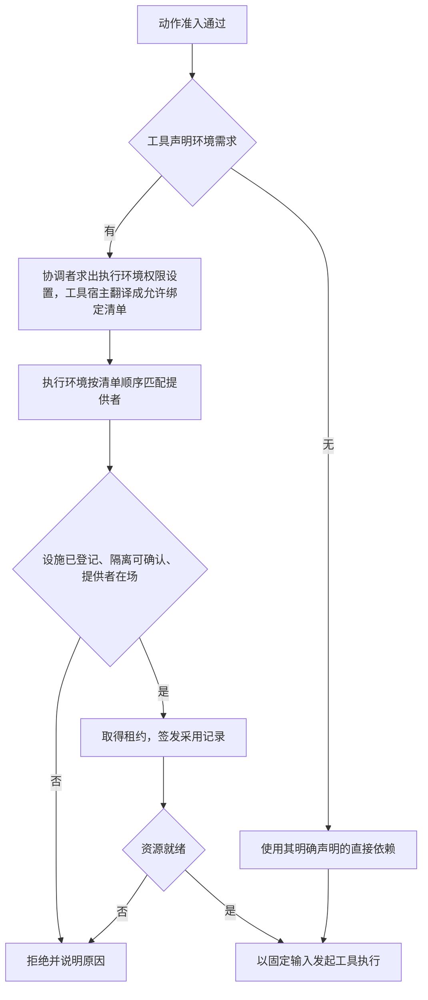

# 执行环境

Execution Environment 提供工具实际执行所需的隔离、计算、文件和其他设施。它回答“在哪里执行、可使用什么资源”，不拥有 Session 的业务状态，也不替代动作授权。

状态：基线段落已接受。依据产品正文[执行环境](../../../.meta_harness/design/product/execution-environments/design.md)第 2 版扩充或改写的节是候选，随产品第 2 版确认与本页技术接受生效。候选部分是：「环境选择与资源准备」的第一段与流程图、按名设施一段、独立工具调用一段、成员一段，以及其后提供者退役、在途结清、待处置、恢复授权与作用域释放各段；「资源、凭据与可见变化」里环境变化一段。环境作为独立输入供会话及程序化工具调用使用。部署节点与进程拓扑由[部署架构](../deployment/README.md)细化。

实现状态：当前纯契约及 Cordis 服务定义已补齐操作 schema、契约套件与机制读数测试；现有机制与宿主 files 提供者的运行范围仍归各成员 SPEC。 源码和包测试不改变本页候选部分的技术接受状态。

## 环境能力与寿命

环境按寿命、隔离和设施分别描述。工作区地址、Cordis Context、Session 与执行环境不是同一个对象。

| 环境类别 | 持续与保存边界 |
|---|---|
| 单次调用的无状态沙箱 | 服务所属的那一次调用，不提供跨调用状态保留承诺。 |
| 会话级沙箱 | 可在会话工作期间复用，有最大连续寿命，不承诺永久数据保存。 |
| 租户级沙箱 | 计算实例可以停止或更换，租户数据按相应生命周期保存并支持备份迁移。 |
| 宿主机 | 使用宿主设施，受单独授权与可用性约束，不能成为沙箱失败的默认后门。 |

多个环境可以同时存在。同租户共享不等于跨租户共享，重要原创产出不能只依赖短寿命沙箱。环境能重建也不代表其中的未保存数据能恢复。

## 环境选择与资源准备

工具声明所需的设施、隔离断言与能工作的绑定层；这份声明是工具定义里的 JSON 值，按执行环境契约导出的 schema 校验。执行环境按工具而非每条命令配值。`always-allow`、`auto_place` 和 `never-allow` 在执行环境之外求值：发起协调者按工具、按实际调用求出执行环境权限设置的有效值，它是这三个策略词之一；工具宿主把这个值与工具声明的目标环境翻译成一份有序的允许绑定清单，连同需要的设施与隔离断言交给执行环境。执行环境只在清单内匹配，不选清单外的层，不认识策略词。求值仍受当前授权、组织约束和实际设施限制。

准入成功不保证环境可用。所需隔离环境不匹配、建立失败或无法访问时拒绝执行，不能静默改用宿主机或更宽松环境。未声明环境需求的工具不自动套用沙箱维度，但实际依赖必须与公开声明相符。

按名设施是开放协议：每种设施由其拥有者声明键、操作与须逐操作授权的操作；提供者声明它提供哪些键；未登记的键不能取得设施。核心设施有文件、命令与终端三种。租约只暴露要求里的设施，每次操作先过集成方实现的逐操作授权；可能跨进程存活的资源先在调用方的耐久账本里取得许可再发出首个外部效果。

具体候选排序、池化、探测和节点选择由环境提供者定义。独立工具调用提供等价的合法环境输入，并实现资源账本、设施守卫与恢复授权三个端口，不要求先创建完整 Session。

执行环境分四个成员：纯契约（身份、绑定层、要求、落点、租约、需要端口、设施协议、块声明）、唯一 Cordis 服务定义、不含 Cordis 的登记表机制、Service 实现与宿主提供者。沙箱是将来新增的提供者，放在新的提供者成员里，登记到同一个登记表，不是新的 Service 实现，也不改契约。成员与依赖见[能力组](../../../packages/execution/README.md)。

提供者退役是一个状态，不是 disposer 里的等待。提供者插件卸载即撤除登记，撤除登记就是退役开始，之后提供者拒绝新租约。提供者的状态与转移见契约对象模型的[提供者](../../../packages/execution/execution-environment-contract/docs/object-model.md#提供者)。

退役时，已交租约的失效对持有方可见。在途的设施操作由原提供者结清。

确认不了停止的受管资源保留在集成方账本里，状态为待处置。查询入口是账本与维护者的恢复操作。

维护者凭集成方签发的恢复授权，停止、认回、结算一个作用域的受管资源。恢复授权只能收场，不能获取环境或发起新执行。

作用域的整体释放由维护者凭恢复授权发起。维护者在本版由应用装配层的协调者担任。执行环境不从任何上层逻辑状态推断作用域已结束。

上面几段的条款见契约的 [INV-EE18](../../../packages/execution/execution-environment-contract/SPEC.md#inv-ee18-提供者换代和-cordis-集成保留原责任)与[恢复](../../../packages/execution/execution-environment-contract/SPEC.md#恢复)。

## 资源、凭据与可见变化

一次工具执行捕获实际环境、工作区和所需资源入口。后续环境选择变化不把原调用搬到另一台机器，也不改写原调用记录。

子进程只取得该消费者允许的环境变量，不能自动继承宿主整份环境。凭据按身份和用途取得，不当作普通 Runtime Context、日志或遥测内容传播。文件和网络能力仍按实际目标与调用资格检查。

环境变化须让模型类读者知道当前设施与上次状态是否仍在：执行环境作为 Runtime Context 的生产者供给当前落点列表与宿主事实两块，按作用域给出，变化是观察不是控制。通知只是变化信息，不足以证明原工具已停止或数据已迁移。工作区可访问和允许执行是两项条件，不能从文件路径反推授权。

## 失效、重建与数据责任

具体节点、环境提供者或设施可能单独失效。影响范围由真实依赖决定，不能将“Agent 所在宿主不可用”一律解释为全系统不可用。

| 已知事实 | 允许得出的结论 |
|---|---|
| 环境查询暂时失败 | 当前无法确认状态，保留未知。 |
| 原计算实例确定丢失 | 按工具自身失联规则收束，不能自动重放原效果。 |
| 租户数据可恢复 | 可按数据契约重建环境，不证明原执行可以热迁移。 |
| 新环境已就绪 | 可以服务新的合法调用，不自动接管旧进程。 |

恢复计算、恢复数据与恢复原执行分别验证。环境差异不自动提供热迁移，异构恢复需要相应协议和兼容前提。无法判断外部副作用时如实报告，不把环境重建成功当成原动作成功。

## 观测与验证责任

环境提供者报告准备时间、排队、失败、资源压力、身份与数据恢复状态，并关联实际工具调用。超长期待机应能释放不再需要的活跃计算资源，同时保护已承诺的数据保留。

验证覆盖隔离不足时拒绝、凭据范围、环境创建失败、节点丢失、沙箱到期及租户数据恢复。数值限额、保留期和设施命名由相应接口与部署规格细化，不在此指定一套固定基础设施。

## 依据

环境类型、选择与资源规则的当前产品责任候选见[执行环境](../../../.meta_harness/design/product/execution-environments/README.md)，工具环境要求的候选见[工具执行](../../../.meta_harness/design/product/tool-execution/README.md)。两者仍为草案；个人设备、云端集群及故障影响控制继续沿[架构目标](../drivers-and-constraints.md)和实际接受记录执行。
