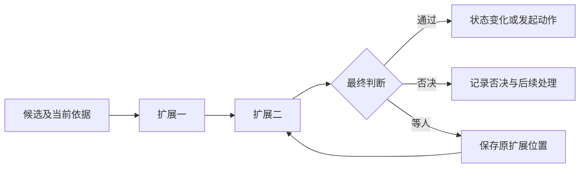

# Loop extensions

Loop extension 在明确状态点观察、改写候选内容或阻止状态变化。它通过受控结果影响 Loop，不能暗中跳转执行位置或改写已记录事实。

状态：已接受的目标架构。本页维护扩展位置、干预力、组合与接续规则。位置集合、干预力档位和位置输出表的机读形式已在 agent-contract 的 [extensions.ts](../../../packages/agent/agent-contract/src/extensions.ts) 与 [judge-output.ts](../../../packages/agent/agent-contract/src/judge-output.ts) 实现。扩展的调用与调度尚未实现。正常执行顺序见[Agent runtime](agent-runtime.md#一轮推进)。

## 扩展位置与干预力

扩展位置按状态变化命名，共九处。纯派生的上下文组装不增加位置。

| 位置 | 输入与触发边界 |
|---|---|
| 执行开始之后 | 新开始的 Agent 逻辑执行及当下条件。每个新的 Agent 逻辑执行经过一次；重挂接、实例换代或接续原执行时不再经过。 |
| 压缩之前 | 将供压缩判断的历史与模型档案。 |
| 压缩之后 | 实际产生的 CompactionMessage；未发生压缩不触发。 |
| 调模型之前 | 组装完成、尚未发出的请求。 |
| 调模型之后 | 按完整回复或失败这两个收场维度选择扩展。失败维度在一次调用内有两种触发：每次首内容前的发出失败触发一次，此时调用尚未收场，可以返回重试计划；原调用最终失败时再触发一次，此时调用已经收场，不能再重试。 |
| 执行动作之前 | 单个动作的候选参数与相关依据。 |
| 执行动作之后 | 按单个结果或整批齐备这两个范围选择扩展。整批范围只在本批至少一个动作已经执行时经过；全部动作在执行之前被拒绝时不经过整批范围，拒绝事实经回复消息与执行事实到达后续位置。 |
| 落终态之前 | 候选终态及其依据。 |
| 落终态之后 | 已经成立的终态。 |

压缩步骤的模型调用也经过调模型之前与调模型之后两个位置，以用途区分于主请求。压缩步骤的请求已由 Model 固定，该用途下调模型之前不提供改写、注入与模型选择。该用途下的否决使该压缩计划按压缩后仍装不下收场并附否决依据，不回到同一步重新求值。

消息持久化归会话，不归 Agent，所以 Agent Loop 不提供消息落盘之前和之后的位置。消息持久化前后对输入的处理挂在会话的业务流程拓展点上。外部输入、模型完整回复和工具结果的消息准入，以及按来源区分的拒收后果，是 Agent 自己的规则，不经过扩展，见 [Agent runtime](agent-runtime.md#回复准入与动作处理)。

扩展声明的干预力只是上限，位置输出表是第二道约束，两者共同裁定实际能力。实际能力还受所处位置和上层约束收窄。运行时不能无声升级权限，也不能因扩展自称可否决就授予否决权。位置输出表见[扩展作者协议](../../../packages/agent/agent-contract/docs/public-api/extensions.md)。

| 干预力 | 允许做什么 | 不能做什么 |
|---|---|---|
| 只观察 | 读取适用输入并记录自身观察。 | 修改候选内容或影响是否推进。 |
| 可改写 | 按位置追加事实或修改尚未提交的候选。 | 改写历史，或撤销已经发生的状态。只有调模型之前、执行动作之前和执行动作之后的单结果范围提供改写；其他位置不提供改写。 |
| 可否决 | 在位置允许时阻止候选状态变化，或登记人工等待。 | 绕过系统授权、把询问直接当成批准。 |

后置位置不撤销原状态。否决阻止尚未发生的状态变化，所以执行动作之后和其他后置位置不提供否决能力。除落终态之后外，停止与请求人处理在后置位置保留，只影响后续推进，不撤销已发生的动作。落终态之后只观察：不能停止，也不能登记等人等待。可否决不表示所有位置都允许等待。

## 有序组合与参数改写

同位置的扩展按装配声明顺序执行。后一个扩展读取前一个扩展处理后的候选与新增事实，否决结束当前扩展链，请求人处理暂停链。停止与重试都不结束链：系统先保存这个结论，链按声明顺序继续，后继扩展读到它但不把它当作取消成立。链完成或被否决截断后，系统只对实际形成的结论前缀归约，不为未运行的后继制造结论。这不是并行读取原输入后再合并的模型。

归约先认回或采用前缀的独立效果（提醒、改写依据、守卫事实），每项沿自己的原身份处理一次，停止不撤销这些真实效果与费用。随后逐项处置停止请求：已经生效的取消、既有终态、挂接取代与实例停用优先，链上的输出不能覆盖它们；每个停止请求保留原来源与身份，受理或核权未知时先查原请求，期间不发出受保护的操作或重试；至少一个取消请求的意图实际成立时转入取消收束，其余失败建议、否决与重试都不能恢复业务；取消请求都被拒绝而至少一个失败请求合法时形成失败候选，多个合法失败请求以链序最早者为主因。停止请求全部明确处置后才选路由：没有停止意图成立时，保留否决，或采用链序最后一个合法的重试计划，或继续。扩展提出的停止只是控制请求，不从名字推导中途短路；它的延迟可以包含后继扩展的费用与人工等待，外部的有效控制不被这项延迟阻塞。作者可见的规则归[扩展作者协议](../../../packages/agent/agent-contract/docs/public-api/extensions.md#否决停止与终态)。

不同动作可分别运行扩展链，但同一批的判断必须齐备后才执行获准动作。某个动作已经通过，不能因此越过其他动作尚未完成的判断。

动作参数改变时，先记录原参数及生效参数。系统准入、人看到的卡片和实际调用均使用同一生效参数。模型前扩展改变了日志时重新组装请求，但同一次经过不再次触发模型前扩展，避免无限自触发。

## 等待与恢复

人工等待保存扩展身份、版本或适用依据、动作、位置、待答内容和原消费位置。卡片答复回到原等待，而不是转换成一句聊天后让新模型猜测含义。

一批卡片答完后继续原位置，后继扩展可以再产生下一批。卡片仅能有效回答一次，同一卡片在会话和决策池的展示共享同一份决定。决策池提供入口，不拥有执行生命周期。

扩展可以使用模型或其他能力，也可以产生副作用，因此接续不能简单重跑函数。已经记录的判断与效果复用，未完成调用按原身份接续。实现规格须定义稳定调用身份、非确定输入记录、等待交接与撤除后的恢复协议。

工具内部的 `Ask()` 等待归工具执行。这里的等待归 Agent 执行的扩展位置，二者不能互换。原等待执行已确定终局时，卡片作废；系统不得伪造人的答案。

## 不可用、报错与系统扩展

不可用表示未能提供扩展能力，执行报错表示扩展已经开始但失败，二者分别记录。宿主不能判明一次调用是否开始或是否收场时，既不记不可用也不记报错：原调用保留，由下一次合法推进按原身份接续，分类规则归[扩展作者协议](../../../packages/agent/agent-contract/docs/public-api/extensions.md#调用协议)。非系统扩展不可用默认跳过。只有实际求值仍为可否决且位于前置位置的扩展，才能按声明执行缺失即否决；干预力被收窄为另两档时仍跳过。实际处置须可见。

没有更具体的声明时，只观察扩展报错不改变推进；可改写扩展不应用本次改写并记录失败；可否决扩展按否决处理。等人属于正常等待，不能默认超时后批准。

| 系统扩展 | 位置 | 不可用时的承接 |
|---|---|---|
| 动作准入 | 执行动作之前 | 全拒件接替，不放行，也不出卡。 |
| 模态转换 | 不在扩展位置上。非 Tool ref 来源由实现消息准入的提供者在接纳前调用转换件，Agent 只看到接纳后的消息与派生表示。 | 按转换失败处理，不能伪造可读内容。 |
| 重试策略 | 调模型之后的失败分支。该分支的有序扩展链由一个具名的重试策略协调者托管，受信系统重试扩展是链中唯一的强制组件；协调者沿原重试位置形成唯一决定，Model 核验来源后才可能再次发出。实现位置见 Agent 的[开放问题 U-2](../../../packages/agent/agent/docs/architecture/open-questions.md#journal-联合表达的具名缺口) | 强制组件确定缺席、失败或超时时，协调者保存不再重试的决定并保留真实失败，不能选回之前作者的重试建议。只有某次查询超时而没有原启动或结果事实时保持未知，不伪造不再重试。 |
| 循环判断 | 调模型之后的完整回复分支 | 记录不可用，不伪造判断。 |
| 结果卸载 | 执行动作之后的单结果分支 | 记录不可用，不伪造已卸载。 |

动作准入不能被替换、禁用或收窄为只观察。额外约束可以增加独立的否决扩展。模态转换本阶段不属于组织或租户可替换的资产，只由系统装配选择和替换。

## 准入与 HITL

动作准入先计算结构化授权交集。明确禁止立即拒绝，不被会话模式或人的临时答复覆盖。可自动执行的动作直接通过；其余动作结合有效授权表达，再按会话授权模式拒绝、询问或放行。

询问只对原动作及其参数有效。改变实现、参数或授权依据后，不能自动复用旧批准。工作区内容不参与授予权限。准入通过后仍须满足[执行环境](execution-environment.md#环境选择与资源准备)的约束。

## 循环守卫与终态扩展

循环阶梯根据未被压缩改写的原始事实计算。L0 不可关闭；L1、L2 追加干预消息；L3 以打转失败收束；L4 请求人处理。具体适用条件与阈值归策略，不能用更换执行挂接或摘要重置计数。

终态前扩展可以阻止不成立的完成候选或失败候选。取消不经过终态前扩展：取消意图成立并撤销推进资格之后，系统对取消做一次受信的只读核对，读取各拥有者的现有事实并保存核对结果，不发起新的模型调用、消息、卡片或人工等待，其他扩展不能阻止它。Run 的被取消终态按会话规则在取消生效时成立，见 Session 产品页的[插队与取消](../../../.meta_harness/design/product/sessions-and-work/design.md#插队取消工作和归档有不同影响范围)；这次核对决定的是 Agent 能否结束自己这次执行，事实不明、责任未交清或收束一方缺少当前资格时 Agent 不结束执行，保留未收尾责任。取消生效后，原有扩展不再向模型、消息或人发起新的请求；已发出的请求、已取得的判断、已有的答复与结果保留，迟到的结果仍按原身份接收。核对的判据、记录与旧取消记录的迁移归 Agent SPEC 的[取消判断与路线](../../../packages/agent/agent-contract/SPEC.md#取消判断与路线)，产品规则归[完成、失败与取消](../../../.meta_harness/design/product/agent-progression/design.md#完成失败与取消)。终态后扩展只能处理已成立事实，失败不让 Agent 执行回到未终结。扩展判断费用归原 Agent 执行，不因运行在主模型调用之外就丢失归属。

## 依据

位置、干预力及组合的产品责任见 [Agent 定义与工作推进](../../../.meta_harness/design/product/agent-progression/README.md)。该产品页已由产品负责人采用，见[技术接受与产品采用决定](https://github.com/nemori-ai/omne-harness-lite/issues/384#issuecomment-6258475204)。[PRODUCT-E01 发生与记录条目的跨产品承接](../../../.meta_harness/design/product/README.md#product-e01)登记共同记录来源的承接缺项。准入与人工等待的候选责任分别见[身份与授权](../../../.meta_harness/design/product/identity-and-authorization/README.md)及[人在回路](../../../.meta_harness/design/product/human-intervention/README.md)。这两个 topic 仍为草案，本页不据此扩大既有采用范围。

以下各项是已作出的设计决定（用户决定，2026-10-17 Agent 扩展继承与边界对齐）：

- 九处位置，其中执行开始之后的触发边界见上文；两种消息持久化位置不属于 Agent，归会话的业务流程拓展点（用户决定，2026-10-19）。
- Agent 不要求也不解释 Session、Run、attempt，所以本页以 Agent 执行表述扩展的归属、接续、终态与费用。
- 符合本架构的 legacy 扩展语义予以继承：压缩之前与执行动作之后整批范围不改写；后置位置不提供否决；后置位置的停止与请求人处理只影响后续推进；落终态之后只观察；声明的干预力是上限，位置输出表是第二道约束。
