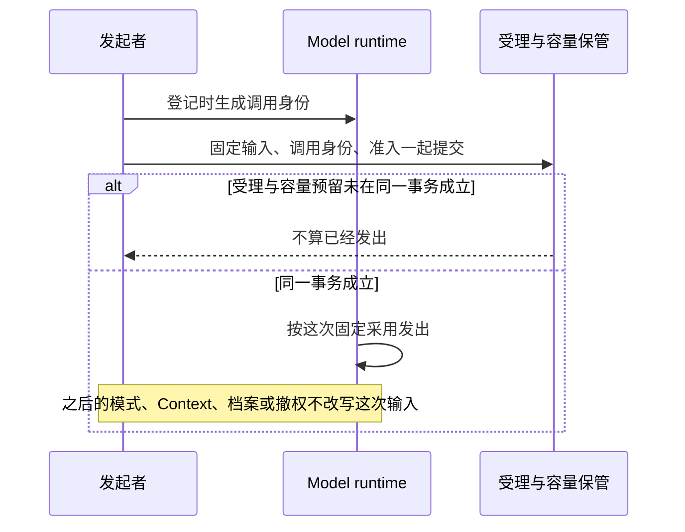
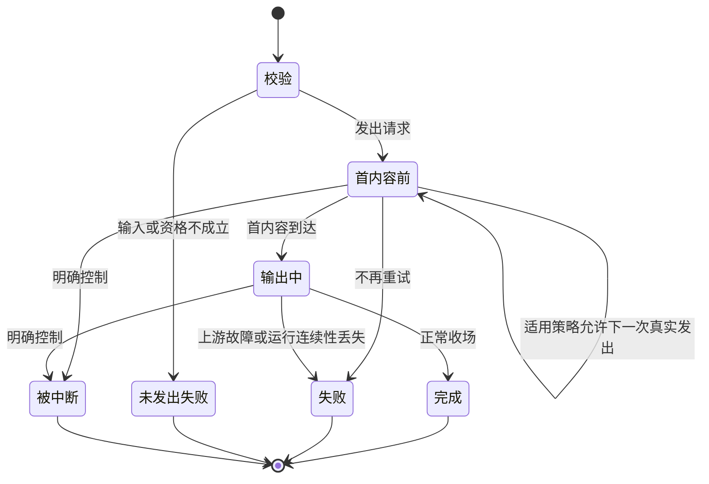

# 模型请求运行时

Model runtime 接受完整请求，管理真实发出、内容交付和实际收场。它不推进 Agent Loop，也不执行模型提出的工具动作。主流程、压缩、扩展判断及独立程序都可以成为它的消费者。

Model 对 Tool 没有直接依赖。工具调用响应与 ToolMessage 使用 common/message 的消息值，内容使用 common/content-block。请求中的可用动作声明属于 Model 请求契约，由上层请求组装者从工具定义投影并保管原工具及命令路由；Model adapter 只负责供应商格式，不读取 Tool 定义、结果对象、注册表或执行句柄。

状态：已接受的目标架构。请求输入由[请求上下文](request-context.md)组织；流式协议和消费责任由[流式与消费](streaming-and-consumption.md)说明。

## 请求身份与输入

模型档案是长期配置数据，逻辑调用是一次有始终的工作，每次真实发出是一次供应商请求。三者分别记录。发起者在登记调用时生成稳定调用身份。会话路径上的发起者是 Agent。独立调用的发起者是那个调用方。这个身份在 Agent runtime 被替换后仍可使用，不能由一个临时句柄代替。受理和结果容量预留在同一真实事务里成立，否则不算已经发出。

一次请求取得有效模型档案、参数、系统提示词、组装消息、可见工具声明、允许读取的 contexts、访问条件和取消关系。固定下来的输入、调用身份和准入决定一起提交。实际采用的输入须可解释或准确还原。之后的模式、Context、档案或撤权不改写这次已发出的输入。

档案声明路由名、允许供应商及顺序、是否回退、模态和输入输出限额。同名档案先按资格筛选，再按租户、组织、官方的具体程度求值。缺少凭据、模态不符或权限不足时不能偷偷改用另一层档案。系统不固定某一家请求通道。

发出前校验目标、凭据、权限与完整输入。统一参数通过适配器传递；上游不支持的参数不能静默丢弃。来源不完整时给出具体失败原因，不能靠重试补出授权或合法输入。

## 供应商适配路线

模型请求以pi-ai作为供应商适配入口，按获准模型加载所需适配器。OMNE的model runtime固定原调用身份、访问依据、结果容量预留和重试政策，随后通过pi-ai发出请求。pi-ai负责供应商协议和流事件映射，原调用的准入、取消、恢复、费用、晚到结果及可靠保管仍归OMNE。

提供者须处理pi-ai内部EventStream无容量上限的已知限制，在实际生产与入队位置落实有限项数、字节数及受控消费。消费端再包一个有界队列不足以证明内部队列有界。所选供应商路径须验证慢消费者、暂停、取消、超限及迟到结果；不能兑现有界流和已发生结果保管时，不开放依赖这些保证的profile。需要修改或补充pi-ai接缝时，由model提供者维护并验证，不把库内部行为当成已兑现保证。

每条供应商路径核对pi-ai及其下层SDK的自动重试、取消、参数映射、原始响应和用量。可关闭的自动重试关闭；不能关闭的重试必须纳入同一原调用的可观察控制，不能形成第二套隐式发出。pi-ai无法满足必要协议或语义时，提供者提交具体差异及替代范围再选择官方SDK或受管fetch，不自行改变优先路线。

统一事件映射不能代替原结果保管。提供者须按原调用契约保留所需供应商字段、原始响应或可恢复引用，并实际核对映射前后的差异。供应商字段保留不能只由统一事件类型推断，不同下层SDK版本和供应商路径须分别验证。显式核对每次真实发出，不能从一个路径省略重试参数时的请求数推断其他路径的默认行为。

具体pi-ai版本与替代条件归[系统技术基础](../technical-foundations.md#共同技术选择)。纯能力入口保持独立消费，不因适配器懒加载而要求Session、Cordis装配或某个存储提供者。

## 真实发出与调用收场

一项逻辑调用可以有多次真实发出，每次只交给一个供应商。换供应商属于新的真实发出。各次失败的供应商、时刻、原因、状态码和费用不能被最终成功覆盖。

首内容指首次实际交付的内容。文字以第一片为准，图片或文件以完整块为准。响应头、心跳或空开块都不算。模型自身 TTFT 与用户入口到首次输出的端到端延迟分别度量。

用户中断属于控制结果，不伪装成上游故障。一次发出失败也不总是整项调用结束，只有策略不再继续时才形成调用终局。

## 重试与失联边界

| 情形 | 处置 |
|---|---|
| 请求、凭据或授权明确无效 | 返回成因，不反复发送同样无效输入。 |
| 首内容前的可重试上游失败或空回复 | 按档案声明和适用策略决定退避或下一供应商。 |
| 首内容后发生故障 | 记录实际失败，不重发同一逻辑回复。 |
| 用户中断 | 停止本次调用，不自动终结 Run 或工具执行。 |
| Agent runtime 或最后一个句柄消失 | 原模型执行继续，合法接手者查询并等待原调用。 |
| Model runtime 确认失去连续性 | 首内容前可按原消费位置恢复重发；首内容后记失联，不重发。 |
| 状态查询暂时不可用 | 保留未知，不能据此宣称模型执行已经终止或丢失。 |

默认重试策略在允许回退时按档案顺序逐家尝试，每家至多一次；不允许回退时在原供应商退避后至多再试一次。策略可替换，但不能改变首内容后不重发、真实费用不隐瞒的边界。

失联恢复可能产生新的真实费用。未知费用保持未知，不写零。模型回复被后续消息入口拒绝不抹除实际调用；再次请求具有新的调用身份。

## 结果、确认与费用

模型原始回复、会话实际采用的消息、消费决定和费用分别存在。结果被会话拒收，不表示模型没有完成执行；压缩或扩展的结果也不直接成为聊天消息。

模型侧保管原结果，直到当前合法消费者完成处理或可靠保存后确认。确认必须晚于真实收场。具体 ACK 资格、确认后的清理和在途读取保护由[模型 ACK 与副本清理](streaming-and-consumption.md#模型-ack-与副本清理)统一维护。

费用属于原调用及原逻辑工作。迟到费用在 Run 终结后仍可补齐，副本清理不能删除尚需结算的事实。费用可独立结算时，也不能以未知费用为理由永久保留无关完整内容。

`cost.source` 的四个值是四份不同的记录。`supplier` 是供应商报告。`observation` 是本侧观察到的报告。`billable` 是可计费报告。`ledger` 归业务账的拥有者。会话收下前三种。会话在收到模型响应的流式增量、该流的完成，或一次已完成工具执行的工具结果时写下这份账。

发出前按[联合结果容量预留](../deployment/execution-and-communication.md#发出前的联合结果容量预留)落实原调用受理与保管预算的共同提交。ACK、副本获准清理和实际容量解除分别判断，未知结果和迟到费用继续使用原调用预留。

## 独立调用

独立消费者提供合法请求、访问资格和控制关系，并承担自己的结果消费责任。它可以处理结果后 ACK，也可以先可靠保存后 ACK，无须创建隐式 Session。

独立入口与会话入口遵循相同的真实发出、失败、重试和费用边界。调用方选择怎样保存自身业务状态，不能要求模型运行时替它判断业务是否完成。

## 验证责任与细化范围

接口拥有者须验证首内容前后故障、重复查询与 ACK、消费者替换、清理失败、迟到费用和供应商多次发出。适配器须验证参数、模态与限额映射，不以模拟流成功代替真实协议验证。

精确状态码映射、退避数值、请求快照格式和失联判据由后续规格确定。图中状态表达语义，不要求实现使用同名枚举。流中已经展示但尚未收场的内容，其故障保留边界只在[局部对账](streaming-and-consumption.md#在途内容的局部对账)集中说明。

## 依据

模型档案、调用及 ACK 的已接受产品责任见[模型调用](../../../.meta_harness/design/product/model-invocation/README.md)。Model 非 pi-ai 细化设计已接受；pi-ai 的采用范围由[组架构各节](../../../packages/model/docs/architecture.md#成员与新增条件)维护。输入与交接另见[会话与工作](../../../.meta_harness/design/product/sessions-and-work/README.md)，其采用范围由该拥有者维护。

## 未决问题与待办事项

以下事项分别跟踪契约承接与运行验证。设计候选、技术接受、实现和验证是不同状态，不能以其中一项代替另一项。

### MODEL-V01 无 Session 的完整消费协议覆盖

状态：消费协议已接受，实际提供者的运行验证仍待完成。

[独立消费指南](../../../packages/model/model-contract/docs/context.md#独立执行与托管独立调用)区分单次独立执行与托管独立调用。前者不提供自动重试、可靠保管或 ACK；后者无需 Session，通过原调用身份完成受理、恢复、消费确认和清理。单次执行成功不能替代托管消费协议的证据。

模型提供者与原消费协调者须按[持续验证场景](../../../packages/model/model-contract/verification/README.md#持续验证义务)及[完整协作场景](../../../packages/model/model-contract/verification/README.md#内部-module-与完整协作场景)，验证可靠交接、原身份恢复、重复 ACK、清理和迟到费用。关闭本项需要实际提供者与消费方的组合证据，覆盖崩溃、未知提交和并发；设计声明的类型检查与时序图解析不满足该条件。

### MODEL-T01 模型请求运行时契约的承接

状态：非 pi-ai 精确契约的设计承接及技术接受已完成，真实导出与实际消费者迁移仍待完成。

领域类型和操作由 [model-contract 公开接口](../../../packages/model/model-contract/docs/public-api.md)拥有。发起、原身份、结果保管、消费确认、恢复及费用关联由[共同规格](../../../packages/model/model-contract/SPEC.md)约束。执行函数和构造由 [model 实现入口](../../../packages/model/model/docs/public-api.md)拥有，框架定义由 [model-cordis-contract](../../../packages/model/model-cordis-contract/docs/public-api.md)拥有。无需再寻找另一份运行时契约正文。

模型公共契约、提供者与原发起消费协调者须按已接受契约落实真实导出，并迁移实际消费者。关闭本项须确认这些消费者沿唯一契约接合，保留首内容、重复发起、未知结果、ACK 和迟到费用的边界。独立消费的运行符合性继续由 MODEL-V01 跟踪，不因契约定位完成而宣称已验证。
