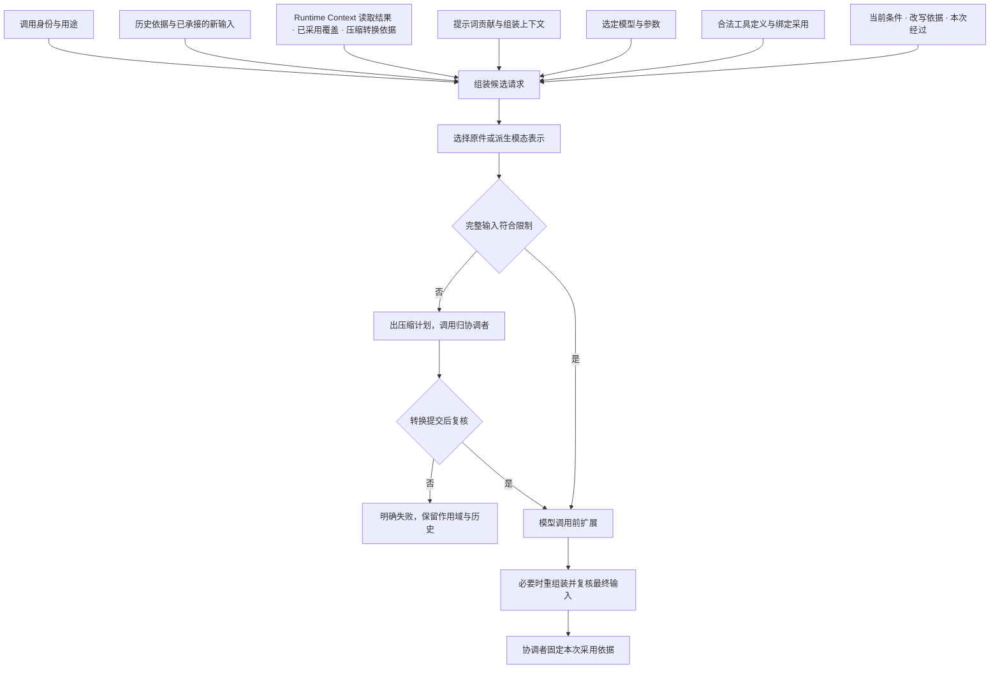

# 单次模型请求的上下文

Request Context 是一次模型请求输入的派生计算与装入保证。一次模型请求取得当前允许使用的系统提示词、历史、工具声明、Runtime Context 读取结果和模型表示，再按实际模型约束形成输入。它不拥有事实，不发请求，不固定采用，不写历史；它拥有的是规则、策略与可重建的缓存。

状态：已接受的目标架构。当前值来源归 [Runtime Context](runtime-context.md)，请求发出后的生命周期归[模型运行时](model-runtime.md)。本页只认通用角色：协调者（发起方）、历史持有者、贡献者、独立调用者。

## 定位与服务面

| 服务面 | 做什么 | 不做什么 |
|---|---|---|
| 历史投影 `project` | 按块的模型可读标注与最近一条压缩记录算出模型可读消息列表 | 不读原件字节，不分页给人 |
| 人侧投影 `projectForHuman` | 用同一套块标注规则给人侧的投影 | 不分页、不写回；入口归持有者与交付面 |
| 系统提示词组装 `assembleSystemPrompt` | 把有序段与变量渲染成纯文本，每请求求值 | 不接受逐请求变化的变量 |
| 工具声明投影 `declareTools` | 从合法工具定义形成直接集合与脚本可调用集合 | 不判可用性，不授权执行 |
| 放置 `placeContext` | 完整读取时生成锚定的快照提醒；生成尾部易变提醒 | 不读 Runtime Context |
| 表示选择 `chooseRepresentations` | 按收件模型的输入模态为每个内容块选原件、派生表示、transcript 或延迟 | 不读字节，不转换 |
| 预算裁定 `judgeBudget` | 比较完整候选与限制，给出装入裁定 | 不计量；数字由模型侧报告 |
| 组装 `assemble` | 按六层布局拼装成请求候选，附覆盖证据 | 不固定、不记录 |
| 压缩计划 `planCompaction`、`deriveStep`、`resume` | 出计划、逐步推导、转换提交后重算 | 不发模型调用 |

九项（含三个压缩计划操作）都是纯计算或计划。贡献登记面是唯一带寿命的部分，见[提示词贡献登记面](#提示词贡献登记面)。

## 输入来源与组装

组装输入分七组，每组由别人拥有并给出修订或证据；同一组输入再算一次给同一份候选，任一组合法变化使尚未固定的候选重算。

| 组 | 谁给 | 要点 |
|---|---|---|
| 调用身份与用途 | 调用方 | 访问身份、用途、消费位置、候选身份；压缩步请求不经组装 |
| 历史与新输入 | 持有者的读取适配器与调用方 | 历史依据经构造时注入的历史源读口分页读，不遍历全历史；新输入先可靠保存再进组装；有效压缩记录从历史派生 |
| Runtime Context 读取结果 | 调用方以模型资格读得 | 完整或增量、覆盖证据、完整时的块材料；组装不读 Runtime Context；私有块永远不在其中 |
| 系统提示词 | 贡献登记面与调用方 | 有序段与变量两类贡献，加解析贡献用的组装上下文 |
| 模型侧 | 调用方经模型选择端口 | 实际收件模型、已解析档案、参数；组装不解析档案、不选模型 |
| 工具侧 | 调用方经装配求值 | 合法工具定义、绑定采用、可编程许可 |
| 当前条件与本次经过 | 调用方 | 条件证据、扩展改写依据、调模型之前位置的经过 |

系统提示词每次求值，不存成历史。历史组装读取已持久保存的适用消息；本次需要承接的新输入必须先可靠记录，再进入组装。工具声明还需与本次合法采用的能力相匹配。投影保留 [Tool 可编程调用许可](../../../packages/tool/tool-contract/SPEC.md#可编程调用的定义与准入)，分别形成直接模型工具集合和脚本可调用集合。省略或 false 不阻止合法直接调用，但不能进入脚本可调用集合；请求快照不替代实际子调用准入。

历史持有者的历史按消息与块的模型可读标记投影。ToolInternalMessage 不进入模型请求。提醒保留变化链，不能把所有提醒压成“最新状态”而不遵循压缩规则。

一次求值须有明确读取范围和外部输入依据。同一次组装内所有历史页用同一份历史依据；持有者在组装期间提交了压缩，读口返回依据已变，组装用新依据重算，不拼接两段历史。组装期间新数据到达时，不能把旧模型档案、新工具 schema 和旧实现混成一个请求。最终输入必须仍满足当次授权和发起条件。

## 候选、装入裁定与失败

| 结果 | 含义 | 协调者对应 |
|---|---|---|
| `assembled` | 装得下，尚未经过调模型之前位置 | 继续到该位置 |
| `ready` | 装得下，已经过该位置并由模型准备成固定请求 | 固定并记录 |
| `needs-compaction` | 装不下，非固定部分可压，本候选身份尚无计划 | 进入压缩计划 |
| `cannot-fit` | 固定部分超限，或已有计划仍装不下 | 按失败处置 |

装入裁定四选一：装得下、固定部分超限、需要压缩、限额未知。限额未知不是失败，候选照常成为 `assembled` 或 `ready`，覆盖证据标明限制未知，发出与否由模型侧按真实能力裁定。

失败分三类：无权（身份或资格不足）、无效（缺必要输入、输入形状或范围越界，含对压缩步请求调组装、带逐请求变量的提示词段）、不可用（没有可用表示，或历史源、计量、转换结果不可读）。另有未知：来源读取或提交结果未知。表示不可用不是第四种失败，是不可用的一种，带原结果。固定部分超限是结局 `cannot-fit`，不是失败。逐项落位见契约的[组装的结果](../../../packages/context/request-context-contract/SPEC.md#组装的结果)。

覆盖证据随每份候选给出：历史范围与各层锚点、有效压缩记录、新输入批身份、Runtime Context 快照修订与完整或增量与快照锚点、提示词各段来源与修订、选定模型与档案采用、参数、工具声明摘要、条件证据、改写依据、表示决定摘要、预算报告摘要、前缀为何中断。它回答三个问题：模型这次看到了什么；和上一次相比什么变了；前缀为什么中断。

## 装载布局与前缀

供应商的前缀缓存命中条件是请求字节从头起逐字相同。布局原则只有一条：越稳定的越靠前，变化只发生在尾部。一次请求分六层。

| 层 | 内容 | 稳定性 |
|---|---|---|
| ① 系统提示词 | 有序段加变量，每请求求值，一个作用域里基本不变 | 不含日期、目录、占用比例等易变事实 |
| ② 工具声明 | 本作用域合法工具的完整集合 | 不按步裁剪 |
| ③ 历史头 | 快照锚点之前的全部模型可读历史。有压缩时依次是保留名单里的消息、最近一条 CompactionMessage、覆盖范围之后到锚点之间的消息；没有压缩时是锚点之前的全部模型可读消息 | 压缩或新的完整读取时变化 |
| ④ 快照提醒 | 完整读取的全部稳定块，锚定在快照锚点 | 同一完整读取代内每次请求重放于同一处 |
| ⑤ 历史体 | 锚点之后的全部模型可读消息，含变化提醒、后台占位、本步新输入 | 只追加 |
| ⑥ 尾部易变提醒 | 只含逐请求变化的块 | 每请求重算，不进历史与变化提醒 |

压缩记录不单列一层。模型视图只按最近一条压缩记录计算；较早的压缩记录落在最近一次覆盖范围内，被摘要取代，或作为保留消息出现。

规则：

- 系统提示词只放慢变内容；逐请求变化的变量拒绝。动态运行事实不走提示词贡献，只走 Runtime Context 块。
- 工具声明按完整集合投影，可用性变化在发起时由工具侧再核。
- 快照锚点是本次完整读取发生时的模型可见历史尾部，不含本次请求承接的新输入。压缩之后重给的快照锚在当时的历史尾部；覆盖范围延伸到压缩点时，这个尾部就是压缩记录之后。锚点记在覆盖证据里，经采用回传，下一次组装沿用。
- 块变化、工具转后台、后台结果到达、外部捎话一律以提醒追加进历史，不改快照、不改早先消息。
- 扩展在调模型之前位置的改写若触及①～④已有内容，覆盖证据记前缀中断原因为扩展改写；只追加到⑤尾部的不中断。
- 系统提示词或工具集合变化时不迁就缓存而延迟变化；变化即中断，覆盖证据记原因。正确性先于缓存。

前缀中断的原因取值：新快照代（新执行、压缩后、游标重置）、系统提示词变化、工具集合变化、压缩、扩展改写、模型切换、无。前缀一致是优化目标，不是任意输入变化后都逐字不变的保证。

## 模态表示与完整输入限制

文字、图片和语音是当前明确支持目标。内容块可以有原始表示、派生表示或 transcript。组装按实际模型的输入能力选择可用表示；多种表示都适用时由明确策略选择，不静默丢弃不兼容内容。工具结果的内容 ref 标为延迟，由模型侧在发送期加载。

模态转换形成可追溯的派生内容，不覆盖原始内容。缺少转换能力与转换执行失败分别报告，不能用空白或捏造文本冒充成功。模型不提供的内部推理也不能被补造。

预算覆盖系统提示词、历史、提醒、工具定义及所有实际模态内容。字节、图片数等精确限制须实际校验；token 可按适用计量方法及明确余量估算。不能只数最后一段用户文本。阈值比较与取整归本页，计量数字归模型侧。

模型档案提供有效上下限。未知上游限制保持未知，不能伪造数值。模型前扩展改动输入后须重新组装或校验最终结果，同一次经过不重复执行该扩展位置。一次请求准备对应一个候选身份；换候选身份即新的准备，计划次数重置；纯操作从输入「上一次准备」得知是否已进入过计划。重组装后仍装不下，而本次准备尚未进入压缩计划时，可以进入一次压缩计划，之后再复核。本次准备已经进入过计划的，按压缩后仍超限失败。

## 压缩与历史保留

压缩函数负责是否压缩、如何压缩和成功后能否装入窗口。系统提示词和历史共同计量，但只压缩历史，不能靠删除固定要求伪装符合预算。

本节关于保留名单的段落是候选修订，技术接受前不扩大本页既有承诺。

一次压缩追加 CompactionMessage，其中共同保存摘要、压缩覆盖范围和保留名单。形状、模型视图规则与判定归[消息成员](../../../packages/common/message/SPEC.md)，本页只规定请求组装怎样使用它。它不修改原块内容、不改原始可见性标记，也不删除原历史。

组装按最近一条压缩记录形成模型视图里的历史：保留名单里的消息按原顺序，接着是这条压缩记录，再接覆盖范围之后的模型可读消息。较早位置仍须给模型的消息只能通过保留名单出现，组装不在消息层面另行排除或补回。进入模型视图的每条消息仍按块的模型可读标记投影，保留一条消息不会让它不给模型读的块进入请求。

压缩计划由请求组装拥有，调用由协调者执行。计划一并确定覆盖范围与保留名单：覆盖范围从历史起点开始；保留名单在保留预算内选出；两者合起来必须使每次工具调用和它的结果在模型视图里同时出现或同时不出现。保留预算按比例或 token 数计在保留名单上。选择偏好可配置为较新优先或被引用多者优先，默认较新优先，使后续请求的开头尽量稳定。保留名单在压缩时固定，之后不变。压缩改变前缀时，覆盖证据记录前缀中断的原因为压缩，这一含义不变。

以下内容受明确保护。

- 最近一次模型请求之后写入、模型尚未读取的输入不能先被压掉。
- 未结束的等待和后台执行等占位不能被摘要抹除。历史持有者给出未结工作集合，其中落在覆盖范围内的条目必须进保留名单，这是保留名单的下界，不是策略的选择。
- 工具调用和它的结果在模型视图里同时出现或同时不出现。
- 压缩后补入模型允许读取的完整 Runtime Context，不能仅依赖已被摘要的旧通知。
- 原始调用、费用和未消费结果不因请求投影省略而消失。

策略在可装入的硬条件内平衡前缀一致、信息保留和长度。前缀一致是优化目标，不是任意输入变化后都逐字不变的保证。

### 压缩计划与步骤

计划有计划编号与步数上界，一个候选身份至多一个计划，上界定下后不变。步骤分修剪步与摘要步：修剪步不调模型，只缩短大的工具结果或媒体占位；摘要步是一次内部模型调用，由协调者发起，结果交回推导下一步或压缩转换。修剪步先于摘要步。计划进度由调用方持久保存，每步恰加一；耗尽上界或步被否决，按压缩后仍超限失败。压缩转换由持有者与协调者共同提交，组装只给材料；提交之后以转换依据重算，快照锚点移到当时的历史尾部；覆盖范围延伸到压缩点时，就是压缩记录之后。

## 失败与固定采用值

在作用域持有者的消费路径中，固定内容本身超限，或压缩后仍超限时，原逻辑执行失败并保留作用域与历史。独立调用向其调用方返回输入不能满足约束的失败，不创建隐式执行。两种原因须可区分。不默认分叉、不删历史、不偷偷换模型，也不在条件未变时无限新建执行。

发出前固定本次模型、参数、内容和工具声明。已经发出的请求不随后续定义、权限表达或 context 内容变化而改写。未来动作仍按未来动作发生时的有效条件准入，不能将请求快照当成长期许可。固定与记录归协调者；覆盖证据随最终请求记录，锚点经采用回到下一次组装。

压缩内部的模型调用有自己的身份、结果和消费位置。这个身份由发起它的协调者分配并记录，不由请求组装分配。它遵循相同的模型执行与费用规则，但其结果回到原压缩处理，不直接成为主流程回复。

## 提示词贡献登记面

系统提示词的贡献天然来自多个插件：协调者采用的定义、工作区指导、技能用法、元能力用法。贡献只有有序段与变量两类，身份是名字加作用域，同层重名拒绝，作用域里的遮蔽全局的，随贡献者寿命存在。登记面是 Request Context 唯一带寿命的部分，落在 Cordis 服务 `requestContext` 上：登记在贡献者 fiber 的效应里，卸载即撤；贡献变化发出带修订的变化通知，使缓存按组失效。贡献的内容归贡献者，Request Context 只拥有登记面与组装规则。

## 成员与 Cordis 落位

| 成员 | 变体 | 责任 |
|---|---|---|
| [request-context-contract](../../../packages/context/request-context-contract/SPEC.md) | module | 组装输入七组、候选与装入裁定、三类失败、覆盖证据、九项纯操作（含三个压缩计划操作）、六层布局与锚点规则常量、历史源与策略端口类型、解码与判定 |
| [request-context-cordis-contract](../../../packages/context/request-context-cordis-contract/SPEC.md) | service-contract | 唯一服务定义 `requestContext`：贡献登记面、策略提供者选择，以及组装入口 `assembly(scope)`（返回已按配置绑定策略与登记面的一组纯操作） |
| [request-context](../../../packages/context/request-context/SPEC.md) | module | 索引、候选缓存、默认压缩策略与表示策略、修剪器 |
| [request-context-cordis](../../../packages/context/request-context-cordis/SPEC.md) | service-provider | Service 实现：贡献登记表、作用域遮蔽、策略实现选择与配置校验 |

依赖方向：契约依赖模型、工具、内容块、消息与 Runtime Context 契约的读取结果类型；不依赖协调者与持有者的契约，二者依赖本域。协调者的准备三端口由适配器翻译到纯操作：准备对应组装，必要时再交模型准备成固定请求；推导对应首次出计划与逐步推导，适配器持久化进度并核计划编号、上界不变、进度恰加一；接续对应带转换依据的重算，适配器核提交来源与原准备一致。独立调用者直接用纯操作，自己提供输入与依赖，没有协调者就没有共同提交。调模型之前位置、压缩之前与之后位置归协调者，本域只接受它们产生的改写证据与经过。

## 长期会话的性能与验证

请求到了不算，算在请求之前：能在输入变化时维护的派生物不在组装时重算，组装时只做比对与拼装。候选缓存的键是七组各自的修订摘要；全部相等即返回已有候选；按组失效，只重算变化的层并在覆盖证据记原因。失效来源是变化通知携带的修订或计数，不是时间，也不是文件时间或内容重哈希；来源拥有者维护计数的义务见[比对代替求值](assembly-and-change.md#比对代替求值)。历史持有者维护历史视图与前缀摘要，组装按锚点比对摘要即可判断前缀是否未变。

派生可见集合、历史索引和稳定前缀可以缓存。缓存失效后必须能从原事实重建，不能成为另一个权威事实来源。增量计算仍须计入实际输出物化和模态读取成本。

评估覆盖冷加载、连续追加、压缩、context 变化和模型切换。超长期会话须能定位扫描、转换、组装与发送各自耗时。具体规模、目标数值和默认策略数值由后续规格确定，默认值只是可配置初值。

验证至少比较缓存与无缓存的同输入结果、压缩前后必要工作保留、混合模态限额、变更期间一致性及预算失败后的历史完整性。性能优化不能省略访问控制或隐瞒内容缺失。

## 依据

组装与压缩的产品规则见[运行感知与一次模型请求](../../../.meta_harness/design/product/runtime-context/design.md)（§6、§7），一次请求采用消息与块的规则见[同一正文的请求章节](../../../.meta_harness/design/product/runtime-context/design.md#6-一次模型请求采用合法完整输入)，模型能力与限额的责任见[模型调用](../../../.meta_harness/design/product/model-invocation/README.md)。这些正文不自动采用旧消息全集；本页既有承诺仍按实际接受范围执行。
