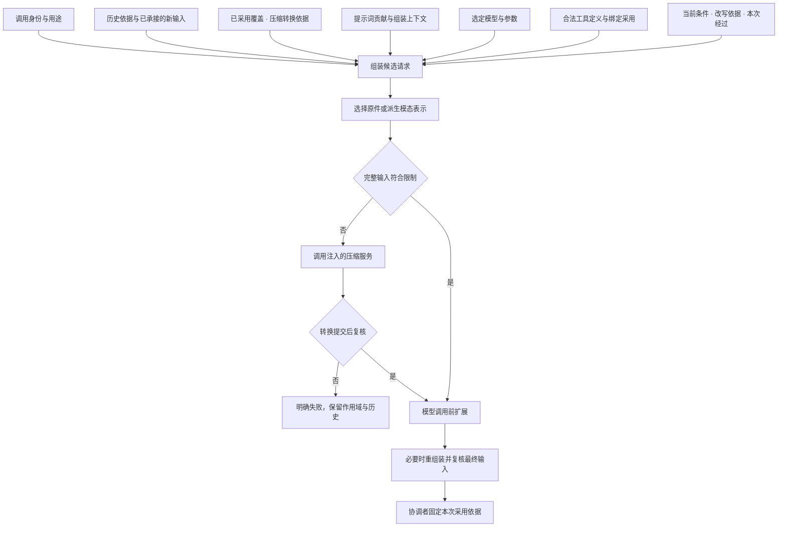

# Request Context

Request Context 是一次模型请求输入的派生计算与装入保证。一次模型请求取得当前允许使用的系统提示词、历史、工具声明和模型表示，再按实际模型约束形成输入。它不拥有事实，不发请求，不固定采用，不写历史；它拥有的是规则、策略与可重建的缓存。

当前值来源归 [Runtime Context](runtime-context.md)，请求发出后的生命周期归[模型运行时](model-runtime.md)。本页只认通用角色：协调者（发起方）、历史持有者、贡献者、独立调用者。

## 定位与服务面

| 服务面 | 做什么 | 不做什么 |
|---|---|---|
| 历史投影 `project` | 按块的模型可读标注与最近一条压缩记录算出模型可读消息列表 | 不读原件字节，不分页给人 |
| 人侧投影 `projectForHuman` | 用同一套块标注规则给人侧的投影 | 不分页、不写回；入口归持有者与交付面 |
| 系统提示词组装 `assembleSystemPrompt` | 把有序段与变量渲染成纯文本，每请求求值 | 不接受逐请求变化的变量 |
| 工具声明投影 `declareTools` | 从合法工具定义形成直接集合与脚本可调用集合，每个工具一条声明，多命令工具的命令写在调用参数里 | 不判可用性，不授权执行 |
| 表示选择 `chooseRepresentations` | 按收件模型原生读得了的模态与文件类型，为每个内容块选原件、派生表示或 transcript；表示读自消息上受理时写下的快照 | 不读字节，不转换 |
| 预算裁定 `judgeBudget` | 比较完整候选与限制，给出装入裁定 | 不计量；数字由模型侧报告 |
| 组装 `assemble` | 按三层布局拼装成请求候选，附覆盖证据 | 不固定、不记录 |
| 压缩前后计算 | 给出预算依据，压缩采用后重组完整请求 | 不拥有压缩任务，不驱动内部步骤 |

操作分两类（[RQ-01](../../../packages/context/SPEC.md#请求的计算边界与结局)）：已检数据上的派生计算是纯函数；组装入口是操作组 `AssemblyOperations`，它从来源集合稳定读取材料，是效果操作。带寿命的部分是来源登记表与贡献登记面，见[提示词贡献登记面](#提示词贡献登记面)。

## 输入来源与组装

组装输入分六组，每组由别人拥有并给出修订或证据；同一组输入再算一次给同一份候选，任一组合法变化使尚未固定的候选重算。

| 组 | 谁给 | 要点 |
|---|---|---|
| 调用身份与用途 | 调用方 | 访问身份、用途、消费位置、候选身份 |
| 历史与新输入 | 持有者的读取适配器与调用方 | 历史依据经历史源读口分页读，不遍历全历史；读口是来源集合 `ContextSources` 的一部分，按目标（租户与作用域）登记，组装时由操作组稳定读取（[RQ-12](../../../packages/context/SPEC.md#六组稳定读取与来源登记)）；新输入先可靠保存再进组装；有效压缩记录从历史派生 |
| 系统提示词 | 贡献登记面与调用方 | 有序段与变量两类贡献，加解析贡献用的组装上下文 |
| 模型侧 | 调用方经模型选择端口 | 实际收件模型、已解析档案、参数；组装不解析档案、不选模型 |
| 工具侧 | 调用方经装配求值 | 合法工具定义、绑定采用、可编程许可 |
| 当前条件与本次经过 | 调用方 | 条件证据、扩展改写依据、调模型之前位置的经过 |

系统提示词每次求值，不存成历史。历史组装读取已持久保存的适用消息；本次需要承接的新输入必须先可靠记录，再进入组装。工具声明还需与本次合法采用的能力相匹配。投影保留 [Tool 可编程调用许可](../../../packages/tool/SPEC.md#定义采用与常驻)，分别形成直接模型工具集合和脚本可调用集合。省略或 false 不阻止合法直接调用，但不能进入脚本可调用集合；请求快照不替代实际子调用准入。

历史持有者的历史按消息与块的模型可读标记投影。ToolInternalMessage 不进入模型请求。提醒保留变化链，不能把所有提醒压成“最新状态”而不遵循压缩规则。

一次求值须有明确读取范围和外部输入依据。同一次组装内所有历史页用同一份历史依据；持有者在组装期间提交了压缩，读口返回依据已变，组装用新依据重算，不拼接两段历史。组装期间新数据到达时，不能把旧模型档案、新工具 schema 和旧实现混成一个请求。最终输入必须仍满足当次授权和发起条件。

## 候选、装入裁定与失败

| 结局 | 含义 | 协调者对应 |
|---|---|---|
| 候选成立待扩展 | 装得下或限额未知，尚未经过调模型之前位置 | 继续到该位置 |
| 候选成立可固定 | 装得下或限额未知，已经过该位置 | 交模型准备、固定并记录 |
| 需要压缩 | 预算不通过，非固定部分可压，本次准备尚未受理压缩任务 | 经 Agent 消费契约请求服务 |
| 装不下 | 固定部分超限；服务判定不能满足限制；压缩采用后的完整重组仍超限 | 保留具体原因，按原工作失败处置 |

组装与压缩后的重组给出上述结局。服务的任务与结果由 [Agent 消费契约](../../../packages/agent/SPEC.md#上下文压缩服务)处理，Request Context 不公开内部压缩步骤。

装入裁定四选一：装得下、固定部分超限、需要压缩、限额未知。限额未知不是失败，候选照常成立（候选成立待扩展或候选成立可固定），覆盖证据标明限制未知，发出与否由模型侧按真实能力裁定。

失败分三类：无权（身份或资格不足）、无效（缺必要输入、输入形状或范围越界，含带逐请求变量的提示词段）、不可用（没有可用表示；历史源、计量、转换结果不可读；Runtime Context 读取结果为缺项；实例已关闭或服务已卸载）。另有未知：来源读取或提交结果未知。表示不可用不是第四种失败，是不可用的一种，带原结果。固定部分超限是结局「装不下」，不是失败。逐项落位见契约的[组装的结果](../../../packages/context/SPEC.md#请求的计算边界与结局)。

覆盖证据随每份候选给出：历史范围、有效压缩记录、新输入批身份、提示词各段来源与修订、选定模型与档案采用、参数、工具声明摘要、条件证据、改写依据、表示决定摘要、预算报告摘要、前缀变化原因。它回答三个问题：模型这次看到了什么，和上一次相比什么变了，请求开头为什么变了。

## 装载布局与前缀

供应商的前缀缓存命中条件是请求字节从头起逐字相同。有些模型还把自己先前的推理绑定在它前面的全部内容上，前面一变，那段推理就用不上。所以请求是会话日志的确定投影：日志只追加，对同一个接收方，下一次请求以上一次请求为开头。一次请求分三层。

| 层 | 内容 | 稳定性 |
|---|---|---|
| ① 系统提示词 | 有序段加变量，每请求求值，一个作用域里基本不变 | 不含日期、目录、占用比例等易变事实 |
| ② 工具声明 | 本作用域合法工具的完整集合 | 不按步裁剪 |
| ③ 历史 | 全部模型可读消息，按日志的次序，含上下文快照提醒、变化提醒、事件提醒和本次新输入。有压缩与没有压缩时的构成见契约的 [epoch 视图到三层的映射](../../../packages/context/SPEC.md#三层布局与前缀) | 只追加；压缩时变化 |

压缩记录不单列一层。模型视图只按最近一条压缩记录计算；较早的压缩记录落在最近一次覆盖范围内，被摘要取代，或作为保留消息出现。

规则：

- 系统提示词只放慢变内容；逐请求变化的变量拒绝。动态运行事实不走提示词贡献，只走 Runtime Context 块。
- 工具声明按完整集合投影，可用性变化在发起时由工具侧再核。
- 运行时上下文只经日志里的提醒到达模型。请求组装不读 Runtime Context，也不在请求里放入日志之外的消息。提醒由作用域持有者写进日志，见 [Session](../../../packages/session/SPEC.md#日志与提交)。
- 块变化、工具转后台、后台结果到达、外部捎话一律以提醒追加进历史，不改早先消息。
- 扩展在调模型之前位置的改写若触及已有内容，覆盖证据记前缀变化原因为扩展改写了已有内容；只追加到历史尾部的不改变前缀。
- 系统提示词或工具集合变化时不迁就缓存而延迟变化；变化即改变前缀，覆盖证据记原因。正确性先于缓存。

前缀变化原因只取以下值：系统提示词变了、工具集合变了、发生了压缩、扩展改写了已有内容、换了模型、无变化。

## 模态表示与完整输入限制

文字、图片和语音是当前明确支持目标。内容块可以有原始表示、派生表示或 transcript。组装按实际模型的输入能力选择可用表示；多种表示都适用时由明确策略选择，不静默丢弃不兼容内容。工具结果的内容 ref 标为待加载，由模型侧在发送期加载。

模态转换形成可追溯的派生内容，不覆盖原始内容。缺少转换能力与转换执行失败分别报告，不能用空白或捏造文本冒充成功。模型不提供的内部推理也不能被补造。

预算覆盖系统提示词、历史、提醒、工具定义及所有实际模态内容。字节、图片数等精确限制须实际校验；token 可按适用计量方法及明确余量估算。不能只数最后一段用户文本。阈值比较与取整归本页，计量数字归模型侧。

assistant 消息里的推理续接状态部件与其他块一样进入会话历史，按块的模型可读标记投影；投影去掉块时，按[消息成员 RS-04](../../../packages/common/SPEC.md#消息) 重写回放描述的位置索引，使交给 Model 的消息仍然合法。请求组装不按目标模型挑选这些部件，也不按目标模型改写或删除 `thinking` 块：一次档案调用可能回退到另一个供应商，只有每次发出时才知道实际供应商。所以每次发出带哪些推理状态、外来可见推理怎样处理，由 Model 按这次供应商的回放声明决定，见 [Model 规格的推理回放](../../../packages/model/SPEC.md#推理回放)。例如会话先后由模型 A、B、A 作答：第三次请求组装的模型视图含两条消息的推理状态，Model 发给 A 时带上 A 产生的那条、略去 B 产生的那条并记诊断；同一历史若回退到 B，结果反过来。历史本身两次都不变。因为筛选随每次发出完成，会话一侧不需要按回放范围建索引或缓存筛选结果。请求组装唯一的手段是按原消费者的要求为一次请求整体关闭回放，用于推理状态被持续拒绝时让会话继续前进。压缩摘要不含推理续接状态，被保留的消息原样保留它。

模型档案提供有效上下限。未知上游限制保持未知，不能伪造数值。模型前扩展改动输入后须重新组装或校验最终结果，同一次经过不重复执行该扩展位置。一次准备的压缩额度由 Agent 持久保护；重启、重组装与提交未知不重置。采用后仍超限时明确失败，不通过更换候选身份重开压缩。

## 压缩与历史保留

请求计算负责装入裁定，注入的压缩服务负责算法与完整结果。系统提示词和历史共同计量，但只压缩历史，不能靠删除固定要求伪装符合预算。

一次压缩追加 CompactionMessage，其中共同保存摘要、压缩覆盖范围和保留名单。形状、模型视图规则与判定归[消息成员](../../../packages/common/SPEC.md#消息)，本页只规定请求组装怎样使用它。它不修改原块内容、不改原始可见性标记，也不删除原历史。

组装按最近一条压缩记录形成模型视图里的历史，顺序见契约的 [epoch 视图到三层的映射](../../../packages/context/SPEC.md#三层布局与前缀)。较早位置仍须给模型的消息只能通过保留名单出现，组装不在消息层面另行排除或补回。进入模型视图的每条消息仍按块的模型可读标记投影，保留一条消息不会让它不给模型读的块进入请求。

Agent 定义消费端口并发起压缩任务；提供者决定算法与内部执行。服务取得完整的当前有效模型历史，不重新取已摘要的旧前缀。覆盖起点是日志身份锚点，不是全历史读取指令。保留名单在压缩时固定，之后不变；压缩改变前缀时，覆盖证据记录这一原因。

以下内容受明确保护。

- 最近一次模型请求之后写入、模型尚未读取的输入不能先被压掉。
- 未结束的等待和后台执行等占位不能被摘要抹除。历史持有者给出未结工作集合，其中落在覆盖范围内的条目必须进保留名单，这是保留名单的下界，不是策略的选择。
- 工具调用和它的结果在模型视图里同时出现或同时不出现。
- 压缩后补入模型允许读取的完整 Runtime Context，不能仅依赖已被摘要的旧通知。
- 原始调用、费用和未消费结果不因请求投影省略而消失。

策略在可装入的硬条件内平衡前缀一致、信息保留和长度。前缀一致是优化目标，不是任意输入变化后都逐字不变的保证。

### 压缩服务与请求计算

服务成功交回完整 CompactionMessage。Agent 原样交给历史持有者核验采用；失败、未知、取消与结果保管遵循 [Agent 契约](../../../packages/agent/SPEC.md#上下文压缩服务)。内部计划、模型步骤及恢复归提供者。服务可以使用规则、模型或 agent，也可以位于本机或远端；它不通过 Loop extension 承载。

采用后按新的历史依据重组，保留覆盖边界之后的全部模型可见增量。采用期间的新事实和条件重新参与判断；原输入合乎预算不替代当前预算校验。

## 失败与固定采用值

在作用域持有者的消费路径中，固定内容本身超限，或压缩后仍超限时，原逻辑执行失败并保留作用域与历史。独立调用向其调用方返回输入不能满足约束的失败，不创建隐式执行。两种原因须可区分。不默认分叉、不删历史、不偷偷换模型，也不在条件未变时无限新建执行。

发出前固定本次模型、参数、内容和工具声明。已经发出的请求不随后续定义、权限表达或 context 内容变化而改写。未来动作仍按未来动作发生时的有效条件准入，不能将请求快照当成长期许可。固定与记录归协调者；覆盖证据随最终请求记录。

压缩内部的模型调用有自己的身份、结果和消费位置。这个身份由压缩提供者分配并记录，不由主 Agent 或请求组装分配。它遵循相同的模型执行与费用规则，但其结果回到原压缩处理，不直接成为主流程回复。

## 提示词贡献登记面

系统提示词的贡献天然来自多个插件：协调者采用的定义、工作区指导、技能用法、元能力用法。贡献只有有序段与变量两类，身份是名字加作用域，同层同名而内容不同的两份答冲突，组装时两份都不用，撤下一份另一份立刻算数，作用域里的遮蔽全局的，随贡献者寿命存在。登记面是 Request Context 唯一带寿命的部分，落在 Cordis 服务 `requestContext` 上：登记在贡献者 fiber 的效应里，卸载即撤；贡献变化发出带修订的变化通知。修订按层计：全局层与每个作用域层各有修订，登记面另有实例代次；一个作用域的提示词键是它适用的段列表（全局层加本作用域层）的摘要加实例代次，别的作用域的贡献变化不使它失效，也不记成它的前缀变化原因。全局层变化的通知作用域为 `null`，每个作用域的监听者都接收。贡献的内容归贡献者，Request Context 只拥有登记面与组装规则。

常驻段不在登记面上：它是作用域持有者在采用点记下的一段文字（例如常驻 Skill 的简介），排在定义的段之后，原样放入，跟着持有者的记录，不跟着贡献者的寿命。

## 成员与 Cordis 落位

| 成员 | 变体 | 责任 |
|---|---|---|
| [request-context-contract](../../../packages/context/SPEC.md#应然设计) | module | 组装输入六组、候选与装入裁定、三类失败、覆盖证据、操作组 `AssemblyOperations` 与已检数据上的纯函数、来源集合与 `createAssemblyOperations`、三层布局的规则常量、历史源与策略端口类型、解码与判定 |
| [request-context-cordis-contract](../../../packages/context/SPEC.md#cordis-装配) | service-contract | 唯一服务定义 `requestContext`：贡献登记面、策略提供者选择，来源登记表的 `register` 与 `replace`，以及组装入口 `assembly(target)`（返回已按配置绑定策略、借用该目标当前登记的来源集合的一组操作；目标没有登记时返回不可用；每次调用时从登记面现取该作用域的贡献） |
| [request-context](../../../packages/context/SPEC.md#总体架构)                    | module           | 索引、候选缓存、表示策略及可复用的压缩纯计算                                                                                                                                                                                                                     |
| [request-context-cordis](../../../packages/context/SPEC.md#cordis-装配) | service-provider | Service 实现：贡献登记表、作用域遮蔽、策略实现选择与配置校验 |

依赖方向：契约依赖模型、工具、内容块、消息与 Runtime Context 契约的读取结果类型；不依赖协调者与持有者的契约，二者依赖本域。请求准备适配器翻译到经 `assembly(target)` 取得的操作组；先按目标登记来源集合，再组装候选并交模型准备。压缩消费与提供者独立装配，原结果由历史持有者采用后重新组装，不经准备端口推导内部步骤。独立调用者用契约根入口的 `createAssemblyOperations` 绑定自己的来源集合与策略，或只要已检数据上的纯函数时直接用契约根入口，自己提供输入与依赖，没有协调者就没有共同提交。调模型之前的扩展位置归协调者，本域只接受其改写证据与经过；压缩服务结果不能由扩展改写。

## 长期运行作用域的性能与验证

请求到了不算，算在请求之前：能在输入变化时维护的派生物不在组装时重算，组装时只做比对与拼装。候选缓存的键是六组各自的修订摘要；全部相等即返回已有候选；按组失效，只重算变化的层并在覆盖证据记原因。缓存只存候选内容与各层渲染结果，不存结局；装入裁定每次重算。失效来源是输入携带的修订或计数，不是时间，也不是文件时间或内容重哈希；来源拥有者维护计数的义务见[比对代替求值](assembly-and-change.md#比对代替求值)。历史持有者维护历史视图与前缀摘要，组装比对摘要即可判断前缀是否未变。

派生可见集合、历史索引和稳定前缀可以缓存。缓存失效后必须能从原事实重建，不能成为另一个权威事实来源。增量计算仍须计入实际输出物化和模态读取成本。

评估覆盖冷加载、连续追加、压缩、context 变化和模型切换。长期运行的作用域须能定位扫描、转换、组装与发送各自耗时。具体规模、目标数值和默认策略数值由后续规格确定，默认值只是可配置初值。

验证至少比较缓存与无缓存的同输入结果、压缩前后必要工作保留、混合模态限额、变更期间一致性及预算失败后的历史完整性。性能优化不能省略访问控制或隐瞒内容缺失。
