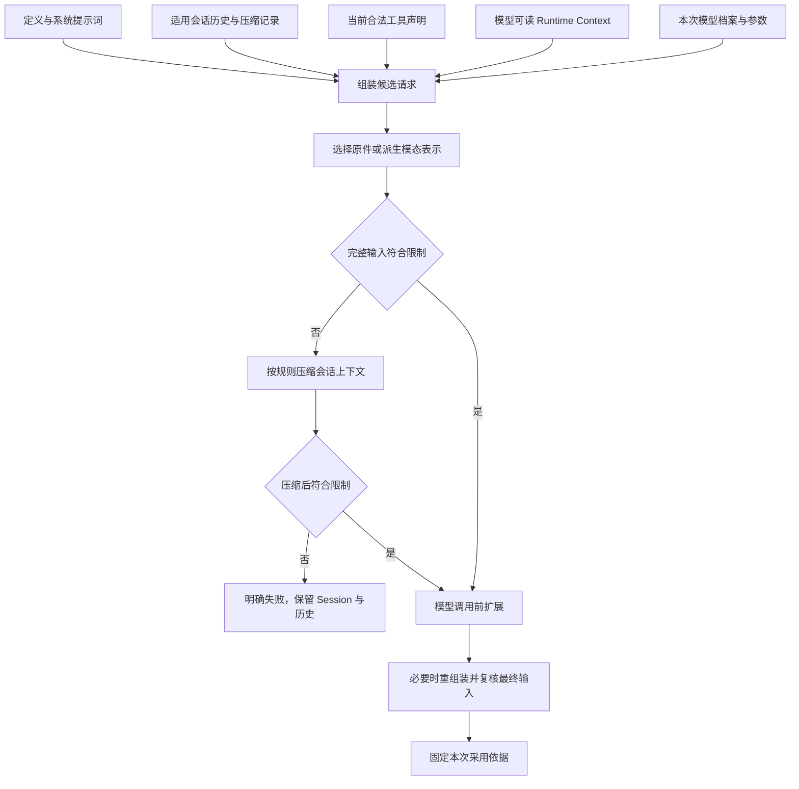

# 单次模型请求的上下文

一次模型请求取得当前允许使用的系统提示词、历史、工具声明、Runtime Context 和模型表示，再按实际模型约束形成输入。上下文组装是派生计算，不改写原始历史，也不代替权限判断。

状态：已接受的目标架构。当前值来源归[Runtime Context](runtime-context.md)，请求发出后的生命周期归[模型运行时](model-runtime.md)。

## 输入来源与组装

系统提示词每次求值，不存成会话历史。历史组装读取已持久保存的适用消息；本次需要承接的新输入必须先可靠记录，再进入组装。工具声明还需与本次合法采用的能力相匹配。投影保留 [Tool 可编程调用许可](../../../packages/tool/tool-contract/SPEC.md#可编程调用的定义与准入)，分别形成直接模型工具集合和脚本可调用集合。省略或 false 不阻止合法直接调用，但不能进入脚本可调用集合；请求快照不替代实际子调用准入。

会话历史按消息与块的模型可读标记投影。ToolInternalMessage 不进入模型请求。提醒保留变化链，不能把所有提醒压成“最新状态”而不遵循压缩规则。

一次求值须有明确读取范围和外部输入依据。组装期间新数据到达时，不能把旧模型档案、新工具 schema 和旧实现混成一个请求。具体快照与版本复核协议由规格确定，最终输入必须仍满足当次授权和发起条件。

## 模态表示与完整输入限制

文字、图片和语音是当前明确支持目标。内容块可以有原始表示、派生表示或 transcript。组装按实际模型的输入能力选择可用表示；多种表示都适用时由明确策略选择，不静默丢弃不兼容内容。

模态转换形成可追溯的派生内容，不覆盖原始内容。缺少转换能力与转换执行失败分别报告，不能用空白或捏造文本冒充成功。模型不提供的内部推理也不能被补造。

预算覆盖系统提示词、历史、提醒、工具定义及所有实际模态内容。字节、图片数等精确限制须实际校验；token 可按适用计量方法及明确余量估算。不能只数最后一段用户文本。

assistant 消息里的推理续接状态部件与其他块一样进入会话历史，按块的模型可读标记投影；投影去掉块时，按[消息成员 RS-04](../../../packages/common/message/SPEC.md#rs-04) 重写回放描述的位置索引，使交给 Model 的消息仍然合法。请求组装不按目标模型挑选这些部件，也不改写或删除 `thinking` 块：一次档案调用可能回退到另一个供应商，只有每次发出时才知道实际供应商。所以每次发出带哪些推理状态、外来可见推理怎样处理，由 Model 按这次供应商的回放声明决定，见 [Model 契约的推理回放](../../../packages/model/model-contract/SPEC.md#推理回放)。压缩摘要不含推理续接状态，被保留的消息原样保留它。本段是候选修订，技术接受前不扩大本页既有承诺。

模型档案提供有效上下限。未知上游限制保持未知，不能伪造数值。模型前扩展改动输入后须重新组装或校验最终结果，同一次经过不重复执行该扩展位置。一次请求准备以主请求的一轮为界。重组装后仍装不下，而本次准备尚未进入压缩计划时，可以进入一次压缩计划，之后再复核。本次准备已经进入过计划的，按压缩后仍超限失败。

## 压缩与历史保留

压缩函数负责是否压缩、如何压缩和成功后能否装入窗口。系统提示词和会话上下文共同计量，但只压缩会话上下文，不能靠删除固定要求伪装符合预算。

本节关于保留名单的段落是候选修订，技术接受前不扩大本页既有承诺。

一次压缩追加 CompactionMessage，其中共同保存摘要、压缩覆盖范围和保留名单。形状、模型视图规则与判定归[消息成员](../../../packages/common/message/SPEC.md)，本页只规定请求组装怎样使用它。它不修改原块内容、不改原始可见性标记，也不删除原历史。

组装按最近一条压缩记录形成会话历史：保留名单里的消息按原顺序，接着是这条压缩记录，再接覆盖范围之后的模型可读消息。较早位置仍须给模型的消息只能通过保留名单出现，组装不在消息层面另行排除或补回。进入会话历史的每条消息仍按块的模型可读标记投影，保留一条消息不会让它不给模型读的块进入请求。

压缩计划由请求组装拥有，调用由协调者执行。计划一并确定覆盖范围与保留名单：覆盖范围从历史起点开始；保留名单在保留预算内选出；两者合起来必须使每次工具调用和它的结果在模型视图里同时出现或同时不出现。保留预算按比例或 token 数计在保留名单上。选择偏好可配置为较新优先或被引用多者优先，默认较新优先，使后续请求的开头尽量稳定。保留名单在压缩时固定，之后不变。压缩改变前缀时，覆盖证据记录前缀中断的原因为压缩，这一含义不变。

以下内容受明确保护。

- 最近一次模型请求之后写入、模型尚未读取的输入不能先被压掉。
- 未结束的等待和后台执行等占位不能被摘要抹除。历史持有者给出未结工作集合，其中落在覆盖范围内的条目必须进保留名单，这是保留名单的下界，不是策略的选择。
- 工具调用和它的结果在模型视图里同时出现或同时不出现。
- 压缩后补入模型允许读取的完整 Runtime Context，不能仅依赖已被摘要的旧通知。
- 原始调用、费用和未消费结果不因请求投影省略而消失。

策略在可装入的硬条件内平衡前缀一致、信息保留和长度。前缀一致是优化目标，不是任意输入变化后都逐字不变的保证。

## 失败与固定采用值

在会话消费路径中，固定内容本身超限，或压缩后仍超限时，原 Run 失败并保留 Session 与历史。独立调用向其调用方返回输入不能满足约束的失败，不创建隐式 Run。两种原因须可区分。不默认分叉、不删历史、不偷偷换模型，也不在条件未变时无限新建 Run。

发出前固定本次模型、参数、内容和工具声明。已经发出的请求不随后续定义、权限表达或 context 内容变化而改写。未来动作仍按未来动作发生时的有效条件准入，不能将请求快照当成长期许可。

压缩内部的模型调用有自己的身份、结果和消费位置。它遵循相同的模型执行与费用规则，但其结果回到原压缩处理，不直接成为主流程回复。

## 长期会话的性能与验证

派生可见集合、历史索引和稳定前缀可以缓存。缓存失效后必须能从原事实重建，不能成为另一个权威事实来源。增量计算仍须计入实际输出物化和模态读取成本。

评估覆盖冷加载、连续追加、压缩、context 变化和模型切换。超长期会话须能定位扫描、转换、组装与发送各自耗时。具体规模、目标数值和实现算法由后续规格确定。

验证至少比较缓存与无缓存的同输入结果、压缩前后必要工作保留、混合模态限额、变更期间一致性及预算失败后的历史完整性。性能优化不能省略访问控制或隐瞒内容缺失。

## 依据

组装与压缩的当前产品责任候选见[运行感知与一次模型请求](../../../.meta_harness/design/product/runtime-context/README.md)。一次请求采用消息与块的候选规则见[同一草案的请求章节](../../../.meta_harness/design/product/runtime-context/design.md#6-一次模型请求采用合法完整输入)，模型能力与限额的候选责任见[模型调用](../../../.meta_harness/design/product/model-invocation/README.md)。这些草案不自动采用旧消息全集；本页既有承诺仍按实际接受范围执行。
