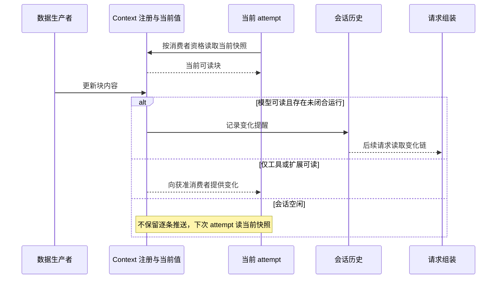

# Runtime Context

Runtime Context 按块提供运行期间可读取的数据。每块声明生产者、来源、消费者与更新方式。它既不是会话历史的别名，也不是把所有信息一次交给模型的大对象。

状态：已接受的目标架构。本页拥有注册、读取、更新及恢复规则；一次模型请求如何使用这些信息归[请求上下文](request-context.md)。

## 数据块与消费边界

| 对象 | 说明 |
|---|---|
| 注册关系 | 哪些数据块属于当前会话，来源与配置是什么，是否必需。 |
| 当前值 | 生产者当前提供的数据，不因写过历史就永久不变。 |
| 变化记录 | 供获准消费者理解变化的通知或提醒。 |
| 实际采用值 | 某次请求或执行实际读取的值，用于解释和恢复该次执行。 |

模型、工具与扩展可以有不同读取资格。模型可读的数据可以进入模型输入；只给工具或扩展的结构化授权不能因此进入模型。一个块可被多个消费者使用，但每个消费者仍需满足该块的访问要求。

会话元信息、用户与环境信息、工作区指导、当前能力、协作状态及授权上下文都可以有各自的生产者。数据类别不是统一授权，新增块必须明确其实际内容和消费者，不能靠“context”名称默认公开。

## 模式与 context 初始化

会话的三个模式维度独立变化。

| 维度 | 取值及含义 |
|---|---|
| 权限处理 | `never` 拒绝本应询问的动作；`auto_permission` 依据有效授权表达，未得结论则问人；`bypass-permissions` 放行本应询问的动作。明确禁止仍不可突破。 |
| 执行环境 | 按工具配置 `always-allow`、`auto_place` 或 `never-allow`，每次实际执行仍求值环境。 |
| 协作 | `co-work` 开启 Ask，不附加该模式的目标完成检查；`auto-drive` 关闭 Ask，并启用该模式的目标完成检查。 |

模式没有显式初值时采用适用租户默认，随后成为会话自己的值。恢复不重新应用默认，租户默认改变也不自动重写已有会话。其他设置按各自规则继承，不能从这一条推出所有配置都只在创建时读取。

`auto-drive` 不解除授权要求，`co-work` 不表示只能讨论。切换协作模式不改变会话身份、用途、执行类型或必需能力。作业会话自身要求的目标完成检查不能因切回 `co-work` 消失。

建立一次 attempt 时取得当前数据块快照，弥补空闲期间的变化。只有在生产者允许读取、块注册有效并满足资格时才纳入，不凭旧日志恢复已经撤回的访问权。

## 更新、通知与读取

模型可读块变化产生提醒。仅工具或扩展读取的数据变化不通知模型。空闲推送可以丢弃，因为下次 attempt 必须主动读当前值。这不允许丢弃业务上必须持久保存的原始输入。快照是否带前值，以及状态变化提醒和事件提醒的写法，见产品[当前值与变化感知](../../../.meta_harness/design/product/runtime-context/design.md#5-当前值与变化感知)。

模型首次读取和压缩后，需要允许它读取的完整 context 内容。平常通过变化提醒保持连续理解，不能只保留最新一条提醒而丢失变化链。结构化权限始终按当前权威来源计算，历史提醒不是授权依据。

工作区 AGENTS.md 是指导输入。在首次访问尚未进入的子目录时加载适用指导，不走普通 `.omne` 资产发现或 reload。精确访问判据、文件规范版本与合并协议由规格明确，不承诺远端文件变化自动同步。

## 注册、移除与恢复

注册关系、来源、配置和不可重算的会话数据须可恢复。派生值可以重新计算，但必须使用有效来源和相应访问资格。

移除可选块只影响当前会话的注册，不删除共享来源，也不影响其他会话。恢复不能无条件按默认清单把主动移除的块装回。必需块不得通过可选移除操作绕过。

数据更新、注册变更和请求固定分别记录。已经发出的请求保留实际采用值，新的合法值作用于后续请求。context 通知不能撤回已发生的工具效果，也不直接等价于重新装配。

## 观测与性能责任

生产者须能解释块内容来自哪里、何时更新、面向哪些消费者。请求记录关联采用版本或足以重建的依据，诊断方不必依赖已销毁实例的内存。

超长期会话不应为每次读取重新扫描全部历史。注册和当前值读取、变化通知与模型投影分别度量。缓存有容量与失效边界，不能让缓存提供超过当前授权的数据。

遥测可以报告更新延迟、读取失败和缺口，但不能因此发送块中全部用户数据。访问、保留与对外传送继续受[项目数据保护要求](../../requirements.md#数据保护sys-data-protection)约束。

## 依据

数据块、模式与恢复的当前产品责任候选见[会话与工作](../../../.meta_harness/design/product/sessions-and-work/README.md)，模型读取与压缩边界的候选责任见[运行感知与一次模型请求](../../../.meta_harness/design/product/runtime-context/README.md)。两者仍为草案；本页既有承诺按项目要求及实际接受范围执行。

## 未决问题与待办事项

以下事项沿本页已接受要求继续承接。来源定位不表示现行契约已经完整或验证已通过。

### RUNTIME-CONTEXT-T01 注册与读取行为契约承接

本项为契约承接待办。注册身份、当前块值、修订条件、消费者资格、移除与恢复的现行精确契约尚须由实际拥有者确认。必需注册、来源所有权及历史采用不能替代当前读取资格。

承接责任为Runtime Context、Session、原来源与读取协调者。待办是定位公开接口和行为，核验并发更新、撤权、初始化、主动移除及恢复，不将可重算值或活体资源误作持久事实。

[封存来源](../../../packages.0.0.1.legacy/core/runtime-context/SPEC.md)仅供核对原范围和消费者；旧接受记录、归档位置与已有测试不能授予冲突设计继续采用。实际限制、待设计输入及验证结果须由各自当前拥有者确认。
