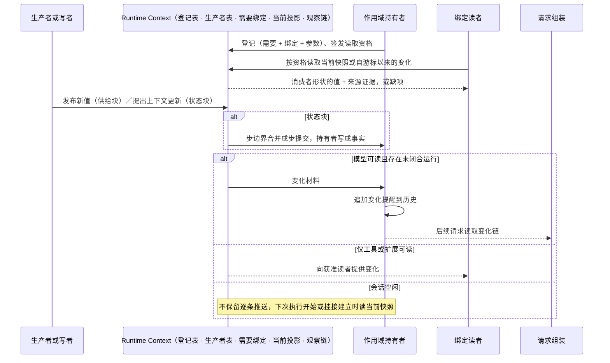
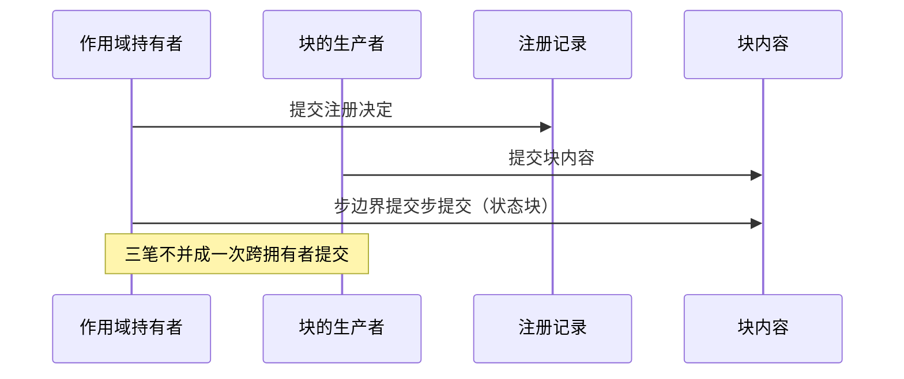

# Runtime Context

Runtime Context 是作用域内共享数据的供给中介与合并协议。它按块供给当前值与变化，核对读取资格，维护观察链，把变化材料交给作用域持有者；它不拥有任何块的事实，不判权限，不选落点，不组装请求。它既不是会话历史的别名，也不是把所有信息一次交给模型的大对象。

状态：已接受的目标架构。本页拥有块的两类、声明与登记、需要与绑定、读取与观察、更新与步提交、恢复规则，以及成员切分与 Cordis 落位；一次模型请求如何使用这些信息归[请求上下文](request-context.md)。本页只认通用角色：作用域持有者、生产者、写者、消费者类、集成方。本版的作用域持有者是会话。

## 数据块与消费边界

| 对象 | 说明 |
|---|---|
| [runtime context 块](../../../.meta_harness/design/ubiquitous_language/terms/scope-and-resolution.md#ul-context-block--runtime-context-块--context-block) | 一个作用域里按块键识别的一份当前值，身份是作用域引用加块键。值就地更新，不是事实流。 |
| [块声明](../../../.meta_harness/design/ubiquitous_language/terms/scope-and-resolution.md#ul-context-block-descriptor--块声明--context-block-descriptor) | 值的语义拥有者发布的静态说明：键、形状、消费者类、必需、披露、前值、变化频率、恢复方式。全系统一个键一份。 |
| [注册](../../../.meta_harness/design/ubiquitous_language/terms/scope-and-resolution.md#ul-runtime-context-registration--运行时-context-注册--runtime-context-registration) | 作用域持有者为一个作用域固定的块与绑定清单，带声明者定形状、持有者给值的参数。必需项创建时固定，可选项可增删。 |
| [上下文需要](../../../.meta_harness/design/ubiquitous_language/terms/scope-and-resolution.md#ul-context-need--上下文需要--context-need)与[需要绑定](../../../.meta_harness/design/ubiquitous_language/terms/scope-and-resolution.md#ul-need-binding--需要绑定--need-binding) | 消费者以自己的形状声明要什么；集成方在登记时把需要对到块，形状不同带纯函数翻译。 |
| [读取资格](../../../.meta_harness/design/ubiquitous_language/terms/scope-and-resolution.md#ul-read-eligibility--读取资格--read-eligibility)与[绑定读者](../../../.meta_harness/design/ubiquitous_language/terms/scope-and-resolution.md#ul-bound-reader--绑定读者--bound-reader) | 持有者签发资格；读者按资格读当前快照与变化，每次读重核资格。 |
| [上下文更新](../../../.meta_harness/design/ubiquitous_language/terms/scope-and-resolution.md#ul-context-update--上下文更新--context-update)与[步提交](../../../.meta_harness/design/ubiquitous_language/terms/scope-and-resolution.md#ul-step-commit--步提交--step-commit) | 参与者对状态块提更新提案；持有者在步边界合并成一份步提交写成事实。 |
| [变化材料](../../../.meta_harness/design/ubiquitous_language/terms/scope-and-resolution.md#ul-change-material--变化材料--change-material) | 块变化后交给持有者变化消费路径的输入，前值按读者资格过滤。它不是提醒本身。 |
| 实际采用值 | 某次请求或执行实际读取的值，用于解释和恢复该次执行。记录归请求的固定方。 |

模型、工具与扩展可以有不同读取资格。模型可读的数据可以进入模型输入；只给工具或扩展的结构化授权不能因此进入模型。一个块可被多个消费者使用，但每个消费者仍需满足该块的访问要求。

数据类别不是统一授权。新增块必须有一份块声明，写明实际内容与消费者类，不能靠“context”名称默认公开。

### 两类块

| 类 | 谁改值 | 怎样成为事实 | 恢复 |
|---|---|---|---|
| [供给块](../../../.meta_harness/design/ubiquitous_language/terms/scope-and-resolution.md#ul-supplied-block--供给块--supplied-block) | 一个生产者发布 | 发布即当前值 | 持久保存、重读来源或重算三选一，由声明写明 |
| [状态块](../../../.meta_harness/design/ubiquitous_language/terms/scope-and-resolution.md#ul-stateful-block--状态块--stateful-block) | 声明的写者类提更新 | 持有者在步边界按声明的合并规则合成步提交 | 检查点保存，或声明为只在一次执行内有效不持久 |

状态块可以声明每步只许一个写者。更新是提案，提交之前不是这一块的值。失败步里成功动作的更新保留为待处理，由持有者处置，不进这一步的提交。第一批状态块是本会话语义授权与未完成待办。

### 声明归语义拥有者

块声明归值的语义拥有者，不归存放者，也不一定归生产者插件。声明用 `declare module` 增补契约的块表并导出描述符；契约包自己不含任何具体键。声明只提供词汇，不安装块，也不授权读。谁供值由生产者登记决定，谁能读由读取资格决定。

块变化只是唤醒：读者收到变化后以读到的值为准，不以通知内容为准。

## 需要、绑定与集成原则

集成方知道被集成方；被集成方对外声明自己供什么、要什么，用自己的词，不知道被谁集成。Runtime Context 是集成方选用的中介，不是让被集成方互相认识的通道。由此：

- 消费者的需要以自己的形状声明，不点名块键。键是中介内部对上的手段，由集成方在登记时绑定。
- 供给与需要之间的翻译归集成方，不归任何一方的契约。消费者读到的值，形状是它自己声明的那一个，并带块的来源证据。
- 必需块的生产者缺席时，注册照常成立，读取得到缺项；缺项使依赖它的动作不可用，不是中介失败。

这是[领域语义依赖与模型边界](../layers-and-dependencies.md#领域语义依赖与模型边界)在本域的具体化。

## 模式与 context 初始化

会话的三个模式维度独立变化。模式事实由持有者供给为块，Runtime Context 只供给当前值及变化。

| 维度 | 取值及含义 |
|---|---|
| 权限处理 | `never` 拒绝本应询问的动作；`auto_permission` 依据有效授权表达，未得结论则问人；`bypass-permissions` 放行本应询问的动作。明确禁止仍不可突破。 |
| 执行环境 | 按工具配置 `always-allow`、`auto_place` 或 `never-allow`，每次实际执行仍求值环境。求值归发起协调者，翻译成执行环境的允许绑定归工具宿主；Runtime Context 与执行环境都不认识模式词。 |
| 协作 | `co-work` 开启 Ask，不附加该模式的目标完成检查；`auto-drive` 关闭 Ask，并启用该模式的目标完成检查。 |

模式没有显式初值时采用适用租户默认，随后成为会话自己的值。恢复不重新应用默认，租户默认改变也不自动重写已有会话。其他设置按各自规则继承，不能从这一条推出所有配置都只在创建时读取。

`auto-drive` 不解除授权要求，`co-work` 不表示只能讨论。切换协作模式不改变会话身份、用途、执行类型或必需能力。作业会话自身要求的目标完成检查不能因切回 `co-work` 消失。

授权域读权限处理模式时，不读模式块本身：它声明自己的「决定模式」需要，由持有者的装配适配器绑到模式块并翻译。工具不读执行环境模式：目标环境是工具自己的设置，会话模式只是这个设置在会话层的覆盖值。

新的逻辑执行开始，或协调者为执行建立执行挂接（接续或换代之后）时，取得当前数据块快照，弥补空闲期间的变化。只有在生产者允许读取、块注册有效并满足资格时才纳入，不凭旧日志恢复已经撤回的访问权。

## 更新、通知与读取

### 读取：完整与增量

读者有游标。第一次读或游标失效后，读到的是完整快照；否则读到自游标以来的变化。游标在授权范围变化、生产者换代、进程重建之后失效。作用域持有者也可以主动使游标失效，压缩提交之后它对模型类读者这样做；Runtime Context 自己不认识压缩。完整还是增量由 Runtime Context 的游标状态决定，不由读者猜测。

模型侧：完整快照由请求组装放进请求，成为锚定在固定位置的快照提醒，不进历史；变化由持有者的变化消费路径生成提醒追加进历史，平常靠变化链保持连续理解，不能只保留最新一条提醒。逐请求变化的块不进快照也不进变化提醒，只进请求最末的尾部易变提醒。位置与形态归[请求上下文](request-context.md#七层装载布局与前缀)。

模型可读块变化产生提醒。仅工具或扩展读取的数据变化不通知模型。空闲推送可以丢弃，因为下次执行开始或挂接建立时必须主动读当前值。这不允许丢弃业务上必须持久保存的原始输入。快照是否带前值，以及状态变化提醒和事件提醒的写法，见产品[当前值与变化感知](../../../.meta_harness/design/product/runtime-context/design.md#5-当前值与变化感知)。

结构化权限始终按当前权威来源计算，历史提醒不是授权依据。

工作区 AGENTS.md 是指导输入。在首次访问尚未进入的子目录时加载适用指导，不走普通 `.omne` 资产发现或 reload。精确访问判据、文件规范版本与合并协议由规格明确，不承诺远端文件变化自动同步。

## 注册、移除与恢复

注册关系、绑定、参数和不可重算的会话数据须可恢复。派生值可以重新计算，但必须使用有效来源和相应访问资格。状态块按声明的持久方式恢复，声明为不持久的在一次执行结束后不存在。

移除可选块只影响当前作用域的注册，不删除共享来源，也不影响其他作用域。恢复不能无条件按默认清单把主动移除的块装回。必需块不得通过可选移除操作绕过。

数据更新、注册变更、步提交和请求固定分别记录。已经发出的请求保留实际采用值，新的合法值作用于后续请求。context 通知不能撤回已发生的工具效果，也不直接等价于重新装配。注册决定与块内容分两笔提交；步提交是持有者的第三类提交，一步一份。

## 作用域链

作用域引用是不透明的，可以带父引用。子作用域读一个块键先查自己再查父级，同键遮蔽。本版只有会话一个持有者，作用域就是会话；父引用保留给将来的租户级持有者（登记身份与结构化授权到租户作用域）与运行级持有者（不持久的状态块）。

## 成员与 Cordis 落位

| 成员 | 变体 | 责任 |
|---|---|---|
| [runtime-context-contract](../../../packages/context/runtime-context-contract/SPEC.md) | module | 作用域引用、块键、两类块声明、空块表、需要、绑定、注册、资格、读者、快照与变化、更新与步提交、变化材料；纯函数 `judgeNeed`、`judgeBinding`、`judgeRegistration`、`reduceStep`、`diffForReminder` 与解码 |
| [runtime-context-cordis-contract](../../../packages/context/runtime-context-cordis-contract/SPEC.md) | service-contract | 唯一服务定义 `runtimeContext`、intercept 配置 `{ consumer }`、事件 `runtime-context-cordis-contract/changed` |
| [runtime-context](../../../packages/context/runtime-context/SPEC.md) | module | 登记表、生产者表、需要绑定解析、当前投影、观察链与游标、资格核对、步合并 |
| [runtime-context-cordis](../../../packages/context/runtime-context-cordis/SPEC.md) | service-provider | Service 实现：一个 isolate 一个服务，作用域为参数；按作用域过滤唤醒；登记即效应 |

三面服务：生产者面 `registerProducer` 返回生产者句柄；持有者面 `prepareRegistration`、`issueEligibility`、`applyCommit`；读者面 `bind` 返回绑定读者。持有者使读者游标作废的操作是重签该读者的资格：`issueEligibility` 给出新资格即作废旧游标，压缩提交之后持有者对模型类读者这样做。Cordis 承载机制，不承载数据：生产者登记在调用方 fiber 的效应里，代际取自 fiber，卸载即撤（[IC-13](../cordis-integration-conventions.md)）；`runtime-context-cordis-contract/changed` 只作唤醒，按作用域过滤监听者。读取资格是消费者类的权威；调用方 intercept 配置里的消费者类只是装配者对该插件的声明，两者不一致即拒绝读取（机制探针待补，见[装配与变化](../assembly-and-change.md)）。作用域、资格、值、修订、观察都在服务自己的进程内状态里。每次获取不开 fiber，不用 `inject` 表达需要。

发布带作用域：生产者句柄的每次发布指明作用域引用加块键。作用域无关的供给块（宿主事实、租户元信息、当前档案）由生产者在持有者注册该块时按回调供值，之后对每个已注册的作用域重发。

Runtime Context 不持有耐久状态，也没有存储端口。`persisted` 供给块的权威持久者是生产者，重启后由生产者重新发布；注册、自有值与步提交由作用域持有者保存；进程内表重启后由持有者重新注册、生产者重新登记重建（[IC-19](../cordis-integration-conventions.md#ic-19)）。

## 观测与性能责任

生产者须能解释块内容来自哪里、何时更新、面向哪些消费者。请求记录关联采用版本或足以重建的依据，诊断方不必依赖已销毁实例的内存。

超长期会话不应为每次读取重新扫描全部历史。注册和当前值读取、变化通知与模型投影分别度量。缓存有容量与失效边界，不能让缓存提供超过当前授权的数据。

遥测可以报告更新延迟、读取失败和缺口，但不能因此发送块中全部用户数据。访问、保留与对外传送继续受[项目数据保护要求](../../requirements.md#数据保护sys-data-protection)约束。

## 依据

块的两类、声明、需要与绑定、登记、资格、更新与步提交、首次注入与提醒的产品规则见[运行感知与一次模型请求](../../../.meta_harness/design/product/runtime-context/design.md)（§2、§5）。数据块、模式与恢复的会话侧责任见[会话与工作](../../../.meta_harness/design/product/sessions-and-work/README.md)。本页承诺按项目要求及实际接受范围执行。

## 未决问题与待办事项

以下事项沿本页已接受要求继续承接。来源定位不表示现行契约已经完整或验证已通过。

### RUNTIME-CONTEXT-T01 注册与读取行为契约承接

本项为契约承接待办。注册身份、当前块值、修订条件、消费者资格、移除与恢复的现行精确契约由 [runtime-context-contract](../../../packages/context/runtime-context-contract/SPEC.md) 承接。必需注册、来源所有权及历史采用不能替代当前读取资格。

承接责任为 Runtime Context、作用域持有者、原来源与读取协调者。待办是核验并发更新、撤权、初始化、主动移除及恢复，不将可重算值或活体资源误作持久事实。

[封存来源](../../../packages.0.0.1.legacy/core/runtime-context/SPEC.md)仅供核对原范围和消费者；旧接受记录、归档位置与已有测试不能授予冲突设计继续采用。实际限制、待设计输入及验证结果须由各自当前拥有者确认。
