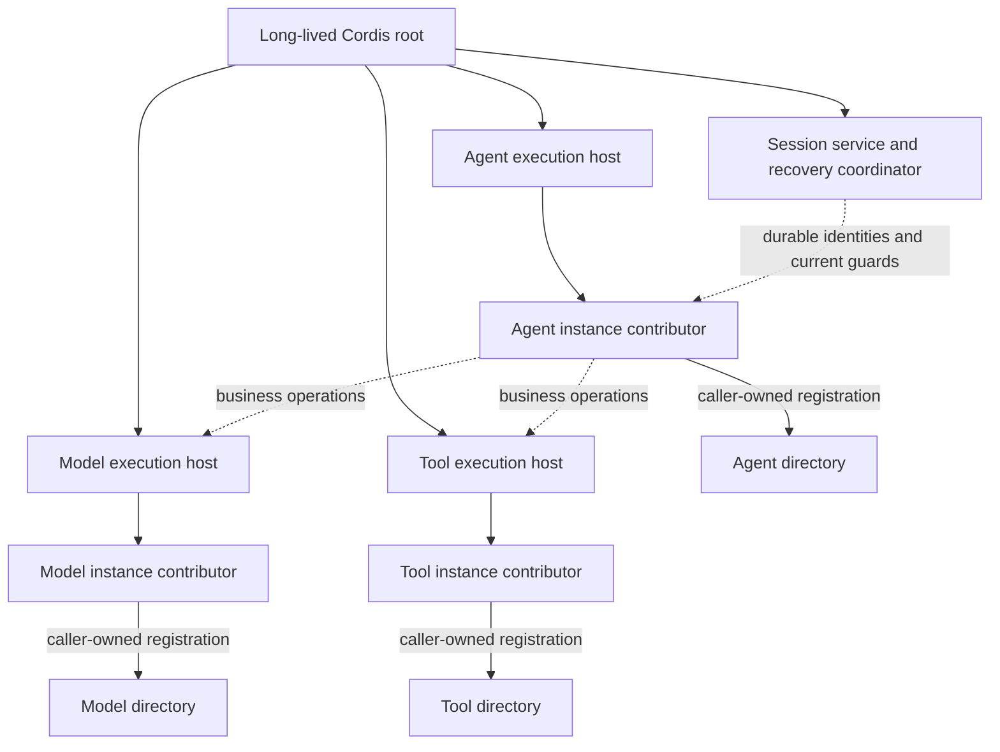

# 四成员主干契约的 Cordis 集成候选

本页是 #342 的装配候选，尚未技术接受或生产实现。领域和操作边界先由[对象模型](runtime-contract-model.md)及四成员 SPEC 与 public-api 确定。这里消费 [IC-1 至 IC-19](../cordis-integration-conventions.md)，选择服务定义、依赖、宿主与撤除协议，不把 Cordis 机制当作领域授权或持久提交。

成员的精确接缝分别归 [Session](../../../packages/session/session-cordis-contract/docs/cordis.md)、[Agent](../../../packages/agent/agent-cordis-contract/docs/cordis.md)、[Model](../../../packages/model/model-cordis-contract/docs/cordis.md)、[Tool](../../../packages/tool/tool-cordis-contract/docs/cordis.md)。Tool 和 Model 的成员集成设计已接受，其中 Model 的 pi-ai 相关细化仍为候选。本页共同集成及 Session、Agent 成员设计保持原候选状态。生产服务图、事件矩阵及绑定读数从实际源码生成，不另立手写实现权威。

## 根入口、定义与提供者

成员根入口不导入 Cordis。公开契约、可复用领域实现和具名宿主按实际安装及消费边界划分，不固定为两个包。领域消费者引用契约；独立程序和应用装配可显式选择实现工厂。Cordis 定义入口持有唯一 Service、键、Context/Events 增补及运行实例登记协议，业务提供者插件继承同一定义，不复制键或类型。各域精确成员分配以其组架构和实际公开入口为准。

Model 的目标为 model-contract、model-cordis-contract、model 和 model-host-local，详见[模型组边界](../../../packages/model/docs/architecture.md#契约包的公开边界)。纯契约不导出执行工厂；框架定义从 model-cordis-contract/cordis 发布，独立执行工厂归无 Cordis 的 model，具体宿主插件归 model-host-local/cordis。其余领域的目标及迁移状态分别由成员拥有，不由本页批量改名。新增 exports 属于后继实现，本卡不新增生产 API。

每个定义类在唯一位置写 static provide；导出键常量取自它，具体子类不再次 provide 同键。抽象服务复用根接口的索引方法类型。定义入口不得引入被选中的业务提供者；后继必须同时检查源码值边、声明和实际产物。运行实例目录是含登记逻辑的具体 Service，查询与贡献权限分开，不能只用 TypeScript interface 代替 Service 定义。

同 isolate 同接缝仅一个提供者。需要测试或多个具体后端并存时，装配明确 isolate 标签及消费者可见性；不能用 isolate 隐含租户身份或授权。最小部署不为每个租户、Session、Run 建 isolate 或根 Context。

## 生命周期与宿主

三种 runtime 各为独立协程。每个在场实例由本域执行宿主创建贡献 fiber；fiber 管理登记和本实例资源，业务身份及未完责任继续保存在领域提供者。Session 是工作治理服务，不被画成拥有三种执行寿命的父协程。

Cordis 4.0.4 的 Service 方法 `this.ctx` 是调用方 Context。Model/Tool 的 schedule 若直接在此处 `this.ctx.plugin(...)`，从 Agent 调用时会生成 Agent 子 fiber，违反独立寿命。采用的宿主设计在构造时捕获执行宿主自己的 Context，schedule 将显式业务身份交入该宿主，由其在自己 Context 上建立实例贡献 fiber。实际注册在该实例插件内调用目录 Service.register，继续遵守 IC-13 的 caller-fiber 归属。捕获宿主只用于生命周期，不用于推断租户或绕过当前资格。

注册表用 `this.ctx.effect` 配对登记与条件撤除。登记项带稳定工作键、实例身份、代次及 contribution token。受信宿主必须先证明该实例合法在场；冲突登记拒绝，仅同一 fiber 的原贡献同值认回；新贡献先等旧贡献明确撤除。精确 register 输入、资格依赖、回执和 release 归三份成员集成页。旧 disposer 仅在 token 与当前项一致时移除，不能撤新实例。查询核当前身份/tenant/资源动作，返回受限句柄或无活体路由；无活体不证明事实不存在。注册表不另记贡献者清单或等待用户手动注销。

API 门面可以将 directory 暴露为只读查询面，但宿主注册必须经自身 fiber 的 `ctx.get(目录键).register`。不得通过 Agent 缓存的目录代理登记，不把普通对象 `ctx.provide` 当具有 caller-context 跟踪的注册表。

## 必需依赖、局部依赖与有序交接

各成员表中标为必需的服务写入该插件的静态 inject。依赖撤除或换代会卸载重跑该插件，不能当作原实例无缝换对象。只有某段工作需要的外域适配放在 `ctx.inject([键], cb)` 子 fiber，核心事实读取、控制和保管不因无关策略或转换能力失效而全部消失。可选诊断和通知不进 inject，在调用点用 ctx.get 或 resolveOptional 重取，undefined 沿原契约缺席结果处理。

运行中的 Model 固定传输和 Tool 固定执行者/环境，不随注册更新偷换。计划换代先停止相应新准入，调用领域 provider.quiesce 或交接方法，确认原操作、保管和新宿主承接条件，再撤原 fiber。业务交接次序由一个具名装配协调者显式 await，不依赖多个 disposer 的执行顺序。

非计划依赖消失时，disposer 只撤观察、登记和实际可释放资源，停止该实例新的受保护动作。尚未可证实停止的网络/工具效果保留未知及原身份，由恢复者认回；不能报告业务已取消或已完成交接。新宿主只有取得原执行排除或合法续接证据才可取得动作资格，数据库 generation 变化不自动证明旧进程不再发送。

已取得的旧门面引用也核当前服务代次和业务资格。失效对象拒绝新变更或结束观察，不把旧引用转发成新的隐式权限。依法处理的迟到事实经当前受信补录入口进入原记录，和旧实例继续发效果是两回事。根关闭的物理等待上界由部署/资源协议给出，不能承诺不可控外部执行在统一时间内停止。

## 同提交与外部动作的保护对象

| 共同性质 | 共同触碰的权威对象与拥有者 | 必须的提供者条件 |
| --- | --- | --- |
| Session 唯一推进、cancel/reload/finish 竞争 | Session 的原工作条目范围、operation identity、当前治理 revision/advance | Session 参加者在同一 Storage transactionDomain 内保护原状态及提交尾部 |
| Agent 会话输入与普通终结 | Session 已受理输入、Run/attempt/control，Agent 输入 frontier、责任及 execution | 专用 Journal 提供者在输入受理时同提交登记原引用，在终结时共同核验并提交；延迟唤醒不得造成遗漏 |
| Model/Tool 受理与当前工作资格 | 原 Session governance/consumer binding，生产者原 call/admission/capacity 或队列责任 | 固定 combinationVersion 同事务执行领域参加者；外域当前资格有实际受信参加者，不能先读后写冒称共同成立 |
| 结果保管及生产确认 | Session 消费版本项、独立材料记录，Model custody 或 Tool delivery | 各域确认顺序及双路径证据，不要求跨域一个 SQL 事务；交接前始终有人保管，未知不解除 |
| 撤权/取消与真实发起 | 当前权威许可、原工作资格、生产者 send/start 意图及实际效果启动边界 | 同一实际排序围栏封闭资格变化与 S；数据库事务不包含网络，部署必须提供可验证的排除/发起协议 |
| 注册及贡献撤除 | 进程内目录项和 contribution token | Cordis caller-fiber effect，加条件移除；不包含业务终态或持久执行事实 |

前五行由具体 Storage、身份授权和执行提供者兑现，Cordis 仅决定能力对象装载、可见与撤除。这里没有扩大跨提供者私有事务读例外；参加者通过已登记协议和精确版本组合，不让 Agent 导入 Model/Tool 存储实现。迁往多进程时，同提交、启动排序、目录路由、时钟和结果流分别需要运输/一致性协议；Context、Fiber、闭包与本地锁不跨边界。

Agent 独立装配只要求本域输入受理与终结的条件提交，不依赖 Session 完成回调。会话绑定则必须证明上述共同保证；服务键存在、同进程或同数据库均不单独构成证据。已成立的取消可先结束 Run，随后沿原控制收束 Agent，不能恢复旧资格或重新裁定 Run。精确协议归[Agent 消费与会话协调](../../../packages/agent/agent-contract/docs/context.md#独立消费与会话协调)。

## 事件与作用域

控制一律优先调用根操作，以得到原身份、业务失败及未知。当前候选不定义用于授权、取消、受理或提交的 Cordis 广播控制事件。扩展有序改写仍是 Agent 的原经过协议，不能用无持久状态的 waterfall 代替。

| 候选通知 | 声明拥有者及模式 | 载荷、失败与消费者 |
| --- | --- | --- |
| session-cordis-contract/work-committed | Session 定义入口，parallel | tenant、SessionId、revision、原 source；恢复调度者按身份过滤，再读权威状态 |
| agent-cordis-contract/instance-retired | Agent 定义入口，parallel | tenant、AgentInstanceId、发布代次、原因；观察/路由刷新，不表示 Run 终态 |
| model-cordis-contract/call-changed | Model 定义入口，parallel | tenant、call、revision；读原调用，不携带正文/秘密 |
| tool-cordis-contract/call-changed | Tool 定义入口，parallel | tenant、call、revision；读原事实，不据通知解除 delivery |

事件在各定义入口唯一增补 Events，JSDoc 写 @mode parallel 与每项 @param。发送方在 await 外捕获，包括 AggregateError 中的监听失败，只记安全诊断，不改变已提交成功结果。不得漏接 Promise。消费者不能因一个监听失败取消其他租户；身份过滤是路由隔离，实际读取仍核权。通知可丢失和重复，可靠性由原领域待办扫描承担。

将来若新增可否决异步控制事件，必须另定义 serial 协议和当前资格，不使用 bail。emit 只接受同步监听，调用端 try/catch；不是 parallel 的无等待替代品。

## 配置与插件树

配置全部为可序列化数据，使用同步 Standard Schema，拒绝未知键、类型错、无穷/非法数值及无合法引用。必需字段在加载前补齐；本卡不虚构统一生产默认。根契约中容量为正整数、退避/间隔为非负整数的约束继续适用。运行对象、主体、租户、句柄、取消信号和回调不进入树。

装配入口通过拥有者服务定义提供实际对象，具体插件 inject 取得。发行层声明稳定行 id、包 ./cordis 导出及配置；运维层按行 id 整行替换、停用或插入。指向不存在行 id 失败；打印最终树和每行来源。缺必需依赖导致 fiber PENDING，不能把 await plugin 返回当作业务就绪；非法配置导致 FAILED，两者分别诊断。

候选发行行是 session-provider、agent-host、model-host、tool-host 与各必要提供者/目录行。精确包导出和配置由后继应用装配实现时登记；本候选不发布一个可运行的假插件树。运行时创建的实例贡献 fiber 不进两层树。Session 作用域只是显式身份和本次贡献，既不是根 Context，也不是组织/租户配置层。

## IC 逐项对账

| IC | 本候选的适用位置 | 验证与边界 |
| --- | --- | --- |
| 1 | 四成员定义入口及其端口表 | 后继源码确认每接缝唯一；当前是设计 |
| 2 | 类静态键、导出键常量、子类复用 | 真实4.0.4 Service构造机制；后继检查重复provide |
| 3 | 抽象门面与具体目录 Service，@owner | 类型示例/源码审查；尚无生产类 |
| 4 | 契约成员根与 `./cordis`、提供者成员根与 `./cordis` | operation-result 零依赖与 kernel-basis 空根入口分别检查；四成员产物仍须独立验证 |
| 5 | 操作消费者仅依赖公开根/定义 | OOP消费样例不读私表；后继源码值边/声明/产物 |
| 6 | 同isolate唯一提供者 | 固定版本机制及装配采用约束；不冒称租户隔离 |
| 7 | 稳定能力名与限定提供者导出 | 成员端口表，后继实现命名审查 |
| 8 | 必需inject与局部子fiber | 真实依赖失去/替换探针；计划换代仍需业务协议 |
| 9 | 可选通知/诊断按次读取 | 真实缺席/出现/撤除无重启探针 |
| 10 | 上述四种通知名称 | 设计静态核对，未来源码生成矩阵 |
| 11 | 定义入口唯一Events增补 | 后继声明及派发对应测试 |
| 12 | parallel捕获，控制用操作；新增异步控制用serial | 真实serial/bail及通知抛错探针；不证明业务持久 |
| 13 | 本域实例贡献fiber内register及条件撤除 | 真实贡献撤除和错误caller归属变体 |
| 14 | 同步Standard Schema与加载失败 | kernel-basis真实配置/异步校验拒绝测试；四成员具体Schema待实现 |
| 15 | 发行层/运维层 | 应用后继两层树接受场景，本卡不实现加载器 |
| 16 | 稳定行id、来源及运行对象服务注入 | 应用后继悬空修改/产物/来源打印验证 |
| 17 | 长期根、身份作用域、独立执行宿主 | 实际Agent卸载后Model/Tool贡献仍在探针；无完整系统实现 |
| 18 | 每次根操作带主体/tenant | 正负类型样例；实际授权/跨租户默认拒绝交提供者验证 |
| 19 | 同进程条件与跨进程责任分开 | 上表逐性质责任；不把本地探针扩大为分布式保证 |

## 采用来源与证据

固定采用 Cordis 4.0.4，发布来源沿 kernel-basis 已记录的 `d0dca04e22f09fe04967090b2ee70587ecdad6cc`。本次实际使用安装的发布包及其 src，记录 lib/index.js 内容 hash；未声称重新构建并比较上游 Git 产物。现有 basis 中旧 `packages/core/kernel-basis` probe 路径不可作为当前可运行位置，使用现行 `packages/assembly/kernel-basis` 的公开入口测试及任务临时探针补核所用主张。

已运行的机制输入包括 caller-context、独立执行宿主、必需依赖换代、可选按次获取、原贡献撤除、serial/bail 和通知异常；拆分前 kernel-basis 的 23 项测试及类型检查通过，该历史结果不代表拆分后的包测试范围。错误地使用 caller Context 建执行子 fiber 的变体触发预期失败。通知探针发现 parallel 返回 AggregateError，断言按实际固定版本精确检查内部错误，不把它误记成单个 Error。

同键后继发布后旧 disposer 晚到的交错不在这组生命周期探针内，不能将“撤 Model 不撤 Tool”扩大为该性质的验证；它继续作为 F-04 的明确后继验证输入。

这些结果支持上述局部机制选择，不证明四个 runtime 已实现、Storage/身份源已可用、启动围栏完备、断电持久、实际跨租户隔离或生产部署通过。W6 需对精确候选分别作 choice、expression、plan 判断；技术接受仍另行进行。

## Tool 完整协议的共同采用条件

以下是 #342 Tool 细化后的候选集成义务，不表示 Session、Agent、HITL、环境或存储提供者已经实现。精确操作归 [Tool协议](../../../packages/tool/tool-contract/SPEC.md#tool-操作协议)，这里仅保持跨拥有者交接。

| 参与者 | 必须承接的条件 |
| --- | --- |
| 身份/权限、Session工作资格、Agent推进资格 | 实际启动的 guard 失效进入同一 ToolStartAuthority 排序域；确认新发起已阻止之前取得失效回执。保存业务取消与宣称启动围栏已生效分别表达 |
| Tool与受信执行边界 | 启动意图、queue名额与待办先提交；唯一待发胶囊由共同围栏消费，不把授权查询后任意函数调用当原子开始 |
| Code协调者 | 父屏障按真实原因和子范围纳入start/resume守卫；Run取消保留已合法受理后台子的自身启动/接续资格，normal returned只封新预留。父状态与child/program-fence任务同提交，由长期宿主扫描 |
| HITL或资源响应拥有者 | 原卡/原响应可认回，决定来源可验证，失效有具名回执；实现可自行选择可靠通知方法，不强制复制Tool存储结构 |
| 环境和执行提供者 | 准备、释放、停止、答复、暂停均有原操作身份与查询；未知不冒充排除，原采用保留受限恢复路由 |
| Session或独立结果消费者 | 读取精确结果版本，使用retained/processed证据解除对应delivery，保存Tool生产侧回执；原或晚到版本不混用 |
| 装配/升级协调者 | quiesce后检查完整inventory，等待实际排空或具名handover，最后撤资源；disposer不产生业务成功 |

任一参与者无法兑现时，该实际组合不具备对应保证。先完成其余独立设计和验证，保留具体缺项，不能以所有对象位于同进程或同数据库补证。
