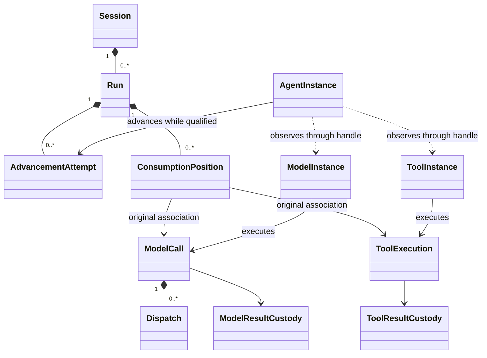

# 四成员运行契约的对象模型

状态：[#342](https://github.com/nemori-ai/omne-harness-lite/issues/342) 的共同对象模型候选，尚未整体技术接受。Model 非 pi-ai 专有设计已在所属包接受，Tool 沿其现有接受范围；本页不改变其他成员状态。既有要求及采用范围仍归[运行架构](README.md)和四成员 SPEC。本页定义本次候选共同使用的对象关系及设计选择，不导出中央 Runtime 类型，也不授予生产实现支持。

## 消费方式与责任

本候选保留三种公开消费层次。独立函数直接处理调用方数据和显式外部执行适配，调用者承担其资源及结果。托管 runtime 增加稳定工作身份、当前资格、可靠受理、控制与结果责任。Cordis 集成将这些操作装配为能力服务，业务含义保持不变。

| 消费者 | 输入与可取得结果 | 所需前提 |
| --- | --- | --- |
| 独立程序 | 调用 Model 传输/Tool executor 的独立函数，取得原输出或具体失败 | 不要求 Session、runtime 或存储；若实际访问托管资源，仍消费原资源的访问规则 |
| 托管独立调用者 | 显式主体、租户、原调用身份、固定请求与消费责任，取得持久受理和查询能力 | 不造 Session/Run；依赖合格治理与持久提供者 |
| Agent 推进者 | Session 的有效推进依据、固定装配和原消费位置，通过公开操作调用 Model/Tool | 当前推进资格与各次资源访问分别成立 |
| 应用装配者 | 选具体提供者，注入所需能力及合法配置 | 不替调用主体授予租户访问权 |

“公开”表示该成员允许的消费者可以使用，不等于把每个内部协议开放给 SDK、网络或模型工具。各成员对普通调用者、受信执行器、保管者和装配者提供不同操作面，身份校验覆盖每个受保护操作。

## 对象与身份

| 对象 | 拥有者 | 身份/表示 | 生命周期与不变量 |
| --- | --- | --- | --- |
| 主体与租户 | identity / authorization | 复用 legal-identity；可信主体依据另核 | 裸 ID 不提供资格，Context 不是租户来源 |
| Session | Session | SessionId | 逻辑身份及历史持久；不是 Cordis 根或 isolate |
| Run | Session | RunId，所属 SessionId | 一个 Session 至多一个未终结 Run；终态不可逆 |
| AdvancementAttempt | Session | AttemptId、推进代次及原 Run | 一个 Run 至多一个有效推进者；实例重启不自行取得资格 |
| ConsumptionPosition | Session 或独立消费者 | Owner + 原工作 + 位置身份 | 区分主回复、压缩、扩展经过、Tool 结果；换推进者不改原位置 |
| ModelCall | Model | ModelCallId、固定请求 | 一个逻辑调用，可能多次政策允许的 Dispatch；终局不反转 |
| Dispatch | Model | DispatchId、原 ModelCallId | 每次实际发出单独保留事实和费用；首内容后不重发 |
| ToolExecution | Tool | ToolExecutionId、固定执行者/参数/环境 | 后台化、观察者变化不创建新执行；未知效果不自动重放 |
| Agent runtime instance | Agent | AgentInstanceId、原 AttemptId | 独立推进协程；失去推进权不能继续发起业务 |
| Model runtime instance | Model | ModelInstanceId、原 ModelCallId | 独立执行协程；原 Agent 退出不取消它 |
| Tool runtime instance | Tool | ToolInstanceId、原 ToolExecutionId | 独立执行协程；按自身控制与实际收场退出 |
| Live handle | 各 runtime 领域 | 绑定实例 ID 与受限操作 | 临时可失效；释放观察不释放原执行责任 |
| Result custody | 原执行与实际消费者 | 原调用/结果版本、交接操作及证据 | 业务完成、结果交接、资源清理分别记录 |

上述新身份采用各自拥有者的词汇类型。它们可在静态类型上防止混用，但运行边界仍验证格式、租户、关联和当前资格。序号、时间点、句柄和随机 token 均不单独提供授权或恢复证明。

图中 Run 的消费位置只覆盖实际属于该 Run 的工作。独立消费者拥有自己的原位置，不放进某个碰巧活动的 Run。Agent 与 Model/Tool 之间只有使用关系，没有生命周期组成关系。

## 深 Module 与内部协作

| Module / 公开 Interface | 隐藏的复杂度 | 内部角色与公开限制 |
| --- | --- | --- |
| Session 工作治理 | 输入与去处共同成立、唯一推进、原位置、控制与终态、未知认回 | 日志/提交参加者/恢复协调者是机制，不向调用方泄露数据库表和写连接 |
| Model 托管调用 | 受理容量、真实 dispatch、独立重试、流与结果保管、ACK 和费用 | 外部只理解原调用与所需控制，不自行驱动 transport 重试和清理 |
| Tool 托管执行 | 固定执行者和环境、前后台等待、内部 Ask、实际效果和全文保留 | 执行者可替换，业务效果仍归所调用业务；不暴露任意重跑按钮 |
| Agent 推进 | 当前前提、纯 Loop 决策、扩展链及整批屏障、原调用消费和接续 | 纯决策和有副作用的协调分开；消费者不手动模拟整轮状态机 |
| 各自活体目录 | 按稳定工作身份定位、实例失效与代次匹配、受限观察 | 内部发布权只交各域实例宿主；没有跨域任意 unregister 的公共管理员 |

内部角色不自动变成公开类或 Cordis 服务。为了测试可替换的内部实现可以保留内部 seam；只有真实消费者所需、或领域提供者必须兑现的能力进入公开契约。每个新增抽象都要回答删除后哪项复杂度会泄露给调用者。

## 抽象、接口和协议的用法

采用组合优先的对象模型。值对象和不可变联合描述身份及结果；工厂显式接收能力；状态拥有者通过操作保护不变量；协议描述跨拥有者先后、竞争与故障责任。类只承载需要封装的实例状态或具体集成规则，不构造所有 runtime 共用的业务父类。

纯操作类型由成员根入口拥有。Cordis Service 以这些操作类型为接口，在集成入口唯一实现或声明，不复制另一份方法签名。是否拆为多个服务面由调用权、提供者替换及卸载责任决定，不按方法数量拆键。

| 协议 | 各方必须知道的事实 | 保护位置 |
| --- | --- | --- |
| P1 原工作受理 | 同身份同输入认回；异输入冲突；未知保留身份查询 | 原工作拥有者的原子受理及持久回执 |
| P2 合格推进与实际发起 | 当前推进和资源访问分别判断；校验、提交和实际发出的时间关系明确 | Session 及实际动作拥有者；不能由一个布尔参数替代 |
| P3 活体发布与撤除 | 注册不是受理；绑定有实例身份；旧清理不能移除后继 | 各域目录与实例宿主；明确串行保护和条件撤除 |
| P4 原结果交接 | 消费位置不漂移；迟到事实仍保存；交付责任移交后才能释放相应责任 | 原执行/保管者与当前合格消费者 |
| P5 控制与退出 | 持久意图、传播、实际停止、外部效果和资源完成分别确认 | 逻辑控制拥有者与独立执行者 |
| P6 扩展与人工等待 | 原经过和原请求关联，唯一有效决定、整批屏障与继续前核验 | Agent 扩展协调者或 Tool 原等待拥有者 |
| P7 装配换代 | 固定采用与当前值分开；旧推进权撤除和接续依据正确成立 | 装配协调者、Session 与各实例宿主 |

各成员必须把本表落实为具体签名、状态及失败结果。本表不是以“以后实现”掩盖关键协议的替代品。自定义代际/恢复协议须给行为模型及关键性质检查；不以串行协程或单机部署消除证明义务。

## 输入和依赖的裁定

按“谁决定、何时变化、谁保管、是否可序列化”分类，之后才作 Cordis 映射。

| 分类 | 典型值 | 规则 |
| --- | --- | --- |
| 操作参数 | 当前主体、显式租户、目标、原操作身份、固定请求、控制原因 | 随调用变化；托管资源重新核验；不从全局服务状态推导 |
| 构造/工厂依赖 | 存储、当前资格检查、传输、时钟、凭据解析、环境端口 | 是可调用能力；注明必需/可选、替换、失败和寿命 |
| 实例固定采用 | 原请求/参数/执行者、版本、实际绑定及消费位置 | 保存可解释的原事实；不使用“最新值”覆盖历史 |
| 配置数据 | 退避/容量/观察队列限额、策略选择 | 可序列化并校验；声明何时生效；默认只是初值 |
| 调用期临时资源 | 观察信号、读取句柄、一次发送可用的秘密值 | 所有者明确；不进业务持久记录或插件树 |
| 内部状态 | 目录路由、协程调度、锁、缓存、连接 | 不成为跨域业务事实；需要恢复的事实另行持久 |

构造注入只表达能力需要。Cordis inject 还表达依赖不在或换代时重跑哪些 fiber，二者不能机械一一映射。固定输入不等于永久资格，资源对象存在不等于它仍可合法使用。

## 生命周期与目录选择

本候选选择每域窄目录加独立事实/控制/消费操作。另一个可行形状是按原身份返回逻辑代理句柄；它能隐藏路由，但仍必须区分无活体、未知、拒绝和已释放。本轮先显式保留这几个状态，使恢复责任容易审查。

一个实例对应一个可独立调度的协程。Model dispatch 属于原调用实例的内部执行进展，不为每次供应商重试重建 Run/attempt。实例退出后事实与结果责任仍归原领域；需要接续时原拥有者先核对资格和执行连续性，再决定是否创建后继实例。

目录发布由各自实例宿主拥有的贡献发起。Agent 观察 Model/Tool 不持有其注册贡献。Cordis 自动撤除只撤注册效应，不能等同业务收场或结果清理。根 Context 登记例外不扩大到普通消费者。各域的操作记录和未完责任不依赖目录条目存活。

观察者收到 NoLiveRoute 必须查询原事实。目录错误返回 unavailable，资格不符返回 denied；不能把这两个结果转成“原工作不存在”。已有句柄绑定特定实例，不静默转到另一实例。后继只能通过原身份重新连接，并核对原业务进展。

## SOLID 与选择理由

单一职责落在事实拥有者和变化原因。新增传输或执行者由 Adapter 接入，不修改 Session 终态规则。替换提供者必须保留同一 Interface 的失败、未知和生命周期，不能只看类型相同。观察者、发起者、控制者、保管者和内部发布者按所需能力分面。消费者依赖公开契约，实际装配选择实现。

窄目录没有吞并执行和保管，原调用恢复也不必先找活体。没有选统一 RuntimeManager，因为它会同时承担三个不同的重试、后台、ACK 与终态语义。没有把每个内部角色公开为服务，因为调用者不应学习提供者内部算法才能正确消费。

## 证据与后续契约

对象划分以本基线四成员 SPEC、#262 限定采用及本轮独立协程前提为输入。现有 Model/Session 根入口没有 runtime 导出；Tool 仅有资产正文契约；Agent 已有定义判断。本页共同对象设计保持候选；Model 的非 pi-ai 专有对象与契约已在所属包接受，Tool 专有设计沿其接受状态。其他成员不随之翻正，不能从文件存在推断实现支持。

成员契约继续拥有具体形状。当前对象模型不声称调用协议、当前授权竞争、原子提交、清理或持久性已由实现验证。后续设计必须用独立调用、Agent 组合、崩溃/未知/换代和迟到结果核对本模型；不符合时修订模型及其消费者。
