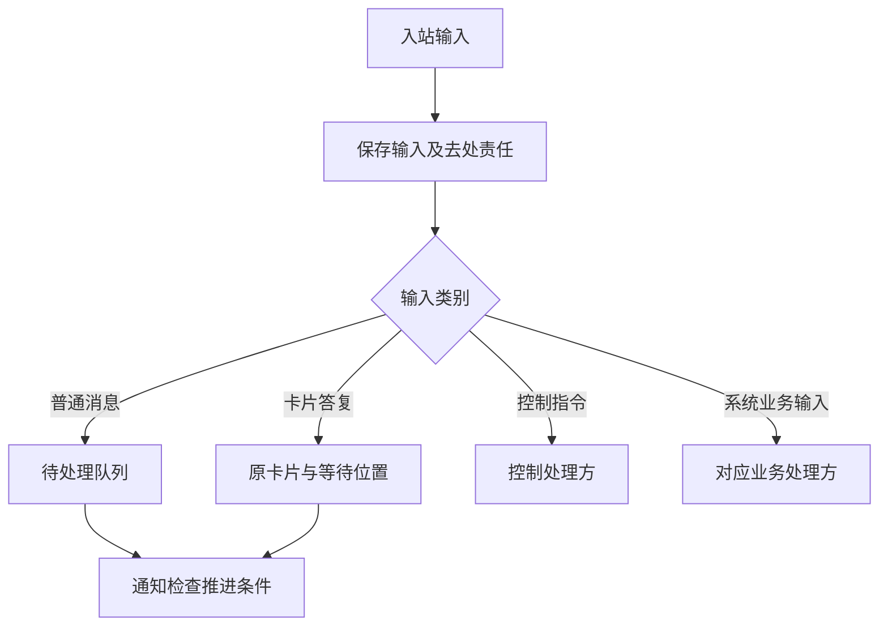
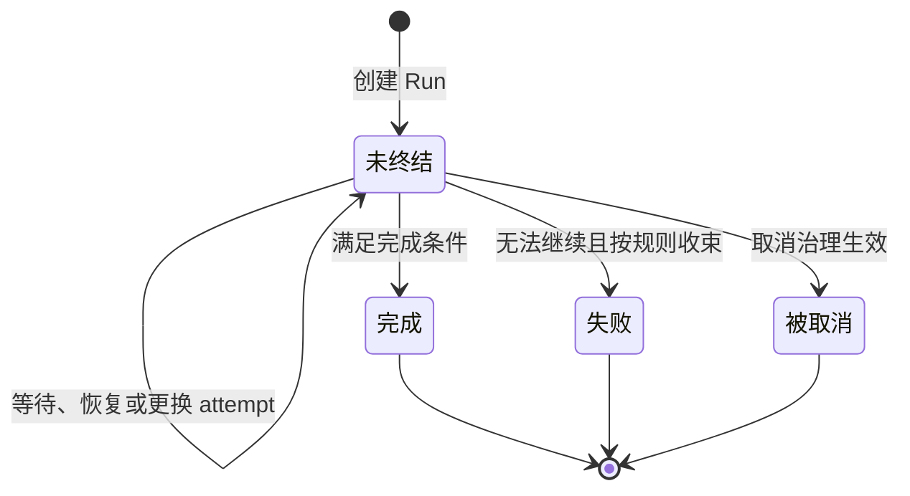
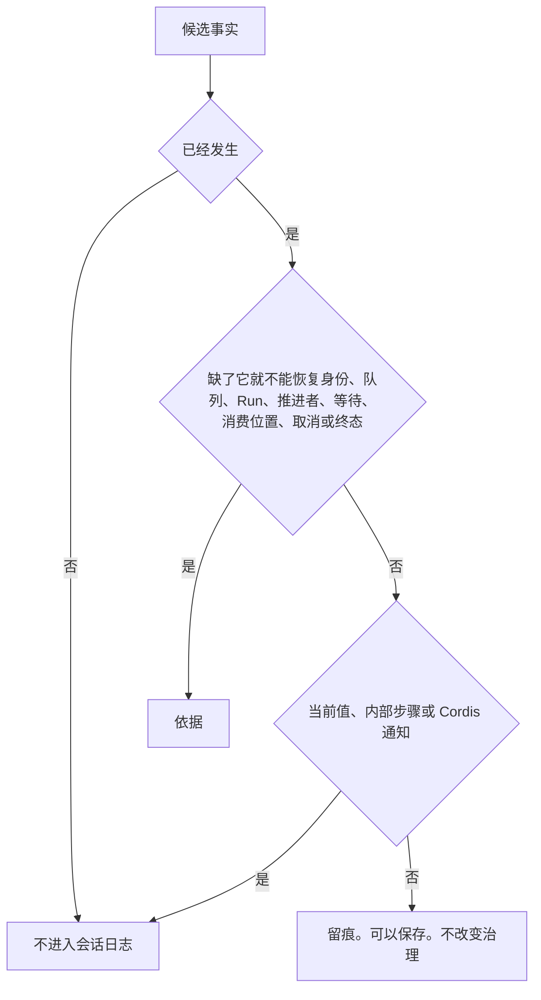

# Session、Run 与输入承接

Session 保存会话身份、历史和治理状态。Run 组织一次逻辑工作。attempt 标识承担该 Run 推进责任的一次执行尝试。它们分别存在，不能用一个进程或对象的寿命替代。

状态：已接受的目标架构。正文承接既有产品规则与本轮明确的生命周期边界，不表示提供者已经实现。运行全图见[总览](README.md)。

## 会话创建与身份

会话创建时确定租户归属、AgentDefinition 身份、执行类型和适用工作区。执行类型及其必需能力身份集合随会话固定，具体实现按资产规则演化。自然人的账号身份与其租户成员身份分别使用。工作区是资产与工作材料的来源，不提供额外授权，也不因被某会话使用就成为该租户私有。

| 信息类别 | Session 的责任 |
|---|---|
| 身份与归属 | 保留租户、会话及定义身份，检查访问与委托范围。 |
| 历史 | 保存原始输入、采用的消息和与工作有关的事实。 |
| 治理 | 保存会话模式、适用权限和对执行发出的控制意图。 |
| 逻辑工作 | 关联 Run、attempt、原调用和未完成的消费责任。 |
| 运行输入 | 关联装配依据、Runtime Context 及实际使用的资源。 |

[多层求值](assembly-and-change.md#多层来源求值)产生合法装配输入。[模式与 context 初始化](runtime-context.md#模式与-context-初始化)说明默认值和当前数据的建立。求值成功不等于必须立即启动 Agent runtime。

## 输入受理与分流

输入受理须持久保存输入及其去处责任，随后才报告可靠受理。仅发送通知或写入进程内队列不能满足这一要求。重复到达须能认回同一份输入，不能重复创建逻辑工作。

普通消息按到达顺序等待，用户插队走明确的加急路径。卡片答复不能当作普通聊天消息取走。取消等控制指令不等队列清空后才生效。业务处理方负责非聊天输入的业务结果，不能因它进入统一入口就强制交给模型。

队列是已受理输入扣除已承接和已取消处理资格的输入。队列投影可以保存，但须说明对应事实进度。投影落后时不能把“暂时没有查到”当成没有待办。

## Run 创建与推进权

同一 Session 至多有一个未终结 Run，同一 Run 至多有一个有效推进者。其他 Session 可同时推进，Run 内也可并行执行多个工具。

触发通知只要求处理方检查条件，不直接授权新建 Run。

| 当前条件 | 处理 |
|---|---|
| 没有未终结 Run，存在合法待处理输入 | 创建 Run，建立第一次 attempt。 |
| 原 Run 尚可推进，但原推进者已无效 | 建立新 attempt，先恢复原工作。 |
| 原推进者仍有效 | 通知原推进者，继续同一次 attempt。 |
| 没有合法工作 | 不创建空 Run。 |

丢失一次通知不能永久遗失已受理工作。重复通知也不能产生第二个有效推进者。具体调度、认领与并发协议由实现规格说明，不预设线程、锁或数据库布局。

## attempt 与原工作接续

新 attempt 首先对账取消意图、Run 终态、未完成调用、卡片和未消费结果，然后才决定下一步。原调用仍在执行时重新取得其句柄，已经收场时取得原结果。查询失败不足以认定执行已经不存在。

一次 attempt 可以等待、恢复等待和处理新输入。以上行为不自动增加 attempt。模型运行时内部的重试同样不创建新的 Agent attempt。替换推进实例时，旧实例不得继续发起新工作，但原模型和工具执行仍可记录真实结果。

承接普通输入时，保存所属 Run、消费顺序和接续位置，并可靠解除它在队列中的待处理资格。既有规则要求本轮承接当时队列的全部输入；工程可分批搬运或处理，但不得因此改变本轮可见输入的边界。

## 生命周期与工作收束

等待和恢复不增加 Run 终态。Run 的终态只有完成、失败和被取消，成立后不可反转。终态检查与扩展见[Agent runtime](agent-runtime.md#完成条件与终态)。

Run 结束后仍可能存在后台工具、迟到结果、费用或保管责任。它们继续关联原工作，不让 Run 复活，也不因 Run 已结束就丢弃真实结果。会话通过归档收起协作并保留历史，不提供将归档等同于删除的语义，也不能简化为销毁一个 Agent runtime。

## 多会话与独立调用

多智能体并行通过多个 Session 的独立推进，以及各自明确的共享资源和委托关系实现。子会话是独立会话，不因父 Run 被取消就隐式终结。子代理权限不得超过父方可委托范围与子方请求范围的交集。

跨会话消息及子代理派发仍需补齐完整授权、可靠投递和目标不存在时的契约。当前可以确定会话隔离、原工作关联和独立生命周期，不能据此宣称跨会话投递协议已经完整。

模型与工具也可以由程序直接调用。调用者明确提供合法身份、输入、控制及结果消费责任，不必暗建 Session 或 Run。各调用契约见[模型运行时](model-runtime.md#独立调用)和[工具运行时](tool-runtime.md#独立调用)。

## 必须进入日志的事实

一条事实进入会话日志，当且仅当它已经发生，并且缺了它就不能恢复下列之一。会话身份与初始化、待处理队列、唯一未终结的 Run、唯一有效推进者、未完成的等待、消费位置、已生效的取消、不可反转的终态或归档。

这样的事实是依据。只解释发生过什么的留痕可以保存。留痕不改变队列、推进资格、等待或终态。能重新读取的当前值、runtime 内部步骤和 Cordis 通知不进入这套标准。

会话规格规定种类准入、效力、整批提交，以及一条事实能否改变推进资格或 Run 终态。调用者不能自填种类取得治理权。各领域只规定自己的事实。日志的追加、分页和恢复只由会话规定。

## 压缩记录的提交

本节是候选修订，技术接受前不扩大本页既有承诺。

会话是会话历史的持有者。请求组装形成的压缩记录经会话的派生提交进入日志，形状与规则归[消息成员](../../../packages/common/message/SPEC.md)。会话不重新决定摘要内容或保留哪些消息，只核对这条记录与本会话历史对得上。

1. 会话核对覆盖范围的起点是本会话历史的第一条，不是就拒绝。然后取出覆盖范围内的全部条目、覆盖范围之后到压缩点之前的消息，以及本会话当前的未结工作集合：最近一次模型请求之后写入、模型尚未读取的输入，待处理输入，等待中的执行，后台占位，结果未知的操作。会话把每项未结工作映射到表达它的消息条目（输入消息、调用消息或占位消息）；没有对应消息的，放入它自己的条目，这时覆盖范围必须在它之前结束。
2. 会话用上一步的三组输入调用消息成员的相对历史判定。这一判定先核对记录的形状，再核对它与历史的关系。任一项失败，提交被拒绝，日志不变，拒绝原因交回请求组装。
3. 判定通过后，压缩记录与对人时间线的标注在同一次提交中成立。任一部分失败，整次提交不成立。
4. 会话为之后的组装重建模型可见历史的物化视图，内容依次是保留名单里的消息、这条压缩记录和覆盖范围之后的模型可读消息。这份视图是可以从日志重建的派生读面，不是另一个权威事实来源；之后的组装读取新视图，不再读取压缩前的视图。
5. 对人的时间线不删除也不隐藏任何原消息。它把覆盖范围内未保留的消息标为「已压缩进摘要」，把保留名单里的消息标为「保留」。这些标记由压缩记录派生，不写回消息，也不改块标注。

请求组装的派生证据绑定这次提交的回执。提交结果未知时，请求组装按原操作查询结果，不能把未知当作已压缩继续组装，也不能重复提交同一条记录。

## 推理续接状态的保存

assistant 消息里的推理续接状态部件（形状归[消息成员](../../../packages/common/message/SPEC.md#推理续接状态)）的载荷是租户数据，随所在消息写入日志、保存和保留，隐私与保留规则与会话历史相同；部件不给人看，对人的时间线不展示它。会话不按回放范围建索引，也不缓存筛选结果；每次发出带哪些推理状态由 Model 决定，见[单次模型请求的上下文](request-context.md#模态表示与完整输入限制)。

## 依据

Agent 工作推进的产品责任见[Agent 定义与工作推进](../../../.meta_harness/design/product/agent-progression/README.md)，该产品页已由产品负责人采用（[技术接受与产品采用决定](https://github.com/nemori-ai/omne-harness-lite/issues/384#issuecomment-6258475204)），受理与队列见[会话与工作](../../../.meta_harness/design/product/sessions-and-work/README.md)，会话交接也见[会话与工作](../../../.meta_harness/design/product/sessions-and-work/README.md)。会话与工作的产品页仍为草案；本页既有承诺继续按实际接受范围执行，不因候选修订扩大采用。

## 未决问题与待办事项

以下事项沿本页已接受要求继续承接。来源定位不表示现行契约已经完整或验证已通过。

### SESSION-T01 会话日志与固定读取的契约承接

本项为契约承接待办。会话日志、输入受理、固定读取前缀和提交关联的现行精确契约仍需与实际 Session 及存储拥有者对账。日志不能独自代表外部作用、全部当前授权或执行状态。

承接责任为Session 日志、存储与原工作协调者。待办是定位公开入口和必要行为，核验受理与可见性、原操作查询、长期读取和恢复消费者，不改变现有工作身份及可靠保存要求。

[封存来源](../../../packages.0.0.1.legacy/core/session-log/SPEC.md)仅供核对原范围和消费者；旧接受记录、归档位置与已有测试不能授予冲突设计继续采用。实际限制、待设计输入及验证结果须由各自当前拥有者确认。
