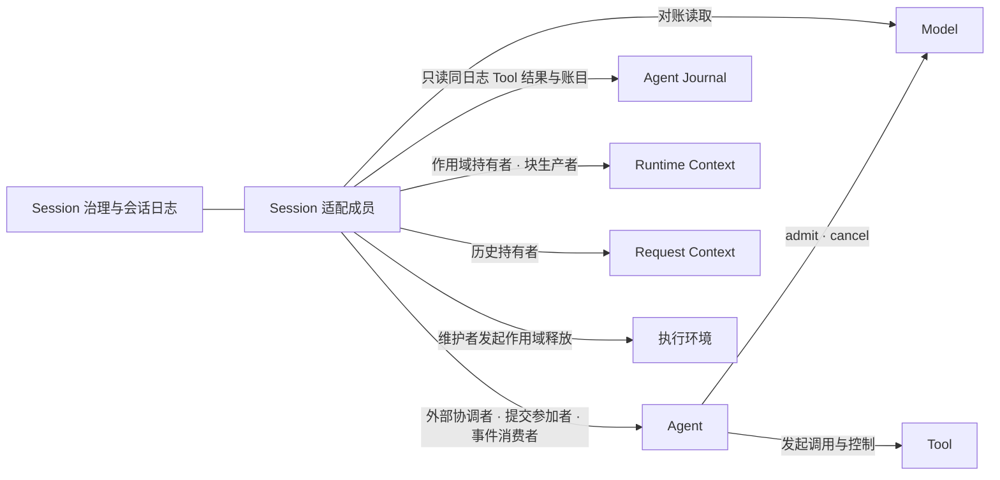
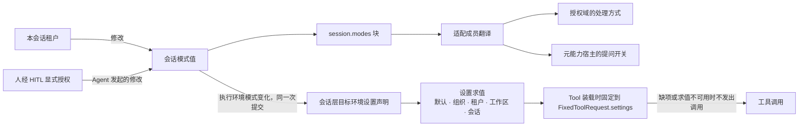
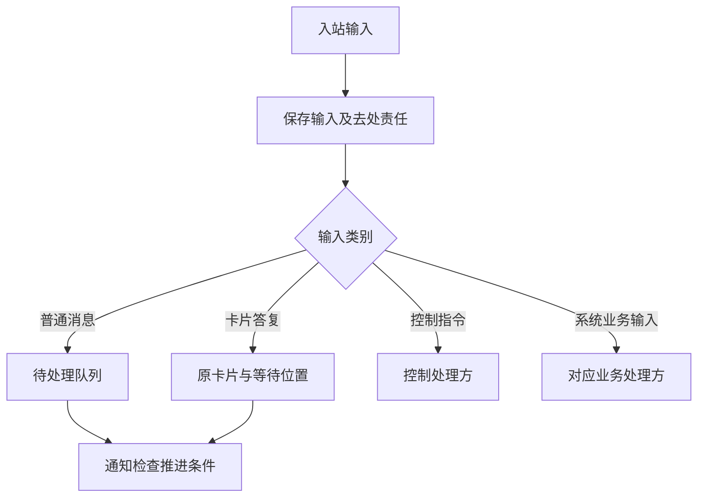
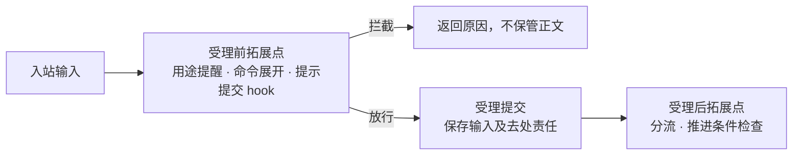
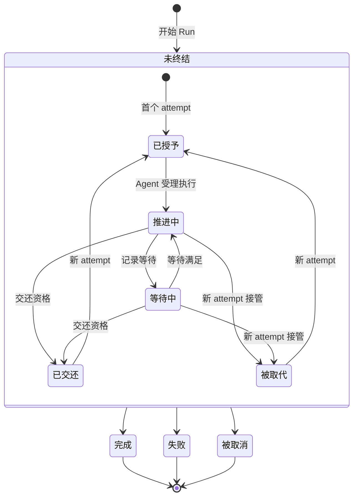
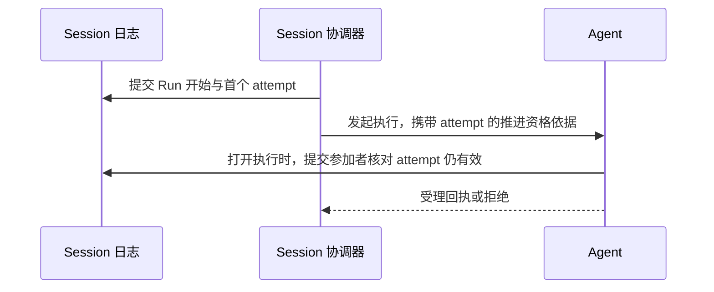
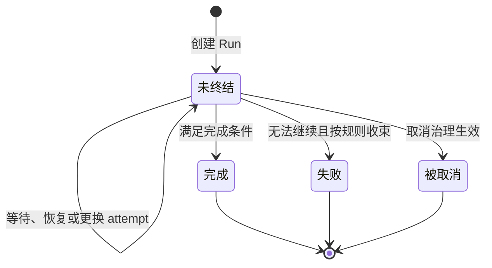
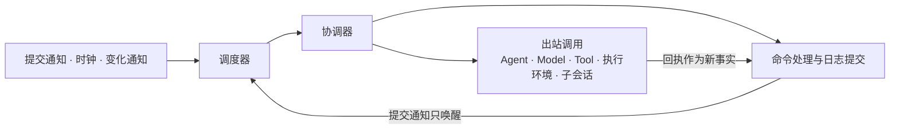
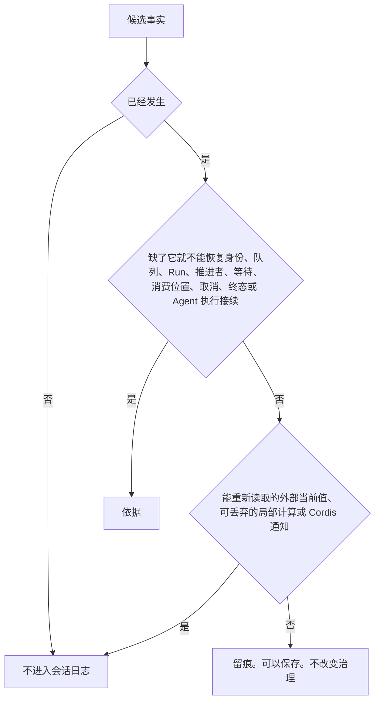

# Session、Run 与输入承接

Session 保存会话身份、历史和治理状态。Run 组织一次逻辑工作。attempt 标识承担该 Run 推进责任的一次执行尝试。它们分别存在，不能用一个进程或对象的寿命替代。

状态：已接受的目标架构。正文承接既有产品规则与本轮明确的生命周期边界，不表示提供者已经实现。运行全图见[总览](README.md)。候选修订的节：[总前提](#总前提)、[Session 的三层与邻域角色](#session-的三层与邻域角色)、[会话模式](#会话模式)、[受理流水线与业务流程拓展点](#受理流水线与业务流程拓展点)、[Run 与 attempt 的两层状态](#run-与-attempt-的两层状态)、[与 Agent 执行的对应及执行引用](#与-agent-执行的对应及执行引用)、[协调器与调度器](#协调器与调度器)、[事件九族与不进入日志的内容](#事件九族与不进入日志的内容)、[共同提交与参加关系](#共同提交与参加关系)、[压缩记录的提交](#压缩记录的提交)、[推理续接状态的保存](#推理续接状态的保存)、[联合前提与具名待决](#联合前提与具名待决)。这些节在技术接受前不扩大本页既有承诺。

## 会话日志是唯一事实源

会话日志是会话的唯一事实源，包含 Agent 执行记录。会话路径上的 Agent Journal 由会话日志承载，执行输入、调用关联、等待、处理进度和终结等恢复所需事实都从这份日志取得。Agent 可以维护可丢弃的视图、缓存和局部计算，不得绕过日志持有第二份权威工作状态。

这一要求不把 Model、Tool 或其他能力的在途内容及外部效果变成会话事实。各生产者继续保管自己的内容并报告真实结果。会话日志保存会话接续所需的事实与稳定引用，见[必须进入日志的事实](#必须进入日志的事实)。

## 总前提

本页各节都以下面五条为前提。

1. Session 拥有业务治理与耐久事实，不是第四个 runtime。它拥有身份与归属、只增不改的会话日志、输入受理与分流、Run 与 attempt 的唯一推进资格、从 Agent 等待事件派生的等待记录与消费位置、控制意图、终态、模式与选择、会话关系与归档。它不执行 Loop，不发模型请求，不运行工具，也不解释其他生产者的 Runtime Context 块内容。
2. Session 认识全部邻域，邻域都不认识 Session。Agent、Model、Tool、Runtime Context、Request Context 和执行环境的契约只使用通用角色。Session 是这些角色在会话路径上的具名实现者。名称与形状的翻译只发生在 Session 的适配成员里。
3. 只有一条权威提交序列。会话日志提交、Agent 的输入受理与终结、压缩转换，凡需要共同成立，都在同一个存储事务域的一次提交里成立。两次独立写入、事件队列或回调都不算共同成立。Runtime Context 的注册决定不与其他事实共同提交：它是作用域持有者单独的一次提交，Runtime Context 在提交之后应用它，见 [RC-02](../../../packages/context/runtime-context-contract/SPEC.md#rc-02-块声明注册与参数)。
4. 逻辑收口与物理收场分开。取消、归档、换代和释放只改变资格与责任。模型是否发出、工具是否停止、环境是否关闭，由各自拥有者报告，Session 只对账。
5. 日志是唯一的业务写入口。外部调用方不能直接追加事件。每个意图经一个具名操作进入，守卫在同一次裁定里检查当前资格与前提，归约只解释已经提交的事实。

## Session 的三层与邻域角色

Session 分三层。每层的变化由不同的一方处理，重装配的判断见[何时重装](assembly-and-change.md#何时重装)。

| 层 | 负责什么 |
|---|---|
| 服务层 | Session 服务、适配成员和存储成员的装配。它们升级或换配置时只重新装配，不写会话事实。在途命令按操作身份认回，协调器和调度器从权威状态重建未完成的工作。 |
| 会话采用层 | 会话保存的选择与实际采用：定义与装配的实际采用、工作区选择、设置声明、Context 注册集合和会话自有的恢复输入。它们是日志事实，在新 Run 入口或显式 reload 时重新求值，结果只在入口成为采用依据。 |
| 作用域资源层 | 按会话作用域存在的运行期资源。Agent runtime 实例、Runtime Context 作用域、执行环境的落点与租约归各自拥有者，Session 只按作用域关联、发起释放并对账。现有释放入口只有执行环境的作用域释放；Runtime Context 作用域与会话级 Agent runtime 实例的释放入口由各自拥有者定义，见会话契约的[明确缺项](../../../packages/session/session-contract/SPEC.md#具名前提与明确缺项)。空闲计时归 Session 的调度器，进程重启后从日志里的空闲证据重建。 |

Session 对六个邻域担任下列通用角色。每个角色只经对方的公开契约履行。

| 邻域 | Session 担任的通用角色 | 公开契约 |
|---|---|---|
| Agent | 外部协调者、提交参加者、事件消费者、恢复发现者 | [托管协调与运行实例](../../../packages/agent/agent-contract/SPEC.md#托管协调与运行实例)、[外部协调者的前提](../../../packages/agent/agent-contract/docs/context.md#外部协调者的前提) |
| Model | 消费位置拥有者、结果承接与 ACK 的消费侧、模型选择的保存者。Session 不参加 Model 的受理点守卫 | [ACK 的前提与效果](../../../packages/model/model-contract/SPEC.md#ack-的前提与效果) |
| Tool | 读取同日志结果与账目并形成 Session 后果；启动围栏归 Agent 日志的 `start-fence` 条目，在 Tool 排序域生效 | [Agent J03](../../../packages/agent/agent-contract/SPEC.md#tool-启动围栏)、[P04 实际发起围栏](../../../packages/tool/tool-contract/SPEC.md#p04-实际发起围栏) |
| Runtime Context | 作用域持有者、会话块的生产者、变化材料的消费者 | [Runtime Context 契约](../../../packages/context/runtime-context-contract/SPEC.md#rc-07-生产者句柄并发撤除与恢复) |
| Request Context | 历史持有者：提供历史源读口与未结工作下界，承担压缩转换的持有者一侧，调用人侧投影 | [历史源读口与 epoch 视图](../../../packages/context/request-context-contract/SPEC.md#历史源读口与-epoch-视图)、[压缩共同结果](../../../packages/context/request-context-contract/SPEC.md#rq-06-压缩共同结果与保护边界) |
| 执行环境 | 不直接认识。经两条间接线：执行环境模式变化时，Session 写一条会话层的目标环境设置声明，有效值经设置求值进入 Tool 装载时固定的设置快照；归档后的作用域释放由 Session 的作用域释放插件以维护者身份发起 | [执行环境恢复](../../../packages/execution/execution-environment-contract/SPEC.md#恢复) |

Agent 以 `admit` 发起 Model 调用，以 `cancel` 请求取消。模型内部重试归 Model，Tool 调用与控制由 Agent 发起。Tool 启动围栏归 Agent J03 日志 `start-fence`，在 Tool 排序域生效。结果与账目经 Agent 宿主结果接收方写入同一日志。结果接收方只返回 saved，生产者收到 saved 后自己解除交付责任。Session 只读同日志事实并提交本域后果。名称与形状翻译集中在[适配成员](../../../packages/session/session-adapters/SPEC.md)。

## 会话创建与身份

会话创建时确定租户归属、AgentDefinition 身份、执行类型和适用工作区。执行类型及其必需能力身份集合随会话固定，具体实现按资产规则演化。自然人的账号身份与其租户成员身份分别使用。工作区是资产与工作材料的来源，不提供额外授权，也不因被某会话使用就成为该租户私有。

| 信息类别 | Session 的责任 |
|---|---|
| 身份与归属 | 保留租户、会话及定义身份，检查访问与委托范围。 |
| 历史 | 保存原始输入、采用的消息和与工作有关的事实。 |
| 治理 | 保存会话模式、适用权限和对执行发出的控制意图。 |
| 逻辑工作 | 关联 Run、attempt、原调用和未完成的消费责任。 |
| 运行输入 | 关联装配依据、Runtime Context 及实际使用的资源。 |

[多层求值](assembly-and-change.md#多层来源求值)产生合法装配输入。[模式与 context 初始化](runtime-context.md#模式与-context-初始化)说明默认值和当前数据的建立。求值成功不等于必须立即启动 Agent runtime。

## 会话模式

会话模式有三个独立的轴。修改一个轴不改另外两个轴，也不改写已经发出的请求。产品规则见[按协作需要调整三个独立模式](../../../.meta_harness/design/product/sessions-and-work/design.md#按协作需要调整三个独立模式)。

| 轴 | 会话保存的值 | 谁使用这个值 |
|---|---|---|
| 权限处理 | `never`、`auto_permission`、`bypass-permissions` | 授权域按它决定仍需询问时的处理方式。`bypass-permissions` 只跳过询问，不越过结构化权限限制。 |
| 执行环境 | 会话层的目标环境设置声明 | 设置求值拥有者按默认、组织、租户、工作区、会话的次序求出有效值，上层锁定照常生效。Tool 装载时由设置读取适配器取得有效值，固定在 `FixedToolRequest.settings`。 |
| 协作 | `co-work`、`auto-drive` | 元能力宿主按它开放或关闭向人提问。`auto-drive` 另外增加目标完成检查。 |

谁能改模式：

- 本会话的租户可以改。
- Agent 不能直接写模式，也不能借未经人授权的工具或委托去改。Agent 要改模式，必须经 HITL 由人显式授权。
- 组织、租户或会话配置的操作权限限制不能被模式改为允许。这类限制在动作准入处拒绝，Session 不替它判断。

初值与生效时点：

- 通用创建入口没有显式初值时，采用租户默认并形成本会话值。租户默认之后的变化只影响后续创建。会话恢复或重新装配不重新套用默认。
- 已经发出的请求保持发出时的模式。
- 目标环境设置在 Tool 装载时固定在 `FixedToolRequest.settings`。之后的模式变化不改这份快照，只影响之后装载的工具调用。
- 运行中的消费者经 Runtime Context 的变化协议感知新值。新的 Agent 执行开始或建立新的执行挂接时，消费者取得当前块快照，见[Runtime Context](runtime-context.md)。

Session 作为生产者向 Runtime Context 供给一个块 `session.modes`，保存三轴的当前值。这个块由 Session 持久保存，恢复时由 Session 重新发布原值。消费者类是模型与协调者，Tool 与扩展不是它的消费者。

模式词到各消费者取值的翻译是 Session 适配成员里的纯函数，带来源证据，经 Runtime Context 的需要绑定交给消费者。授权域与元能力宿主只读自己的值，不认识模式词。Session 的契约不出现执行环境的类型。翻译表归[适配成员](../../../packages/session/session-adapters/SPEC.md)。

目标环境设置不经 Runtime Context 块，走设置求值：

1. 执行环境模式变化时，Session 在同一次提交里写一条会话层的目标环境设置声明。它是会话设置声明的一种，计入[设置声明修订](../../domains/sessions-and-work/architecture.md#设置声明修订)。模式词到这条声明的翻译是 [session-adapters](../../../packages/session/session-adapters/SPEC.md) 证据桥里的纯函数，经 `change` 的设置材料进入同一次提交，在模式变化时算好，不在工具调用时翻译。
2. 设置求值的拥有者按默认、组织、租户、工作区、会话的次序求出有效值，取最具体的合法值，上层锁定照常生效，见[配置资产的行为，同时守住权限上界](../../../.meta_harness/design/product/assets-and-rules/design.md#配置资产的行为同时守住权限上界)。
3. Tool 装载时，设置读取适配器取得有效值，固定在 `FixedToolRequest.settings`。执行、收场与恢复都用这份快照，见 Tool 契约的 [P15 配置声明与合法装载](../../../packages/tool/tool-contract/SPEC.md#p15-配置声明与合法装载)。

Session 不要求 Agent 增加传递设置的端口，也不为每次工具调用翻译模式。

设置缺项或求值不可用时，Tool 一侧不猜落点，这次工具调用不发出，见执行环境的[产品规则](../../../.meta_harness/design/product/execution-environments/design.md#产品需求描述)「无法取得允许依据时不能猜测许可」。系统不回退到工具声明的缺省值：缺项说明会话层有没有覆盖值仍未知，回退会让用户设置的禁止项静默失效。拒绝带原因，由 Agent 按自己的规则形成拒绝消息。

## 输入受理与分流

输入受理须持久保存输入及其去处责任，随后才报告可靠受理。仅发送通知或写入进程内队列不能满足这一要求。重复到达须能认回同一份输入，不能重复创建逻辑工作。

普通消息按到达顺序等待，用户插队走明确的加急路径。卡片答复不能当作普通聊天消息取走。取消等控制指令不等队列清空后才生效。业务处理方负责非聊天输入的业务结果，不能因它进入统一入口就强制交给模型。

队列是已受理输入扣除已承接和已取消处理资格的输入。队列投影可以保存，但须说明对应事实进度。投影落后时不能把“暂时没有查到”当成没有待办。

### 受理流水线与业务流程拓展点

受理流水线把业务流程拓展点分成受理前与受理后两组。拓展的语义归命令域与 hooks 的拥有者，Session 只规定顺序与提交边界。这一分工是 Session 与这两方的联合前提。

1. 受理前一组依次是用途提醒、内容型斜杠命令展开、用户提示提交的 hook。这一组可以拦截请求。拦截时 Session 不保管正文，只记录留痕。命令展开的正文与原命令在同一批提交。失效命令明确拒绝，不降为普通消息。hooks 不可用时按 hooks 拥有者的规则放行或拒绝，Session 只记录结果。
2. 受理提交保存输入及去处责任。同一原提交重复进入时，按操作身份认回。
3. 受理后一组是分流与推进条件检查。这一组不改已经提交的内容。

## Run 创建与推进权

同一 Session 至多有一个未终结 Run，同一 Run 至多有一个有效推进者。其他 Session 可同时推进，Run 内也可并行执行多个工具。

触发通知只要求处理方检查条件，不直接授权新建 Run。

| 当前条件 | 处理 |
|---|---|
| 没有未终结 Run，存在合法待处理输入 | 创建 Run，建立第一次 attempt。 |
| 原 Run 尚可推进，但原推进者已无效 | 建立新 attempt，先恢复原工作。 |
| 原推进者仍有效 | 通知原推进者，继续同一次 attempt。 |
| 没有合法工作 | 不创建空 Run。 |

丢失一次通知不能永久遗失已受理工作。重复通知也不能产生第二个有效推进者。具体调度、认领与并发协议由实现规格说明，不预设线程、锁或数据库布局。

### Run 与 attempt 的两层状态

Run 是 Session 里一次逻辑工作的治理记录。它承接一段输入，由恰好一个有效推进者推进，最后得到唯一终态。执行归 Agent 执行。Run 只拥有推进资格、承接的输入、等待的对象和收场方式。

状态分两层：

- Run 层从未开始进入未终结，再进入完成、失败或被取消之一。终态不可反转。
- attempt 层只在未终结的 Run 内循环，描述当前推进资格属于谁。等待是 attempt 层的一个阶段，不是 Run 的状态。

开始 Run 与 Agent 受理执行是两次提交，顺序固定，不能合并成一次：

1. Session 先提交 Run 开始与首个 attempt，固定首条输入，不扣除任何输入的待处理资格。
2. 协调者把这个 attempt 的耐久证据作为推进资格依据，连同首条输入交给 Agent 的发起入口。其余待处理输入按到达顺序逐条交入同一执行。
3. Agent 打开执行或受理输入时，Journal 提供者与 Session 的提交参加者共同核对证据对应的 attempt 仍然有效、输入仍有待处理资格。核对失败时，Agent 答拒绝。

批界由 Agent 的输入水位线决定：Agent 每一步取当时已交入的全部输入。Session 读到 Agent 的承接事件时解除这些输入的待处理资格。发起或交入回执丢失时，协调者按 Agent 的操作身份查询，不另开执行，也不重复交入。

Run 的不变量与守卫归[会话契约](../../../packages/session/session-contract/SPEC.md)。

## attempt 与原工作接续

新 attempt 首先对账取消意图、Run 终态、未完成调用、卡片和未消费结果，然后才决定下一步。原模型调用仍在执行时，由 Agent 外侧按日志中的稳定调用引用恢复观察和交付；已经收场时，由结果接收方取得原模型结果并记入日志，Agent 从日志接续处理。工具调用按工具自身契约接续。查询失败不足以认定执行已经不存在。

一次 attempt 可以等待、恢复等待和处理新输入。以上行为不自动增加 attempt。模型运行时内部的重试同样不创建新的 Agent attempt。替换推进实例时，旧实例不得继续发起新工作，但原模型和工具执行仍可记录真实结果。

已受理的普通输入由 Session 按会话业务规则调度：执行存在时，按到达顺序把待处理输入及时交入。Agent 承接一批输入时按自己的输入水位线取当时已交入的全部输入，Session 读到承接事件后保存所属 Run、批次与顺序，并可靠解除这些输入的待处理资格。工程可以分批搬运或处理，但不得因此改变这次承接可见输入的边界。

### 与 Agent 执行的对应及执行引用

| Session 一侧 | Agent 一侧 | 规则 |
|---|---|---|
| Run | Agent 执行 | 一一对应。reload 与恢复都沿同一个 Agent 执行。 |
| attempt | 执行挂接 | 一一对应。挂接被取代或脱离，attempt 就失去资格。同一 runtime 实例脱离后再接续，也是新挂接与新 attempt。 |
| attempt 序号 | 挂接的围栏代次 | 两边各自保存，不互相替代。序号供人与恢复使用，代次供提交围栏使用。 |
| 推进实例身份 | Agent runtime 实例 | 只作追溯。资格判断不比较它。 |

会话路径上的 Agent 执行记录保存在会话日志中，不能另存一份权威接续状态。执行引用关联 Agent 执行身份、最后已知修订、耐久证据和事件读取位置，用来定位同一日志中的记录。引用和可重建投影都不能替代日志事实。Agent 的通用提交要求见[提交参加者协议](../../../packages/agent/agent-contract/SPEC.md#提交参加者协议)，不因此要求 Agent 契约依赖 Session。

推进命令不携带另一份权威接续数据。修订与证据取自已提交的会话日志及提交回执。恢复时，Session 发现需要恢复的 Run，Agent 通过会话日志所承载的 Journal 读取原执行记录，再以恢复依据与新 attempt 的推进资格依据接续原执行。通用恢复行为见[恢复与接管](../../../packages/agent/agent-contract/SPEC.md#恢复与接管)。换代时的接续转换由 Agent 的[采用交接](../../../packages/agent/agent-contract/SPEC.md#采用交接)证明，交接证据也进入会话日志。

## 生命周期与工作收束

等待和恢复不增加 Run 终态。Run 的终态只有完成、失败和被取消，成立后不可反转。终态检查与扩展见[Agent runtime](agent-runtime.md#完成条件与终态)。

Run 结束后仍可能存在后台工具、迟到结果、费用或保管责任。它们继续关联原工作，不让 Run 复活，也不因 Run 已结束就丢弃真实结果。会话通过归档收起协作并保留历史，不提供将归档等同于删除的语义，也不能简化为销毁一个 Agent runtime。

冻结是会话自己的另一种生命周期状态，不是归档。冻结由 Tool 在采用点的判定触发，原因是 `tool-shape-lost`，状态转换由会话执行。冻结后会话不再派发新 Run，在途 Run 自然收场。冻结不可逆。冻结的会话仍可按会话规则归档，撤销这次归档后会话回到冻结状态。

## 协调器与调度器

Session 的应用层由命令处理、协调器和调度器组成，遵守六条规矩：

1. 业务规则不进应用层。允许与拒绝由领域服务的纯裁定给出，应用层只编排读取、裁定、提交和通知。
2. 一个用例只做一次提交。跨用例的事只能由后一个用例读取前一个用例已经提交的事实。
3. 幂等只依靠操作身份。协调器与调度器重放同一命令时带同一身份。
4. 协调器与调度器不持有状态。它们从权威读取重建要做的事，通知只起唤醒作用。
5. 外部效果与日志分开。对 Agent、执行环境和子会话的调用在提交之后发出，回执作为新事实提交。Tool 启动围栏由 Agent 日志的 `start-fence` 条目在 Tool 排序域生效。生产者收到 saved 后自己解除交付责任，结果接收方只返回 saved。Session 只按 [JC-Release](../../../packages/session/session-contract/SPEC.md#jc-release) 读取原确认，Tool 确认怎样进入日志见具名偏离 [JC-RELEASE-TOOL-PATH](../../../packages/session/session-contract/SPEC.md#jc-release-tool-path)。
6. 能预先算好的派生物在变化时维护。请求到达时只读取与采用。

协调器读取事实后决定发出哪些命令或调用：

| 协调器 | 职责 |
|---|---|
| 受理流水线 | 按受理前拓展点、受理提交、受理后拓展点的顺序处理一次到达。 |
| Agent 推进 | 决定何时开始、续入输入和恢复 Agent 执行；在消息、压缩转换、保管与处理完成四种交接上担任 Agent 的提交参加者；按序读取同一会话日志中的 Agent 执行记录，派生承接、登记、等待、控制阶段与执行结束的治理事实，并保存读取位置。通知只起唤醒作用，不另建 Agent 权威状态。 |
| 控制传播 | 经 Agent 长期控制入口送达原执行，不先取得挂接。按原事实收集核对结果，未知保留；Tool 围栏生效归 Agent/Tool，不作为 Session 另一套失效调用的进度条件。 |
| 归档与级联 | 归档提交后传播原控制，推进子会话级联与作用域释放，读回作为新事实提交。逻辑归档不证明 Tool 已停止或物理资源已释放。 |
| 恢复 | 读取恢复快照，按类别把未结事项交给对应的协调器或拥有者。 |

调度器只决定什么时候再检查、检查哪个会话，检查结果交给协调器：

| 调度器 | 职责 |
|---|---|
| 推进触发 | 提交通知之后检查开始 Run 的条件，交给 Agent 推进。 |
| 空闲与自动归档 | 按时钟与提交通知计算空闲，到期时交给归档与级联。 |
| 恢复扫描 | 在进程启动、周期到点和协调器上报失败时分页扫描待对账的会话，交给恢复。 |
| 待决认回 | 对结果未知的提交按操作身份查询，把已提交的回执交回原协调器。 |
| 控制重放 | 对尚未全部对账的控制按间隔重放传播。 |
| 级联推进 | 对待完成的级联任务与作用域释放任务按间隔重新驱动。 |
| 预求值与预热 | 资产、工作区或设置变化时比对本会话采用依据的作用域变更计数。计数变化时调度器对本会话尚未提交的 `startRun` 命令调用证据桥的 `prepare`，取得候选采用材料；这一调用不提交、不改变状态。已校验装配候选的缓存，以及对哪些会话预求值的策略，都归[装配协调者](assembly-and-change.md#比对代替求值)。预热要请 Agent 宿主按新采用预建空闲实例，依赖 Agent 宿主创建实例的入口，见[联合前提与具名待决](#联合前提与具名待决)。入口定义之前，本调度器只触发预求值，不调用 Agent。 |

三条共同规则：

- 调度器不写日志。只有命令处理写日志。
- 每个会话同一时刻只有一个协调实例在动作。跨进程的第二道保护是操作幂等与 Agent 的条件提交围栏，不是锁。
- 所有间隔、上限和退避都是策略对象的配置初值，实现可以替换。

协调器与调度器只在 Agent 执行之外决定开始、续入和恢复三件事。执行之内的节点、等待、唤醒和控制处置都归 Agent，所以它们不构成第二个 Loop，分界见[Agent runtime](agent-runtime.md)。精确算法归[通用实现](../../../packages/session/session/SPEC.md)。

## 多会话与独立调用

多智能体并行通过多个 Session 的独立推进，以及各自明确的共享资源和委托关系实现。子会话是独立会话，不因父 Run 被取消就隐式终结。子代理权限不得超过父方可委托范围与子方请求范围的交集。

跨会话消息及子代理派发仍需补齐完整授权、可靠投递和目标不存在时的契约。当前可以确定会话隔离、原工作关联和独立生命周期，不能据此宣称跨会话投递协议已经完整。

模型与工具也可以由程序直接调用。调用者明确提供合法身份、输入、控制及结果消费责任，不必暗建 Session 或 Run。各调用契约见[模型运行时](model-runtime.md#独立调用)和[工具运行时](tool-runtime.md#独立调用)。

## 必须进入日志的事实

一条事实进入会话日志，当且仅当它已经发生，并且缺了它就不能恢复下列之一。会话身份与初始化、待处理队列、唯一未终结的 Run、唯一有效推进者、未完成的等待、消费位置、已生效的取消、不可反转的终态、冻结或归档、会话常驻工具在会话内不变的 name 与参数形状。

这样的事实是依据。只解释发生过什么的留痕可以保存。留痕不改变队列、推进资格、等待或终态。能重新读取的外部当前值、可丢弃的局部计算和 Cordis 通知不进入这套标准。Agent 执行接续所需的记录属于会话事实，不能作为 runtime 内部状态排除。

Tool 的 `tool-resident-admitted` 记录会话常驻工具首次装载的定义。缺了它就不能恢复上列的常驻工具 name 与参数形状，因此它满足准入。常驻工具当前记下的登记键可从 Run 的采用依据派生，不另写会话事实。常驻规则见 [Tool 契约](../../../packages/tool/tool-contract/SPEC.md#会话常驻规则r1r5)。

会话规格规定种类准入、效力、整批提交，以及一条事实能否改变推进资格或 Run 终态。调用者不能自填种类取得治理权。各领域只规定自己的事实。例如 `tool-resident-admitted` 的内容由 Tool 规定，它的种类准入由会话规定。日志的追加、分页和恢复只由会话规定。

### 事件九族与不进入日志的内容

会话日志的事件按事实拥有者分为九族，每族有一个主要来源。

| 族 | 主要来源 |
|---|---|
| 会话身份与声明 | 用户、装配、设置拥有者、Runtime Context |
| 历史消息 | 用户、Agent、Request Context（压缩记录）、作用域持有者一侧的变化提醒、Tool（后台占位） |
| 受理与分流 | 用户、HITL、业务拥有者、准入者 |
| Run、批次与 attempt | Session 治理、Agent（承接与退出） |
| 调用与结果 | Agent（登记与处理）、Model 与 Tool（执行事实）、保管者 |
| 扩展与人工决定 | Agent 与扩展拥有者、HITL |
| 控制与终态 | 用户（意图）、Session（范围）、Agent、Model 与 Tool（处置回执）、Agent 的条件终结 |
| 归档、冻结、关系与空闲 | 用户、Session 治理、时钟与空闲输入 |
| 账目、更正与授权 | Model 与 Tool（账目）、语义拥有者（更正）、授权拥有者 |

一条事实进入日志，是因为会话以后要据此判断，或人以后要据此理解发生过什么。下列内容不进入日志，它们的可追溯义务由各自拥有者的保管协议承担：

- Model 的流片段、受理诊断与重试诊断。
- Tool 的过程块与内部调度。
- Agent 可重建的内部视图。Agent 不转发生产者的流片段，观察不经过 Agent。Agent 执行记录经 Journal 进入同一会话日志，不能因其来自 Agent 而排除。事件通知不另存为第二份权威记录，Session 治理投影按已提交记录派生，见下表。
- 调度器唤醒。

条目封套记录事实拥有者与经由方。经由方只供人与诊断使用，不参与治理。事件种类名保持稳定：旧种类永不复用，未知种类先隔离，不跳过。

迟到的 Model 与 Tool 账目和收场，由 Agent 宿主结果接收方取得生产者读取资格后写入同一会话日志。Session 的消费适配器只读同日志事实与原材料，核对当前读取资格后提交本域后果，不直接查询生产者。读取资格、日志交付或必要原材料未具备时，相应事实保持未知，见[联合前提与具名待决](#联合前提与具名待决)。Run 终态之后到达的后台结果作为后继工作的业务输入受理，保留原执行关联，不让原 Run 复活。精确目录见[事件目录](../../../packages/session/session-contract/docs/object-model/session-log-events.md)。

## 共同提交与参加关系

需要共同成立的事实在一次权威提交里成立。下表列出提交方与参加者。

| 共同成立的事 | 提交方 | 参加者 |
|---|---|---|
| Run 开始与 Agent 受理执行 | Session 先提交 Run 开始与首个 attempt，Agent 再以首条输入打开执行 | Agent 打开执行时，Journal 提供者与 Session 参加者只读核对来源依据与推进资格依据。这是两次提交，顺序固定。 |
| Agent 受理后续输入与 Session 已受理的事实 | Agent | Session 参加者只读核对来源依据与待处理资格，不写 Session 事件。其余待处理输入按到达顺序逐条交入同一执行，批界由 Agent 的输入水位线决定。 |
| 消息进历史 | Agent（消息交接） | Session 参加者在同一事务域里写历史消息。 |
| 压缩转换 | Agent（压缩转换交接）在协调者的权威提交里 | Session 作为历史持有者参加，写压缩记录与标注。 |
| 结果保管与处理完成 | 模型结果由 Agent 外侧的结果接收方保存，Agent 经 Journal 记录处理完成；工具结果按原交接协议承接 | 模型结果和迟到账目经会话日志到达 Agent。Model 依据结果接收方的 saved 证据自己取得 ACK，Agent 不承担 ACK 协议。Tool 的交付责任解除仍按工具契约使用对应回执。 |
| Agent 条件终结 | Agent | Session 参加者只读核对：有尚未交入的输入或 Run 已被取消时以冲突响应，不写 Run 终态。 |
| 承接、调用登记、等待、控制阶段与执行结束 | Agent 经 Journal 提交执行记录 | 会话路径上记录直接进入会话日志，不另存 Agent 权威记录。Session 按已提交记录派生治理事实，Run 的完成与失败按 Agent 的结束结论成立。治理投影不能成为第二份 Agent 工作状态。 |
| Tool 启动资格失效 | Session 提交本域资格撤销；Agent 日志的 `start-fence` 条目在 Tool 排序域生效 | 围栏归 [Agent J03](../../../packages/agent/agent-contract/SPEC.md#tool-启动围栏)。Session 不拥有另一套 Tool 资格版本，也不以本域提交或控制受理宣称 Tool 已阻止新发起。 |
| Runtime Context 注册决定 | Session 单独一次提交 | Runtime Context 只提供材料，不参加这次提交，在提交之后应用已确认的决定。 |
| 自动归档 | Session | 空闲输入的参加者重新核对全部范围。 |

会话日志承载 Agent Journal，Session 的事务端口与 Journal 提供者使用同一个存储事务域。这是上表成立的具名前提，由 Agent 与存储拥有者联合确认。没有共享事务域的装配被拒绝，见[联合前提与具名待决](#联合前提与具名待决)。

外部协调者与 Agent 共同受理输入和终结涉及三件事：输入绑定与 Agent 终结的共同提交、推进映射与重装配交接、日志与消费责任及恢复投影的集成。三件事的闭合位置见[SW-M01 技术兑现义务](../../../packages/session/session/docs/architecture/mechanisms.md#sw-m01-技术兑现义务)。共同提交表与参加者条款归[会话契约](../../../packages/session/session-contract/SPEC.md)，Agent 提交参加者插件归[适配成员](../../../packages/session/session-adapters/SPEC.md)，持续验证场景归[通用实现](../../../packages/session/session/SPEC.md)。

## 压缩记录的提交

会话是会话历史的持有者。请求组装形成的压缩记录经会话的派生提交进入日志，形状与规则归[消息成员](../../../packages/common/message/SPEC.md)。会话不重新决定摘要内容或保留哪些消息，只核对这条记录与本会话历史对得上。

1. 会话核对覆盖范围的起点是本会话历史的第一条，不是就拒绝。然后取出覆盖范围内的全部条目、覆盖范围之后到压缩点之前的消息，以及本会话当前的未结工作集合：最近一次模型请求之后写入、模型尚未读取的输入，待处理输入，等待中的执行，后台占位，结果未知的操作。会话把每项未结工作映射到表达它的消息条目（输入消息、调用消息或占位消息）；没有对应消息的，放入它自己的条目，这时覆盖范围必须在它之前结束。
2. 会话用上一步的三组输入调用消息成员的相对历史判定。这一判定先核对记录的形状，再核对它与历史的关系。任一项失败，提交被拒绝，日志不变，拒绝原因交回请求组装。
3. 判定通过后，压缩记录与对人时间线的标注在同一次提交中成立。任一部分失败，整次提交不成立。
4. 会话为之后的组装重建模型可见历史的物化视图，内容依次是保留名单里的消息、这条压缩记录和覆盖范围之后的模型可读消息。这份视图是可以从日志重建的派生读面，不是另一个权威事实来源；之后的组装读取新视图，不再读取压缩前的视图。
5. 对人的时间线不删除也不隐藏任何原消息。它把覆盖范围内未保留的消息标为「已压缩进摘要」，把保留名单里的消息标为「保留」。这些标记由压缩记录派生，不写回消息，也不改块标注。

请求组装的派生证据绑定这次提交的回执。提交结果未知时，请求组装按原操作查询结果，不能把未知当作已压缩继续组装，也不能重复提交同一条记录。

## 推理续接状态的保存

assistant 消息里的推理续接状态部件（形状归[消息成员](../../../packages/common/message/SPEC.md#推理续接状态)）的载荷是租户数据，随所在消息写入日志、保存和保留，隐私与保留规则与会话历史相同。部件写入之后不再改写，换模型也不改写历史。部件不给人看，对人的时间线不展示它。会话不按推理回放范围建索引，也不缓存筛选结果，Session 存储的派生索引不包含它。每次发出带哪些推理状态由 Model 决定，见[单次模型请求的上下文](request-context.md#模态表示与完整输入限制)。

## 依据

Agent 工作推进的产品责任见[Agent 定义与工作推进](../../../.meta_harness/design/product/agent-progression/README.md)，该产品页已由产品负责人采用（[技术接受与产品采用决定](https://github.com/nemori-ai/omne-harness-lite/issues/384#issuecomment-6258475204)），受理与队列见[会话与工作](../../../.meta_harness/design/product/sessions-and-work/README.md)，会话交接也见[会话与工作](../../../.meta_harness/design/product/sessions-and-work/README.md)。会话与工作的产品页仍为草案；本页既有承诺继续按实际接受范围执行，不因候选修订扩大采用。

精确接口与行为归 Session 的成员：[会话契约](../../../packages/session/session-contract/SPEC.md)、[通用实现](../../../packages/session/session/SPEC.md)、[适配成员](../../../packages/session/session-adapters/SPEC.md)和[存储成员](../../../packages/session/session-storage-sql/SPEC.md)。

## 未决问题与待办事项

以下事项沿本页已接受要求继续承接。来源定位不表示现行契约已经完整或验证已通过。

### SESSION-T01 会话日志与固定读取的契约承接

本项为契约承接待办。会话日志、输入受理、固定读取前缀和提交关联的现行精确契约仍需与实际 Session 及存储拥有者对账。日志不能独自代表外部作用、全部当前授权或执行状态。

承接责任为Session 日志、存储与原工作协调者。待办是定位公开入口和必要行为，核验受理与可见性、原操作查询、长期读取和恢复消费者，不改变现有工作身份及可靠保存要求。

[封存来源](../../../packages.0.0.1.legacy/core/session-log/SPEC.md)仅供核对原范围和消费者；旧接受记录、归档位置与已有测试不能授予冲突设计继续采用。实际限制、待设计输入及验证结果须由各自当前拥有者确认。

### 联合前提与具名待决

每行写明缺什么、谁拥有，以及闭合之前本系统怎样表现。

| 事项 | 拥有者 | 闭合之前本系统怎样表现 |
|---|---|---|
| 共享存储事务域 | Agent 与存储拥有者联合 | [共同提交与参加关系](#共同提交与参加关系)以它为前提。没有共享事务域的装配被拒绝。不提供退化为两次提交加对账的方案。 |
| 压缩转换的参加查询桥与载荷配对 | Session 与 Request Context 的拥有者 | Session 只承担持有者一侧的参加。协调者一侧的提交点见 Agent 的[请求准备与压缩](../../../packages/agent/agent-contract/SPEC.md#请求准备与压缩)第 7 条。参加查询桥与载荷的配对登记为 Agent 开放问题的 [U-6](../../../packages/agent/agent/docs/architecture/open-questions.md#journal-联合表达的具名缺口)。 |
| 受理拓展点的语义 | 命令域与 hooks 拥有者 | Session 只规定[受理流水线](#受理流水线与业务流程拓展点)的顺序与提交边界。 |
| 迟到账目与收场的读取资格 | Model 与 Tool 拥有者 | Agent 外侧的结果接收方须取得生产者读取资格，再把收场与账目写入日志。读取资格或日志交付未闭合时，相应事实保持未知，不以查不到当作未发生，也不要求 Agent 直接查询 Model 或用 Agent 事件代替账目。 |
| 有界恢复者：Agent 记录不可解释时恢复者以原事实收束失败 | Agent 拥有者 | 恢复者不收束，Run 保持未终结，恢复任务保留并报告。Agent 执行已结束时不在此列，Session 按 Agent 的结论写终态。见[有界恢复者](control-and-recovery.md#有界恢复者)。 |
| 参加者冲突映射：推进资格已被新 attempt 取代时，Agent 把 Session 参加者的冲突映射为 `stale-advance` | Agent 拥有者 | Session 先提交 `claim` 或 `reload`，再请 Agent 接续。接续失败不撤销已提交的推进授予。其间旧 runtime 的共同提交得到 `changed`，窗口的上界是恢复扫描周期。 |
| 承接与调用登记的参加种类（可选）：Agent 若将来为输入承接与调用登记提供调用方交接 | Agent 拥有者 | Session 不依赖它，只在消息、压缩转换、保管与处理完成四种交接上参加。承接、登记、等待与执行结束的治理事实从同一会话日志中的 Agent 执行记录派生。 |
| Agent 宿主创建实例的入口：宿主按指定采用预建空闲实例的公开入口，见 Agent 开放问题[宿主怎样创建并持有实例的 AgentProvider](../../../packages/agent/agent/docs/architecture/open-questions.md#宿主怎样创建并持有实例的-agentprovider) | Agent 开放问题页的拥有者 | [预求值与预热](#协调器与调度器)调度器只触发预求值，不调用 Agent 预建实例。新 Run 照常在入口取得采用。 |
| 执行环境维护者角色的对应 | 执行环境契约拥有者（复核） | 应用装配层把维护者角色交给 Session 的作用域释放插件，恢复授权由装配注入，与执行环境契约「维护者由应用装配层的协调者担任」一致，见[作用域释放](control-and-recovery.md#作用域释放)。 |
| 执行环境重启到重新释放之间的窗口 | 执行环境契约的拥有者与发起获取的集成方（工具宿主） | 执行环境重启后不记得已释放的作用域。作用域释放插件在执行环境提供者换代时按页重新释放；重新释放完成之前，已归档会话的作用域可能仍有资源。 |
