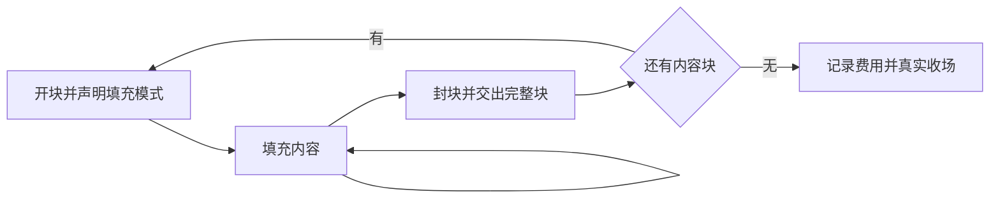
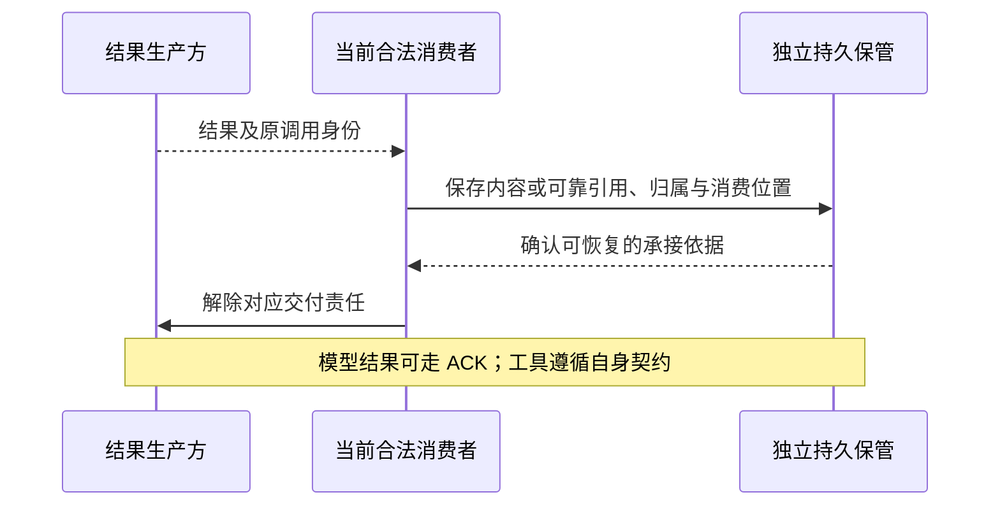
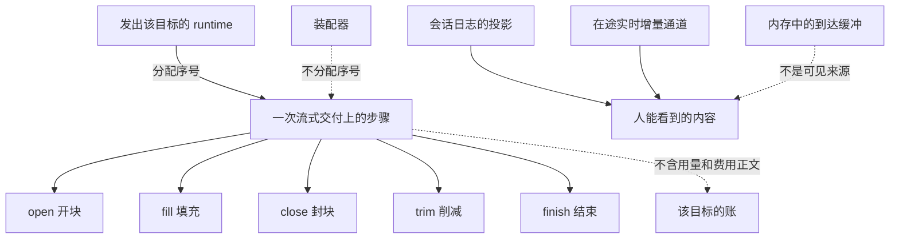

# 流式交付与结果消费

流式到达说明内容怎样交付，结果消费说明谁已完成处理，副本清理说明哪些数据可以释放。这些阶段各自有责任和状态，不能用“收到结果”概括。

状态：已接受的目标架构。本页串起块协议、在途观察、可靠交接与模型 ACK。工具结果使用自身保留规则，不因共享流式表达而获得模型侧清理语义。

## 到达语法与在途观察

流式不是第八种消息类型。消息类型区分谁在说话，流式协议区分同一内容怎样到达。

块在打开时声明填充方式，此后不改变。追加片段模式保留各片内容，整体替换模式更新同一块的当前值。替换只发生在块内部，不能覆盖已经形成的其他块或历史消息。

文字、思考内容、工具调用参数和语音可逐片追加。图片、文件和工具结果按完整块交付；整体替换的图片块可以每次提供一张完整新图。协议不要求暴露模型未提供或无权查看的思考内容。

封块交付完整块，消费者可以自行拼增量，但不必把自行拼接结果当作唯一成品。同一次有效回复的分次到达结果应与一次取得的结果一致。流必须有真实结局，费用不得因多个观察者或重复通知被重复记录。`judgeStreamArrival` 不给步骤排序。`assembleStream` 不重排。序号、重复和续接的精确规则在 `packages/common/stream-arrival` 的成员说明里。

新加入或重新连接的观察者先读取在途快照，再接收后续增量。快照表示已经到达的当前内容，不是完整增量历史。读到内容、页面展示、持有句柄都不表示结果已经消费，也不授予 ACK 权限。

## 真实收场与消息形成

完整回复、故障和用户中断分别收场。尚在增长的块不作为一条可误认成完整回复的历史消息。中断后的已交付内容可以按规则形成标记为中断的消息；故障记录保留真实原因，不冒充正常模型回复。

未收齐的工具参数不得解析执行。已经完整收场的模型回复仍需通过消息准入，原调用结果与后来被接受的会话消息分别保存。

模型完成、失败、原 Agent runtime 退出或无人持有句柄，都不自动解除结果保管责任。单次上游发出失败但整项调用还在重试时，整项调用仍未收场。

## 可靠承接与原消费位置

会话必须可靠消费的一次性数据，先保存内容或所需期限内可恢复的引用，并保存原调用、归属、原消费位置和待交付责任。通知到达、读到内容或开始处理，都不等于完成这个交接。

消费者可以先完成处理，也可以先可靠保存接续所需的内容和依据。无论哪条路径，停机恢复后都须辨明责任仍在生产侧，还是已经交给消费者。不能出现双方都认为对方负责而丢失数据，也不能重复逻辑承接。

主流程模型回复、压缩结果、扩展判断与工具结果回到各自原位置。原 Agent runtime 消失后，合法接手者继续处理原结果，不重新执行已经存在的调用。独立消费者自行处理或保管，不强制落为 Session 消息。

## 模型 ACK 与副本清理

ACK 是当前合法消费者对已经收场的模型结果所作的确认。确认表示处理完成，或已保存后续需要的内容。它不要求 Run 结束，也不要求所有结果都写成聊天消息。

| 条件或状态 | 约束 |
|---|---|
| 当前合法消费者 | 具备原租户内访问资格，并承担当前消费责任。旧消费者或只读观察者不能代确认。 |
| 调用真实收场 | 仍在输出或准备重试时不能提前 ACK。 |
| 确认生效 | 停止向新消费者提供完整结果重新领取。 |
| 实际清理 | 保护已经开始的真实读取、在途写入及尚未判明的写入结果。闲置句柄不永久阻止清理。 |
| 清理失败 | 继续由模型侧负责，不回滚已生效确认，不要求消费者持续在线。 |
| 重复确认或查询 | 不重新执行、不重复收费、不复活完整副本，仍能辨认曾存在和已释放事实。 |

确认生效、清理完成和费用结算分别可见。清理不能删除消费者持有的历史或必要费用依据。尚未结算的费用继续关联原调用；可以独立结算时，不扣住无关的完整输入输出。

工具全文沿工具结果保留规则管理，不能直接套用这套 ACK。通用责任交接原则也不自动定义所有能力都使用同一个确认协议。

## 在途内容的局部对账

PF-009 要求用户已经看见的内容在故障后仍可查，同时另一段文字把未收场内容限定为 runtime 内存在途数据。本节用生产者的保管边界对齐这两段文字。

已有结果 ACK 面向真实收场后的结果，不能据此证明每片在途内容已持久化。本页保留“展示、消费、持久保管、清理分别判断”的模型。

### 用户可见内容的两处来源

用户看到的内容只来自两处：

1. 会话日志的历史投影。投影只读已经提交的日志条目，这些条目提交后不再改变。
2. 在途实时增量通道。通道只发布生产者已经可靠保管的批次。观察者重新连接时，先取生产者已保管的快照，再接收后续增量。

进程内的到达缓冲、观察者队列和装配中间值都不是可见来源。[STREAM-T01](#stream-t01) 的到达流契约沿用这两处来源。

### 三条流不逐块进会话日志

模型回复流、工具内部事件流和 Agent 的 `stream` 事件都不逐块写入会话日志。Session 不逐片落盘。

| 流 | 在途内容由谁保管 | 会话日志收到什么 |
|---|---|---|
| 模型回复流 | Model 按每次 dispatch 有界批量保管，游标只指向已保存的内容。 | 收场事实、经消息准入的回复消息、保管或处理事实、账目。 |
| 工具内部事件流 | Tool 先保存过程块与游标，再发布。 | 收场事实（含副作用确定性）、工具结果消息、保管或处理事实、等待与账目。 |
| Agent 的 `stream` 事件 | 不保管。它转发生产者已保管的批次，带生产者游标与来源证据。 | 不进日志。它给观察者统一入口，并给消费方确认用的游标。 |

会话日志只在收场、消费和记账三个时点写入。写入次数与流片段数无关。在途内容的耐久边界是生产者的保管，不是会话日志。

### 崩溃后的恢复

崩溃后，已展示的内容从上面两处来源恢复，Session 不需要重放流片段。

- 首内容到达之前崩溃：恢复后显示等待状态。系统不重发同一逻辑回复。重试是新的 dispatch。
- 模型回复流途中崩溃：生成中的内容从 Model 已保管的快照重建。最后一批可能没有保管成功。缺的尾部标为“未确认”，不补造内容。因为通道只发布已保管的批次，未保管的尾部也没有展示过。
- 模型已收场、消费方尚未提交时崩溃：恢复者按原调用从 Model 取回结果，再按保管或处理路径形成消息。不重新执行调用。
- 消费方已提交、ACK 之前崩溃：日志条目已经存在。适配器重发 ACK，同一操作按原身份认回。
- 工具内部事件流途中崩溃：过程从 Tool 已保管的过程块重建。缺口按工具契约续流，或明确报告缺口。
- 工具已有最终结果、消费方尚未提交时崩溃：恢复者按原执行取回最终结果。不重新执行工具。

每一种情形的规则相同：保管了内容的一方持有内容。Session 只持有事实与证据，不持有流内容。

在途通道的背压由生产者的观察缓冲与缺口机制承担。会话日志的提交通知只起唤醒作用。

若技术衔接确需改变已经承诺的可见结果，再由负责人裁定具体影响；不需要重新选择整套流式或消费设计。

## 性能、权限与验证

观察者重连、多个读取者、快照生成和清理并发均须有明确资源边界。长期保管不能无界增长，缩减副本也不能破坏当前有效的保留和读取责任。

每次观察、消费和确认分别核对资格。可显示内容不自动可导出到遥测端，持久化权限也不自动授予对外传送权限。诊断记录保留身份与状态，秘密及正文按数据保护规则筛选。

验证覆盖两种填充模式、增量与完整块一致、断流、观察者接续、消费者替换、交接失败、重复 ACK 和清理竞争。局部在途耐久性未对齐前，不声称已证明该故障边界下的无丢失。

## 依据

到达语法的产品来源在 [MODEL-E02 到达语法的跨产品来源承接](../../../.meta_harness/design/product/model-invocation/design.md#model-e02)维护完整跨产品承接缺项。模型结果 ACK 的当前产品责任候选见[模型调用的结果承接与清理](../../../.meta_harness/design/product/model-invocation/design.md#j-md06)，可靠交接的候选责任见[会话与工作的故障接续](../../../.meta_harness/design/product/sessions-and-work/design.md#故障后接续原工作并保留真实结果与成本)。两者仍为草案；本页既有承诺按实际接受范围执行。

## 现行契约

### STREAM-T01 到达流公共契约的承接

本项是现行契约。附件保留、断线协议和产品责任入口的草案不在本项里。`packages/common/stream-arrival` 发布一次流式交付上的开块、填充、封块、削减和结束。它不是入站受理，也不是 Cordis 派发。模型与工具保留各自的发出和执行，并消费这套词汇。`judgeStreamArrival` 只核对步骤名和序号是否在场，不给步骤排序。`assembleStream` 把同一次交付折成 `live` 或 `ended`。它不重排。序号、重复和续接的精确规则在该成员说明里。

序号由发出该目标的 runtime 分配。去重范围是这一个目标。模型目标是一次模型调用加 dispatch。工具目标是一次工具执行。装配器不分配序号。同一目标最多记一次账。全局内容哈希不是去重范围。用量和费用的正文不在这个成员里。

人能看到的内容只来自[两处来源](#用户可见内容的两处来源)：会话日志的投影和在途实时增量通道。内存里的到达缓冲不是可见来源。

assistant 目标可以收到推理续接状态部件，形状归[消息成员](../../../packages/common/message/SPEC.md#推理续接状态)。它没有追加形式，只以整块到达：开块后由带完整部件的封块封口，中间没有填充。`finish` 可以带这次发出的回放范围 `scope` 与格式 `format`，装配按推理续接状态部件在已封口部件中的位置写位置索引 `at`，组成带回放描述的消息再判定。有推理续接状态部件而 `finish` 没带回放范围与格式时，收场被拒。`stopped` 等终态仍只带已封口部件，流的结算方组成消息时按同样规则写回放描述。回放范围与格式不是用量，用量和费用仍不进入共享步骤；哪个模型能消费这些状态归 [Model 契约的推理回放](../../../packages/model/model-contract/SPEC.md#推理回放)。

本页开头的流程图说明块怎样打开、填充和封口。下图只标共享步骤词汇，以及序号、账和可见内容各归谁。五个步骤之间没有先后箭头。`judgeStreamArrival` 不给步骤排序。`assembleStream` 不重排。序号、重复和续接的精确规则在 `packages/common/stream-arrival` 的成员说明里。

[封存来源](../../../packages.0.0.1.legacy/core/arrival-events/SPEC.md)仅供核对原范围和消费者；旧接受记录、归档位置与已有测试不能授予冲突设计继续采用。实际限制、待设计输入及验证结果须由各自当前拥有者确认。
