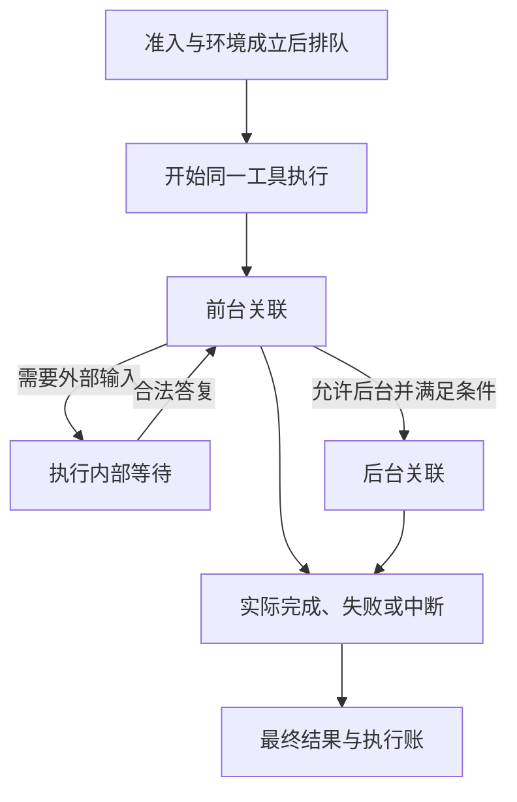

# 工具运行时

Tool runtime 管理一次工具的实际执行、等待、结果和收场。工具定义、会话已知能力视图与实际执行分别存在。知道某个工具、当前能够调用它、这次调用获得授权，是三个不同判断。

状态：已接受的目标架构。动作准入归[Loop extensions](loop-extensions.md#准入与-hitl)，环境供应归[执行环境](execution-environment.md)。两者都不代替工具实际执行的责任。

## 调用输入与身份

一次执行固定匹配的定义、实现、参数、设置、允许读取的 contexts、准入依据、环境、工作区和资源入口。保留调用身份、原消费位置、适用租户与逻辑工作关联，以及明确的控制关系。

发起后不能把新定义与旧实现拼接，也不能暗中改参数、换工作区或迁移到更宽松的执行环境。变化后的合法输入影响后续调用，旧调用仍按自身契约执行。

Agent runtime 只持有工具执行的访问和控制句柄。最后一个句柄释放、等待者退出或被替换，均不自动停止执行。调用方要停止工具时必须发出明确控制，实际停止结果由工具执行报告。

## 已知能力、可用性与排队

工具可用性在装配、attempt 开始和必需提供者变化时重算。会话初始化、新 Run 开始、显式 reload 和 Run 中的提供者变化各自允许哪些变化，由 Tool 契约的刷新点规则规定，见[刷新点允许的变化](../../../packages/tool/tool-contract/SPEC.md#刷新点允许的变化)。Run 中的提供者变化只改变可用性。必需依赖全部成立才可用；可选依赖在使用时探测。附件存储可用不够，消费者还须具备读取能力。会话中的模型交互路径还须让输入输出模态与当前模型及转换能力相容。独立工具调用按调用者与工具契约处理模态，不强制存在模型。

已知能力因撤权、卸载或依赖故障而不可用时，保留最近合法的身份与形状，用不可用应答说明原因。不能读取撤权后的新内容，也不能为从未合法取得的能力编造定义。

会话常驻工具被卸载或暂时不可用时，会话以同形替换件替代它。同形替换件是带原定义的 `known-unavailable`，调用它得到不可用应答。会话持久保存每个常驻工具首次装载的定义，这条会话事实是 `tool-resident-admitted`。常驻工具的 name 与参数形状在会话内不变，判据是与首次定义同形。

绑定登记表按登记键接受作者插件 fiber 的贡献。登记键由来源层、能力身份和资产版本组成。换代协调者 `toolGenerations` 装载作者插件，并按会话引用保留或撤除贡献。登记表与协调者的规则归 [Tool 契约](../../../packages/tool/tool-contract/SPEC.md#p15-配置声明与合法装载)和 [tool-host-local 的 Cordis 集成](../../../packages/tool/tool-host-local/docs/cordis.md#作者装载与贡献登记)。

动作获得准入后，选择合法环境并准备资源，再进入执行排队。同一会话、同一工具的并发限制计入前后台执行，超额按发起顺序排队，不直接冒充执行失败。实际发起时仍须核对有效推进权、工作状态和当前授权，排队前的判断不是永久许可。

## 脚本编排的调用方式许可

Tool Definition 的 `programmable` 决定该工具是否允许被 Agent 脚本组合或编排，只有显式 true 允许。默认与产品依据见[可编程调用许可](../../../.meta_harness/design/product/tool-execution/design.md#可编程调用许可)。它与当前动作授权、后台许可及常驻呈现分别判断。

受信发起协调者固定调用方式和来源，Tool 在受理及实际启动前核对目标许可。脚本可调用集合的筛选不代替逐调用检查；通用入口、SDK、MCP 和包装工具不能抹去编排来源。直接模型调用或普通独立 SDK 消费不因未声明而被禁止。具体字段、拒绝及原调用收束归[Tool 规格](../../../packages/tool/tool-contract/SPEC.md#342-值定义和固定请求)，不由 Cordis 配置产生许可。

## 前后台与内部等待

前台表示当前步骤等待本次执行结果，后台表示当前步骤可以继续。转后台改变等待关系，不创建第二次工具执行。

工具作者声明是否允许后台，缺省不允许。阈值、用户操作或插队可触发转后台，但不能突破声明。前台上限不计等待时间；到点后允许后台则转后台，否则被中断。

内部等待说明当前需要什么外部输入，输入可来自人、系统或其他 Agent。等待与前后台在概念上正交，但当前交付范围仅允许需要答复的执行在前台等待。`Ask()` 无超时和默认答案，当前不能转后台。

人的答复必须回原等待执行。普通会话消息不自动回答卡片，原执行已经确定终局时卡片作废。等待期间其他会话仍可运行，当前会话也继续可靠受理普通输入。

## 返回、结果与执行账

| 面向调用方的结果 | 含义 |
|---|---|
| 完成 | 本次执行已完成并提供结果。 |
| 失败 | 执行未正常完成，原因与已知效果分别交代。 |
| 不可用 | 能力当前不能执行，提供具体原因。 |
| 转后台 | 前台等待结束，原执行继续，尚非执行终局。 |
| 被中断 | 明确控制或适用上限导致中断。 |
| 等不到应答 | 按适用契约无法取得执行所需答复，不编造默认答复。 |

转后台后还须交付最终执行收场，不能再次以转后台充当终局。完整参数解析失败时不执行原工具，返回具体失败；这与模型流中参数尚未到齐不同。

工具结果含给消费者的内容及可选附件或卸载原文。作者在 content 用多模态 ref 声明模型直接感知，在 attachments 留地址供 agent 按需另行读取；附件只投影为文本，不自动载入。Agent、Session、Context 保管引用，Model 仅在实际请求时加载选中的内容 ref。精确规则归 [P14](../../../packages/tool/tool-contract/SPEC.md#p14-附件引用与模型交付)。过程帧给人观察，不能替代最终结果，帧发送失败也不单独使工具执行失败。执行账保存实际时长和资源用量，不直接塞进模型上下文。

成员契约规定普通函数返回与直接 ToolResult 在 settle 时归一化。具名程序数据与展示内容使用同一结果身份；Code 消费前校验输出声明和真实值，不解析展示文本猜业务字段。自定义等待固定请求和响应 schema，无效响应提交不结束等待。精确形状与边界归成员 [P12](../../../packages/tool/tool-contract/SPEC.md#p12-等待-schema-与响应提交)及 [P13](../../../packages/tool/tool-contract/SPEC.md#p13-双返回形态与程序输出契约)，不据设计声明运行支持。

会话路径在 Tool 已可靠保管结果的前提下，先保存内容或可恢复引用及原消费位置，或先完成处理并可靠保存必要完成事实，再凭对应证据解除原交付关系。工具全文没有现行到期清理规则，不能因压缩、Run 结束或归档使历史引用失效；模型 ACK 不自动成为工具 ACK。

### 不可用应答的分类边界

已知工具不可用的归类见产品[定义、已知能力与一次执行](../../../.meta_harness/design/product/tool-execution/design.md#定义已知能力与一次执行)。该结果进入执行账。真实工具没有运行。不能虚构真实工具的耗时、资源消耗或副作用。调用尝试和实际执行不分成两套账。

## 中断与失联

工具可被单独中断，不要求模型或 Run 同时结束。会话路径中，Run 取消停止其前台关联执行，后台执行按自身规则继续；会话归档请求停止两者。完整传播关系见[控制与恢复](control-and-recovery.md#取消与归档)。

工具自身确认失去运行连续性时，以失败和异常中断原因报告，系统不自动重放。即使推测效果尚未开始，也不能据此保证没有效果。实际副作用未知时保留未知，由合法调用方决定核查、补偿或另起动作。

只丢失 Agent runtime 时认回原执行。查询暂时不可用不等于已经确认工具执行丢失。节点或环境故障按真实影响范围处理，不泛化成全系统崩溃。

## 独立调用

独立程序调用直接提供合法输入、环境需求、结果消费和控制责任，无须通过完整会话界面或 Agent Loop。独立入口同样支持查询、停止及允许的转后台，并保持定义与实现匹配。

MCP 动作通过工具契约接入。远端刷新影响后续调用，断线保留最近合法清单的不可用解释，不为未发现过的动作伪造定义，也不自动重发已产生外部效果的请求。

## 依据

工具执行与独立入口的产品责任见[工具执行](../../../.meta_harness/design/product/tool-execution/README.md)。授权、人工等待和持久承接分别归[身份与授权](../../../.meta_harness/design/product/identity-and-authorization/README.md)、[人在回路](../../../.meta_harness/design/product/human-intervention/README.md)及[会话与工作](../../../.meta_harness/design/product/sessions-and-work/README.md)，按各自采用范围协作。

## 未决问题与待办事项

以下事项沿本页已接受要求继续承接。来源定位不表示现行契约已经完整或验证已通过。

### TOOL-T01 工具执行与原执行账契约承接

本项为契约承接待办。工具受理、执行身份、前后台、原结果、内部等待、停止及执行账的现行精确公开契约尚须对账。不可用应答的归类见上文「不可用应答的分类边界」。逻辑取消不证明物理执行或外部效果已撤回。

承接责任为工具执行公共契约、实际执行者、原记录及消费协调者。待办是定位独立入口和运行时消费者，验证原身份认回、参数冲突、可靠结果、内部 Ask 和后台工作，不以旧服务定义代替完整装配。

工具运行契约由 [Tool SPEC](../../../packages/tool/tool-contract/SPEC.md) 和 [公开定义](../../../packages/tool/tool-contract/docs/public-api.md)维护。具体提供者说明实际限制，并完成适用的故障验证。

## 成员协议与系统协作

本节说明 Tool 成员契约与系统的协作。ToolRuntime 是操作门面，独立 Tool 宿主驱动实例协程，实例目录只暴露观察句柄。持久调用、队列、等待、操作回执和未完任务由本域提交提供者保管，Agent 退出不撤这些责任。

实际启动采用具名许可与失效共同排序。Tool 先保存原启动与名额，受信执行边界在当前身份、工作资格、调用方式、批决定和固定绑定成立时消费唯一许可。资格失效先成立则禁止发出，启动受理先成立则按在途控制；不承诺撤回已发远端效果。各状态拥有者须在共同围栏失效后才能确认新发起已被阻止，不能只靠异步通知维持此保证。

Tool 侧完整 [操作协议](../../../packages/tool/tool-contract/SPEC.md#tool-操作协议)、[对象模型](../../../packages/tool/tool-contract/docs/object-model.md)及 [Cordis装配](../../../packages/tool/tool-cordis-contract/docs/cordis.md)拥有精确机制。环境准备/释放、等待答复、停止和检查点都使用原操作查询未知。原输出先保管后投影，过程先保存后展示，事实查询独立于活体目录。

Code 是 Tool 执行者的一种组合。原子调用按真实目标队列和当前资格发起，父子关联与未完责任先持久保存，父程序终止不销毁子调用责任。具体 [组合协议](../../../packages/tool/tool-contract/SPEC.md#code-与-tool-的组合协议)不替语言和执行环境提供者选型，也不改变 Code 的产品阶段。
