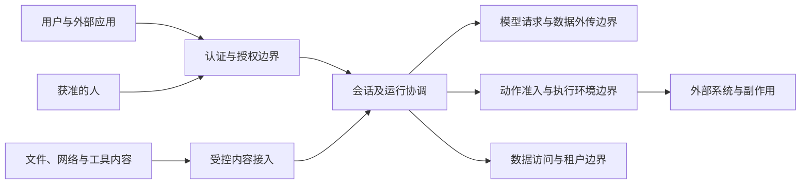

# 安全与隔离架构

本专题说明系统怎样识别调用主体、执行授权、隔离数据与资源，并防止不可信内容取得控制权。安全限制须在实际读取、调用和交付的边界成立，不能只写进提示词或依赖模型主动遵守。

状态：目标架构正文已获项目负责人接受。七页正文均已接受，具体未决范围见文末。项目要求拥有安全目标，产品规则拥有权限含义，各页拥有相应技术责任；本文不声明现有实现已经兑现这些保证。

## 阅读地图

| 正文 | 主要问题 |
|---|---|
| [保护对象与威胁模型](threat-model.md) | 保护什么，哪些参与者和内容不可信，保证依赖哪些前提？ |
| [身份与授权](identity-and-authorization.md) | 谁代表谁，怎样计算权限、准入和人工决定，撤权影响什么？ |
| [数据保护与隐私](data-and-privacy.md) | 谁能读取、传送和保存数据，秘密怎样使用，备份有什么边界？ |
| [执行与资源隔离](execution-isolation.md) | 哪些数据和资源可以共享，环境怎样限制实际代码和工具？ |
| [不可信内容与指令边界](untrusted-content.md) | 外部内容怎样进入模型，为什么不能自行授予操作权？ |
| [安全验证与符合性](assurance.md) | 哪些安全性质必须验证，谁提供证据，如何定位偏离？ |

修改授权和 HITL 时读身份与授权；接入模型、工具或遥测时读数据保护；装配插件、沙箱和执行节点时读执行隔离。不可信内容可以经过任何入口进入，因此对应读取与执行边界仍须查阅各自专题。

## 资产与威胁假设

保护范围包括租户内容、凭据、资产、工作进度、授权与人工决定、计量事实及实际执行资源。攻击者可能通过普通请求、工具输出、文件、网络内容或资产内容影响系统。一次登录成功、一次模型判断或一个合法文件路径，都不足以证明后续操作获准。

图中的边界表示必须承担的检查责任，不规定服务、线程或进程数量。哪些代码可以在同一进程内运行，以及宿主权限的保证范围，由[威胁模型](threat-model.md#保证前提与未覆盖范围)明确。

## 身份与访问控制

系统区分认证主体、资源归属和本次调用所代表的主体。权限由有效身份、适用组织与租户规则以及实际操作共同确定，不能由显示名称、当前连接或调用链上某个高权限服务代替。

动作执行须满足当前准入条件。明确禁止不能被会话模式、模型判断或人工临时批准覆盖。工作区提供内容和配置来源，不提供提权来源。HITL 是受约束的决定入口，其批准对象与失效条件由[身份与授权](identity-and-authorization.md)维护。

## 隔离与凭据保护

数据权限与执行隔离承担不同责任。租户过滤不能阻止任意本机代码读内存；沙箱隔离也不能代替业务访问检查。Cordis 的作用域用于装配与生命周期管理，安全效果须由实际访问路径和环境能力兑现。

| 边界 | 主要责任 | 详细正文 |
|---|---|---|
| 读取、订阅与导出 | 校验主体、数据归属、用途与当前访问资格。 | [数据保护](data-and-privacy.md) |
| 模型、工具与遥测外传 | 核对实际接收方和发送内容，筛选秘密及不允许传送的数据。 | [数据外传](data-and-privacy.md#模型工具与遥测的对外传送) |
| 代码、文件、进程与网络 | 只提供获准资源，禁止失败后静默切换到更宽松环境。 | [执行隔离](execution-isolation.md) |
| 内容到指令或动作 | 保留来源及权限区别，经过正式的授权和准入。 | [不可信内容](untrusted-content.md) |

凭据的取得、使用和撤销由专门接口承接，不作为普通 Runtime Context、日志或遥测数据传播。数据被保存过不代表永久允许读取，曾经允许读取也不代表允许发送给新的接收方。

## 安全验证责任

每项安全保证须能定位到执行检查的拥有者、必要输入和实际证据。跨边界性质由组合责任方验证，不能仅凭各模块单独通过测试就宣布成立。

重点核对跨租户读取、借高权限服务代操作、等待期间权限变化、沙箱不可用后的回退、秘密外传，以及旧备份恢复后的失效资格。[安全验证与符合性](assurance.md)维护这些性质和验证范围，具体场景与测试随实际拥有者保存。

## 采用状态与待明确边界

本专题以[项目要求](../../requirements.md#租户与身份隔离)、已接受的[运行架构](../runtime/README.md)及[数据与状态](../data-and-state.md)为上游输入。产品条款的精确采用范围仍沿对应 PF 入口，不因本次整合而扩大。

首版不承诺阻止主机管理员或原始数据、备份持有者读取其中内容。这一边界已确认，具体限制见[数据保护](data-and-privacy.md#存储备份与删除)。系统内的租户隔离、权限检查和外传控制仍须成立。

系统须支持不可信代码进入主进程，并按恶意代码设防，允许限制可用 Node API 和交互方式。[执行隔离](execution-isolation.md#插件装配与代码信任)列出所需保证；具体执行机制尚未选定，不据此宣称已有实现达标。普通成员的组织创作委托等既有产品缺口不在这里补成新政策。

后续仍须逐项核对提供者、部署条件和真实消费者。结构检查、文档接受和实现兑现分别记录；尚未完成的具体边界继续可见。
