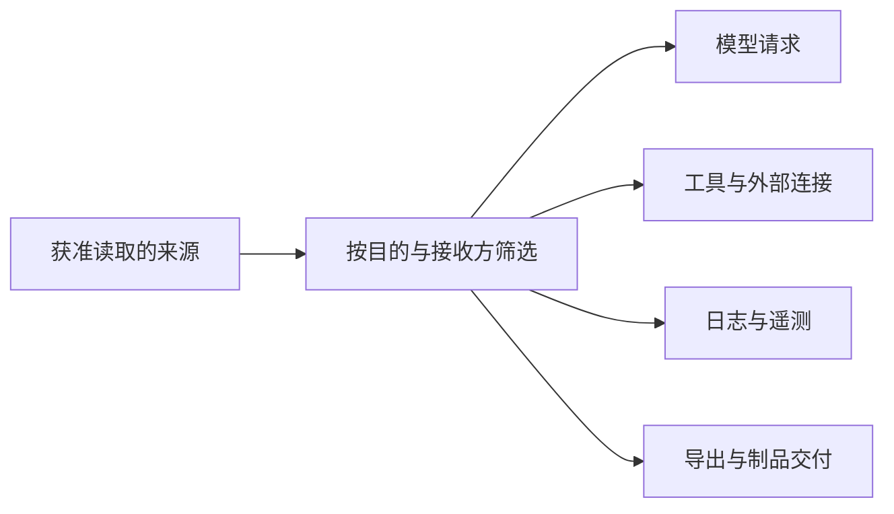

# 数据保护与隐私

本页说明系统如何限制数据读取、秘密使用及对外传送。保护对象包含原始内容、派生内容、元数据和凭据；不同环节分别检查目的、主体与接收方。

状态：目标架构正文已获项目负责人接受。首版不承诺阻止主机管理员或原始数据、备份持有者读取其中内容；这一保护范围已由负责人确认。它不取消系统内的访问控制、租户隔离和外传限制。

## 数据用途与可见范围

数据的业务拥有者定义允许的用途、读取者和保留规则。访问方须按实际操作取得许可，不能因为数据已进入系统，就用于任意模型调用、分析或遥测。

共享资产、租户私有内容和系统数据按各自归属处理。同一内容可以有不同的读取视图，但不能让派生摘要、索引、缓存或模态转换结果绕过原数据的访问限制。

Runtime Context 的块按声明的消费者提供。允许模型读取、允许工具读取和允许扩展读取分别判断，不能将整份上下文无差别转交。工具内部消息不因已经保存就自动进入模型请求。

工作区实例可被多个租户使用，文件可见范围取决于实际环境与访问规则。`.omne.local` 表示不参加共享同步，不承诺同一实例内的租户私有存储。租户秘密应交给明确提供相应保护的保存能力，而不是以文件名约定代替隔离。

## 凭据与秘密生命周期

秘密包括账号认证材料、登录出示物、模型或工具的访问凭据、签名密钥及其他可直接行使权限的数据。秘密是否存在、谁拥有它和能否取得它的值是不同信息；普通存在性查询不应解引用秘密。

实际调用方按身份、用途和相应绑定取得所需凭据。凭据不能作为普通模型上下文、扩展输入、错误详情或遥测内容流转。子进程只取得明确允许给它的变量，不能自动继承宿主的整份环境。

模型凭据通常归发起调用的租户，组织不能以成员共用凭据代替其租户绑定。官方模型档案使用部署默认凭据的既有例外按原规则处理。租户绑定存在但不可读取时，不能静默退回默认凭据或另一个租户的凭据。

凭据更换、登录撤销、持久保存和缓存失效须保持各自契约。已经取得的运行资源能否撤回须单独定义，删除配置不证明远端会话、文件描述符或已发请求已经停止。账号认证材料的具体派生方法、登录期限与代际规则由[身份契约](../../../packages/core/account-identity/SPEC.md)维护。

## 模型工具与遥测的对外传送

向系统外发送数据前，发送方须能回答以下问题。

1. 本次操作代表哪个主体，数据属于哪个范围？
2. 处理目的是什么，实际接收方是谁？
3. 哪些内容可以发出，哪些必须排除、裁剪或脱敏？
4. 发送结果如何记录，失败或结果未知时怎样处理？

能读数据不自动代表能向外部模型、工具、MCP 服务或观测端传送。更换模型提供者或连接目标时，应按实际接收方重新满足这些条件，不能沿用旧接收方的许可。连接配置本身不提供数据使用授权。

文字、图片、语音、附件和派生表示都属于实际发送内容。检查不能只扫描文字正文，也不能把图片链接、文件地址或音频转写视为天然无敏感信息。选择原件或转换件仍遵循[请求上下文](../runtime/request-context.md)的模态与完整输入规则。

日志和遥测保留诊断所需身份、阶段与关联信息，并按权限筛选正文。采样、脱敏失败和发送缺口须可识别；记录“已过滤”不能代替验证实际发出的载荷。远程排障不自动获得租户完整内容。

## 存储备份与删除

存储和备份沿数据拥有者的保留、读取与恢复契约处理。业务权限不能以数据库路径或备份文件的持有关系代替；备份操作和恢复后开放业务也属于需要授权的操作。

首版沿用既有主机保护边界。治理中心的部分模型凭据在原始数据及备份中可读，不应描述为已全面加密保存。部署密钥用于既定身份或信任机制，不意味着业务数据自动得到加密保护。部署者须据此控制机器、存储目录及备份的访问和分发。

恢复数据后，须防止旧凭据、撤销登录、成员与角色重新获得效力。恢复安全核对的可信材料和处置资格仍由原产品责任承接；不能仅凭从旧备份恢复的管理员身份批准重新开放。

删除正文、移除关系、清理缓存和删除备份具有不同后果。各拥有者明确相应范围，不能把一次应用删除宣称为所有副本立即物理消失。保留规则与耐久性由[数据与状态](../data-and-state.md)统一承接。

## 查询与错误中的信息暴露

查询、订阅、列表、错误和导出均可能披露数据。接口按其公开契约决定允许暴露的身份、类别和存在性，检查应早于内容返回；不能先返回完整内容，再让界面遮住未授权字段。

身份无效、没有权限、来源不可用和结果未知分别表达。既要避免通过错误细节泄漏私有对象，也不能把存储不可用伪装为对象不存在。具体失败集合和顺序由公开契约维护。

依据包括 [PF-013 模型凭据](../../../.meta_harness/design/product/PF-013-model-profiles-and-invocation/README.md)、[PF-017 治理中心](../../../.meta_harness/design/product/PF-017-governance-center-as-deployable-application/README.md)、[PF-020 工作区](../../../.meta_harness/design/product/PF-020-workspace/README.md)与已接受运行、数据架构。具体秘密读取范围还须满足其实际接口契约。
