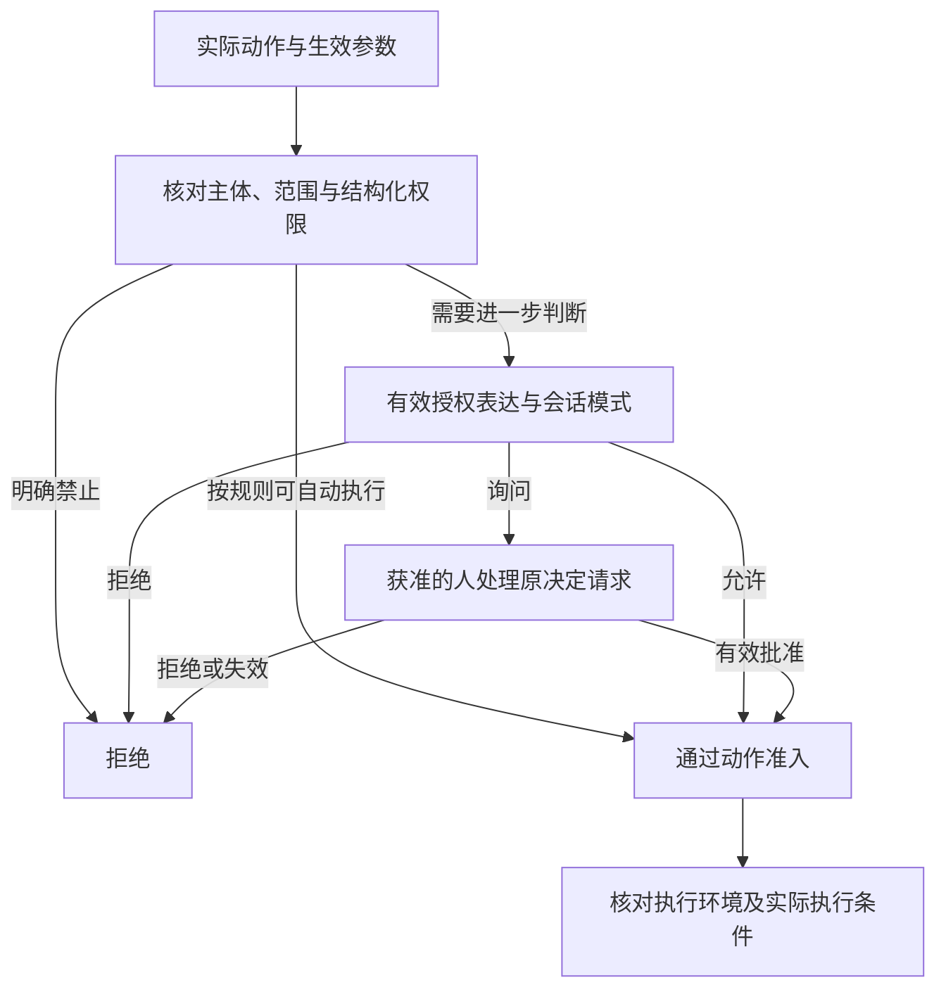

# 身份与授权架构

本页说明谁发起操作、操作代表谁，以及怎样从权限规则得到实际准入。认证、权限求值、人工决定和执行检查分别有责任，任何一项都不能代替其余环节。

状态：目标架构正文已获项目负责人接受。运行顺序与人工等待的持久接续由[Loop extensions](../runtime/loop-extensions.md)维护，本页维护安全含义。

## 主体身份与资源归属

自然人的全局账号与组织中的租户成员身份分开。受租户约束的资源和跨边界调用显式携带租户身份，不能把当前界面选中项、连接或宿主进程当作身份默认值。

认证主体、资源所有者、资产作者和实际执行者分别记录。Agent 代表某个主体运行，不因此拥有独立的无限权限。调用高权限服务时，服务须按该操作的授权模型校验原调用主体，不能用自身权限替越权请求放行。

组织管理员不自动取得其他成员的私有租户内容。系统归属的工作也须声明自身可用的能力和资源，不能只因没有租户就绕过所有检查。

持有 ID、句柄或历史记录只帮助定位对象，不能直接证明有权读取或控制它。对不应暴露存在性的私有对象，按对应公开契约统一不可见与不存在的表现。

## 权限来源与求值

组织、租户和 AgentDefinition 等来源提供各自允许声明的约束。锁定的允许集合构成上界，组合时取其共同允许范围。未锁定的值按规定由更具体的来源选择，但不能超出已有上界。明确禁止无论是否锁定都构成约束，不能被下层配置放宽。工作区参与内容和配置供给，不参与授予更高操作权限。

资产可见、允许持有、允许装配、允许调用和允许修改是不同问题。共享或复制关系只按对应规则改变数据可达性和归属，不自动授予工具执行、对外发送或再次分享的权限。

结构化权限决定必须遵守的边界，授权表达用于对应规则允许的判断。系统须保留本次使用的主体、操作、资源、参数和必要依据，使准入结果可解释。缓存权限时须明确有效条件及失效机制，不能把旧的允许结果无限沿用。

普通成员对组织资产的创作委托仍沿原拥有者的未决范围处理。本页不发明通用委托令牌、角色继承或权限转授协议，也不将管理角色推广成全部数据的访问权。

## 动作准入与人工决定

图中的通过仅表示动作准入通过，不保证环境可用或动作一定成功。授权模式只能在允许的范围内选择拒绝、询问或放行，不能覆盖结构化的明确禁止。具体求值顺序沿已接受的[准入与 HITL](../runtime/loop-extensions.md#准入与-hitl)。

人工决定绑定原等待点、操作和生效参数。参数改写后，人看到的内容与实际执行内容须一致。改变实现、参数或影响决定的授权依据时，不能自动借用旧批准。

卡片答复者须有当前决定资格，同一卡片只产生一次有效决定。决策池和会话界面使用同一份决定，不生成彼此独立的批准。原执行已经终局的卡片失效，系统不能替人补答或默认超时批准。

HITL 也不能解除执行环境的限制。获准的人可以作出规则允许的决定，但不能通过普通批准把沙箱要求改成不受限制的宿主执行。

## 撤权与在途工作

权限和成员关系变化作用于相应规则定义的后续准入。已经进入实际执行的工作如何停止，由独立的控制与取消协议决定；撤权通知本身不等于工具停止，也不撤销已经发生的外部效果。

会话级授权不会因归档与恢复自动清除，撤销须显式表达。单次授权按其规则在所属 Run 终局时清理。运行时实例回收不等于授权撤销，恢复实例也不能重新生成已经消耗或撤销的授权。

排队、等待人答复和恢复会跨越权限变化。继续推进前须按原操作契约检查当前准入资格，不能把入队时允许或旧登录状态当作永久许可。具体检查与提交需要共同成立时，由拥有者定义原子边界，不由普通通知模拟。

撤权后的观察、读取结果和消费确认也各有权限条件。停止向已失去资格的读取者交付内容，不免除原生产方或合法承接方的保管责任。归档、取消和权限变更不能让工作变成无人负责。

授权、时间或成员状态不可取得时，保持未知并阻止依赖该允许结论的新动作。可以明确拒绝的分支照常拒绝；不能把服务不可用伪装成允许或制造成功事实。

## 独立调用与跨边界身份

Session 外独立调用也须明确调用方、资源范围和授权责任。纯计算能力可以只处理调用方提供的数据；一旦访问系统托管数据或资源，实际集成方必须兑现相应访问契约，不能靠“未启动 Cordis”跳过检查。

系统内部创建子 Agent 时，其权限不得超出父方当前权限与子方请求权限的交集。`spawn` 按规则复制派发时的上下文，`delegate` 只传递委派指令，不因此取得父方整份上下文。权限与上下文分别计算，复制内容不能扩大操作权限。

外部 harness 不自动继承系统内的授权。向外发送任务本身属于数据外传，返回内容按外部输入处理。系统只承诺实际协议能够实现的控制，不能把内部子 Agent 的约束直接套作外部执行保证。

网络入口只接受其认证协议认可的身份材料。裸账号 ID、证书、IP 和过去的连接不自动构成当前登录资格。传输保护和业务认证分别验证；具体协议与登录期限归真实公开契约，不在每个架构页重写。

跨进程或节点传递的身份与授权依据须能验证来源、适用对象和有效条件。仅传一个调用方可任意修改的租户字段不能证明授权。实现同样须保护后台任务与恢复路径，不能只有用户前台路径执行检查。

身份与租户边界的当前产品责任候选见[身份与授权](../../../.meta_harness/design/product/identity-and-authorization/README.md)，资产权限见[资产与规则](../../../.meta_harness/design/product/assets-and-rules/README.md)，准入责任也见[身份与授权](../../../.meta_harness/design/product/identity-and-authorization/README.md)，人工等待见[人在回路](../../../.meta_harness/design/product/human-intervention/README.md)。这些 topic 仍为草案，已接受运行架构继续有效。登录和治理入口的精确承诺须由实际公开契约拥有；[IDENTITY-T01 账号登录与凭据公共契约承接](identity-and-authorization.md#identity-t01)与[IDENTITY-T02 治理入口的精确边界承接](identity-and-authorization.md#identity-t02)分别定位当前公开契约与实测证据的承接待办。

## 未决问题与待办事项

以下事项沿本页已接受要求继续承接。来源定位不表示现行契约已经完整或验证已通过。

### IDENTITY-T02 治理入口的精确边界承接

本项为契约承接待办。治理入口的可信登录、显式租户、准入、拒绝表达和校验次序尚须定位当前公开契约。已核实的租户冲突仍须拒绝，认证不可用不能伪报为已确认的冲突。

承接责任为治理入口、身份与授权及客户端维护者。待办是明确实际接口和消费者，验证冲突、不可用、撤权及后台路径；既有 Session 和 Run 的固定归属不因入口选择改变。

[封存来源](../../../packages.0.0.1.legacy/core/governance-center-entry/SPEC.md)仅供核对原范围和消费者；旧接受记录、归档位置与已有测试不能授予冲突设计继续采用。实际限制、待设计输入及验证结果须由各自当前拥有者确认。

### IDENTITY-T01 账号登录与凭据公共契约承接

本项为契约承接待办。账号、登录、凭据校验、签发与换代的精确公开行为尚须定位当前身份及提供者拥有者。认证材料派生、登录期限和代际不能由调用方或数据保护入口另行定义。

承接责任为身份公共契约、凭据及登录提供者与实际消费者。待办是确认当前类型及必要行为，验证共同提交、过期和撤销、实例换代与不可用分类，不复活旧登录或扩大秘密读取资格。

[封存来源](../../../packages.0.0.1.legacy/core/account-identity/SPEC.md)仅供核对原范围和消费者；旧接受记录、归档位置与已有测试不能授予冲突设计继续采用。实际限制、待设计输入及验证结果须由各自当前拥有者确认。

## 本阶段不提供的打开路径

接受本节之前，不改写本页已经接受的准入、撤权和跨边界句子。那些已接受句子保持原效力。

0.0.0 到 0.1.0 的交付是单机。持久状态在这台机器上。进程崩溃、操作系统崩溃或断电后，已确认事实按本页和耐久要求恢复，不因此增加一次人工批准。介质或整机损毁后，本阶段没有另一份系统内副本，也不提供从旧备份重新打开的路径。旧备份中的管理员角色不授予开放权。以后若有阶段承诺机外副本，必须先另定开放政策。
