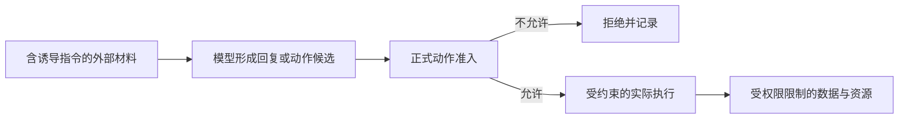

# 不可信内容与指令边界

本页说明内容怎样影响模型与业务，而不取得其本来没有的操作权限。内容可信度与代码信任分别处理；这里不承诺仅靠提示词或内容检测消除所有提示注入。

状态：目标架构正文已获项目负责人接受。数据和动作的实际访问控制继续由其拥有者执行。

## 内容来源与控制权限

用户可以经获准入口提交请求，外部页面、工具结果、检索材料和其他 Agent 返回的内容则可能含有伪造指令。系统须保留这些来源和用途的区别，不能因内容声称自己是系统消息、管理员命令或授权证明，就改变它的权限。

| 内容来源 | 可以参与的处理 | 不自动获得的效力 |
|---|---|---|
| 用户通过合法入口提交的请求 | 表达任务、选择及规则允许的指令。 | 绕过组织限制、取得其他租户数据或修改自身权限。 |
| 网页、文件、检索及外部 Agent 返回 | 作为任务所需资料，供获准的模型或工具处理。 | 冒充系统控制、确认、凭据或新的授权。 |
| 模型回复与工具调用意图 | 形成待检查的输出或动作候选。 | 直接执行工具、变更权限或证明任务已完成。 |
| 资产内容与工作区配置 | 在资产与配置规则允许的范围内贡献内容。 | 改变身份、权限边界、执行落点或隐式装载任意宿主代码。 |

资产中本来就允许表达的指令仍须经过正式的发现、选入和装配，不因“不可信内容”一词一概失去产品用途。关键是按真实来源与采用流程取得效力，不能由正文自报身份。

## 模型上下文与内容转换

上下文组装保留系统指令、用户请求、历史消息与外部材料的角色和来源，按各自可见性及用途选择内容。摘要、翻译、转写和模态转换不应抹掉会影响安全判断的来源区别。

图片、音频、附件名称和链接同样可能携带诱导内容。把它们转换成文本不表示可信度提高；改用另一种模型表示也不自动改变外传许可。

工具内部数据仅供相应消费者使用，不能为了调试或便利而自动塞入模型。请求上下文缓存须绑定来源及有效范围，不能把另一个租户的内容或已失效的允许结果混入本次输入。

## 动作边界与提示注入

提示注入可以试图让模型更换目标、泄漏秘密、调用额外工具或伪造批准。系统可以检测和提示风险，但对动作的限制必须由实际准入、数据访问和执行环境继续执行。

模型输出不能直接作为身份、权限、签名、付款完成或其他业务事实的证据。输出中的工具名和参数仍须匹配真实可用能力及当前规则；工具结果也不能自行宣称接管下一步控制。

外部调用返回未知时，系统不能接受内容中自报的“已成功”作为唯一依据。原调用拥有者按实际协议确认结果，不让模型生成的叙述覆盖真实状态。

## 扩展与人工决定的限制

扩展的干预力由正式声明、所处位置及上层约束共同决定。外部 hook 的允许意见不能解除系统禁止，也不能由其返回文本扩大自身权力。工作区来源的权限和落点类配置按产品规则过滤。

HITL 页面应让人看到真实动作、生效参数、涉及资源和必要风险信息。外部内容自称“用户已经批准”不能替代原等待点的有效答复。模型或插件也不能代替获准的人回答系统卡片。

防护效果须用诱导外传、角色伪装、工具参数更换和旧批准复用等场景验证。检测漏报时仍应由下游权限与隔离边界阻止未获准行为；不能仅以模型拒绝了几条恶意提示就宣布边界可靠。

依据来自 [PF-007](../../../.meta_harness/design/product/PF-007-meta-capabilities/README.md)、[PF-010](../../../.meta_harness/design/product/PF-010-context-management-and-assembly/README.md)、[请求上下文](../runtime/request-context.md)和[Loop extensions](../runtime/loop-extensions.md)。具体提示格式与检测技术由相应实现设计，不能替代本页的控制责任。
