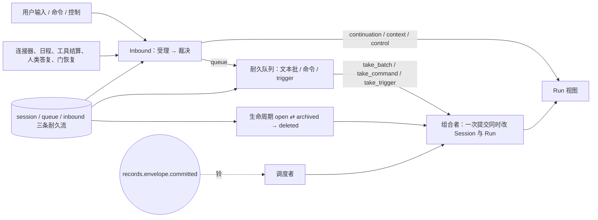

# Session

本页是 Session 的系统视图；选择依据见[提案](../proposals/session-run-agent-lifecycles/README.md)
与 [D-014](../decisions/D-014-session-run-agent-lifecycles.md)，精确承诺归
[session v2](../../spec/capabilities/session/v2/contract.md)（[D-015](../decisions/D-015-tool-execution-message-stream-and-hooks.md)
发布：入站裁决按 Run 的等待登记簿、系统来源与 hooks 续跑来源、取入既有 Run、历史派生表与
快照读面、`frames(S)` 流；v1 冻结可引用）。Session 只拥有自己的身份、
生命周期、历史、耐久队列、Inbound 到达账本、会话级 hold、状态贡献注册与恢复顺序；
Run 归 [Run 视图](run.md)，实例归 [Agent 运行时](agent-runtime.md)，三者的关系与级联归
[生命周期组合 v2](../../spec/compositions/session-run-agent-lifecycles/v2/contract.md)。
目标提供者尚未实现；当前 fork 的映射见[提供者设计](../../packages/session/session/design.md)。

## 系统位置

Session 有三条耐久流（session、queue、inbound），与 Run 流写同一协调域，由同一个
[CC v2](../../spec/compositions/core-work-coordination/v2/contract.md) 协调者提交。持久格式
是语言与后端无关的记录模型（[DR v1](../../spec/capabilities/durable-records/v1/contract.md)）；
JSONL 只是一个提供者。

## 已确认的选择

- **生命周期只有三态。** `open ⇄ archived → deleted`（[SE-02](../../spec/capabilities/session/v1/contract.md)）；
  归档与删除的前提是没有非终态 Run，前提在门内读 Run 状态，成功后同一提交关闭未取批
  队列项与未消费 arrival；封闭新激活，空闲实例由宿主对 archived 事实反应关闭。
- **一次 Run 恰有一个启动依据。** 连续文本批、有序命令或 trigger（[SE-06/07](../../spec/capabilities/session/v1/contract.md)）；
  运行中不接收新输入，用户中途插入走 `interrupt_then_run`（[SE-08](../../spec/capabilities/session/v1/contract.md)）。
- **异步到达统一裁决。** 一切异步到达先受理成 arrival，再由不依赖驱动器的裁决者按裁决
  时刻的 Run 状态判为 queue / continuation / context / control 之一并耐久记录
  （[SE-12～14](../../spec/capabilities/session/v2/contract.md)）；同一事实只有一条进入驱动器的路径；
  是不是接续只看 holder 在其发起 Run 的等待登记簿上有没有开放登记（[run v2](../../spec/capabilities/run/v2/contract.md)）；
  已终态 Run 的晚到回调作为 trigger 开新 Run，被 cancel / force_stop 的 Run 的晚到结算只关闭。
- **等待中的 Run 会取入排队文本。** Run 在 `waiting` 的空闲点由驱动器取入队首合格文本开一步，
  不必等所有前台调用回来（[SE-06/15](../../spec/capabilities/session/v2/contract.md)，PF-013.C5）；
  被越过的 Run 留下的工作清单作为系统来源的上下文由下一个有模型 Step 的 Run 消费一次。
- **历史是派生表，快照只有一个时刻。** 派生 `Message` 按 `(seq, index, ordinal)` 定位；全量重取
  从 projection 的一个水位取全部视图，请求与调用由 HD / tools 注册的贡献裁剪
  （[SE-03/10](../../spec/capabilities/session/v2/contract.md)，[消息流视图](message-stream.md)）。
- **占位由 Run 状态派生。** Session 不单独记录"当前 Run"；占位是该 Session 中唯一处于
  running / waiting* / stopping 的 Run（作者裁决 [A-13](../proposals/session-run-agent-lifecycles/README.md#作者裁决)，
  [LC-02](../../spec/compositions/session-run-agent-lifecycles/v1/contract.md)）。
- **恢复有硬顺序。** records 重同步 → 各流 fold → Session 校验 → 裁决扫描 →
  投影重建 → 在途核实 → 资格重取 → 调度重取（[SE-11/18](../../spec/capabilities/session/v1/contract.md)）；
  裁决扫描完成是任何重取的前提。
- **checkpoint 不是权威。** 驱动位置从 Run 事实 fold 得到，投影缓存只加速
  （用户裁决 [U-23](../proposals/session-run-agent-lifecycles/README.md#裁决记录2026-09-14用户)）。

## Cordis 位置

Session 是独立插件 `omneSession`，与 `omneRun` 互不 required inject（作者裁决
[A-12](../proposals/session-run-agent-lifecycles/README.md#作者裁决)）。凡同时涉及两者的操作落在
同包的三个宿主级插件：裁决者 `omneInboundAdjudicator`（消费 arrival、启动扫描）、调度者
`omneSessionScheduler`（响应铃，决定取批或重取，先找 ready 实例再激活）、组合者
`omneLifecycleCompositions`（`take_*`、`run_settle`、`session_archive/delete`、
`session_force_stop`、`interrupt_then_run_accept` 各一个具名的一次 batch 提交）。
插件依赖图、装载效应与撤除责任见[提案 Cordis 视角](../proposals/session-run-agent-lifecycles/cordis.md)，
提供者归 `packages/session/session`。

## 证据与缺口

[生命周期组合模型](../../spec/compositions/session-run-agent-lifecycles/verification.md)覆盖
归档前提、占位唯一、终态后接续处理与恢复重取；队列顺序、命令与强停仍由
session-run v1 的 `QueueControl` 模型承担；Inbound 裁决与驱动器交互由
[RunDriver 模型](../../spec/capabilities/run-driver/verification.md)与
[调用生命周期模型](../../spec/capabilities/tools/verification.md)承担；客户端一侧的水位由
[游标模型](../../spec/capabilities/message-stream/verification.md)承担。尚未完成：
事件词汇与 envelope 的 JSON Schema；通知作用域过滤的实现；session 与 projection 提供者
设计按 v2 修订；真实提供者与恢复顺序的崩溃注入验收。
