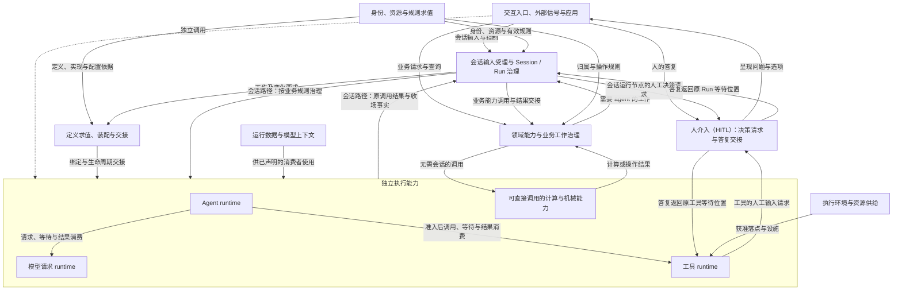
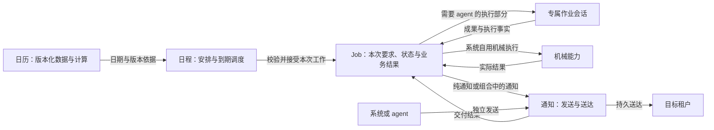

# 总体结构与责任

本页说明系统应当由哪些部分组成、各部分负责什么，以及它们怎样协作形成完整的 agent harness。领域能力拥有各自的业务事实和工作状态，通过公开契约使用模型、工具、Agent 及其他计算与执行能力，并按业务规则处理结果。会话是组织 agent 工作的一种路径；系统还支持无需会话的查询、机械操作和通知交付。

状态：已接受的目标架构。它接续[项目要求](../requirements.md)、[架构目标与约束](drivers-and-constraints.md)和负责人已明确的责任边界，总体分组与协调分工已获接受。本页不从当前源码反推设计，不表示具体模块或协议已经实现。具体未决项和旧源切换见[架构入口](README.md#采用状态与当前有效源)。

本页明确状态、资源、生命周期与跨模块保证的责任归属。具体状态机、执行时序与恢复过程归[运行过程](runtime/README.md)，数据格式、一致性与持久化规则归[数据与状态](data-and-state.md)，安全机制归[安全与隔离](security/README.md)，节点拓扑与环境装配细节归[部署拓扑](deployment/README.md)。领域内部结构与精确接口由各自拥有者维护。

## 系统分解与结构图

### 三条分解轴

系统按三条相互交叉的轴理解。每条轴回答不同的问题；轴上的名词不直接对应一个包、服务、进程或数据库表。

| 分解轴 | 回答的问题 | 必须分开的概念 |
|---|---|---|
| 身份与资源 | 谁在什么范围内，能够使用哪些资源和规则？ | 账号、组织、租户、工作区与系统自用工作的归属；资产身份与持有、实现选择、设置求值、权限求值。 |
| 工作与执行 | 哪一份业务工作需要持续，由哪些执行完成它？ | 领域业务工作及其状态，例如日程的 Job、会话的 Session/Run；执行尝试、三类 runtime，以及可直接调用的计算与机械能力。 |
| 运行条件 | 当前工作按什么方式推进，能看到什么，实际在哪里执行？ | 会话的三个模式轴、Runtime Context、模型上下文、执行环境。 |

账号、组织、租户和工作区不组成单一包含链。账号表达全局身份，租户表达组织与账号关联下的身份及隔离范围；工作区是可以由多个租户参与的资源。已有工作的租户归属不随账号切换当前租户而改变。

系统自用机械工作可以归系统，不借用某个人的租户，也不通过特殊租户表示系统归属。系统归属、操作发起者与通知接收方分别表达；向某租户发送通知不转移来源工作的所有权，系统工作也不自动获得读取租户私有数据或跨租户发送的权限。

资产可用、设置有效和动作获准是三个判断。工作区来源可以参与资产及设置求值，但不能因此成为授权来源；同一工作区的参与者也不自动共享彼此的私有资产、设置或凭据。

Session 的授权处理方式、逐工具执行环境策略和协作方式分别表达。Runtime Context 提供有明确生产者与消费者的运行数据，模型上下文组织一次请求实际使用的输入，执行环境提供动作的落点与设施。它们不能合成一个包揽规则、数据与资源的对象。

三条轴用于辨认不同问题，不要求每项能力都具有轴上的全部对象。日历计算不需要会话模式，系统机械工作不需要租户会话。领域责任仍须按业务含义识别；这张分类表不直接枚举全部能力，也不要求不同业务工作采用统一基类或状态机。

分解以独立责任、事实权威和变化边界为依据。正交允许必要依赖；一项能力的变化应通过明确契约影响其他能力。多个能力组合后才能成立的保证，由指定协调责任承担。

### 总体协作关系

图表示主要协作，不规定调用时序、源码依赖或物理部署。动作准入、数据保护、持久化和工程观测按下文分工贯穿这些关系，独立调用同样须满足自身契约。图中向执行能力的入口不代表绕过这些约束。

“领域能力与业务工作治理”表示各领域自己的责任，不是一个集中管理全部业务的服务。“可直接调用的计算与机械能力”也不是第四类通用 runtime；它表示普通函数或具有自身执行契约的能力，无须经 Agent Loop 或工具包装才能使用。

HITL 负责把决策请求呈现给获准的人，并将答复关联回原等待位置。会话运行节点与工具执行可以分别等待人的输入；等待、恢复和后续推进仍由原工作或执行的拥有者负责。图中的 Session/Run 连线表示会话路径的治理与关联，不要求答复必须经一个仍在运行的 Agent runtime 才能交接。人工输入可以是补充信息、选择方案或授权决定；答复的含义由原请求的契约确定，不自动授予执行权限，也不表示所有调用都需要人工批准。

交互应用通过公开接口使用领域能力。日程、日历和通知等能力拥有各自的业务事实；它们调用模型、工具或会话时，不接管被调用能力的执行事实，被调用能力也不接管它们的业务状态。工具可以提供访问入口，但不决定业务归属。独立模型调用、工具调用及其他应用工作不必为复用能力而创建隐式 Session。

以下用日程说明领域能力如何组合。日历提供计算依据，日程接受并治理一次 Job，通知负责送达；需要 agent 的执行部分才使用专属作业会话。

图中的 Job 可以先于作业会话存在；尚未开始的工作由日程负责等待和取消。纯通知及系统机械 Job 不创建作业会话。日历更新影响尚未接受的候选；已接受 Job 的本次要求与依据保持不变。执行、通知及 Job 整体结果分别记录，后者由日程按本次工作要求判定。当前产品责任候选见[日程与作业草案](../../.meta_harness/design/product/schedules-and-jobs/design.md)，其新 Job 语义仍待接受；本图不据此扩大既有架构承诺，也不规定存储与调度实现。

## 职责与公开边界

### 核心职责

下表列出通用责任及本页展开的领域责任，不是全部产品能力的清单。一个分组内可以有多个独立契约；同一提供者也可以兑现多个契约。具体拆分须保留事实与保证的拥有者，不能由目录或插件数量决定。

| 责任 | 拥有的事实或决定 | 公开边界 |
|---|---|---|
| 身份与范围治理 | 账号身份、组织成员关系、租户身份及相应治理状态。 | 向操作提供可信主体与范围；区分租户业务与系统自用工作，资源访问仍由相应操作核验。 |
| 资产治理与实现选择 | 资产定义、持有、复制分享关系、来源资格与实现选择。 | 提供可采用的能力及来源依据，不将可用性当作授权。 |
| 设置与权限求值 | 各自规则的来源、合成与有效结果。 | 为装配和使用时判断提供依据；不同合成规则分别维护。 |
| 工作区资源 | 工作区、参与关系、实例及地址。 | 提供获准的资源关联；实例、目录、逻辑身份及授权分别表达。 |
| 会话输入受理与工作治理 | 会话输入到达及承接事实，Session/Run 的状态、消费位置、等待与推进资格。 | 治理会话路径；区分已受理、已承接和已生效，不替代其他领域工作或底层执行事实。 |
| 日程与定时工作 | Schedule 及其内含工作描述、候选处置、Job 的接受、采用依据、业务状态与结果。 | 使用日历计算，治理等待、取消及执行和通知的组合；需要 agent 的部分交给作业会话，Job 不等同于 Run。 |
| 日历数据与计算 | 日历身份、供应依据、不可变版本、覆盖范围与日期计算含义。 | 提供可复核的计算结果和供应状态；日程拥有候选的最终校验与接受，Runtime Context 和存储不接管日历语义。 |
| 通知与交付 | 通知发送、目标租户、交付状态及尚未完成的送达责任。 | 支持有无 Schedule/Job 来源的调用；区分发送受理、持久送达和已读，不用成果提交代替送达。 |
| 定义求值与装配交接 | 定义采用、实现与配置绑定、装配结果及交接关系。 | 产生明确的执行条件，变化时承接既有工作与在途责任。 |
| Agent Loop 与 Agent runtime | 下一步的求值规则，以及按规则推进工作的实际执行。 | Loop 求值与动作执行分开；推进者使用其他能力的公开接口。 |
| 运行数据与模型上下文 | Runtime Context 的注册与消费关系，模型输入的组装、选择和压缩规则。 | 数据块内容仍归生产者；模型输入是有来源的派生结果，不改写原始事实。 |
| 模型请求 | 一次模型调用的输入、执行状态、原始输出、收场与费用。 | 返回结果供实际消费者处理，不执行模型回复里的工具建议。 |
| 工具执行 | 一次工具调用的输入、执行状态、结果及外部效果。 | 在准入与环境条件下执行，报告取消、失败和不确定效果。 |
| 动作准入 | 适用权限与授权依据下的准入决定。 | 判断动作是否可执行；需要人工决定时使用 HITL，答复仍按相应权限与准入规则解释。 |
| 人介入（HITL） | 决策请求、卡片、人的答复及其关联关系。 | 向获准的人呈现请求，将答复交回原等待位置；后续执行与推进由原拥有者负责。 |
| 执行环境与资源供给 | 执行落点、设施能力及所供资源的生命周期。 | 满足工具声明的环境条件；环境可用性与业务授权分别核验。 |

领域的定义、业务状态和完成条件由该领域能力拥有；执行能力拥有实际调用与外部效果。一次业务工作可以组合多次调用，其生命周期和成功条件不由某个 runtime 的退出决定。日程中的工作描述也不因可被复用而自动成为独立资产或独立管理对象。

持久化负责按契约保存和读取，业务事实的含义、变化条件和保留义务仍由业务拥有者决定。工程观测负责关联和输出诊断信息，不成为业务状态的第二份权威。各能力还须声明对凭据及其他秘密的使用、保管和释放边界，不能将秘密值作为普通运行数据传播。

### Session 治理与三类 runtime

Agent runtime、模型请求 runtime、工具 runtime 的执行生命周期分别管理。架构须允许它们独立创建、运行、停止、替换与回收；某一类 runtime 的等待、退出或重建，不自动决定另一类 runtime 的生命周期。

Session 承担逻辑治理职责，按会话的业务规则控制相关 runtime 的运行与生命周期。这里的治理关系不规定三个 runtime 共享执行栈、线程、进程或 Cordis fiber，也不要求把它们组织成随父实例一同销毁的执行树。

| 责任 | 拥有什么 | 与其他执行的关系 |
|---|---|---|
| Session | 会话归属、业务状态与治理规则。 | 按规则发起、取消或关闭指定工作，协调需要共同处置的执行。 |
| Run | 一次逻辑工作的身份、消费位置及结果关联。 | 工作可以跨 runtime 实例接续；Run 的业务终态与各执行的实际收场分别记录。 |
| Agent runtime | Agent Loop 的实际推进及本次推进资源。 | 通过调用句柄和结果等待模型或工具；自身回收、替换不自动结束所引用执行。 |
| 模型请求 runtime | 模型请求的实际执行、输出、收场及所属执行资源。 | 向实际消费者交付结果，按明确控制操作和自身契约处理取消、失败及资源回收。 |
| 工具 runtime | 工具的实际执行、状态、结果及所属执行资源。 | 按明确控制操作和自身契约处理取消、失败、外部效果及资源回收。 |

Agent runtime 等待模型结果，是推进 Agent Loop 所需的数据与控制依赖，不据此获得模型执行的生命周期所有权。Agent runtime 可以在等待期间释放或重建推进实例，后继实例按原工作与调用身份接回结果；模型或工具执行的实际状态仍由各自负责。

业务规则要求多个执行共同取消或关闭时，由治理与协调责任显式发起，并分别确认实际收场。取消请求、推进实例退出、底层执行结束和外部效果撤销是不同事实，不能互相替代。

从线程模型看，三类 runtime 是可分别调度的执行活动，通过明确的调用、等待、结果和控制接口协作。线程、协程、进程及 Cordis 装配是实现映射，不由调用关系或等待关系直接决定。共享执行资源的实现仍须保留上述生命周期边界，并说明资源失效时的影响范围。

会话外独立调用由调用应用明确提供生命周期治理与结果承接责任，不要求创建隐式 Session。Session 是会话路径的逻辑治理者，不能据此要求所有独立调用采用同一种物理宿主。

### 执行事实与结果承接

生命周期解耦之后，执行事实与消费事实也须分别拥有。模型请求或工具执行的实际状态、原始输出、收场及费用等事实，由相应能力拥有；结果是否被采用、是否已处理以及怎样推进后续工作，由实际消费者拥有。Session/Run 的推进事实不替代原调用事实，runtime 的执行完成也不自动表示消费者已接收或采用结果。

| 责任 | 保持的事实与保证 |
|---|---|
| 执行能力 | 报告实际执行状态、结果及其归属，保留尚未完成的交付或结算责任。 |
| 结果保管与交接 | 在下一承担者可靠接手前，保持所需内容或可恢复引用及交付责任；通知和临时句柄不代替保管。 |
| 结果消费者 | 记录处理或承接结果及原消费位置，按业务规则决定采用、拒绝或继续工作。 |
| Session/Run 治理 | 在会话路径中维护逻辑工作的消费位置与推进资格；迟到结果仍按原调用归属处理，不据此重开已终结的工作。 |
| 领域业务治理 | 维护所属业务工作的状态与完成条件；分别承接执行和交付结果，调用完成不自动成为业务成功。 |

上述责任不要求分别建立服务或存储副本。业务事实保持明确的权威拥有者；具体保存、索引与交接机制由数据和运行专题展开。执行结果、待交付副本、消费方历史和派生缓存具有不同用途，不能统一用“已消费”作为删除依据。

会话需要可靠消费的数据须先持久保管再交接；没有 Agent runtime 在场时，交接责任仍须能够接续。消费者失败或暂时不可用，不改变已经发生的执行事实，也不自动允许重新执行产生外部效果的动作。后继消费者按原调用身份和消费位置接回工作。

结果取得、可靠承接、业务采用、调用收场、费用结算及资源释放分别判断。模型结果确认及副本清理沿其明确的 ACK 契约；工具结果的保留和清理由工具契约约束，不因模型存在 ACK 而推定工具也有同一协议。会话外调用由实际调用应用明确结果承接责任。

面向用户的通知交付还有独立的送达责任。以执行并通知的 Job 为例，执行成功后通知仍可待送达；通知重试保留原执行结果，不能重新执行工作来补发通知。通知是否送达由通知能力确认，Job 是否整体成功由日程按本次声明判断。

### 组合保证由谁承担

协调者负责组合关系与交接规则，参与方仍对自己的事实和公开承诺负责。协调不意味着把所有状态收进同一对象或让所有执行共享一个生命周期。会话日志里的事实按拥有者分开。记入标准见[必须进入日志的事实](runtime/session-and-run.md#必须进入日志的事实)。Session 不持有其他领域的事实。

| 整体保证 | 协调责任与参与方 | 必须明确的边界 |
|---|---|---|
| 输入受理后工作不丢失 | 输入受理协调到达事实、去处责任与持久化。 | 受理成功须有可恢复的承接依据；去重、提交和确认不能留下无人负责的间隙。 |
| 同一会话有唯一有效推进者 | Session/Run 治理与装配交接协调新旧推进者。 | 新实例接手不能与旧推进权重叠；原调用结算与新动作准入分别处理。 |
| 业务接受与后续执行一致 | 业务工作拥有者协调候选校验、接受、等待、启动与取消。 | 按所属契约区分接受时固定的要求与运行时可变条件；开始前取消成立后不能再启动，恢复不能抹去已经接受或取消的事实。 |
| 执行与交付形成真实业务结果 | 业务工作拥有者协调执行能力和交付能力。 | 各部分分别记录结果；整体成功须满足业务声明，补做交付不重新执行已完成工作。 |
| 动作同时满足授权与环境条件 | 动作发起协调准入、环境供给及实际执行入口。 | 条件须在适用时点核验；等待、换代和重试不自动延续旧许可。 |
| 工作及结果可恢复 | 工作治理协调原执行者、结果保管者与实际消费者。 | 保留原工作、调用及消费位置；无法确定外部效果时不能推定未执行。 |
| 动态变化不造成系统性停机 | 装配交接协调变化来源、受影响能力及在途工作。 | 已发执行与未发动作分别处置；撤除贡献、关闭执行和业务终结分别确认。 |
| 故障影响可控 | 故障能力、依赖它的消费者及工作治理分别承担处置。 | 明确受影响范围与恢复条件；兜底优先无副作用，且不能放宽授权和隔离。 |

共享依赖故障可能影响多个工作；隔离要求不能被表述为所有工作均不受影响。持久化或其他关键服务不可用时，相关能力须保留或如实报告未完成责任，不得假报成功。恢复推进的保证以所需资源重新可用及明确调度条件为前提。

多模态、长期运行、数据保护及工程观测由各边界共同承接。输入、持久记录、模型组装与输出交付须保留各自声明的模态及来源；不能依靠隐式转成文本绕过模态要求。各能力须提供诊断所需的身份与因果关联，并控制读取、对外发送和遥测导出的用途。历史增长时的读取、组装、恢复和待机开销，由对应状态与执行拥有者承担性能责任。

## 依赖方向与扩展点

本节维护能力独立、提供者与 Cordis 集成的总体原则。客户端、SDK、公开契约与服务端接入的分层及依赖约束，由已接受的[分层与依赖专题](layers-and-dependencies.md)展开；其具体接口与实现设计仍按该页的待细化范围推进。

### 公开契约与独立使用

交互入口通过公开的业务能力操作状态。业务策略依赖它需要的公开契约；存储、模型传输、执行环境等提供者实现相应契约。具体提供者由装配选择，消费者不依赖某个提供者的内部表示。

模块的公开接口与行为独立于 Cordis，在满足已声明的依赖与资源条件后可被其他应用使用。独立使用的应用须明确承接治理、结果、授权和资源责任中属于自己的部分；不能用省略 Session 的方式省略适用保证，也不能为独立使用强加隐式 Session。

核心计算可以是普通函数，有资源与在途工作的能力则公开相应控制和交接接口。是否需要独立模块，由契约及变化边界决定；不要求每个函数、对象或数据块成为插件。跨能力通知、控制、提交与结果交付各有语义，不用一种通用事件替代全部交互。

同一数据的公开形状由一个拥有者维护，各参与方引用该定义。跨边界保证由协调契约说明参与方、成立条件和失败责任，不能把多个局部调用成功当作整体提交或整体完成。

### Cordis 集成与作用域

Cordis 提供系统内的装配、依赖注入、组合与生命周期机制。集成代码负责把独立的领域接口及提供者接入这些机制，不能让领域含义依赖某个 Context、服务键或插件布局。

公开业务接口与 Cordis 绑定分别提供。服务定义、提供者、消费者和装配入口的关系须遵循系统集成契约；一份能力可以有多个服务面，一个插件也可以承载多项相容的实现责任。提供者、服务面及执行资源的划分须说明各自的撤除与在途责任。

运行时依赖须区分必需与可选。缺少必需依赖时不能对外宣称能力已就绪；可选依赖缺席时，能力按自身契约给出明确行为。替换或移除依赖时，应处理旧引用、已登记贡献、在途执行及结果交付，不能仅依赖重新装配来证明连续性。

业务身份与装配作用域分别表达。租户授权、Session 治理范围、服务可见性和执行环境隔离是不同边界；操作不能从插件来源、Context 或隔离标签推断租户身份和访问权限。

进程的发行与运维装配，与组织、租户、工作区、Session 的资产及配置求值分别负责。按会话产生的动态贡献须有自己的登记、撤除与故障责任，不据此把会话对象定义成一个 Cordis 容器。

### 变化与部署

定义、装配结果与执行实例分别存在。定义说明需要什么，装配确定本次采用的实现与配置，实例使用已捕获的结构性绑定。数据更新与结构性绑定换代分别处理；不要求每次运行数据变化都重建执行实例。

允许运行中的定义、模型、工具、MCP、skills、loop extensions、权限与模式按各自规则变化。需要重装配或重新实例化时，交接须保留逻辑工作与原调用责任，并在新动作发起前核验适用条件。变化的生效点、不可用时的行为和旧实例收尾规则由相应契约说明。

目标中的逻辑模块、提供者与应用装配不必一一对应进程或节点。第一版完整交付采用单机范围；个人设备与云端集群通过不同发布装配承接同一套领域语义。跨进程后，共同内存、对象引用和本地提交提供的条件不再自动成立，相关提供者及协调协议须重新兑现身份、授权、交接和恢复保证。

扩展通过已声明的接口及贡献位置参与组合。扩展引入的资源、数据与控制效果须有拥有者，卸载时处理贡献撤回和未完成责任。新增扩展不获得绕过准入、读取私有数据或发送遥测的权限。

### 后续专题的边界

本页确定总体责任和遵循方向。执行时序、取消传播与换代协议归[运行过程](runtime/README.md)；持久事实、投影、保留与提交机制归[数据与状态](data-and-state.md)；授权、隔离与秘密保护机制归[安全与隔离](security/README.md)；进程、节点及发布装配归[部署拓扑](deployment/README.md)。精确接口和类型外行为由各自拥有者维护，本页不预先规定包名、存储后端、线程数量或协议格式。

持续利益对齐保留为长期承诺，当前阶段不开展专项设计与实现，阶段边界沿[架构目标与约束](drivers-and-constraints.md#持续的利益对齐)。它不阻塞本页的责任分解，也不改变当前的租户隔离、授权、数据保护与工程观测要求。
