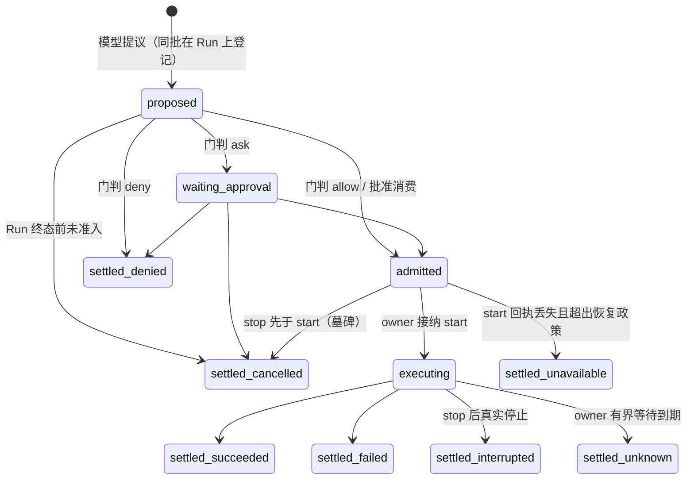

# 工具执行

本页是工具调用的系统视图；选择依据见[提案](../proposals/tool-execution/README.md)与
[D-015](../decisions/D-015-tool-execution-message-stream-and-hooks.md)，精确承诺归
[tools v2](../../spec/capabilities/tools/v2/contract.md)。一次调用从模型提议到结算被消费，
经过五个各有 owner 的维度；Run 在等谁归 [run v2](../../spec/capabilities/run/v2/contract.md)
的等待登记簿，到达的结算怎样路由归 [session v2](../../spec/capabilities/session/v2/contract.md)
的 Inbound，驱动器怎样呈现结果归 [run-driver v3](../../spec/capabilities/run-driver/v3/contract.md)，
人类答复归 [human-decisions v2](../../spec/capabilities/human-decisions/v2/contract.md)。
目标提供者尚未按新版本重写；当前设计见
[tools](../../packages/tools/tools/design.md) 与 [local-execution](../../packages/tools/local-execution/design.md)。

## 系统位置

进展只是五维之一。attempt 账本（absence → accepted → dispatch_intent → terminal）归执行
owner；等待关系（前台 / 转换中 / 后台 / 等人）是 Run 登记簿在调用上的投影；控制
（stop 意图与物理事实）由 tools 记意图、owner 记事实；结算交付（continuation / context /
queue / closed）由 Inbound 裁决。任何一个维度的转移都有自己的提交面与同批伙伴
（[tools v2 转移表](../../spec/capabilities/tools/v2/contract.md)）。

## 已确认的选择

- **提议即登记，注销随释放它的事实。** 调用在 `tools.call.proposed` 同批登记到发起 Run 的
  等待登记簿，人类请求附属于调用；结算被裁决为接续、detach 确认、启动即后台的准入或 Run
  终态注销。Run 处于 `waiting` 当且仅当 Step 已收束且登记簿非空（用户裁决 U-59）。
- **Run 与调用生命周期错位。** 工具状态耐久；Run 不可恢复失败只取消未准入的调用，已准入
  调用与未答问题保留，结算按 SE-14 触发新 Run（U-43）。
- **前台上限由工具声明。** `foreground{limit, onLimit: keep_waiting | detach | stop}`，有效阈值是
  声明与系统上限的较小者；没有 Run 级执行预算；调用级 `detach` 不能否决声明的自动离场（U-45、U-46）。
- **停止的物理事实是封闭三轴词表。** `physical: quiescent | isolated | unknown`、`cleanup`、`effect`；
  `unknown` 计入收口、长期可见而不冒充隔离；单调用强停只对声明 `forced_isolation` 的 owner
  存在，首版 owner local-execution 是 `cooperative_fence`。
- **Agent 向人提问是内建工具。** `human` 工具恰有 `ask_user` 与 `request_approval` 两条命令，HD 是
  执行 owner，答复在同一提交结算调用并作为返回值进入模型；Agent 发起的批准是提示词，
  不是系统机制（U-41、U-44）。
- **帧缺省耐久。** 工具帧与 Session 日志同域 append-only（`frames(S)`），三个记录等级
  critical / durable / transient 由命令声明（U-42）。
- **占位与迟到结果只有一份词表。** 未回来的调用在下一 Step 恰得一个 `deferred_receipt`，结果
  以 `system_reminder{late_result}` 引用已耐久的结果进入到达的 Step（U-46）。

## Cordis 位置

调用运行时归 `omneTools` 插件（`packages/tools/tools`）：门、提议登记、前台计时与转换、
关系视图、帧读面；执行 owner 是独立提供者（首版 `packages/tools/local-execution` 与同进程
shell），只兑现 start / stop / inspect / detach 与物理事实；`human` 工具的执行 owner 是 HD。
插件依赖图、四类接口对接与时序、装载效应与撤除、依赖变化政策、hooks 在 S5 / S7 的落点
见[提案 Cordis 视角](../proposals/tool-execution/cordis.md)。

## 证据与缺口

[调用生命周期模型](../../spec/capabilities/tools/verification.md)覆盖五维状态、`human` 调用、
owner 崩溃、归档级联、复合打断与停止未知；不覆盖跨协调域、门、受理未裁决窗口、多 Run
并存与帧。尚未完成：tools 与 local-execution 提供者设计按 v2 重写；Ajv profile 与投影单测；
帧与媒体场景；`human` 工具崩溃注入；PF-004 派发形态；PF-015 制品对象；归档后后台调用的
存续政策已定（不动工作、结算到达即关闭），实现待验收。
