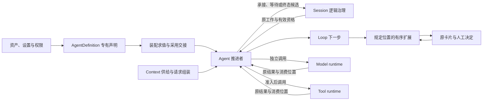

# Agent 定义与工作推进的角色与交接

本页在正式维护位置保存待审技术设计。领域分解已评审不等于成员技术接受、阶段选择或实现支持。具名目录只有文档，公开形状和实际验证仍待设计及补证。

## 拥有者与输入

Agent 能力拥有定义专有声明、Loop 求值、推进协调和扩展位置协议。共同资产持有、版本、同标识来源与锁定由资产治理提供；共同权限与准入由授权责任提供；装配求值和有效构成切换由 assembly 协调；Session 拥有逻辑工作、推进资格、输入承接及终态。

| 事实 | 拥有者 | Agent 的使用关系 |
| --- | --- | --- |
| AgentDefinition 的类型、依赖、继承声明与工作规则 | Agent 能力 | 校验专有含义，向装配提供可解释声明 |
| 定义的持有、发布版本及替换资格 | 资产治理 | 读取合法版本，不建立第二份资产注册权威 |
| Session、Run、attempt、输入承接及逻辑终态 | Session 治理 | 取得当前资格，提出推进决定及终态候选 |
| 清单、当前采用值与结构换代 | 装配交接 | 消费已校验依据，交出原进度与等待 |
| Loop 下一步与已采用扩展判断 | Agent 能力 | 保留规则依据及原求值位置 |
| 模型与工具原调用、收场、费用和实际效果 | Model 与 Tool | 发起、等待、可靠承接，不拥有执行寿命 |
| 数据注册、当前 Context、请求输入投影 | Context 两成员及原生产者 | 取得允许输入，固定实际请求，不改写生产者事实 |
| 决策卡片、答复资格和唯一有效答复 | 人工介入与授权责任 | 登记原等待并按原语义继续 |

主流程推进对象固定到一个合法 Session、未终结 Run 与有效 attempt。定义校验和清单求值可先于 Run；独立模型或工具调用不为此伪造 Run。Agent 为某个 Run 发起的扩展判断和压缩调用必须关联该原工作，不能混入碰巧活跃的其他 Run。

箭头表达输入与结果协作，不规定源码互引或共同寿命。消费者通过公开契约及显式依赖使用能力。Cordis 接入遵循共同 IC，不能用 scope、fiber 或 disposer 代替租户隔离、业务提交或执行取消。

完整行为读[能力组](../../../packages/agent/README.md)，精确机制与流程随成员维护。
