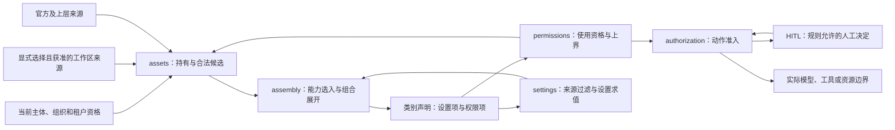
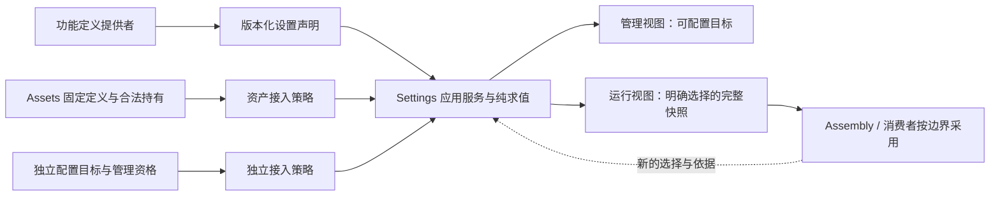
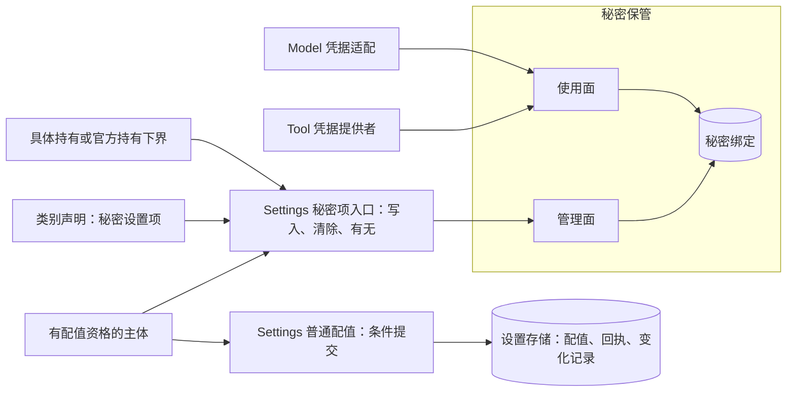
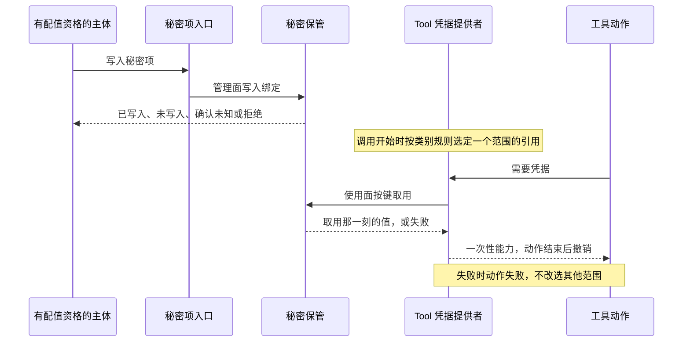

# 资产领域关系

状态为待审技术设计。正式维护位置不授予技术接受、实施或支持；精确公开形状仍待定义。

## 三条求值路径

图表示协作关系，不表示全部行为由某一循环调用完成。候选筛选前需要共同使用资格；完整装配后才知道其全部属性项。Plugin的成员启用设置影响展开，在该Plugin展开处先取得该值，不能等全部展开后才回算。

## 变更计数与通知

装配入口用[比对代替求值](../../architecture/runtime/assembly-and-change.md#比对代替求值)，需要本域按作用域提供采用变更计数。本域承担下列义务，计数的存储与通知机制由各成员实现。

| 计数 | 维护者 | 计数加一的变化 |
| --- | --- | --- |
| 定义版本指针 | 定义与版本 | 同一定义发布、撤回或改变合法最新版本 |
| 能力身份胜出者 | 共同治理，持有与转移参与 | 凡改变该作用域合法候选集合或生效选择的治理事实，例如发布、选版、加入或结束持有、禁用与再启用、锁定、替换、分享的确认与撤销、复制形成新持有 |
| 使用资格与权限上界 | 权限求值 | 该作用域的使用资格、「谁可以使用它」或锁定上界变化 |
| 组织锁定修订 | 共同治理 | 组织层锁定或解除锁定替换 |
| 设置修订 | 设置求值 | 该作用域的设置值或设置锁定变化 |

每个计数只增不减，与它所计的变化在同一次提交中成立，进程重启后不倒退。变化提交后，维护者通知订阅方。通知只带作用域、来源类别、新计数和变化原因，不带秘密配值或其他租户的内容。通知丢失不改变正确性：装配入口读当前计数比对，通知只用于提前求值。

会话级的覆盖与继承声明由会话维护自己的修订，不在本域计数内，见[会话与工作的领域关系](../sessions-and-work/architecture.md#设置声明修订)。

## 设置组合与当前性

Settings 拥有共同声明消费、配值和求值；Assets 拥有资产定义、持有与选版；各功能拥有声明含义、专有校验和采用时点。独立配置目标与资产持有目标通过不同策略接入同一设置核心。前者不伪造持有，后者不绕过持有。

查询参数中的租户、组织或目标引用只用于定位，资格由可信来源验证。管理视图包含可合法配置但尚未启动的资产；运行视图消费明确选择依据，不以当前 Cordis fiber 列表推导合法资产集合。

共同提交由应用集成层协调：Settings 拥有配值、结果查询与设置来源计数；Assets、Identity 等提供当前事实守卫。所有影响同一条件的写入参与同一受支持的提交协议，才能声称核验与写入共同成立。仅传 revision、签名、事件或进程内锁不能提供跨进程原子性。未实现该协议的提供者不得把先查后写标成强提交。

成员声明精确来源版本与复核点；Assembly 负责完整采用、拒绝晚到旧结果及保留已捕获输入。通知只提示重读。跨进程一致性、退出和持久确认的验证义务见[组合模型](../../../packages/assets/docs/settings-composition.md#性质与证明义务)。

## 秘密设置项与秘密保管

秘密设置项是声明为秘密的设置项。它的值只在 Settings 的秘密保管里，不进入设置配值、求值来源、提交记录或回执。秘密保管按（范围、目标、用途）保存秘密绑定。范围是官方或某个租户。目标由具体持有与项推出，或指向某项类别凭据。用途不同的绑定互相读不到。

图中秘密值只走秘密项入口到秘密保管这一条路，不进入普通配值和设置存储。

秘密项入口与普通配值分开：

- 写入与清除走受限入口，不经普通配值的提交路径。
- 「有没有配置」只由秘密保管回答，Settings 不另存一份。
- 目录对秘密项只显示有无和配置时刻，不显示值。
- 秘密项不支持锁定，锁定命令明确拒绝。这是已知限制。

使用面只交给装配时注入的受信消费方。类别各自决定从哪个范围取哪个引用，以及缺凭据时怎样失败。秘密保管只按键精确取用，每次读当前值，不回退到其他范围、目标或用途。Model 的 `factory` 例外由 Model 判定，保管不认识它。

目标随具体持有推出，所以同标识替换后的新实现取不到原实现的秘密；持有移除或定义删项后，原目标不可再写入、查询或取用。

| 性质 | 由谁守 |
| --- | --- |
| 秘密在任何读面都不返回原文，也不进入持久的设置记录、工具固定请求或日志 | 秘密项入口、秘密保管、各类别的结果与诊断 |
| 一个租户的调用取不到另一个租户的秘密 | 秘密保管的绑定键与使用面 |
| 用途或目标不同的秘密互相取不到 | 秘密保管的绑定键 |
| 调用开始时选定引用；使用时只解析该引用，绑定被替换就用取用那一刻的值，被清除或撤销就失败，不改选其他范围 | 类别的凭据提供者 |
| 写入结果分为已写入、未写入、确认未知、拒绝 | 秘密保管 |

秘密值和「有没有配置」都只在秘密保管里，所以秘密项与普通配值之间没有需要共同提交的状态，也就没有跨两处存储的一致性协议。因此，这里不用模型检查器验证提交顺序，上表各项由契约测试守。如果以后让 Settings 也保存秘密项的有无或引用，就出现了两处写入，必须先为这个提交协议建立有限模型，再改实现。端口形状、绑定格式和本地文件提供者归 [settings](../../../packages/assets/settings/SPEC.md) 与 [settings-local](../../../packages/assets/settings-local/SPEC.md)。

## 当前本地提供者的边界

设置与资产本地实现的源码分工见 [组架构](../../../packages/assets/docs/architecture.md#当前本地组合)。独立设置无需资产持有，资产设置由真实持有投影参与条件提交。Identity 成员资格仍归 Identity，跨域写入使用公开预留与终态协议，不能把单次资格读取当原子保证。

发布、持有维护与重新采用目前作为受信部署能力提供，普通租户设置入口另行校验当前资格。贡献卸载改变目录可用性并保留配值，真正配置权失效由目标拥有者和 Identity 完成。该纵切不授予外域业务或最终消费者已经接入的声明。
