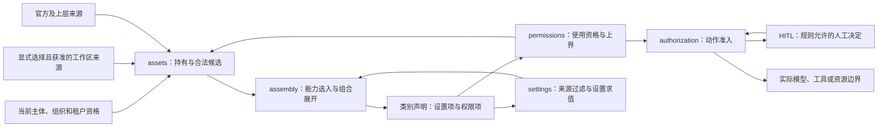

# 资产领域关系

状态为待审技术设计。正式维护位置不授予技术接受、实施或支持；精确公开形状仍待定义。

## 三条求值路径

图表示协作关系，不表示全部行为由某一循环调用完成。候选筛选前需要共同使用资格；完整装配后才知道其全部属性项。Plugin的成员启用设置影响展开，在该Plugin展开处先取得该值，不能等全部展开后才回算。

## 变更计数与通知

装配入口用[比对代替求值](../../architecture/runtime/assembly-and-change.md#比对代替求值)，需要本域按作用域提供采用变更计数。本域承担下列义务，计数的存储与通知机制由各成员实现。

| 计数 | 维护者 | 计数加一的变化 |
| --- | --- | --- |
| 定义版本指针 | 定义与版本 | 同一定义发布、撤回或改变合法最新版本 |
| 能力身份胜出者 | 共同治理，持有与转移参与 | 凡改变该作用域合法候选集合或生效选择的治理事实，例如发布、选版、加入或结束持有、禁用与再启用、锁定、替换、分享的确认与撤销、复制形成新持有 |
| 使用资格与权限上界 | 权限求值 | 该作用域的使用资格、「谁可以使用它」或锁定上界变化 |
| 组织锁定修订 | 共同治理 | 组织层锁定或解除锁定替换 |
| 设置修订 | 设置求值 | 该作用域的设置值或设置锁定变化 |

每个计数只增不减，与它所计的变化在同一次提交中成立，进程重启后不倒退。变化提交后，维护者通知订阅方。通知只带作用域、来源类别、新计数和变化原因，不带秘密配值或其他租户的内容。通知丢失不改变正确性：装配入口读当前计数比对，通知只用于提前求值。

会话级的覆盖与继承声明由会话维护自己的修订，不在本域计数内，见[会话与工作的领域关系](../sessions-and-work/architecture.md#设置声明修订)。
