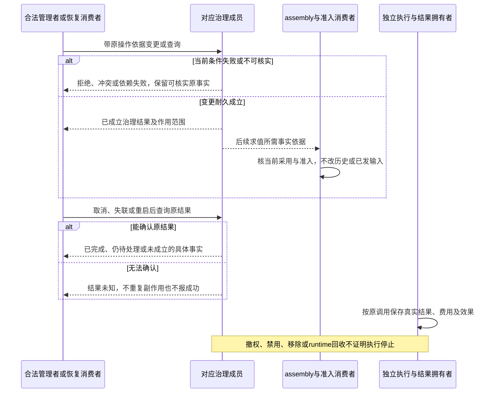

# 资产跨域交接

状态为待审技术设计。正式维护位置不授予技术接受、实施或支持；精确公开形状仍待定义。

## 变更、失效与恢复的真实结果

对应 [AR-J10](../../../.meta_harness/design/product/assets-and-rules/design.md#ar-j10)。各成员分别拥有自己的结果与恢复，assembly 拥有候选采用和推进交接。共同完成行为归 [assets](../../../packages/assets/assets/SPEC.md#failure-and-recovery)、[settings](../../../packages/assets/settings/SPEC.md#failure-and-recovery)和 [permissions](../../../packages/assets/permissions/SPEC.md#failure-and-recovery)，不会由本文合成统一提交机制。

已确认事实覆盖进程崩溃、操作系统崩溃及断电恢复，介质或整机物理损毁不在同一保证内。旧允许缓存、旧成员角色和旧分享不得复活当前无效权利。reload 候选失败保留此前合法采用，取消优先及连续候选交接沿 [现行 assembly](../../architecture/runtime/assembly-and-change.md#reload-与推进权交接)，不复制其状态机。对已知能力保留不可用身份，不向失去资格者交付新私有内容。

结果查询区分真实空集合、权限不足、来源故障、引用阻断和冲突，多步结果分别呈现已完成与待处理。来源及影响解释须有披露资格，秘密原文不进日志、审计或遥测。确认、求值、装配、通知及准入都不冒充模型或工具实际成功。完整解释、独立刷新及治理观测的长期范围不扩大九项阶段承诺，各自必要的安全、来源与耐久义务继续约束阶段内操作。
