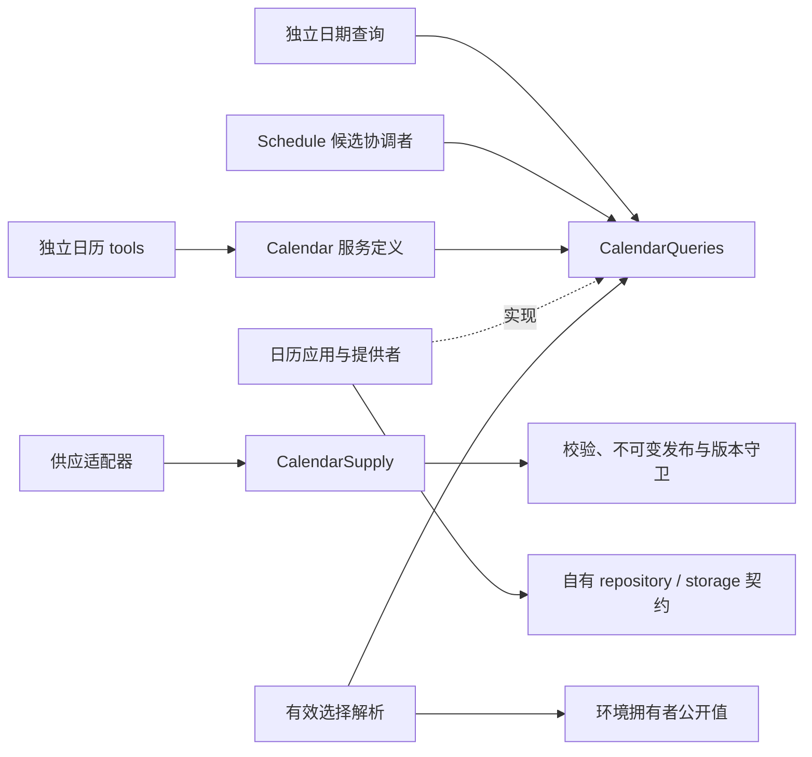

# 日历协作设计

本页维护已确认的目标责任与消费关系，不表示实现或提供者已验证。范围归[领域入口](README.md)，产品规则归[产品正文](../../../.meta_harness/design/product/calendars/design.md)，精确行为归[calendar/calendar SPEC](../../../packages/calendar/calendar/SPEC.md)。

## 事实与责任

| 责任                 | 权威事实或计算                                               | 不据此取得的责任                     |
| -------------------- | ------------------------------------------------------------ | ------------------------------------ |
| 日历定义与治理       | 日历身份、来源关系、适用范围和使用条件                       | 租户设置写权、Job 接受、通知送达     |
| 供应与版本           | 原始依据、校验候选、不可变发布版本、current 指针、覆盖及健康 | 修改已发布版本、把旧校验当新发布依据 |
| 日期计算             | 明确版本的日别、工作日算术和有界日期解释                     | 自行解释自然语言、修改安排、触发工作 |
| 查询与缓存适配       | 目录、版本及健康投影，可重建计算缓存                         | 第二发布真相、第二用户环境真相       |
| 既有环境与权限拥有者 | 有效 timezone/calendar、环境 revision、写资格及使用资格      | 编辑日历供应事实                     |
| 日程消费者           | 候选重算、最终校验与接受、Job 本次采用关系                   | 抓取或发布国家供应数据               |
| 发布物拥有者         | 种子集包装与发行，按每历政策核对供应条件                     | 把安装时间改成知识截至时点           |

这些是逻辑责任，不要求一角色一插件、服务或数据表。原始来源与候选保留出处；published 版本不可变。current 是发布指针，健康反映维护状况，覆盖反映可解释日期范围，三者不能用一个可用布尔值代替。

## 公开契约消费图

实线是消费者到公开契约的依赖，虚线是实现关系，不表示消息流或进程拓扑。

Calendar 核心不依赖 Schedule、Session、Agent、Tool 宿主、HTTP 或具体 storage 提供者。调用应用提供必要上下文与读取资格，查询不要求启动完整 Harness。供应网络、格式解析和持久化集中在各适配边界；核心保留来源政策、覆盖和日期计算含义。

## 邻域交接

| 接缝       | 日历交出什么                                  | 接收方保护什么                                                              |
| ---------- | --------------------------------------------- | --------------------------------------------------------------------------- |
| 消费者选择 | 已解析选择、明确日历和版本依据                | 环境拥有者核对真实写入、生效、权限及未知查询；人工答复不赋予设置写权        |
| 候选与 Job | 可复核计算、版本守卫、覆盖不足或真实故障      | 日程保护最新依据与接受一致，固定 Job 来源及去重，不在发布提交中强制共写 Job |
| 供应恢复   | 新可用版本、publication generation 和真实健康 | 日程按 follow/explicit 及 latest/pinned 重算未接受候选，已接受 Job 不变     |
| 维护提示   | 获准披露的出处、覆盖和维护状态                | [通知](../notifications/README.md)保管受理与交付，失败不重发日历版本        |
| 独立调用   | 无需会话的计算和查询                          | 程序、工具、SDK 适配保持相同语义及当前读取资格                              |

### 环境绑定与发布版本分开

followUserEnvironment 采用同一 revision 下的 timezone 与 calendar，环境不相容时受阻，不拼接两个观察位置。恢复后日程从当前时刻重锚。explicit 不随用户偏好变更日历身份；其 latest 政策仍可采用新发布版本，pinned 则继续原不可变版本。两种模式均不能回写已接受 Job 的冻结依据。

### 共同提交与提交后反应

发布协调者只负责本域版本、出处、current 指针和发布回执一致成立。Schedule 接受协调者通过日历拥有者注册的公共 participant 校验 publication generation；不能绕过边界读写日历私有表。pinned 校验版本及访问资格，latest 才校验 current generation。网络抓取和计算放在事务外，事务内只核验版本并提交决定。

事件用于加速唤醒，漏事件通过有界查询与反熵恢复。事件送达、Cordis emit 成功和工具响应均不是最终接受证据。单机同进程也不自动提供跨拥有者原子性。实际 storage 前提与限制沿[提供者规格](../../../packages/storage/sqlite-provider/SPEC.md#已知限制)，不得把设计目标写成当前保证。

## 接口与替换边界

读操作与供应写操作分开，计算消费者不需要抓取或发布权限。替换解析库、缓存或查询提供者时，版本、覆盖不足、来源与错误含义必须保持。某库把周一至周五视作工作日，不能覆盖国家补班事实；某库返回空集合，不能掩盖供应失败。成员维护精确 API 及算法验证，本页不以接口隔离为由制造一方法一服务。
