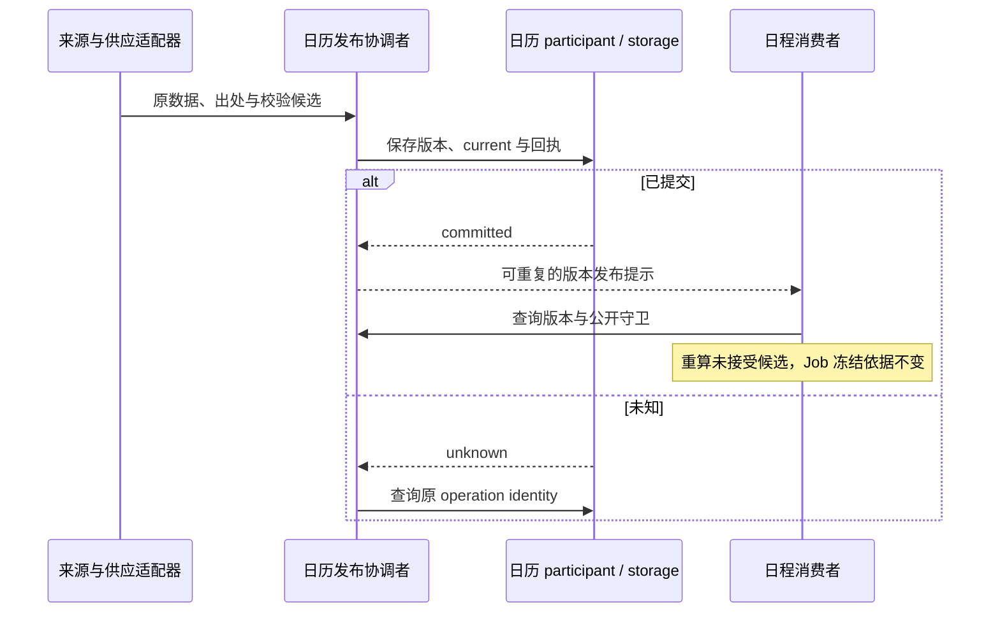

# 日历跨领域关键流程

本页维护已确认目标流程，尚不表示实现或运行验证。精确行为见[calendar/calendar SPEC](../../../packages/calendar/calendar/SPEC.md)，责任见[领域协作](architecture.md)，产品范围见[产品正文](../../../.meta_harness/design/product/calendars/design.md)。既有流程与不变量编号保留作追溯入口。

## F-CA01 供应、校验与不可变发布

供应适配器按每历来源政策下载或导入，保留原数据、哈希、出处、知识截至和校验结果。无变化、无可用数据、withheld 与失败分别记录。发布协调者在同一提交保存不可变版本、覆盖、出处、current 指针及操作回执。提交未知按原操作查询，不换版本身份盲发。

提示失败只恢复已提交发布的 outbox。覆盖不足时拒绝所请求的计算范围，不伪装成没有工作日，也不静默采用另一日历。

## F-CA02 保存消费者选择并继续解析

覆盖 J-CA05，保护 INV-CA02、INV-CA03、INV-CA14。获授权者向真实环境设置入口提交合法选择，入口核对 owner、租户、写资格及允许值，并原子保存 timezone、calendar 和 revision。Calendar 只读这份事实。失败不改设置；回执未知沿原设置操作查询。人工答复不直接赋写权。

后续 followUserEnvironment 查询或日程对账采用同一 revision 的环境；事件只是加速，漏事件仍由反熵收敛。尚未接受的旧准备证明失效后重新准备，不能在旧证明上替换版本。explicit Schedule 的日历身份不随选择变化，latest/pinned 版本政策另行适用。历史计算与已接受 Job 按原版本复核，不改变 Schedule 身份或工作要求。

## F-CA03 查询、计算与最终接受

独立调用方明确查询范围、版本政策和可信 owner 上下文，Calendar 返回可解释结果或真实缺失。纯计算不建立 Session，也不接受 Job。日程读版本并准备候选后，在最终接受提交中使用原拥有者的公开守卫；期间发布变化导致旧 latest 证明失效时退出并重算。pinned 不因 current 指针变化强制更新。

## F-CA05 健康观察与发布物把关

覆盖 J-CA09，保护 INV-CA06、INV-CA12、INV-CA18。维护观察读取每历真实覆盖、知识截至、成功更新、失败、待裁候选和余量，按有效政策报告风险。更新故障可与旧覆盖仍可查询并存。发布物核对所声明每份日历的新鲜度，严重条件拒绝发行，警告明确披露；政策或状态未知不能报通过。

需要通知时交正式通知服务，受理、送达和供应健康分别观察。通知失败不重做供应更新，也不解除风险。维护和发行检查须使用真实来源、数据许可及日期边界证据，候选库的测试通过不能替代这些责任。
