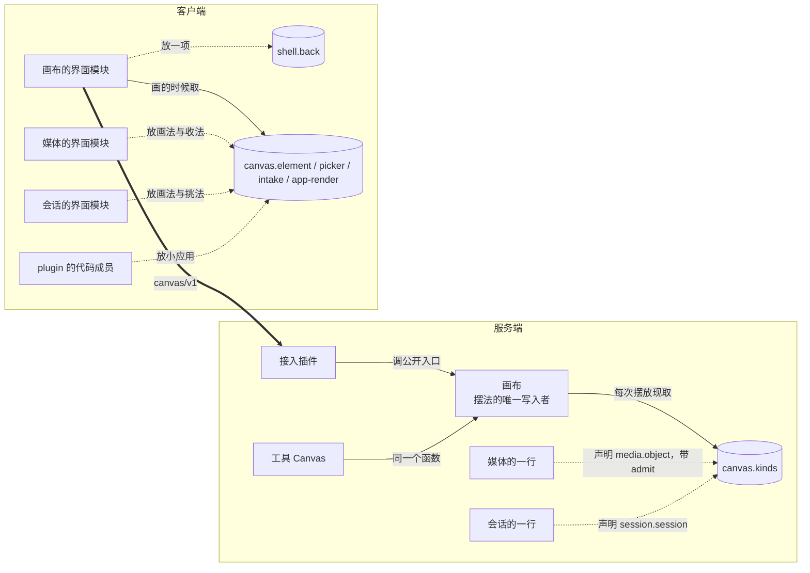

# 画布

## 范围与边界

[画布](../../../.meta_harness/design/ubiquitous_language/terms/interaction-and-dispatch.md#ul-canvas--画布--canvas)是人和 agent 共用的一张纸，在[应用的反面](../../../.meta_harness/design/ubiquitous_language/terms/interaction-and-dispatch.md#ul-application-face--应用的面--application-face)。纸上摆的是对象引用：别的领域里某一样东西的种类与标识。画布记下哪些引用摆在纸上，各在哪、多大、在哪[一叠](../../../.meta_harness/design/ubiquitous_language/terms/interaction-and-dispatch.md#ul-canvas-pile--一叠--canvas-pile)里、锁没锁、是谁摆的。它不拥有被引用的东西；拿走只去掉[摆法](../../../.meta_harness/design/ubiquitous_language/terms/interaction-and-dispatch.md#ul-canvas-arrangement--摆法--canvas-arrangement)，那样东西照旧在它的拥有者那里。

画布是接在核心系统上的支撑能力。核心域的成员不依赖它；去掉它，会话、agent、模型与工具原有的流程不变。

画布不认识任何一类东西。一类东西能摆上纸，是拥有它的领域声明了它[可画布渲染](../../../.meta_harness/design/ubiquitous_language/terms/reach-and-availability.md#ul-canvas-renderable--可画布渲染--canvas-renderable)，并带来它在纸上的画法：

| 事实 | 归谁 |
| --- | --- |
| 被引用的东西在不在、是什么、谁能看 | 拥有那一类东西的领域，例如[媒体](../media/README.md)、[会话与工作](../sessions-and-work/README.md) |
| [画布小应用](../../../.meta_harness/design/ubiquitous_language/terms/capabilities-and-composition.md#ul-canvas-app--画布小应用--canvas-app)画什么 | 带来它的 [Plugin](../plugins/README.md) |
| agent 的调用许不许 | 放行判断，见[Agent推进](../agent-progression/README.md) |
| 主体能不能为一个租户行事 | [身份与授权](../identity-and-authorization/README.md) |
| 应用的两面与翻面 | 外壳，见[共用界面的规格](../../../packages/frontend/SPEC.md#外壳契约) |
| 视口、远近、磁吸开没开 | 这台设备的偏好 |

## 模块角色与事实归属

| 模块角色 | 责任 |
| --- | --- |
| 摆法 | 一个租户的纸、每一个[画布项](../../../.meta_harness/design/ubiquitous_language/terms/interaction-and-dispatch.md#ul-canvas-item--画布项--canvas-item)与每一叠；每次改动是谁做的。唯一的写入者 |
| 种类登记 | 现在有哪些可画布渲染的种类；摆上之前要不要先问拥有者 |
| 找空处 | 服务端的几何：没给位置时摆在哪 |
| 开放 | 协议、接入插件、给 agent 的工具。两条路落到同一个函数上 |
| 纸的界面 | 反面上的纸，与四个客户端的点：画法、挑法、收法、小应用 |

这是逻辑分工，不裁定成员的划分。成员见[包组规格](../../../packages/canvas/SPEC.md#领域边界)。

## 协作与依赖

实线是调用，虚线是往拓展点上放一项，粗线是协议。画布的成员不依赖媒体、会话与 Plugin 的任何成员。两个种类的服务端声明在应用的装配里；界面模块之间不互相导入，点由应用的装配交过去。这些拓展点照[拓展点的共同契约](../../architecture/cross-cutting-concepts.md#拓展点的共同契约)开，十问的答案在包组规格里。

画布的服务端不替任何人读被引用的东西。被引用的东西不在了、这个人无权看，由那一类的画法经它自己的协议读出来并说明。

## 主路径与交接

1. 人在纸上操作，经协议调画布；agent 调工具 `Canvas`。许不许在各自的发起点判：人的调用由画布按行事的租户问权威，agent 的调用由 Agent 的准入问放行判断。
2. 摆上一个引用时，画布先查这个种类声明着没有、纸上还摆不摆得下，再问拥有者接不接受。媒体在这一步持有那个对象。拥有者接受了，画布才带条件提交记录。这几步的交错有一个有限模型守着，见[画布的摆上](../../architecture/verification/canvas-place/formal-mapping.md)。
3. 画布用一次提交写下摆法与是谁做的，观察告诉客户端「可能变了」。
4. 客户端重读画布，按种类取画法，画出每一样。

交接的形在每一处相同：拥有者先接下，画布后提交。结果不知道时，客户端重读画布；命令是绝对的，原样重发也不会多出一份。精确规则见[包组规格](../../../packages/canvas/SPEC.md)。
