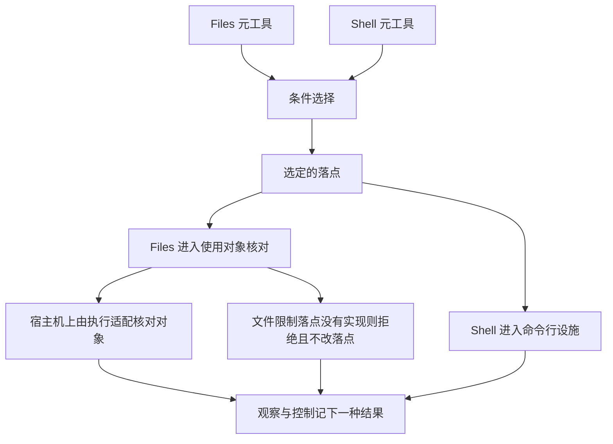

# 执行环境领域交接设计

状态：技术设计草案，未获整体技术接受。领域责任沿[已接受入口](README.md)；本页只拥有角色、事实归属与跨领域交接。

## 事实归属与公开协作

领域独立于 Cordis 建模。本域的工程成员分四段：纯契约 `execution-environment-contract`、唯一 Cordis 服务定义 `execution-environment-cordis-contract`、不含 Cordis 的登记表机制 `execution-environment`、Service 实现与宿主提供者 `execution-environment-host-local`，见[能力组](../../../packages/execution/README.md)；逻辑分工不自动决定服务、进程、线程或存储表数量。

| 拥有者 | 权威事实及责任 | 必要交接 |
| --- | --- | --- |
| 条件选择协调（域外：发起协调者与工具宿主） | 这次工具调用的要求、允许策略的求值、资格依据及翻译出的有序允许绑定清单 | 消费准入及工具要求，不能自己授予动作权；本域只接收清单并在清单内匹配，不认识策略词 |
| 登记表（本域） | 提供者与设施的登记、按清单匹配、获取的幂等与核验、采用记录的签发、租约视图与逐操作门、恢复编排 | 不拥有策略、授权、持久化；账本、守卫、恢复授权三个端口由集成方实现；不从任何上层逻辑状态推断作用域已结束 |
| 维护者（域外） | 凭集成方签发的恢复授权停止、认回、结算一个作用域的受管资源 | 恢复授权只能收场，不能获取环境或发起新执行；作用域整体释放由应用装配层的协调者以维护者身份、凭恢复授权发起 |
| 环境提供者 | 实际环境身份、修订、设施、就绪及真实寿命 | 分配/关联/控制资源，说明隔离、可用及失败条件 |
| 资源管理与托管 | 资源持有与释放、临时或保留数据、备份恢复与清理依据 | 计算关闭与数据删除分别确认，保留未完成责任 |
| 执行适配与受控宿主接口 | 把合法原调用交设施；约束执行域可达能力，在使用时点核对使用对象，校验跨界请求与返回 | 不接管工具业务，不把宿主服务权限借给请求者 |
| 观察与控制 | 真实准备、控制、停止、未知和恢复结果，以及域外监督者记录的进程回收状态 | 可查询原资源，必要记录及诊断不制造假成功 |
| 原工具及桥接调用拥有者 | 原调用、外部效果、内部等待、迟到输出与结果保管 | 执行域终止后仍能完成原调用及可靠交接 |
| 数据存储与部署提供者 | 所采用耐久、备份介质、故障域和监督条件 | 为托管承诺提供可验证前提，不能缩短业务数据寿命或代判业务完成 |

相邻责任从正式入口展开：[身份与授权](../identity-and-authorization/README.md)提供可信主体及当前准入，[资产与规则](../assets-and-rules/README.md)求值合法配值，[工具执行](../tool-execution/README.md)拥有原效果，[工作区](../workspaces/README.md)拥有身份、参与及实例关联，[Session 与工作](../sessions-and-work/README.md)治理逻辑工作，[装配](../assembly-and-handoff/README.md)拥有采用及推进交接，[Context](../runtime-context/README.md)供给可感知变化，[MCP](../mcp/README.md)和[HITL](../human-intervention/README.md)保留各自协议。

工作区合法关联可以供来源校验和环境准备使用，不能以装配完成作为所有准备动作的前提。来源校验、正式采用、设施就绪及工具开始是不同确认。工作区接缝的技术细化仍保留草案状态，不能提升为本领域的已接受上层。

## 文件使用的交接

PanQiWei 已接受本节，见 [技术设计接受](https://github.com/nemori-ai/omne-harness-lite/issues/278#issuecomment-6197369869)。它不增加角色，只标明 `Files()` 与 `Shell()` 怎样交到上表已有的拥有者。工作区目录是地址，不参与这张图里的围栏。本页其余部分仍是草案。

`Files()` 只在落点算完之后进入使用对象核对。`Shell()` 进入命令行设施，不进入那一次文件核对。命令碰到的文件仍由条件选择决定的落点承担。声称文件限制的落点没有实现时，文件请求拒绝，不改交宿主机。宿主机上的对象核对由执行适配完成，环境提供者提供该次设施。观察与控制不另造工具成功账。成员机制见[宿主文件使用](../../../packages/execution/execution-environment-host-local/docs/architecture.md#宿主文件使用)。
