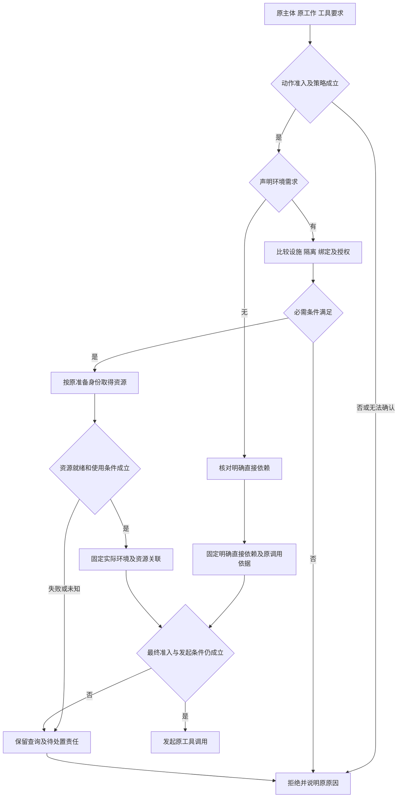
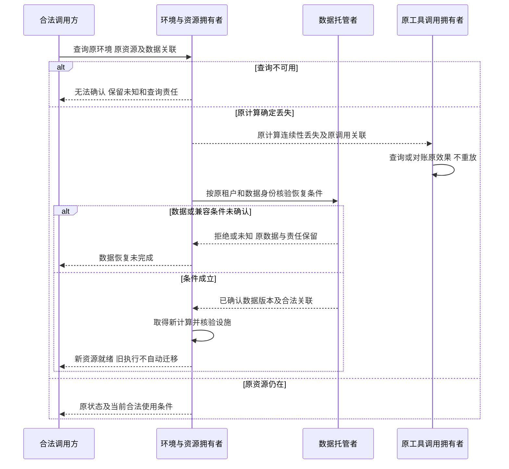

# 执行环境跨领域关键流程

状态：技术协作草案。图表达责任，不表示进程或寿命共属。产品旅程见[产品正文](../../../.meta_harness/design/product/execution-environments/design.md)，所有 INV 与验证义务归[契约成员 SPEC](../../../packages/execution/execution-environment-contract/SPEC.md)。本页只放跨领域流程；成员内部的协议级与机制级流程归[能力组协作入口](../../../packages/execution/docs/key-flows.md)与各成员 `docs/flows.md`。

## F-EE01 合法选择、准备与原调用发起

对应 J-EE01；INV-EE01、INV-EE02、INV-EE03、INV-EE04、INV-EE05、INV-EE15。

拒绝不换到宿主或更宽松目标。准备期间取消、分配后答复丢失或条件变更，分别查询实际分配及清理；已有资源事实不被拒绝答复抹去。独立工具以等价输入经过此链，未声明需求的路径不能暗中使用声明之外的依赖。

## F-EE03 租户数据与计算分别恢复

对应 J-EE03；INV-EE01、INV-EE04、INV-EE08、INV-EE14、INV-EE15、INV-EE16。

租户级沙箱数据按与租户相应的生命周期托管。租户仍存续且数据未按合法规则删除时，停止、更换或空闲回收计算，以及技术 TTL，不能提前清空数据。备份或副本窗口只约束对应技术副本，清理不能提前删除唯一有效托管内容；合法删除及租户结束后的处置另按相应数据规则处理。

备份、复制、数据可读及新计算就绪分别确认。任何分配或迁移后记录/响应失败须能按原身份查询，不重复创建或覆盖另一租户数据。故障恢复按声明的介质、可恢复位置和故障范围验证，不承诺任意物理损毁后都可取回。数据恢复不重新打开已终结逻辑工作。

## F-EE04 新选择与迟到准备竞争

对应 J-EE04；INV-EE02、INV-EE04、INV-EE05、INV-EE15、INV-EE17、INV-EE18。

Session/策略拥有者保存新选择，工作区返回合法关联，装配按自身条件采用；环境按实际调用取得设施。新的选择、来源校验及采用都不能改写已发调用的环境或原痕迹。较早准备结果迟到时，核验它所关联的原工作、选择和资源代际，不能覆盖新选择；未被采用但确已分配的资源由原准备拥有者查询并处置。

失败时保留原采用记录和资源事实，后续访问仍按当前权利判断。替换提供者后先接续原查询和结果责任；Context 消费真实变化，不用通知成功代替物理完成。

## F-EE07 控制、迟到结果与释放确认

对应 J-EE07；INV-EE06、INV-EE11、INV-EE12、INV-EE13、INV-EE14、INV-EE15。

控制方核验目标及资格，控制拥有者记录原请求和已知受理结果。代码终止、工具/宿主调用停止、资源关闭及数据清理分别查询和确认；不把 Run 终态或 dispose 当关闭回执。原调用已提交后返回迟到结果，仍按原主体、调用及工作保管；当前无披露资格时保管事实不丢弃，不能向无权消费者交付内容。

资源只有在实际关闭确认或责任可靠移交后才退出原处置责任；未完成、失败和未知可见。确认外部效果后不得宣称取消撤销，恢复只查询并接续未完成控制。

## F-EE08 观察、故障分类与可靠接续

对应 J-EE08；INV-EE01、INV-EE04、INV-EE14、INV-EE16、INV-EE17、INV-EE18。

观察方以原身份读取权威资源和调用事实，说明来源、版本及新鲜度。区分查询失败、确认计算丢失、数据可恢复及新资源就绪，向 Context 提供各工具真实落点和痕迹。记录或查询失败保持可见，不以空结果或业务重试隐藏。

恢复协调者定位尚未完成的资源、数据和结果责任，当前授权继续核验；旧事实用于解释历史和原效果，不能赋予新执行权。组合验证分别核对资源实际状态、持久数据、原工具效果及消费者接续，不用一项恢复成功替全部保证。
