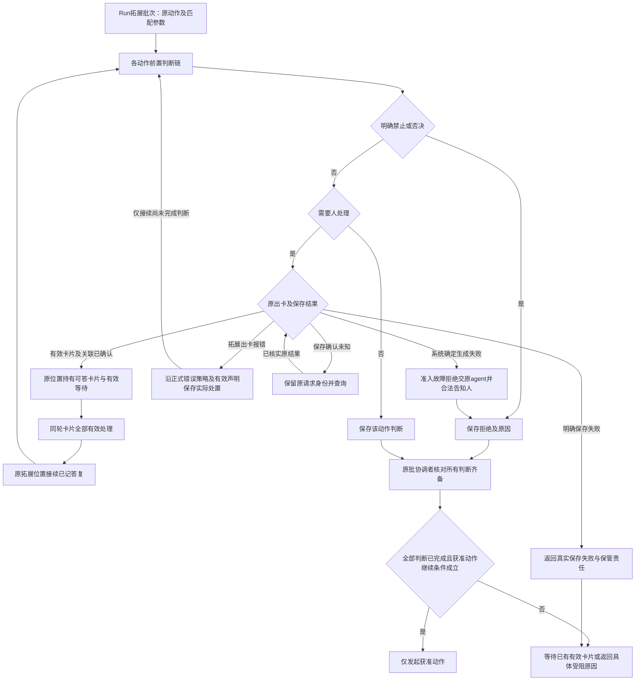

# 人在回路协作设计候选

本页保存尚待技术采用的设计，不表示实现、产品接受或阶段承诺。完整必要行为见[human-intervention/human-intervention SPEC](../../../packages/human-intervention/human-intervention/SPEC.md)，产品范围见[产品正文](../../../.meta_harness/design/product/human-intervention/design.md)。

下列流程里的请求、卡片、答复、池查询与通知都带原请求的租户。跨租户的读取与答复默认拒绝。

## F-HI01 问询和请示回原工具

对应 J-HI01、J-HI02。原 Tool 创建问题/请示和等待关联，Ask 每个问题有描述、必需文本候选及系统保证的独立自由作答；图解可选且不能替代文字。请示提供批准、拒绝及不选按钮而提交原话的路径。HITL 核验呈现资格，人从任一入口处理，协调者裁定有效答复并可靠关联。Ask 多问题全部处理后原 Tool 才继续。

请示文字能明确读成准驳时沿原规则解释；读不出时将原话和“人有话说但未给准驳”交原 agent，指导调整后再请示，不据此执行拟动作，也不合成批准、拒绝或明确拒答。明确“不回答”另按原语义交回。原 Tool 确认终局则卡片失效；Agent runtime 不在不代替这一确认。拒绝、写入失败和确认未知分别报告。INV-HI01–HI08、INV-HI10、INV-HI11、INV-HI13–HI15。

## F-HI02 系统准入及拓展轮次

对应 J-HI03、J-HI04。准入先拒绝明确禁止，自动路径不造卡；需问时只给当前可生效选项。系统放行卡同时允许不选任何授权档位而独立提交自由文字，保留原话交原准入及授权拥有者按现行规则解释；文字提交本身不自动批准动作或写入权限设置。拓展卡允许不选选项而独立提交自由文字，原话回原拓展件解释，不增系统授权。拓展链只能收紧或再问，按原动作与生效参数判断。

系统确定需问但生成有效卡片确定失败时，相关动作被拒、不执行，拒绝及真实故障原因交原 agent，并通过合法可见方式告知人；不记成人拒答，不等待不存在卡片。拓展出卡报错按正式扩展错误策略及有效声明收束，HITL 不另定全域报错默认。卡片保存确认未知只查询原请求；明确保存失败返回真实失败，二者均不先确认有效人工等待，查询不可用则保管未知及下一责任。

一个动作被否决、另一个动作获准时，待整批判断完成后仅执行获准动作。后继拓展件新出卡形成下一轮。图中回原链是按稳定位置和记录接续，不重跑已有非确定判断或已处置错误；图不授权重复出第一轮卡。原批协调者也检查取消、当前权限、匹配实现及实际环境；Tool 内部等待不被图强制并入整批。INV-HI03、INV-HI04、INV-HI05、INV-HI09、INV-HI10、INV-HI11、INV-HI13、INV-HI14、INV-HI17。

## F-HI04 等待中消息与插队

对应 J-HI06。普通聊天沿原消息受理/队列；卡片提交沿原关联；控制沿原操作目标，三路不偷换。插队是人明确发起的控制，按原工作规则解除对应等待并保留占位、原因及消息，不落整个 Run 的取消终态。卡片拒答只处理一张，插队范围由原 Run/Tool 拥有者确认。未知先查原控制，不假称已解除。INV-HI03、INV-HI10、INV-HI11、INV-HI15。

## F-HI05 终局、归档与迟到

对应 J-HI07。原工作确认终局或业务归档，协调者失效相应等待/卡片并保存依据；与答复竞争给出可追溯先后。Q04 的归档解除业务依赖并传播适用取消，不等全物理停止。独立执行保存真实效果、费用、结果和资源责任，迟到不重开原等待；成员失效本身不代替归档。INV-HI06、INV-HI11、INV-HI12、INV-HI15、INV-HI16。

## F-HI06 恢复与拓展件换代

对应 J-HI08。按原卡片、答复、工作及调用位置查询：待答继续等待，已答未消费交原位置，已消费复用结果，确定终局按失效处理，未知保管并报告。原拓展身份、版本及非确定结果匹配时才接续，兼容机制未定只阻塞该路径；不重新运行副作用或更换 Session 的 AgentDefinition ID。必要数据达到已声明耐久前不确认交接；退出只撤自身资源。INV-HI01、INV-HI07、INV-HI13–HI19。

## F-HI07 呈现等待和交通知

对应 J-HI09。有效请求进入所属池投影，交付面提供等待入口；需要通知时以获准目标/内容交正式通知能力。其受理、送达与未知按通知契约查询，已读不算答复，提示失败不重复源动作或删除卡片。INV-HI02、INV-HI08、INV-HI12、INV-HI20。
